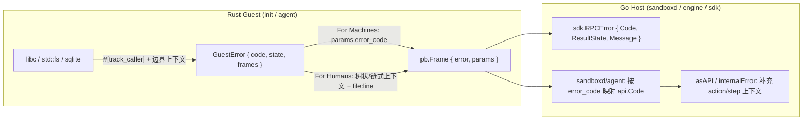

# Plan 023：建立面向动作的机器错误分类与零成本人类上下文追踪

> 已完成并归档。实施包含线程补充批准的 sandboxd 独立错误契约与边界翻译；不包含 Shape 等其他公开 DTO 的解耦。实际命令、曾失败的验收及未运行边界见[本轮证据](evidence/023-structured-errors.md)。本记录不授权提交、推送、合入或后续 VM 验收。

```nu
git diff --stat 6f498c8..HEAD -- guest/init/Cargo.toml guest/init/src/lib.rs guest/agent/Cargo.toml guest/agent/src/lib.rs guest/agent/src/wire.rs guest/agent/src/server.rs guest/agent/src/system.rs guest/agent/src/process.rs guest/agent/src/session.rs guest/agent/src/keyed.rs guest/agent/src/fs.rs guest/agent/src/ledger.rs guest/agent/src/proxy.rs guest/agent/tests/agent.rs guest/agent/tests/keyed.rs guest/agent/tests/tree.rs sandboxd/agent/client.go sandboxd/sdk/client.go engine/api/types.go engine/metadata.go engine/operation_completion.go sandboxd/service.go sandboxd/operations.go protocol/README.md guest/README.md
```

## 状态

- Priority：P2；Effort：M；Risk：MED。
- Depends on：无（与 017/020/021 独立；若与 017 交错修改 `sandboxd/operations.go` 或 `service.go` 须串行合并）。
- Category：architecture / observability；Planned at：`6f498c8`；Status：DONE。

## 问题与目标

当前错误处理在控制面顶层（`api.Error` + 8 种动作导向 `api.Code`）契合“面向机器恢复（For Machines）”原则，但在 Rust Guest（`guest/init`、`guest/agent`）与 Go/Rust 跨协议边界上存在明显的 **Error Forwarding（无上下文裸转发）**：

1. **`guest/init` 启动期裸 `?` 转发**：`mount`、`dir`、`loopback`、`discover` 等系统调用失败直接返回 `std::io::Error::last_os_error().into()`，PID 1 崩溃时控制台仅输出 `Invalid argument (os error 22)`，丢失挂载源、目标路径、文件系统类型、参数与源码位置（`file:line:col`）。
2. **`guest/agent` 全量 `anyhow` 擦除与非 `exec` RPC 退化**：除 `keyed.rs` 手工在 `params` 中塞入 `error_code` 外，其余所有 RPC（`fs_*`、`proc_*`、`session_*`、`activate`、`prepare_template`、`reseed`、`clock_sync`）均通过 `anyhow::Result` 裸 `?` 冒泡并在 `server.rs` 中被格式化为纯字符串 `frame.failure(format!("{error:#}"))`。这导致：
   - **机器侧（SDK / `sandboxd/agent`）**：无法通过 `RPCError.Code` 区分 `invalid`、`not_found`、`conflict`、`resource_exhausted`、`quiesced`、`unauthorized` 或 `internal`；`sandboxd/agent/client.go` 将所有非 `exec` 故障一律拼接为无类型 `fmt.Errorf("guest %s: %s", method, r.Error)`，最终退化为 `api.Internal`。
   - **人类侧（排障日志）**：丢失具体操作阶段、目标路径/进程 ID 以及错误创建的源码位置。
3. **Go 控制面 `Operation` 终态收敛缺少阶段上下文**：`engine` 与 `sandboxd` 在 `asAPI(err)` / `internalError(err)` 兜底包装未分类底层错误时，未附带当前 `Operation` 的 `Action` 与 `Step` 上下文。

目标是按 **“面向机器：扁平、动作导向的 ErrorCode；面向人类：`#[track_caller]` 零成本位置捕获 + 边界显式上下文”** 重整错误处理，不破坏既有 wire 帧兼容性、幂等账本与持久状态恢复不变量。



## 当前状态与不变量

`guest/agent/src/server.rs:107`：

```rust
let result = dispatch(agent, portal, &output, input).await;
if let Err(error) = result {
    let _ = output.send(frame.failure(format!("{error:#}"))).await;
}
```

`sandboxd/agent/client.go:167`：

```go
if r.Error != "" {
    if method == "exec" {
        switch r.Params.AsMap()["error_code"] {
        // 仅映射 exec 的 4 个 code，其余全部退化为 fmt.Errorf
```

`engine/metadata.go:154` 与 `sandboxd/service.go:196`：

```go
func asAPI(err error) *api.Error {
    if a, ok := errors.AsType[*api.Error](err); ok {
        return a
    }
    return &api.Error{Code: api.Internal, Message: err.Error()}
}
```

必须保持的不变量：

- **Wire 协议与向后兼容**：`protocol/sandbox.proto` 的 `Frame` 二进制编码保持不变；失败响应仍然设置非空 `Frame.error`，并在 `Frame.params` 中携带结构化 `"error_code"`（以及可选的 `"result_state"` 与 `tree_push` post-commit 状态字段）。
- **Keyed Exec 账本与状态机严格不变**：`result_unknown`、`exec_in_progress`、`exec_key_conflict`、`exec_ledger_capacity_exhausted` 的触发条件与 SQLite 持久化时机保留；sandboxd 现使用自有 `ErrUnknown` / `ErrConflict` / `ErrExhausted` 表达相同动作语义与 wire code。任何未确认结果的执行错误仍必须降级为 `result_unknown`，绝不因细化错误分类而放宽幂等围栏。
- **`tree_push` 提交后失败契约保留**：018 中发布目录 `fsync` 失败时，terminal frame 必须同时保留非空 `Frame.error` 和 `committed:true, publication_durable:false` 等 `params` 字段，不能被通用错误转换抹除。
- **Completion Fence 与脱敏边界**：`engine/operation_completion.go` 中对 `opRecord` 的 `reflect.DeepEqual` 校验不受影响；HTTP 500 对外响应（`sandboxd/http.go` 的 `writeError`）对未知未分类错误继续向不可信客户端返回固定 `"internal error"`，不泄露宿主路径或凭据，而持久化的 `Operation.Error` / `VM.BlockedReason` 保留清晰的操作阶段上下文。

## Scope

原始范围为 drift check 所列路径。本线程补充授权将 Go 范围扩展到 sandboxd 自有错误模型、业务错误构造、Engine/Agent 调用边界、恢复分类判断、HTTP/SDK 及对应行为测试和组件契约；同时纳入跨 UID 的 postcommit 断言与依赖锁文件更新。不解耦 Shape 等其他公开 DTO，不新增外部 crates（不引入 `thiserror` 或外部宏依赖，直接用标准库 `std::panic::Location` 实现轻量结构）。禁止修改 `protocol/sandbox.proto` wire 字段编号、禁止修改 SQLite 表结构/schema 版本、禁止放宽 `result_unknown` 保护。

### 补充决策：sandboxd 错误契约归属

- 根包拥有独立 `ErrorCode`、`Error`、`Fail`、`Wrap`，不是 Engine 类型的 alias；`Operation.Error` 和 SDK HTTP 错误使用本层类型，保留既有 code/message JSON。
- 本层分类与 Engine 回答分别使用 `isCode` / `isEngineCode`。后者不穿透已翻译的本层错误或联合错误，权限隐藏 404 不能证明物理回收。
- 调用点先消费预期缺失或实例围栏，再翻译剩余依赖失败；内部 Engine NotFound 不成为租户 404，host 构造的 invalid 不成为租户参数错误。
- `Cause` 不序列化、不通过 Unwrap 重新开放依赖分类；原始诊断使用既有私有 audit journal 的事件字段，不增加表。公开错误、Operation 查询/重放与 sandbox LastError 投影脱敏，不改写历史落盘终态。
- Engine/sandboxd 全量 race 的当前入口按 README 使用 10 分钟预算。原计划 180 秒运行如超时必须记录 FAIL，不得以扩大预算隐去；窄行为验收仍使用明确的短预算。

## 目标模型

### 1. `guest/init`：零成本位置与系统调用上下文

在 `guest/init/src/lib.rs` 内定义轻量 `InitError`（移除或收敛裸 `anyhow` 转发）：
- 每个错误帧通过 `#[track_caller]` 自动记录 `&'static std::panic::Location<'static>`。
- 为 `mount`、`dir`、`loopback`、`discover`、`switch_root` 提供带动作意图的上下文构造（例如 `mount(source, target, kind, flags, data)` 失败时直接格式化出 `mount {source:?} -> {target} (fstype={kind:?}, data={data:?}): {os_err} at {file}:{line}`）。

### 2. `guest/agent`：扁平 `ErrorCode` + `#[track_caller]` 上下文帧

在 `guest/agent` 中引入统一的内部错误结构（例如 `crate::Error` / `ErrorCode`），替代跨模块的无约束 `anyhow::Result`：

- **`ErrorCode`（面向机器，按调用方响应分类）**：
  - `invalid`：参数类型/范围/路径格式非法、UTF-8 校验失败、不支持的标记组合（不重试）。
  - `not_found`：目标文件、目录、进程 ID 或会话 ID 不存在（不重试）。
  - `conflict`：进程已退出、非目录替换冲突、跨文件系统重命名等状态冲突。
  - `resource_exhausted`：进程表（256）、会话表（64）、传输体积（1 GiB）或条目数（100,000）超限。
  - `quiesced`：agent 处于 `quiesced` 状态或模板准备期间存在活跃请求拒绝准入。
  - `unauthorized`：当前 Portal 不允许调用该方法（如在 workload 调 `activate`/`ping`）或尝试访问 agent 私有账本路径。
  - `exec_in_progress` / `exec_key_conflict` / `exec_ledger_capacity_exhausted` / `result_unknown`：保留 Keyed Exec 的精确协议码。
  - `internal`：未分类 I/O、系统调用或内部故障。
- **上下文帧与 `#[track_caller]`（面向人类）**：
  - 错误携带根 `ErrorCode`、可选的附加协议 `params`（如 `result_state` 或 `tree_push` post-commit 参数），以及带 `Location::caller()` 的上下文栈 `Vec<Frame>`。
  - 提供零摩擦的 `.or_context(|| ...)` / `.map_code(ErrorCode::..., || ...)` 扩展 trait，强制将 `std::io::Error`、`rusqlite::Error`、`serde_json::Error` 在模块边界赋予业务上下文和 `ErrorCode`（如将 `io::ErrorKind::NotFound` 在路径打开边界映射为 `ErrorCode::NotFound` 并附上目标路径与调用点位置）。
- **Wire 编码统一**：
  - `Frame::failure_with(code, params, message)` 在返回错误帧时，总是将 `error_code` 写入 `Frame.params`，并将包含上下文链与 `file:line` 的人类可读信息写入 `Frame.error`。

### 3. Go 侧（`sandboxd/agent`、`sdk`、`engine`、`sandboxd`）

- **`sandboxd/sdk`**：`Connection.Call` 已支持从 `r.Params.AsMap()["error_code"]` 提取 `RPCError.Code`；当 `guest/agent` 全方法统一输出 `error_code` 后，所有 SDK 调用（包括 `fs_*`、`proc_*`、`session_*`）天然获得机器可判定的 `RPCError.Code`。
- **`sandboxd/agent/client.go`**：`rpc()` 全方法读取 `error_code`，翻译为本层 `*sandboxd.Error`；管理参数错误归 internal，管理资源缺失归 operator recovery，冲突/排空归 conflict、容量归 exhausted。Keyed exec 的 4 个精确状态及未知完成围栏保留；Message 安全，guest 原始诊断只在 Cause 中。
- **`engine` 与 `sandboxd` 终态错误收敛**：Engine 为未分类错误增加 action/step，不改变既有 API 分类；sandboxd 使用自有分类落盘安全 action/step 文案，将原始因果链记入私有 audit 事件。HTTP 与 Operation 的公开投影不透传私有诊断；历史错误 JSON 不因读取、重启或重放而重写。

## 命令

根目录 Nushell：

```nu
cargo test --locked --workspace --all-targets
cargo fmt --all -- --check
cargo clippy --locked --workspace --all-targets -- -D warnings
with-env {GOWORK: 'off'} { ^go -C protocol/gen test ./... }
with-env {GOWORK: 'off'} { ^go -C engine test ./... -count=1 }
with-env {GOWORK: 'off'} { ^go -C sandboxd test ./... -count=1 }
make lint
make integration
git diff --check
```

## 步骤

### 1. 重整 `guest/init` 错误结构与位置捕获

在 `guest/init/src/lib.rs` 中实现带 `#[track_caller]` 的错误包装，覆盖 `Boot::parse`、`discover`、`mount`、`dir`、`loopback`、`clear_old_root`、`switch_root`。移除 `guest/init/Cargo.toml` 中不再需要的裸 `anyhow` 依赖（或仅保留测试依赖）。

**Verify**：在 `guest/init` 现有测试中验证非法启动参数、异常块设备 serial、非 PID 1 拒绝时，错误输出不仅包含业务原因，还包含操作目标与 `guest/init/src/lib.rs:<line>` 位置；`cargo test --locked -p sandbox-init` 通过。

### 2. 实现 `guest/agent` 结构化 `Error` 并完成各模块边界迁移

在 `guest/agent` 中定义 `ErrorCode` 与带 `#[track_caller]` 的 `Error` 类型，并在 `wire.rs` / `server.rs` 中统一错误帧序列化（自动注入 `params.error_code`）。逐个迁移 `system.rs`、`process.rs`、`session.rs`、`keyed.rs`、`ledger.rs`、`fs.rs`、`proxy.rs`：
- 确保 `keyed.rs` 的 4 种错误码与 `result_state` 100% 兼容原有 wire 表现；
- 确保 `fs.rs` 中 `tree_push` post-commit `fsync` 失败保留完整 `committed` / `publication_durable` / `cleanup_*` 参数与非空 `Frame.error`；
- 在 `guest/agent/tests/agent.rs`、`keyed.rs`、`tree.rs` 中补充对 `error_code`（如 `not_found`、`invalid`、`unauthorized`、`quiesced`、`resource_exhausted`）及上下文位置信息的断言。

**Verify**：

```nu
cargo test --locked -p sandbox-agent --all-targets
cargo test --locked -p sandbox-agent --features filesystem-fixtures --all-targets
```

### 3. 对齐 Go 侧 `sandboxd/agent`、`sdk` 与 Operation 步骤上下文

1. 更新 `sandboxd/agent/client.go` 的 `rpc()` 错误映射，保留 `exec` 特有保护的同时支持通用 `error_code` 映射与上下文保留。
2. 在 `engine` 和 `sandboxd` 的 operation 终态错误收敛处补充 `action`/`step` 上下文（仅针对未分类或缺少步骤说明的底层错误，不破坏既有测试对特定 `api.Code` 和关键错误短语的断言）。
3. 更新 `protocol/README.md` 与 `guest/README.md` 中关于 `params.error_code` 通用契约的说明，并将本计划登记到 `plans/README.md`。

**Verify**：

```nu
with-env {GOWORK: 'off'} { ^go -C engine test -race ./... -count=1 -timeout=10m }
with-env {GOWORK: 'off'} { ^go -C sandboxd test -race ./... -count=1 -timeout=10m }
make integration
make lint
git diff --check
```

## 完成标准

- [x] `guest/init` 与 agent library 使用结构化错误与静态调用位置，模块/RPC 边界附加操作和目标上下文。
- [x] 所有 RPC 失败 terminal 提供 `error_code`；SDK 对非 exec 方法也可读取。连接级非法帧仍可直接断开，不伪造 RPC 回复。
- [x] Keyed exec 状态机、未确认 spawn/commit 的 Unknown 围栏与 tree push postcommit 参数契约保留。
- [x] Engine 与 sandboxd 持久错误包含 action/step；sandboxd 的原始诊断进入私有 audit，公开投影安全且不改写历史终态。
- [x] sandboxd 错误契约独立；本层 404 与 Engine 物理 absence 判断分离；SDK 不再直接导入 Engine API。
- [x] Rust 默认与 filesystem-fixtures、两模块全量 Go race、真实 Rust fixture integration、跨 UID runner 与 lint 通过，详见证据；KVM/native image/production 不在本轮证明范围。

## STOP 与维护

若后续变更导致 sandboxd 将 `result_unknown` 误判为可安全换 key 重试的普通错误，必须保持 `ErrUnknown` 围栏。不得为追求错误格式统一而篡改已提交终态 Operation 的历史落盘记录。
