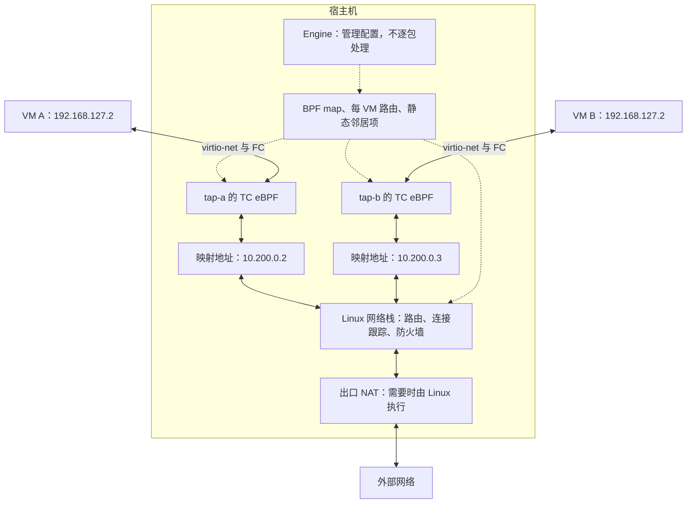
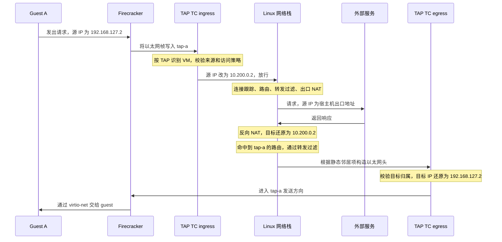
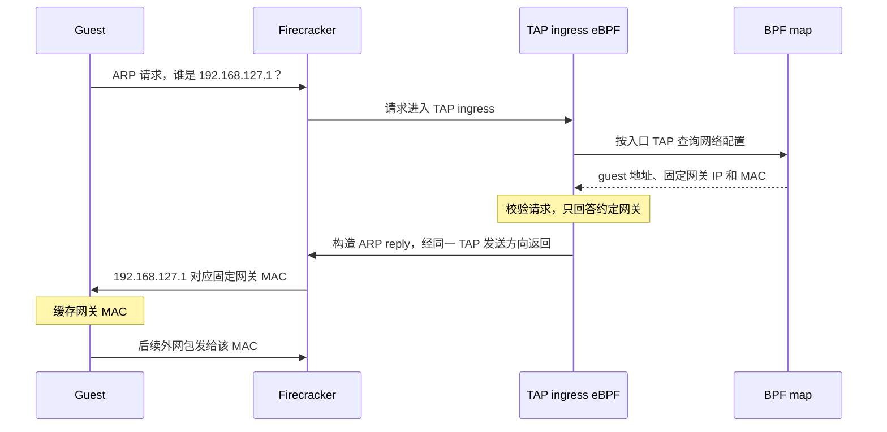

# sandbox monorepo

An overall design for sandbox monorepo.

# 0. intro

技术栈我们选择 go + rust 来构建整个项目。它们都是优秀的系统编程语言但侧重点不同。

- go 语言有强大的web和云计算生态，非常适合用于做控制面服务，k8s集成等功能
- rust 能对内存有更大的掌握能力，且运行时开销较少。而且很多主流的 VMM 都是用 rust 写的。

# 1. engine

engine 是运行在宿主机上的 microVM 引擎，负责启动 VM，管理 host 上 VM 的生命周期。
VM是由一组资源组成的，因此创建VM不能简单等同于创建进程（实际上进程也有生命周期），而是类似于 pod 一样有明确的状态转换
engine 驱动所有的 vm，事实上是整个系统的大脑，与vm相关的，存储，内存，快照，镜像，网络，设备等等都有 engine 统一管理
我们不会自己实现 VMM，毕竟基于 kvm 的 QEMU，Firecracker（fc），cloud hypervisor(CH) 等技术已经发展多年，相当成熟了。我们将直接基于 fc 作为 VMM 层来启动虚拟机
看完本设计，可以说是本系统是在发明沙盒系统的的 docker engine也不为过

> VM，microVM，VMM，kvm，docker。。。本文建立在读者熟悉这些概念的基础上。不懂也没关系，花几分钟时间问问大模型就行了

## why microVM

microVM 是权衡下的决定。如果使用容器，基于现有的容器运行时很容易就造出一套沙盒系统来，前文也说过本 engine 可能是在重新发明 docker engine。但容器本质仍然是进程，它共享 host kernel，无论容器安全发展得如何，这个隔离模型就决定了边界所在。

而模拟了完整设备的 VM 确实获得了独立的 guest kernel，但其引入了对我们来说没有必要的额外设备。由于这些 VM 系统构建了完整的设备模型，那么 microVM 就从这里出发，将设备模型进行裁剪。这样得到的 microVM 的启动速度就会变得很快了，当然还可以再进行极端的优化，比如引入 uffd + fuse 来做延迟载入。

> 但所有的一切都是有关于权衡。容器在这个场景会不会更好？真的需要极端冷启动优化吗？我们都用一句「看业务场景」轻轻带过，但真有业务场景了要怎么权衡？

## 存储层

存储层要回答三个问题：宿主机上有哪些 VM，它们依赖的数据从哪里来，以及如何保存和恢复运行状态。对应地，我们管理三类数据：

1. **元数据**：VM 的身份、配置、资源引用和生命周期操作的进度。
2. **启动与运行数据**：guest 内核、初始根文件系统，以及每台 VM 独立的磁盘修改。
3. **快照数据**：同一暂停点的内存、CPU、设备状态和磁盘版本，用于恢复原 VM 或创建新 VM。

快照的恢复范围是 engine 管理的 VM 本地状态。外部连接和远端服务不会随本地快照回退，因此不能承诺恢复整个外部环境。

### 元数据

元数据保存在宿主机本地，用于记录 VM 配置、资源归属和未完成的操作。它描述 engine 希望达到的状态，也为故障恢复提供依据，但不能单独证明 VM 进程或宿主机资源的实际状态。

本地存储可以采用 JSON 文件或 SQLite。JSON 的好处是便于直接查看，但需要自行处理原子更新、并发控制和崩溃恢复；SQLite 需要通过 SQL 读写，但提供数据库内部的事务能力。具体选型待定，不能仅凭数据能够表示成键值对就判断哪一种更合适。

数据库事务也不是 VM 生命周期的事务。它可以原子地更新多条记录，却不能同时提交磁盘文件、FC 进程和内核资源的变化。engine 必须记录足够的操作进度，在重启后核对实际资源，继续或回滚未完成的操作，而不是直接把数据库中的状态当成事实。具体恢复流程放在生命周期设计中展开。

### OCI 镜像构建与分发

VM 启动需要什么？对于这里采用的 FC 方案，我们需要提供可加载的 Linux 内核镜像，以及承载 guest 根文件系统的块设备。内核由 engine 配置给 FC，不需要从 guest 磁盘中的 BIOS 或引导程序加载。

如果所有沙盒都使用固定环境，预先制作磁盘镜像就足够了。但我们希望调用方能够选择不同的 Linux 用户空间、语言运行时和工具链，而不必为每种环境手工制作 VM 磁盘。

我们使用 OCI 镜像分发 guest 的初始用户空间，复用 Dockerfile 构建流程和现有镜像仓库。OCI 镜像由配置、清单和按顺序应用的文件系统层组成；层以内容摘要标识，使已有内容可以复用。

OCI 镜像不是可直接启动的 VM 磁盘。engine 需要按 OCI 的层语义还原文件系统，包括上层对下层文件的删除，再生成 guest 可使用的磁盘格式。启动依赖必须固定到具体内容版本，不能仅记录可能变化的镜像 tag。

镜像的启动要求还需要明确：CPU 架构必须与 guest 匹配；必须提供可作为 PID 1 的初始化程序，或由 engine 在构建根文件系统时补充；网络配置等必要初始化能力也必须有明确的提供方。普通容器镜像不能仅凭能够解包就被视为可启动的 VM 镜像。内核版本、初始化程序的提供方式，以及 OCI 启动命令如何映射到 guest 内的进程，属于后续镜像构建流程需要确定的接口。

### 运行时磁盘与写入隔离

镜像分发完成后，下一个问题是：每台 VM 的修改写到哪里？

OCI 层用于分发和缓存，运行时磁盘则向 guest 提供块设备。这是两个不同层次：下载时能够复用镜像层，不意味着 VM 运行时可以自动共享未修改的磁盘数据。

宿主机上的 OverlayFS 合并的是目录，提供文件级的联合视图，不能直接作为 FC 的块设备后端。它可以用于镜像构建阶段，但不能据此推导出 VM 的运行时磁盘布局。

运行时磁盘必须保证每台 VM 的写入彼此隔离，不能修改其他 VM 或快照依赖的基础数据。磁盘后端尚未选定：独立磁盘文件是简单的基线；若宿主机文件系统支持 reflink，即创建初始共享数据块、写入时再分离的文件副本，可以减少初始复制；其他块级快照机制则需要额外评估部署要求和恢复语义。在选定后端之前，不承诺增量快照或特定的启动、复制耗时。

无论采用哪种后端，元数据都要记录 VM 和快照对基础镜像、磁盘版本的依赖。只要仍被引用，这些数据就不能被回收。

> reflink 是文件系统提供的写时复制（copy-on-write，COW）文件克隆能力。新文件有独立的文件身份和元数据，但最初与源文件共享底层数据块；任一方修改共享区域时，文件系统为修改的数据分配独立空间，另一方的内容不变。它不同于硬链接：硬链接的多个路径指向同一个文件，修改内容会通过所有路径可见。对于 VM 磁盘，reflink 可以避免创建副本时立即复制全部数据，但后续写入仍会消耗空间，也可能因空间不足而失败。它要求底层文件系统支持，并通常限于同一文件系统内；克隆单个磁盘文件也不等于获得完整的 VM 快照，仍需协调内存、设备和磁盘状态的一致性。

### 快照、restore 与 clone

FC 提供内存、CPU 和设备状态的快照能力，但不会替 engine 保存磁盘内容。engine 必须把 VMM 快照与对应的磁盘版本组织成一份完整快照，而不是分别保存几类文件后就认为它们能够一起恢复。

一份可恢复的快照必须满足三个条件：

1. 内存、CPU、设备状态和磁盘版本属于同一暂停点。
2. 所有组成部分完整且持久化之前，快照不能被 restore 或 clone 使用。
3. 快照依赖的不可变镜像和磁盘数据，在快照存在期间不能被回收。

创建快照的基本流程如下：

1. 获取 VM 的生命周期操作锁，避免快照与停止、删除、恢复等操作并发执行。
2. 暂停 VM，按所用 FC 版本与磁盘后端的语义确认在途 I/O 已妥善处理，并阻止其他写入改变待捕获的磁盘。
3. 调用 FC 的快照接口，保存 VMM 状态与内存，并在保持 VM 暂停期间捕获对应的磁盘版本。
4. 持久化快照文件，生成记录组成文件、内容校验信息、基础数据引用和恢复所需配置的快照清单。
5. 所有数据完成持久化后，原子发布完整清单或其引用，使快照对恢复操作可见。恢复操作只读取已发布的清单，不扫描临时文件拼装快照。
6. 恢复 VM 并释放操作锁。失败处理必须按阶段执行：未发布的快照不能被使用；VM 能否继续运行要单独确认，不能因快照失败就丢失其暂停状态的记录。

原子发布解决的是“要么看见完整快照，要么看不见”，持久化解决的是“进程或宿主机崩溃后数据仍然存在”，两者不能互相替代。

如果磁盘后端只能全量复制，复制期间就必须保持源磁盘不变。如果后端能够快速创建稳定的磁盘版本，后续可以把耗时的复制移到恢复 VM 之后，但不能在副本持久化完成前发布可恢复快照。

这里保证的是 VM 本地状态的一致性，不额外保证应用与外部系统的事务一致性。如果需要应用主动提交事务或协调外部服务，必须增加 guest 内部的配合流程。

快照支持两种操作：**restore** 将原 VM 恢复到快照状态；**clone** 从快照派生具有新身份的 VM。两者都必须以完整快照清单为单位，不能混用不同快照的内存、设备状态和磁盘版本。

restore 必须在原 VM 停止运行后切换资源。恢复所需文件优先在独立位置准备，校验完整性和运行环境兼容性后，再切换 VM 的资源引用，避免逐个覆盖当前可用版本。准备中的资源不得用于启动 VM。如果失败后无法确认当前资源仍属于同一版本，就必须禁止启动，只允许重新 restore 或删除。

clone 必须创建独立的可写磁盘，不能写入快照本身或原 VM 的磁盘。它还需要新的 VM 身份和宿主机资源；从内存快照恢复不会重新执行 guest 的启动流程，因此 guest 内部需要改变的身份和网络配置也必须在开放服务前完成协调，不能只修改 engine 的元数据。

## 网络层

存储层解决了 VM 从哪里启动、修改写到哪里，以及如何从快照恢复。接下来，即使 VM 已经运行起来，它也不会自动拥有网络：guest 中的网卡如何连接到宿主机？从同一份快照克隆出来的 VM 使用相同 IP，会不会冲突？外部响应又怎么找到正确的 VM？

VM 默认不联网。下面讨论显式启用网络后的数据路径：VM 可以按策略主动访问互联网，但不默认允许外部主动连接 VM。允许出网也不意味着可以访问宿主机管理服务或其他 VM。我们沿着一个数据包的往返过程，说明 engine 和 Linux 各自负责什么。

### guest network 与 virtio

先看 guest 中的网卡从哪里来。物理机的操作系统通过网卡驱动控制硬件，虚拟机也需要一个能被驱动识别的设备，但这个设备不一定是真实网卡。

一种方式是模拟已有的真实网卡，让 guest 使用原来的驱动。兼容性很好，但 VMM 需要实现对应硬件的寄存器、操作流程和设备行为。另一种方式是将物理设备直接交给 guest，也就是硬件直通；它减少了中间处理，却引入了对真实设备及其状态的依赖，不适合作为这里通用的快照、克隆基础。

既然 guest 运行在虚拟机里，能不能让它明确知道自己使用的是虚拟设备，不再要求 VMM 模拟一张真实网卡？

virtio 就采用这种思路。它定义 guest 驱动和虚拟设备之间的接口，双方通过约定的队列交换缓冲区和通知。这叫半虚拟化：guest 通过专门的驱动配合 VMM，而不是完全按照某种真实硬件的接口工作。FC 提供的 virtio-net 就是这种虚拟网卡。

> 这里比较的是设备接口，而不是把某个 VMM 简单归类为“纯软件模拟”。例如 QEMU 既可以模拟真实网卡，也支持 virtio；CPU 是否使用 KVM 加速则是另一个层次的问题。

但 virtio-net 只把帧交到了 FC。FC 是宿主机上的用户态进程，它拿到帧之后，如何交给宿主机网络栈？

这就是 TAP 的作用。TAP 是 Linux 的二层虚拟网络设备，处理的是包含 MAC 地址的以太网帧。对 FC 来说，它是可以读写的文件描述符；对 Linux 网络栈来说，它是一个网络接口。FC 写入 TAP，相当于这个接口收到了帧；Linux 向 TAP 发送帧，FC 就可以读取并交给 guest。与之相对，TUN 处理的是 IP 包，不包含以太网头；这里 virtio-net 交换的是以太网帧，所以使用 TAP。

到这里，我们只打通了 guest 和宿主机之间的帧传递。TAP 不会自动提供 IP、网关或互联网连接，还需要继续设计地址和路由。

### 固定 guest 配置与地址映射

[前面介绍的 clone](#快照restore-与-clone) 不只是复制磁盘，还恢复了 guest 的内存。假设快照中的网卡地址是 `192.168.127.2`，从它派生的两台 VM 也会带着这个地址继续运行。如果直接把它们接到同一个二层网络里，IP 和 MAC 重复就会导致寻址冲突。

一种解决方式是在 clone 后修改 guest 配置，让每台 VM 获得不同的地址。地址可以由 engine 或上游网络分配。这样 guest 使用的地址与宿主侧路由使用的地址一致，不需要额外的一对一转换，排查问题时也不必对照两套地址。但内存恢复不会重新执行开机流程，不能假设网络初始化或 DHCP 会自动重新运行。开放网络前，需要通过 guest 内的配合机制更新地址、路由和相关缓存；已经绑定旧地址的 socket 或应用状态也不一定随之更新。

另一种方式是保留 guest 的配置，把差异放在宿主侧：guest 始终使用固定的 IP、MAC 和默认网关，每台 VM 在宿主机网络中则使用独有的映射 IP。clone 不必为地址唯一性修改 guest 网络状态，但宿主侧需要正确处理双向地址转换，包括校验和、分片和 ICMP 中的内嵌报文。排查流量时也需要对照 guest 地址与映射地址，不能只看包里的 guest IP 区分 VM。

| 权衡 | 修改 guest 地址 | 宿主侧地址映射 |
|---|---|---|
| clone 后的准备 | 协调 guest 更新配置，再开放网络 | 准备独立 TAP 和映射，不为地址唯一性修改 guest |
| 数据路径 | 无需这层地址转换，仍需路由和访问控制 | 每个包需要转换，协议细节由宿主侧承担 |
| 排查与应用行为 | guest 与路由使用同一地址，但应用需适应地址变化 | guest 配置稳定，但日志需关联两套地址，应用通告的内部地址不自动转换 |
| 更适合的场景 | 可以可靠重配 guest，或主要从头启动 VM | 频繁从同一份内存快照派生 VM |

我们选择宿主侧映射，因为这里需要从同一份内存快照派生多个 VM，希望把地址差异集中在 engine 管理的宿主侧，而不是让每次 clone 都依赖 guest 完成网络重配置。这是把复杂度从恢复协调移到数据面，不是消除了复杂度；两种方式都不能保证快照中的外部连接继续有效。

guest IP 都一样，宿主机凭什么区分它们？答案是入口设备。每台 VM 连接独立的 TAP，engine 知道每个 TAP 属于谁，数据面就可以根据入口 TAP 选择映射，而不是相信 guest 自报的身份。

这些 TAP 不接入共享的二层网络。报文还没有进入宿主机共享的路由和连接跟踪路径时，我们就将重复的源 IP 转换为唯一的映射 IP。地址转换不代替访问控制，访问策略仍需单独执行。

后面都使用下面两台 VM 作为例子。地址仅用于说明，实际网段需要与部署环境协调：

| 配置项 | VM A | VM B |
|---|---|---|
| guest IP | `192.168.127.2` | `192.168.127.2` |
| guest 默认网关 | `192.168.127.1` | `192.168.127.1` |
| 宿主侧 TAP | `tap-a` | `tap-b` |
| 映射 IP | `10.200.0.2` | `10.200.0.3` |

### 数据面与控制面

现在我们知道了要做什么：VM A 发出的包把源 IP 从 `192.168.127.2` 改为 `10.200.0.2`，VM B 则改为 `10.200.0.3`。谁来执行这个修改？

我们使用 eBPF。它允许将经过内核校验的程序加载到指定的内核处理位置，在这里用于检查和修改网络报文。engine 负责安装程序和配置，由内核执行实际的逐包操作。

这就是控制面与数据面的区别：**控制面决定规则，数据面处理流量。** engine 创建 TAP、分配地址、安装程序和发布访问策略；eBPF 根据规则执行地址改写和访问检查。两者通过 BPF map 共享配置，它是用户态程序和 eBPF 程序都能访问的内核数据结构。例如，程序可以按入口 TAP 查询对应的 guest IP、映射 IP 和允许的目标。

eBPF 只负责这里的一对一地址映射、访问检查和网关 ARP 应答。路由、连接跟踪和有状态防火墙复用 Linux；私网映射地址访问互联网所需的出口 NAT 由 Linux 或上游网关提供，不在 eBPF 中实现端口分配和连接状态管理。

### TC 挂载位置与双向流量

eBPF 程序需要放在一个具体位置才能处理包。这里最重要的顺序是：出站包先消除地址重复，再交给 Linux；返回包先经过 Linux 的路由和防火墙，再还原为 guest 地址。

因此选择 TAP 上的 TC（Traffic Control）。它是 Linux 的流量控制框架，可以在网络接口上组织报文调度、分类和处理。TC 中的 qdisc（queueing discipline，排队规则）通常决定报文如何排队和发送；filter 负责匹配报文，action 决定匹配后如何处理，例如丢弃或重定向。

`clsact` 是一种特殊的 qdisc，名称来自 classifier 和 action。它本身不缓存或调度报文，而是在接口的 ingress 和 egress 两侧提供过滤处理位置，不替换原有的发送排队规则。我们在每个 TAP 上安装 `clsact`，将 eBPF 程序作为 filter 挂在这两个位置，并使用 direct-action 模式，让程序直接返回放行、丢弃或重定向等处理结果。

| guest 视角 | TAP 视角 | 处理 |
|---|---|---|
| guest 发包，FC 将帧写入 TAP | ingress，接收入口 | 校验来源、访问检查、源地址映射 |
| guest 收包，FC 从 TAP 读取帧 | egress，发送出口 | 校验目标归属、返回访问检查、目标地址还原 |

以 VM A 的一次出站请求为例，TAP ingress 先根据 `tap-a` 查找配置，再检查源 IP 和 MAC 是否符合约定、目标是否允许访问。通过检查后，将源 IP 从 `192.168.127.2` 改为 `10.200.0.2`，并更新受影响的校验和。校验和用于检测报文损坏，修改地址却不更新它，会让原本正常的包被接收方判为错误。缺少配置或不符合策略的包默认丢弃。

返回包则反过来：Linux 先将它路由到 `tap-a`，并完成相关防火墙检查。TAP egress 确认目标是 VM A 的映射 IP，再将目标地址 `10.200.0.2` 还原为 `192.168.127.2`，设置 guest MAC 和约定的网关 MAC，更新校验和后交给 FC。guest 从未配置过映射 IP，所以它必须在收包前看到还原后的地址。

下面以宿主机提供出口 NAT 为例，展示一次请求的往返顺序：

为什么不在物理网卡收到响应时就用 eBPF 直接送到 TAP？因为我们决定复用 Linux 的连接跟踪和防火墙，提前截走包可能绕过这些检查。正常转发路径中的 TAP egress 位于转发过滤和 postrouting，也就是路由后的网络处理阶段之后，适合作为最后的地址还原点。

### 返回路由与邻居项

上一节暂时跳过了一个问题：Linux 怎么知道返回包应该交给 `tap-a`？

假设宿主机提供出口 NAT，外部响应先发回宿主机出口地址。Linux 根据连接记录执行反向转换，把目标还原为 `10.200.0.2`。但对 Linux 来说，这只是一个待查路由表的地址，它并不知道这个地址代表 VM A。

映射 IP 应作为经 TAP 可达的路由目标，而不是配置到 TAP 上的本地 IP，否则返回包可能进入宿主机本地接收路径。

选中了接口，事情还没结束。TAP 传递以太网帧，Linux 还需要目标 MAC。通常它会通过 ARP 询问目标 IP 对应哪个 MAC，再把结果记到邻居表中。但 guest 只认识 `192.168.127.2`，不知道 `10.200.0.2` 是自己的映射地址，不能指望它回答这个查询。

因此 engine 直接安装静态邻居项：在 `tap-a` 上，`10.200.0.2` 对应 guest MAC。它不依赖动态 ARP 学习，使用 Linux 的 `NUD_PERMANENT` 状态避免老化，由 engine 随 VM 创建和回收。

| 记录 | VM A 的例子 | 作用 |
|---|---|---|
| 主机路由 | `10.200.0.2/32 dev tap-a` | 选中返回出口 |
| 静态邻居项 | `10.200.0.2` 对应 guest MAC，接口为 `tap-a` | 不发起 ARP，直接构造以太网头 |

不同 VM 可以复用 guest MAC，因为邻居项分别属于不同 TAP，且这些 TAP 不在同一个共享二层网络中。

如果宿主机执行出口 NAT，返回包先根据连接记录还原为映射 IP，再命中上述路由。如果不在宿主机执行出口 NAT，上游网络必须具有到映射网段的有效路由，将返回包送到正确的宿主机。

### 固定网关与 ARP

guest 对固定网关 `192.168.127.1` 的 ARP 查询由 TAP ingress 上的 eBPF 响应，返回约定的网关 MAC。

这样网关地址可以只是 guest 看到的固定下一跳，不必在宿主机上为每个 TAP 配置相同 IP。guest 拿到 MAC 后就能发送外网包，真正的路由工作仍然交给 Linux。宿主侧还必须让发往这个网关 MAC 的帧被识别为可接收流量，例如将 TAP MAC 设置为约定值，而不是让它们被当作发给其他设备的帧丢弃。

eBPF 先校验请求来源和格式，只回答约定的网关查询，再构造 ARP reply，经同一个 TAP 的发送方向送回 guest。请求不扩散到其他 TAP 或外部网络，应答也不能套用普通 IPv4 地址映射规则。

两个方向的邻居解析分别处理：guest 查询网关 MAC，由 eBPF 回答；宿主机查询映射 IP 对应的 MAC，由 engine 提前安装的静态邻居项解决。固定网关 MAC 在 clone 后保持不变，使快照中的 guest ARP 缓存仍然有效。

### 访问边界与协议范围

现在双向路径已经连通，但连通不等于安全。地址映射只能回答“这个包属于哪台 VM”，不能回答“它是否应该被允许”。

尤其要区分两种状态：一对一地址映射是 engine 预先配置的，不必为每个 TCP 连接分配映射关系；但判断一个入站包是 VM 请求的响应，还是外部主动发起的新连接，就需要记录连接状态。前者由 eBPF 完成，后者复用 Linux 连接跟踪和防火墙。eBPF 的地址、协议和端口检查也仍然需要执行，不能把“属于已有连接”当成绕过其他访问策略的理由。

默认禁止 VM 访问宿主机管理服务、其他 VM、集群控制面、云实例元数据服务及部署环境中其他受保护目标。实际受保护地址范围由部署环境确定，不能只屏蔽几个私网网段就认为隔离成立。DNS 的提供方和允许的解析路径也需要明确配置。

这里的 `input`、`output` 和 `forward` 都以宿主机为参照，不是以 guest 为参照，也不等同于 TAP 的 ingress、egress。Linux 根据包的来源和路由结果选择不同的防火墙处理路径：

- VM 请求外部网站：宿主机只是中转，包从 TAP 进入，再从出口接口离开，经过 `forward`。
- VM 请求宿主机 IP 上的管理接口：请求的接收者是宿主机本地进程，经过 `input`，不经过 `forward`。
- 宿主机进程主动请求 VM：包由宿主机本地产生，经过 `output`，也不经过 `forward`。

例如，仅在 `forward` 中禁止访问管理接口，并不能阻止 VM 请求宿主机本地的管理服务，因为这种包根本不经过该位置。规则必须放在对应路径上：

| 路径 | Linux 防火墙位置 | 要求 |
|---|---|---|
| VM 经宿主机访问外部 | `forward` | 检查目标和连接状态，默认拒绝外部主动连接 |
| VM 访问宿主机自身 | `input` | 不暴露宿主机管理服务 |
| 宿主机主动访问 VM | `output` | 明确允许范围，不能假设经过了转发检查 |

engine 只管理自己的规则，不清空宿主机已有防火墙配置。部署时需要确认 IP 转发、现有网络规则和连接跟踪配置满足上述处理顺序，不能假设宿主机网络栈尚未被其他组件配置。

网络层以 IPv4 为范围，未支持的 IPv6 和其他协议明确阻断，不能绕过策略直接放行。普通 TCP、UDP 请求成功也不足以证明地址转换已经完整：

- **分片**：一个 IPv4 包可能被拆成多个片段，后续片段不一定带有端口字段，不能对每片都按完整 TCP、UDP 报文解析。
- **ICMP 错误**：网络设备报告不可达或包过大时，报文会携带部分原始包头。只修改最外层 IP，可能仍让 guest 看到不认识的映射地址，无法关联原来的请求。
- **校验和卸载**：部分校验和计算可能被延后到其他处理阶段，eBPF 不能假设当前看到的每个包都已经完成全部计算。

这些都属于实现必须处理或明确限制的范围，不能留成未经检查的放行路径。未完成相应支持前，不宣称具备通用 IPv4 出网能力。

### 网络生命周期与快照

最后回到前面的存储与生命周期设计。保存了 guest 内存，是否就保存了整条网络连接？没有。guest 里的 socket、ARP 缓存可能还在，但宿主机的连接记录没有一起回退，远端服务也可能早已关闭连接。

因此，固定网络配置只减少恢复时的配置工作，不保证旧 TCP 连接继续有效。显式启用网络并完成配置后，VM 才能建立符合策略的新连接，应用仍然需要处理超时、断开和重连。

TAP、映射地址、BPF map 条目、路由、邻居项和相关规则都属于 VM 的宿主侧资源，不属于 guest 快照。为了在 engine 重启后确认归属，元数据需要记录 VM ID 和本次网络资源创建的唯一标识。这个创建标识在重建网络资源时更换，用来区分同一台 VM 先后使用的两组资源。

创建资源前先持久化这组归属信息，再将它写入 TAP 的接口别名（`ifalias`）及 engine 管理的 BPF 配置。恢复时先核对 VM ID、创建标识和设备类型，再取得当前接口编号，检查关联的映射 IP、路由、邻居项和规则是否符合记录。路由和邻居项不单独携带这组标识，而是通过已确认归属的接口和记录的地址关联。接口名和编号只用于定位，不作为归属凭据；标记与记录不一致时，不接管、不删除该设备，也不开放 VM 网络。标记用于故障恢复，不用于抵御能修改宿主机网络配置的特权进程。

VM 默认不联网，创建、restore 或 clone 都不会仅因 guest 中存在网卡配置就自动获得网络访问。只有显式启用网络时，engine 才准备并核对相应的宿主侧资源，在映射、路由、邻居项和访问策略全部就绪后接通数据路径。准备或恢复失败时保持不联网；多个内核资源不能原子更新，因此不能在配置完成前提前放行。

删除时先阻断通信，再清理网络资源和连接状态，最后释放地址。假如刚删除 VM A 就把 `10.200.0.2` 分配给新 VM，旧连接记录或迟到报文可能仍然指向这个地址。因此，地址复用前必须处理旧连接状态，并明确迟到报文的隔离或地址延迟复用策略，不能认为删掉 TAP 就完成了全部清理。

启用网络时，restore 需要核对并重新准备原 VM 的网络资源；clone 使用新的网络资源创建标识、TAP 和映射地址，但可以保留 guest 内部的固定 IP、MAC 和网关配置。

至此，网络层的原则可以归结为：guest 保持稳定的内部配置，engine 管理每台 VM 独有的宿主侧资源；eBPF 在 TAP 边界完成地址映射和访问检查，Linux 执行通用的路由、连接跟踪和出口处理。快照可以复用 guest 状态，但不能代替宿主侧资源准备，也不能保存外部世界。
