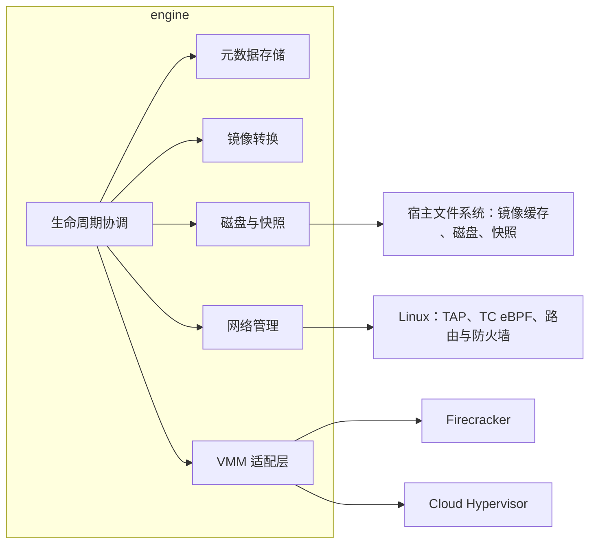
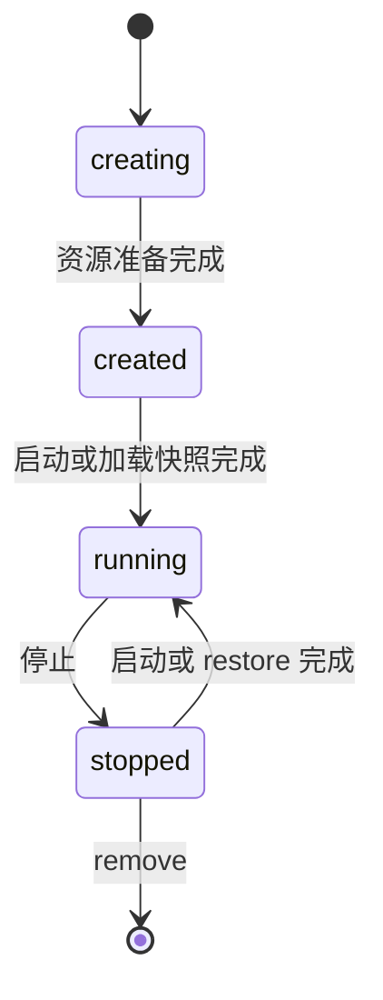
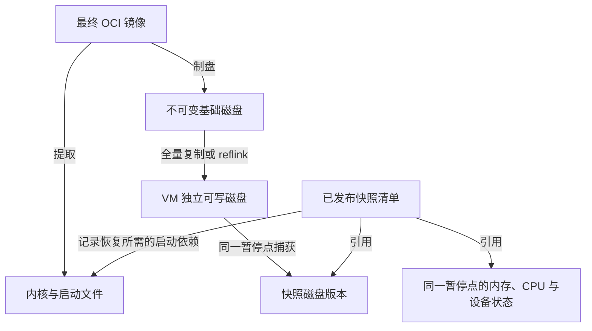
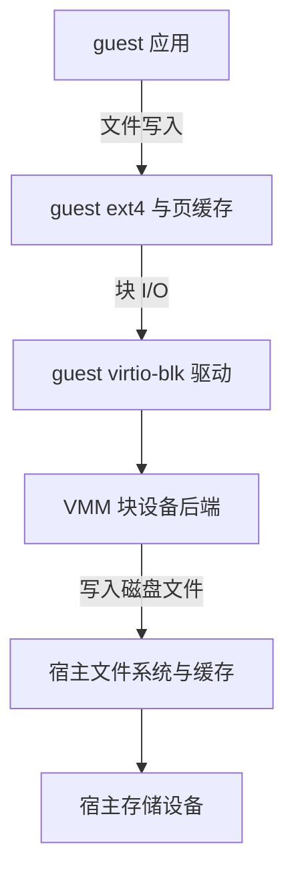
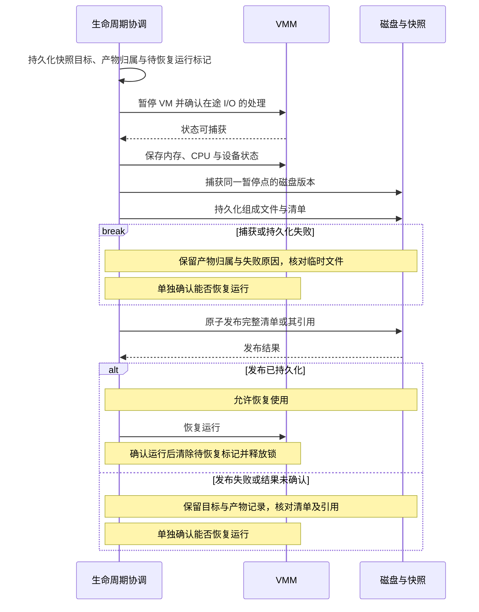
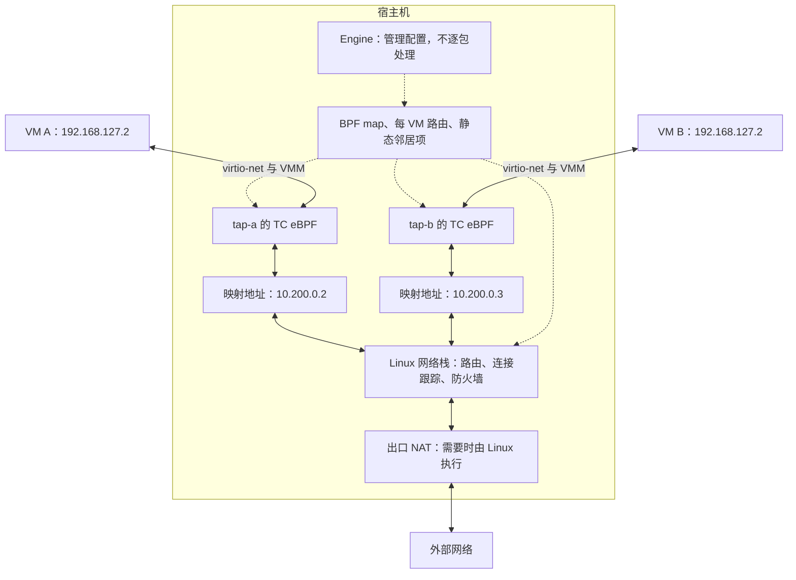
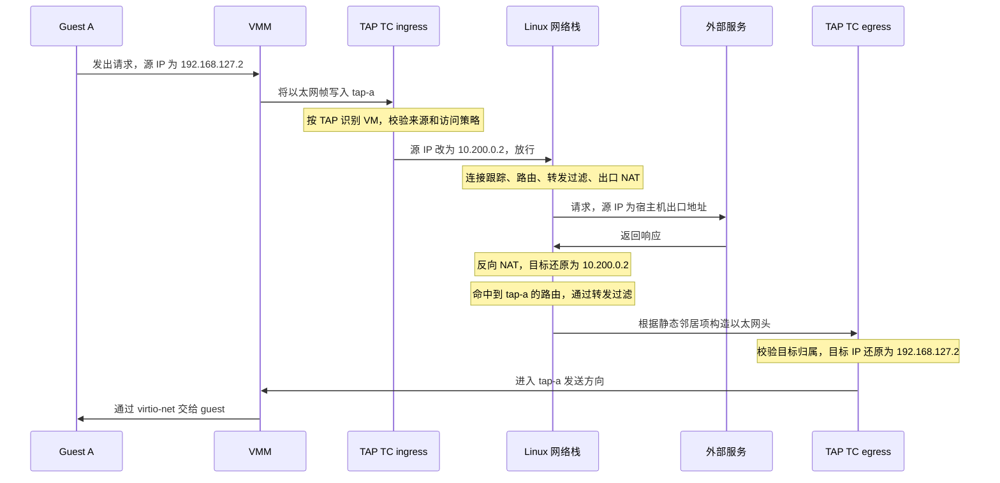
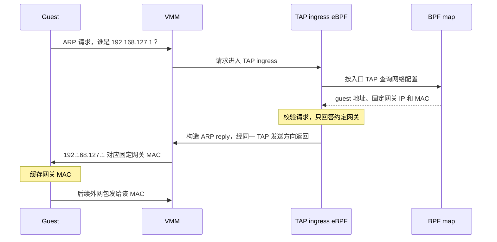

# sandbox monorepo

sandbox monorepo 的整体架构设计：

- 正文：范围、决策、数据路径与约束。
- 附录 A：virtio、TAP、TC、reflink 等概念。
- 附录 B：资源归属标记、邻居项状态、协议处理等实现备注。

能力承诺以实现与验证为依据；标为「待定」「需要验证」的能力，完成决策与验证后才纳入支持范围。

# 0. 范围

engine 是单宿主机 microVM 引擎，以 VM 为单位管理生命周期、存储、内存、快照、镜像、网络与设备。目标是提供可编程管理、可保存和恢复的完整 Linux 计算机。

范围之外：

- 多宿主机调度与集群控制面。engine 的对外 API 待定，本文只约束它的内部边界。
- 应用与外部系统的事务一致性。engine 只保证 VM 本地状态一致。
- 增量快照、跨 VMM 的快照互换、IPv6。具体限制见对应章节。

# 1. 设计原则

**默认拒绝，失败保持关闭（fail-closed）**。资源就绪并核对归属后才允许使用；访问控制默认拒绝。

**以实际资源核对元数据**。元数据记录配置、意图与恢复信息；进程和资源的当前状态通过实际核对确认。故障恢复流程见第 4 章。

**信任边界在宿主侧实施**。guest 和 OCI 镜像内容均作为不可信输入处理，隔离、配额和限速由宿主机强制执行。

# 2. 技术选型与 engine 定位

技术栈选择 Go + Rust：

- Go：利用 Web 和云计算生态实现控制面与 Kubernetes 集成。
- Rust：用于需要精细内存控制、低运行时开销的组件，与主流 VMM 技术栈一致。

## 为什么选择 microVM

「完整 Linux 计算机」指独立的 guest kernel、完整的 Linux 用户空间、自主运行服务，以及机器级的保存和恢复。兼容范围限定为 Linux 与所选后端支持的设备。

普通容器共享 host kernel，VM 提供独立内核与机器级状态。microVM 的精简设备模型适合当前需求；若需要更广泛的设备能力，应重新权衡后端。设备裁剪和 uffd、FUSE 等按需加载机制，均按实际启动、恢复需求及实现成本选择。

engine 支持 Firecracker（FC）和 Cloud Hypervisor（CH），每台 VM 使用一种后端。下文用 VMM 描述共同路径，启动配置、设备能力和快照操作按后端及版本处理。

## 为什么自行实现 engine

自行实现的重要目的是学习和掌握 VM 生命周期、存储、快照与网络管理。

参考项目：[Flintlock](https://github.com/liquidmetal-dev/flintlock) 的单机 microVM 管理、[E2B 节点实现](https://github.com/e2b-dev/infra/blob/main/docs/ARCHITECTURE.md)的快照与快速恢复。[Kata Containers](https://github.com/kata-containers/kata-containers) 以 VM 承载容器运行时接口，与本项目的机器管理模型不同。

OCI 用于软件分发，机器生命周期与资源管理由 engine 负责。containerd 可提供内容存储、镜像解包和文件系统快照；包含内存与设备状态的 VM 快照由 engine 协调。复用范围限定为镜像格式和必要的处理组件。

# 3. engine 结构

engine 内部按职责划分为六个模块。「生命周期协调」是唯一驱动状态转换的模块，其余模块各管一类资源，向协调模块提供资源操作。

| 模块 | 职责 | 详见 |
|---|---|---|
| 生命周期协调 | VM 状态转换、跨资源编排、互斥、失败处理与中断恢复 | 第 4 章 |
| 元数据存储 | VM 配置、资源归属、生命周期恢复信息 | 5.1 |
| 镜像转换 | OCI 校验与解包、启动文件提取、根磁盘制作、转换缓存 | 5.2 |
| 磁盘与快照 | 运行时磁盘、快照清单、发布与回收 | 5.3 至 5.7 |
| 网络管理 | TAP、映射地址、eBPF 程序与配置、路由与邻居项、访问策略 | 第 6 章 |
| VMM 适配层 | 屏蔽 FC 与 CH 在启动配置、设备、快照上的差异 | 第 2 章 |

# 4. 生命周期

VM 生命周期统一协调 VMM 进程、磁盘与网络，负责各动作的互斥、失败处理和中断恢复。恢复信息属于生命周期内部实现，与 VM 的运行状态分别记录。

| 状态 | 含义 |
|---|---|
| creating | 正在准备磁盘副本、网络资源等，尚未启动 |
| created | 资源准备完成，VMM 尚未首次启动 |
| running | VMM 进程存活，临时暂停及恢复需要由具体动作管理 |
| stopped | 进程已停止，资源保留 |

快照保存目标、产物和 guest 待恢复运行标记；删除通过墓碑记录意图并阻止新使用。这些信息用于恢复中断的变更，资源回收见 5.7。

生命周期状态描述运行阶段；当前事实由资源核对确认，下一次操作是否可执行由资源校验决定。核对或校验失败时，在对应记录中保存具体原因，使用原有生命周期状态描述已确认的运行阶段。

执行与恢复约定：

1. **互斥**：create、start、stop、snapshot、restore、clone、delete 等动作先获取该 VM 的锁，串行执行。
2. **保存恢复依据**：执行宿主侧变更前，先持久化该动作所需的意图、资源归属及原有引用；提交结果按对应协议记录。SQLite 事务原子更新元数据，生命周期负责协调文件、进程和内核资源。
3. **重启核对**：engine 重启后核对进程及归属、磁盘文件、网络归属标记和提交记录，再处理未完成的变更。例如记录为 running，但已确认 VMM 退出，应修正为 stopped；资源损坏另按实际检查结果判断。
4. **安全条件**：启动、恢复运行、切换资源前，必须确认进程归属和所需资源的一致性；切换或回收资源还须确认相关使用均已结束。条件待确认时拒绝相应动作，保留资源和恢复信息，记录原因并允许重新核对；需要人工处理时明确报告。

各动作保存的信息与恢复规则如下。生命周期依据这些规则实现专用恢复函数；持久化阶段或标记仅用于中断前后处理方式不同、且实际资源不足以可靠判定的边界。

| 动作 | 恢复所需信息 | 中断后处理 |
|---|---|---|
| create | 创建意图、固定镜像与资源配置、资源归属 | 核对准备完整性，继续补齐资源；决定放弃时设置墓碑并清理。就绪后记为 created |
| start / stop | 启动或停止意图、进程归属、资源版本 | 核对进程实际状态，接管已完成的启动或继续未完成的启停，再更新 VM 状态 |
| delete | 删除墓碑、资源归属和使用关系 | 继续停止进程、解除使用并回收资源；墓碑保留到清理完成 |
| restore | 目标快照、原资源引用、候选版本、当前引用 | 核对当前引用及进程实际使用的版本；切换或回滚前确认待替换版本已停用，校验通过后启动或接管 |
| clone | 源快照及使用登记、新 VM 身份与资源归属 | 核对新 VM 的资源与进程，继续准备或恢复；放弃时按实际依赖清理新资源并释放使用登记 |
| snapshot | 目标快照、产物归属与发布记录、guest 待恢复运行标记 | 核对产物完整性、发布结果与 VMM 状态；继续满足一致性条件的捕获或发布，或清理未发布产物；单独处理 guest 恢复运行 |

具体顺序见第 5 章。恢复完成后清除对应的待处理信息；仍被 VM 或快照使用的资源归属与引用继续保留。恢复信息的存储布局按各动作需要确定。

# 5. 存储层

存储层以文件保存 VM 数据，以 SQLite 记录配置、归属和生命周期恢复信息。基础磁盘与快照不可变，运行中的 VM 只写自己的磁盘副本。

## 决策

| 决策点 | 选择 | 理由与限制 |
|---|---|---|
| 元数据 | 宿主机本地 SQLite | 事务原子更新记录；文件与 VMM 按生命周期协议恢复 |
| 启动材料 | 一个 OCI 镜像提供内核、启动文件、系统环境和应用 | 提取启动文件并制作 raw/ext4 根磁盘，统一使用该镜像版本 |
| 运行时磁盘 | 每 VM 独立可写文件 | 全量复制为正确性基线；reflink 是否作为部署要求待定 |
| 快照 | 内存、CPU、设备状态与对应磁盘版本的完整清单 | engine 负责捕获外部磁盘并与 VMM 状态配套 |
| 发布与恢复 | 数据持久化后原子发布，恢复只读已发布清单 | 组成文件必须属于同一份完整快照 |

## 5.1 数据对象与关系

| 对象 | 内容与用途 | 管理方式 |
|---|---|---|
| 元数据 | VM 配置、资源归属与引用、墓碑、生命周期恢复信息 | SQLite 事务更新，支撑第 4 章的恢复流程 |
| OCI 镜像 | 用户选择的完整 guest 软件版本 | 以内容摘要固定版本，包含全部启动所需内容 |
| 启动产物 | 从同一 OCI 镜像提取的内核、启动文件及转换后的基础磁盘 | 关联输入镜像摘要与转换参数，作为不可变缓存 |
| 运行时磁盘 | 每台 VM 的块设备后端文件 | VM 独占写入 |
| 快照 | 清单、内存、CPU 与设备状态、磁盘版本 | 完整发布后才能用于 restore 或 clone |
| 临时产物 | 转换、复制、快照等动作尚未完成的文件 | 记录所属变更，完成并正式发布后才作为可用版本 |

内核、启动文件与基础磁盘均来自同一个 OCI 镜像。基础磁盘用于生成运行时副本；快照清单引用恢复所需的文件：

副本来源与读取依赖各有回收条件。全量复制或 reflink 副本可独立读取，源文件删除后副本仍然有效；来源记录仅用于追溯。清单直接引用的文件是恢复依赖，清单可用期间必须保留。reflink 共享块及其引用由宿主文件系统管理。

## 5.2 从 OCI 镜像到 VM 启动文件

用户提供一个 OCI 镜像，包含 guest 内核、启动文件、系统环境和应用，构建工具由用户选择。内核和启动文件可以独立构建后组合进最终镜像；创建 VM 时只指定这一个镜像。

镜像构建负责提供完整的内核与 guest 初始化环境，engine 的导入职责限定为校验和转换。仅满足启动要求的镜像可用于 VM，缺少必要内容时拒绝导入。

1. **校验并解包**。固定镜像内容摘要，校验 CPU 架构与 guest 匹配，按层合并文件并处理删除语义。解包以隔离权限执行并限制空间占用，通过路径、符号链接和文件属性校验，将写入范围限定在工作目录内。
2. **提取启动文件**。从合并后的镜像内容中定位内核及所需启动文件，校验格式与所选 VMM 后端兼容，保存为宿主侧文件。缺少必要文件则拒绝导入。
3. **制作根磁盘**。在指定容量的 raw 文件中直接制作 ext4，填入镜像文件系统内容，发布为不可变基础磁盘（布局见附录 A.4）。

启动时，engine 准备该 VM 的可写磁盘副本，并配置 VMM 直接加载提取出的内核与启动文件、接入磁盘块设备。这些本地文件共同对应同一镜像版本。

guest 初始化由镜像提供。采用 initramfs（挂载正式根文件系统前使用的内存启动环境）时，其中的早期 init 负责准备并挂载根文件系统，再交接给正式的 PID 1；正式 PID 1 负责应用启动和运行期间的进程管理。网络初始化也由镜像内组件完成，早期 init 与正式 PID 1 的具体实现由镜像作者选择。

启动文件的定位约定、启动参数，以及 `ENTRYPOINT`、`CMD` 到 guest 进程的映射规则仍需确定。

启动产物可缓存复用。缓存键包含 OCI 内容摘要、平台、转换程序版本及参数，产物以内容摘要校验。内核、启动文件与基础磁盘作为一组，按同一输入版本生成、校验和使用。

## 5.3 运行时磁盘与写入

### 副本与隔离

每台 VM 从基础磁盘生成独占的可写副本，基础磁盘保持只读。

| 方式 | 创建成本 | 后续写入 |
|---|---|---|
| 全量复制 | 复制磁盘数据，成本随复制量增长 | 各自修改独立数据块 |
| reflink | 创建独立文件，初始数据块与源共享 | 宿主文件系统为修改区域分配独立块 |

全量复制是正确性基线，直接使用宿主文件系统的复制能力。reflink 是否作为部署要求待定；将其明确为部署要求并完成验证后，才可承诺依赖它的 clone 延迟或快照暂停时间（文件系统要求见附录 A.5）。

guest 的 ext4 管理磁盘内部；宿主文件系统管理磁盘文件及 reflink 共享块。OCI 层用于分发和缓存，OverlayFS 的使用范围限于制盘时合并目录，运行时块设备由磁盘文件承载。

### 写入与持久化

guest 通过 virtio-blk 访问块设备，VMM 将块请求转换为宿主磁盘文件的读写。一次写入经过两层文件系统和缓存：

guest 应用的 `write` 返回或 VMM 的宿主侧写返回，都可能只完成了缓存写入；断电持久性取决于整条路径的同步完成情况。

持久化要求 guest 文件系统、virtio-blk、VMM 和宿主存储正确处理同步与 flush 请求。保证范围需按 VMM 类型与版本、块设备缓存配置和宿主存储核实；已发布快照则必须满足 5.4 的完整持久化要求。

## 5.4 创建与发布快照

快照保存同一暂停点的内存、CPU、设备状态与磁盘版本，由 engine 用清单组织。FC、CH 按各自的接口、设备支持和产物格式实现这套流程。

### 捕获一致状态

暂停 guest 后，VMM 仍可能有在途宿主 I/O。捕获前必须确认这些请求已完成，或能与设备快照一致地恢复，并保持待捕获磁盘稳定。guest 脏页可以保存在内存快照中，恢复后继续写回。

下图是完整发布后再恢复运行的基线流程，全程持有 VM 锁。暂停前先持久化目标快照、产物归属和 guest 待恢复运行标记；发布结果由清单及其引用确认，guest 恢复执行后清除待恢复标记。

全量复制期间必须保持源磁盘稳定。若后端能快速创建稳定磁盘版本，可在完成一致状态捕获后先恢复 VM，再复制和持久化该版本；副本持久化后才可发布。发布成功后恢复运行失败，已发布快照继续保留，待恢复标记与失败原因留给生命周期继续处理。

### 发布完整产物

清单记录组成文件、内容校验、基础数据引用及恢复配置。发布必须同时满足：

1. **一致性**：内存、CPU、设备状态和磁盘属于同一暂停点。
2. **持久化**：组成文件、清单及其目录项在崩溃后仍可读取。
3. **原子可见**：恢复端以已发布的完整清单为唯一读取入口。

文件发布的顺序是：同步组成文件，持久化清单，原子发布后同步目录项。rename 负责原子可见，文件和目录同步负责持久化；若通过 SQLite 事务发布引用，必须先完成文件及目录项持久化，再提交引用。具体同步语义需在宿主文件系统上验证。

快照保证 VM 本地状态一致；应用与外部系统的事务一致性由 guest 配合提交或协调。仅从磁盘启动会执行 guest 开机流程，完整内存快照恢复则从保存的机器状态继续执行。

## 5.5 restore 与 clone

两种操作都以一份已发布的完整清单为单位恢复，所有组成文件必须与该清单对应。

| 操作 | VM 身份 | 资源处理 |
|---|---|---|
| restore | 保留原 VM 身份 | 原 VM 停止后切换到快照对应的资源 |
| clone | 创建新 VM 身份 | 新建宿主资源，写入仅落到自己的独立磁盘副本 |

### 校验恢复环境

文件摘要校验内容完整性，运行环境兼容性根据清单中的以下配置校验：

- VMM 类型、版本与快照格式。
- CPU 架构及暴露给 guest 的 CPU 特性。
- 内存与设备布局、磁盘对应关系。
- 输入 OCI 镜像的固定内容摘要、启动产物版本，以及恢复实际依赖的内核和启动文件。

恢复端按清单中的固定版本读取组成文件，并确认运行配置受支持。restore 和内存快照 clone 均使用原 VMM 类型及其快照格式；兼容性按具体配置验证，跨宿主机、跨版本的恢复范围以验证结果为准。

### 切换与失败处理

restore 先持久化目标快照、原资源引用与候选版本。所需文件优先在独立位置准备，校验完整性与兼容性后再整体切换资源引用，准备期间保留当前可用版本。切换前必须确认原 VM 已停止，相关进程和操作均已结束对待替换资源的使用（第 4 章）。

中断后核对当前引用、候选文件和进程实际使用的版本，决定完成切换或恢复原引用：

- 只有确认 VMM 已停止，才能记为 stopped。
- 资源版本不一致或尚未核实时，禁止启动；修复并通过校验后才可启动。
- 进程归属或修复安全条件待确认时，记录原因并拒绝相应操作。

clone 从保存的 guest 执行状态继续运行。guest 内部需要改变的身份和网络配置，必须通过 guest 协调在开放服务前完成，engine 记录对应元数据（网络处理见 6.9）。

## 5.6 容量与故障

### 容量核算

稀疏文件在写入时分配块，reflink 还可能共享数据块。需分别记录和限制：

| 指标 | 含义 |
|---|---|
| guest 可见容量 | 虚拟块设备大小，决定 guest 文件系统可用范围 |
| 宿主实际占用 | 已分配的数据块；共享块按实际物理占用计数 |
| 可用空间与预留 | 后续写入、转换临时文件、内存快照和磁盘复制可用的空间 |

预留降低写满风险，但减少可接纳的 VM 数量；超额分配提高利用率，但可能使后续写入失败。创建前的空闲空间检查反映当时余量，后续写入保障取决于预留机制。预留机制待定，逻辑容量对应的物理空间保证须在机制确定后明确。

### 空间不足与 I/O 错误

guest 的 ext4 写满时向应用报告空间不足；宿主写满时，即使 guest 仍有空闲块，也可能收到块设备 I/O 错误，导致文件系统报错或转为只读。虚拟磁盘容量与宿主总容量分别管理，配额与 I/O 限制均在宿主侧实施。

空间不足时，保留已有可用版本，将受影响的镜像或快照操作记录为失败，待发布产物继续保留为临时文件。宿主 I/O 错误必须上报并记录相关操作失败；释放空间后，仍须依据 VMM 和 guest 的实际状态判断能否继续运行。

## 5.7 删除与回收

### 先禁止使用，再回收

删除 VM 时先在 VM 锁内持久化墓碑，拒绝新操作与使用登记，只继续删除所需的核对、停止和回收。墓碑记录删除意图，进程退出与资源释放分别核实；回收完成前保留资源归属与引用，engine 重启后逐项核对并继续清理。放弃的创建操作也按此流程回收。

VM、快照和 clone 独立删除，已有快照与 clone 在源 VM 删除后继续保留。对象的使用与回收遵循同一并发协议：

1. 开始使用前登记使用关系。
2. 删除时关闭新使用登记，等待已有使用释放。
3. 确认实际依赖均已解除后回收文件。

使用登记、删除标记与回收条件检查必须在同一套并发控制下完成。

| 对象 | 回收条件 |
|---|---|
| VM 可写磁盘 | VM 及相关操作均已结束对该版本的使用 |
| 快照组成文件 | 快照已禁止新的恢复操作，已有恢复和实际读取依赖均已结束 |
| OCI 与启动产物缓存 | 转换、创建、恢复操作及可用快照的实际依赖均已解除，可按缓存策略回收 |
| 未发布的临时产物 | 已确认所属操作失败或取消，相关进程均已结束使用 |

磁盘与内存后端的依赖分别检查。按需加载内存的 VM 在运行后仍可能读取快照内存文件，这些文件须保留到实际读取依赖结束。

### 崩溃清理与数据保护

临时文件必须能关联到所属镜像、VM 或快照，以及创建该文件的变更。engine 重启后依据对应恢复信息和进程、文件的实际使用情况决定继续或清理。回收允许重试，崩溃后仍能定位剩余文件；快照可用性以完整清单的发布记录为准。

内存快照可能包含令牌、私钥和应用明文，磁盘包含用户修改，均作为私有数据按 VM 访问权限管理。保留和删除策略覆盖内存、磁盘及临时产物；需要底层数据安全擦除时，应采用专门的存储擦除机制。

# 6. 网络层

## 决策

| 决策点 | 选择 | 理由与限制 |
|---|---|---|
| 默认状态 | VM 不联网 | 完成显式启用和配置后接通；出网流量仍受宿主机管理服务、其他 VM 等边界规则约束 |
| 设备路径 | virtio-net + 每 VM 独立 TAP，与共享二层网络隔离 | 见 6.1；概念注释见附录 A.1、A.2 |
| 地址方案 | guest 固定配置 + 宿主侧每 VM 映射 IP，按入口 TAP 识别身份 | 见 6.2 |
| 执行位置 | eBPF 在 TAP 边界做地址映射、访问检查和网关 ARP；路由、连接跟踪、防火墙、出口 NAT 复用 Linux | 见 6.3、6.4 |
| 返回路径 | 每 VM /32 主机路由 + 静态邻居项 | 见 6.5 |
| 协议范围 | 仅 IPv4，其余明确阻断 | 见 6.8 |
| 访问默认值 | 拒绝外部主动连接，并阻断宿主机管理服务、其他 VM、元数据服务等受保护目标 | 见 6.7 |

## 6.1 数据路径

FC 和 CH 统一采用 virtio-net + TAP：guest 经 virtio-net 与 VMM 交换以太网帧，VMM 读写独立 TAP 接入 Linux 网络栈。每个 TAP 保持独立，不桥接到共享二层网络；设备配置按后端处理。概念见附录 A.1、A.2。

## 6.2 固定 guest 配置与地址映射

内存快照的 clone 保留原 guest IP 和 MAC，接入共享二层网络会产生地址冲突。可选方案：

| 权衡 | 修改 guest 地址 | 宿主侧地址映射 |
|---|---|---|
| clone 后的准备 | 协调 guest 更新配置再开放网络；内存恢复沿用当前运行状态，需显式处理网络初始化、DHCP 和已绑定旧地址的 socket | 准备独立 TAP 和映射，不为地址唯一性修改 guest |
| 数据路径 | 无需这层地址转换，仍需路由和访问控制 | 每个包需要转换，校验和、分片、ICMP 内嵌报文由宿主侧承担 |
| 排查与应用行为 | guest 与路由使用同一地址，但应用需适应地址变化 | guest 配置稳定，但日志需关联两套地址，应用通告的内部地址不自动转换 |
| 更适合的场景 | 可以可靠重配 guest，或主要从头启动 VM | 频繁从同一份内存快照派生 VM |

选择宿主侧映射，clone 后由宿主直接提供独立网络身份，避免依赖 guest 重配；宿主侧承担地址转换和协议处理。外部连接的恢复限制见 6.9。

每台 VM 使用独立 TAP，数据面以**入口 TAP 的配置**确定 VM 身份。报文进入共享路由和连接跟踪路径前，将重复的 guest 源 IP 转换为唯一映射 IP；访问控制另行执行（见 6.7）。

后文示例，实际网段需与部署环境协调：

| 配置项 | VM A | VM B |
|---|---|---|
| guest IP | `192.168.127.2` | `192.168.127.2` |
| guest 默认网关 | `192.168.127.1` | `192.168.127.1` |
| 宿主侧 TAP | `tap-a` | `tap-b` |
| 映射 IP | `10.200.0.2` | `10.200.0.3` |

## 6.3 控制面与数据面

**控制面决定规则，数据面处理流量**。engine 创建 TAP、分配地址、加载经内核校验的 eBPF 程序、发布访问策略。eBPF 按规则处理报文，通过 BPF map 读取配置。BPF map 是用户态与 eBPF 共享的内核数据结构，保存 TAP 对应的 guest IP、映射 IP 和访问策略。

eBPF 负责一对一地址映射、访问检查和网关 ARP 应答；路由、连接跟踪、有状态防火墙复用 Linux。出口 NAT 由 Linux 或上游网关提供，eBPF 不管理端口分配和连接状态。

## 6.4 双向处理顺序

每个 TAP 的 TC ingress、egress 各挂一个 eBPF 程序：**出站先由 eBPF 映射地址，再由 Linux 连接跟踪和防火墙处理；返回先经 Linux 连接跟踪、路由和防火墙，再由 TC egress 还原 guest 地址**。TC 的概念见附录 A.3。

| guest 视角 | TAP 视角 | 处理 |
|---|---|---|
| guest 发包，VMM 将帧写入 TAP | ingress，接收入口 | 校验来源、访问检查、源地址映射 |
| guest 收包，VMM 从 TAP 读取帧 | egress，发送出口 | 校验目标归属、返回访问检查、目标地址还原 |

VM A 出站时，ingress 按 `tap-a` 查找配置，校验源 IP、MAC 和目标访问策略；通过后将源 IP 改为 `10.200.0.2` 并更新校验和。缺少配置或不符合策略则丢弃。

返回包经过 Linux 路由和防火墙后，egress 确认目标为 VM A 的映射 IP，将其还原为 `192.168.127.2`，设置 guest MAC 和约定的网关 MAC，更新校验和后交给 VMM。

返回流量统一沿 Linux 转发路径到达 TAP，完成连接跟踪和防火墙检查后再还原地址。TAP egress 位于转发过滤和 postrouting（路由后的网络处理阶段）之后。

## 6.5 返回路由与邻居项

每个映射 IP 配置一条指向所属 TAP 的 `/32` 路由，并安装映射 IP 到 guest MAC 的静态邻居项。映射 IP 保持为路由地址，不配置为宿主本地地址，确保返回包进入转发路径；guest 不识别映射 IP，静态邻居项直接提供 MAC，无需 guest 回应 ARP。路由和邻居项随 VM 创建、回收，邻居项实现见附录 B.2。

| 记录 | VM A 的例子 | 作用 |
|---|---|---|
| 主机路由 | `10.200.0.2/32 dev tap-a` | 选中返回出口 |
| 静态邻居项 | `10.200.0.2` 对应 guest MAC，接口为 `tap-a` | 直接提供目标 MAC，用于构造以太网头 |

不同 VM 可以复用 guest MAC，邻居项按 TAP 区分，各 TAP 保持二层隔离。

宿主机执行出口 NAT 时，返回包先按连接记录还原为映射 IP，再命中上述路由。由上游承担出口处理时，上游网络必须具有到映射网段的有效路由，将返回包送到所属宿主机。

## 6.6 固定网关与 ARP

TAP ingress 的 eBPF 回应 guest 对 `192.168.127.1` 的 ARP 查询，返回固定网关 MAC。网关 IP 仅作为 guest 的下一跳，无需配置到宿主 TAP；实际路由由 Linux 执行。宿主侧配置为接收发往该 MAC 的帧，例如将 TAP MAC 设为约定值。

eBPF 校验请求来源和格式，仅对约定网关查询应答，其他 ARP 请求直接丢弃。ARP 处理限定在同一 TAP 内，应答按独立的 ARP 路径返回 guest；IPv4 地址映射仅处理 IP 报文。

clone 保留固定网关 MAC，快照中的 guest ARP 缓存继续有效。

## 6.7 访问边界

eBPF 按预配置规则执行一对一地址映射。Linux 连接跟踪和防火墙区分响应流量与外部主动连接；已有连接也须通过 eBPF 的地址、协议和端口检查。

默认阻断宿主机管理服务、其他 VM、集群控制面、云实例元数据服务等受保护目标。按部署环境明确配置受保护地址范围，覆盖私网之外的目标。明确配置 DNS 提供方和允许的解析路径。

`input`、`output`、`forward` 以宿主机为参照，与 TAP ingress、egress 不同。规则按报文路径设置：

| 路径 | Linux 防火墙位置 | 要求 |
|---|---|---|
| VM 经宿主机访问外部 | `forward` | 检查目标和连接状态，默认拒绝外部主动连接 |
| VM 访问宿主机自身 | `input` | 阻断对宿主机管理服务的访问 |
| 宿主机主动访问 VM | `output` | 明确配置允许范围，并在 output 路径执行检查 |

engine 仅管理自身规则，并保留宿主已有防火墙配置。部署时确认 IP 转发、现有规则和连接跟踪配置满足上述处理顺序。

## 6.8 协议范围

除上述网关 ARP 外，网络层仅处理 IPv4，按访问策略放行，其余协议明确阻断。通用 IPv4 出网能力的验证须覆盖分片、ICMP 错误和校验和卸载；各类报文的支持范围与限制见附录 B.3。

## 6.9 网络生命周期与快照

快照保留 guest 的 socket 和 ARP 缓存；宿主连接记录与远端服务状态独立演进。恢复后的旧 TCP 连接可能失效，应用须处理超时、断开和重连。

TAP、映射地址、BPF map 条目、路由、邻居项和规则均由宿主管理，其生命周期独立于 guest 快照。engine 重启后按 VM ID 和网络资源创建标识核对归属；核对一致后才允许接管、删除或启用网络，否则保留设备现场并拒绝这些操作（标记方案见附录 B.1）。

创建、restore、clone 默认保持断网。显式启用后，engine 准备并核对宿主资源，映射、路由、邻居项和访问策略全部就绪后才接通；准备或恢复失败时保持阻断。内核资源逐项更新，配置期间持续阻断流量。

删除时先阻断通信，再清理网络资源和连接状态，最后释放地址。地址复用前必须处理旧连接记录，并采用迟到报文隔离或地址延迟复用策略，避免旧流量进入新 VM。

启用网络时，restore 需要核对并重新准备原 VM 的网络资源；clone 使用新的网络资源创建标识、TAP 和映射地址，但保留 guest 内部的固定 IP、MAC 和网关配置。

# 附录 A. 概念注释

## A.1 virtio 与半虚拟化

guest 网卡有三种实现方式：

- **硬件模拟**：VMM 模拟真实网卡的寄存器和设备行为，guest 可复用驱动；兼容性好，但逐步模拟交互比队列批量交换开销大。
- **硬件直通**：guest 直接使用物理设备，减少中间处理；快照与克隆的适用范围受物理设备及其状态恢复能力约束。
- **半虚拟化**：guest 使用专门驱动与虚拟设备配合。virtio 定义双方接口，通过队列交换缓冲区和通知；virtio-net 是网卡接口，virtio-blk 是块设备接口。

设备接口与 CPU 加速是两个独立维度。QEMU 同时支持硬件模拟和 virtio，CPU 则可由 KVM 加速。

## A.2 TAP 与 TUN

TAP 是 Linux 的二层虚拟网络设备，处理包含 MAC 地址的以太网帧。对 VMM 来说它是可读写的文件描述符，对 Linux 网络栈来说它是一个网络接口：VMM 写入 TAP 相当于这个接口收到帧，Linux 向 TAP 发送帧则 VMM 可以读取并交给 guest。TUN 在第三层收发 IP 包。virtio-net 交换以太网帧，因此使用 TAP。

## A.3 TC、qdisc 与 clsact

TC（Traffic Control）是 Linux 的流量控制框架，在网络接口上组织报文调度、分类和处理。其中的 qdisc（queueing discipline，排队规则）通常决定报文如何排队和发送；filter 负责匹配报文，action 决定匹配后如何处理，例如丢弃或重定向。

`clsact` 是一种特殊的 qdisc，名称来自 classifier 和 action。它只在接口的 ingress 和 egress 两侧提供过滤处理位置，报文排队与调度继续由原有 qdisc 负责。每个 TAP 安装 `clsact`，两侧挂载 eBPF filter，使用 direct-action 模式直接返回放行、丢弃或重定向结果。

## A.4 raw 与 ext4

raw 文件按磁盘偏移直接保存字节，ext4 在这些字节中组织目录、文件和空闲块。本项目以整个 raw 文件承载 ext4，由 VMM 直接加载内核。guest 内核需支持 virtio 和 ext4，并通过启动参数识别、挂载根设备。

## A.5 reflink

reflink 是文件系统提供的写时复制（copy-on-write，COW）文件克隆：新文件有独立身份和元数据，初始数据块与源共享，修改时分配独立块，另一方保持原内容。硬链接则是多个路径指向同一文件，修改对所有路径可见。

reflink 需要底层文件系统支持，通常限于同一文件系统内。后续写入仍占用空间，可能因空间不足失败。完整 VM 快照需将磁盘副本与同一暂停点的内存、设备状态配套保存。

## A.6 校验和

IP、TCP、UDP 头部带有校验和，用于检测报文损坏。eBPF 改写地址时必须同步修正受影响的校验和，使报文通过接收方的完整性校验。

# 附录 B. 实现备注

## B.1 网络资源归属标记

为了在 engine 重启后确认网络资源归属，元数据记录 VM ID 和本次网络资源创建的唯一标识（创建标识），重建网络资源时更换，用来区分同一台 VM 先后使用的两组资源。

创建资源前先持久化这组归属信息，再写入 TAP 的接口别名（`ifalias`）及 engine 管理的 BPF 配置。恢复时先核对 VM ID、创建标识和设备类型，再取得接口编号，确认关联的映射 IP、路由、邻居项和规则与记录一致。路由与邻居项通过已确认归属的接口和记录的地址关联。

接口名和编号用于定位，VM ID 与创建标识用于核对归属。核对一致后才允许接管、删除或启用网络；核对失败时保留设备现场并拒绝这些操作。归属标记服务于故障恢复，其可信性以宿主机特权配置受信任为前提。

## B.2 静态邻居项

静态邻居项使用 Linux 的 `NUD_PERMANENT` 状态以保持常驻，由 engine 随 VM 创建和回收。示例：`10.200.0.2 dev tap-a lladdr <guest MAC> PERMANENT`。

## B.3 协议陷阱

- **分片**：一个 IPv4 包可能被拆成多个片段，后续片段可能不带端口字段；按分片状态处理，避免将后续片段当作完整 TCP、UDP 报文解析。
- **ICMP 错误**：网络设备报告不可达或包过大时，报文会携带部分原始包头。地址转换须覆盖最外层 IP 和内嵌原始包头，确保 guest 能识别原请求。
- **校验和卸载**：部分校验和计算可能延后到其他处理阶段；依据卸载状态区分已完成计算与待后续阶段补全的校验和。

这三类都须由实现处理或明确限制；通过校验的报文按策略放行，其余丢弃。
