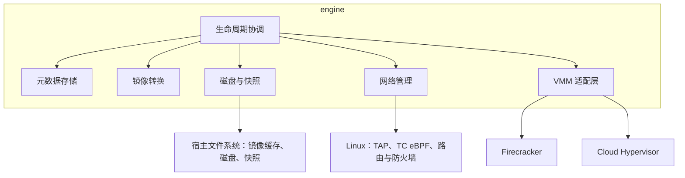
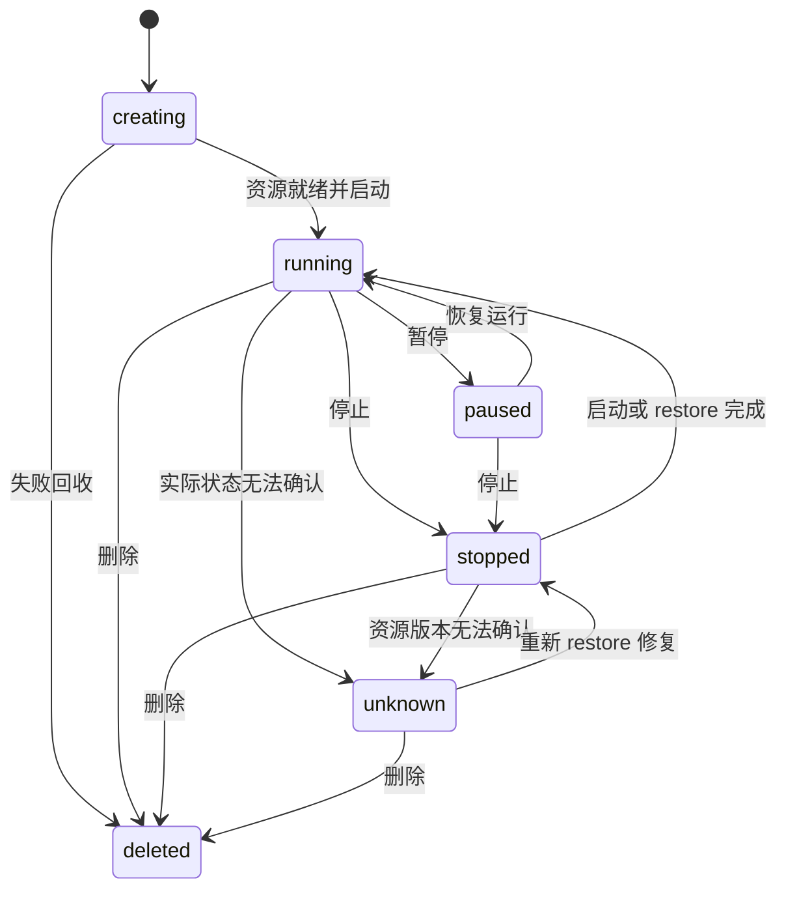
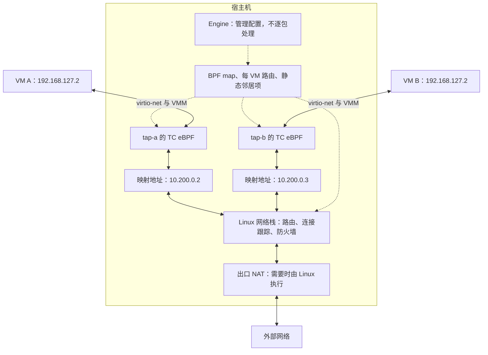
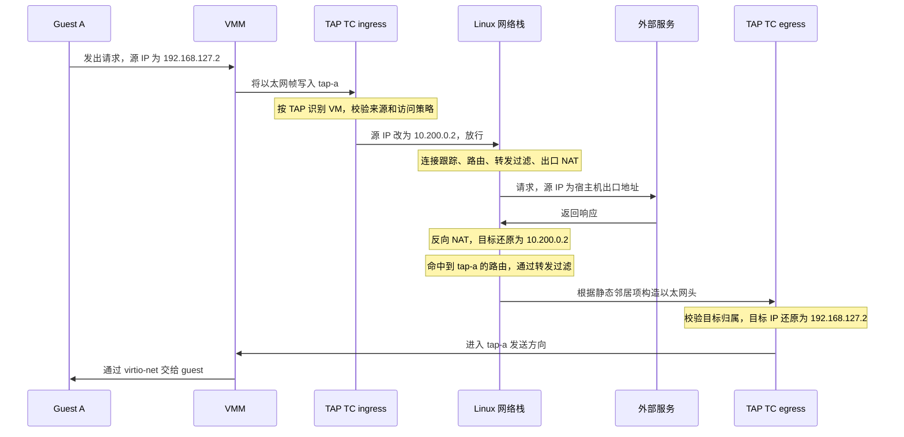
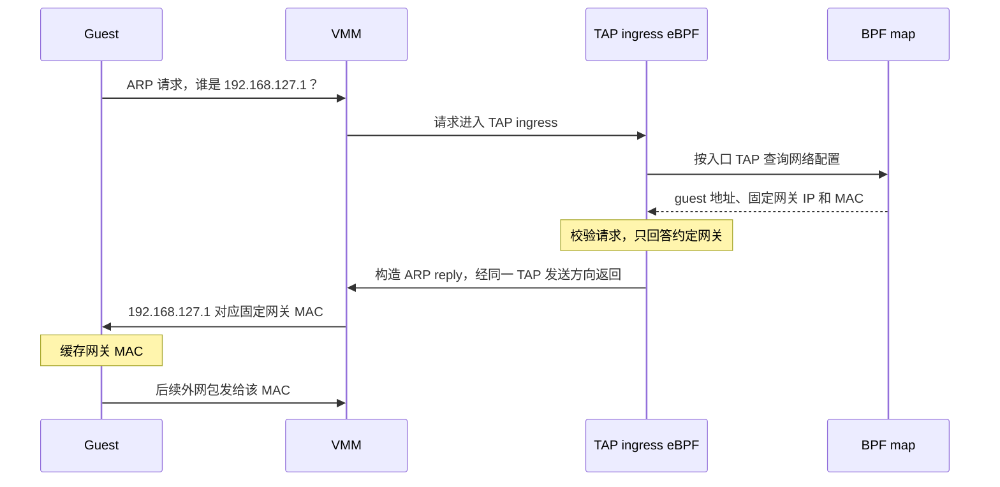

# sandbox monorepo

sandbox monorepo 的整体架构设计。本文分三层阅读：

- 正文回答范围、决策与机制。每章开头是决策表，之后是数据路径与必须满足的不变量。
- 附录 A 是概念注释（virtio、TAP、TC、reflink 等），供需要背景的读者查阅。
- 附录 B 是实现备注（归属标记、邻居项状态、协议陷阱），属于实现规格，架构阅读可以跳过。

本文只承诺有实现与验证支撑的能力。凡写「待定」「需要验证」的地方，表示该能力尚未被承诺，而不是默认可用。

# 0. 范围

engine 是运行在单台宿主机上的 microVM 引擎，以 VM 为管理单位，统一管理它的生命周期、存储、内存、快照、镜像、网络与设备。目标是提供一台可编程管理、可保存和恢复的完整 Linux 计算机，而不只是执行不可信任务的隔离环境。

明确不在范围内：

- 多宿主机调度与集群控制面。engine 的对外 API 尚未定义，本文只约束它的内部边界。
- 应用与外部系统的事务一致性。engine 只保证 VM 本地状态一致。
- 增量快照、跨 VMM 的快照互换、IPv6。具体限制见对应章节。

> 本文建立在读者熟悉 VM、microVM、VMM、KVM、容器这些概念的基础上。不懂也没关系，花几分钟问问大模型，或查附录 A。

# 1. 设计原则

贯穿全文的立场只有三条，各章节的具体约束大多是它们的实例。各节只写该节特有的增量，不再重复原则本身。

**默认拒绝，失败保持关闭（fail-closed）**。资源未全部就绪就不开放：未发布的快照不可用，未核对归属的设备不接管，网络准备失败就保持不联网。访问控制的默认值一律是拒绝。

**元数据是意图，不是事实**。数据库记录描述 engine 希望达到的状态，不能单独证明 VM 进程或宿主机资源的实际状态。engine 重启后必须核对实际资源，再继续或回滚未完成的操作，流程见第 4 章。

**信任边界在宿主侧实施**。guest 和 OCI 镜像内容都是不可信输入。隔离、配额、限速由宿主机执行，不依赖 guest 自律。

# 2. 技术选型与 engine 定位

技术栈选择 go + rust，它们都是优秀的系统编程语言但侧重点不同：

- go 有强大的 web 和云计算生态，适合做控制面服务、k8s 集成等功能。
- rust 对内存有更大的掌握能力，运行时开销少，主流 VMM 大多用 rust 编写。

## 为什么选择 microVM

我们希望管理的是一台计算机，而不是一个容器中的进程。这里的「完整 Linux 计算机」指独立的 guest kernel、完整的 Linux 用户空间、自主运行服务的能力，以及机器级的保存和恢复；不意味着当前承诺任意操作系统或完整的物理设备兼容性。

普通容器共享 host kernel，VM 则提供独立的 guest kernel 和机器级状态。microVM 在此基础上裁剪设备模型，适合当前的 Linux 计算环境。不可信任务不是唯一或首要场景，但这不改变宿主侧实施隔离、配额和访问控制的要求。

设备越少、启动越快并不是独立于需求的目标。是否使用 uffd、FUSE 等按需加载机制，应根据启动和恢复的实际需求及实现成本决定；未来若需要更广泛的设备能力，也应重新权衡后端选择，而不是为了维持最小设备模型限制计算环境。

engine 支持 Firecracker（FC）和 Cloud Hypervisor（CH）两种 VMM 后端，每台 VM 使用其中一种。下文用 VMM 描述共同的数据路径，启动配置、设备能力和快照操作按具体后端及版本处理。

## 为什么自行实现 engine

学习和掌握 VM 生命周期、存储、快照与网络管理，是自行实现的重要目的。我们不以「现有产品都无法满足需求」作为自研前提，也不需要为学习目标虚构产品差异。

现有项目用于参考、比较和复用：[Flintlock](https://github.com/liquidmetal-dev/flintlock) 的单机 microVM 管理与本项目定位接近；[E2B 的节点实现](https://github.com/e2b-dev/infra/blob/main/docs/ARCHITECTURE.md) 可作为快照与快速恢复的参考；[Kata Containers](https://github.com/kata-containers/kata-containers) 以 VM 承载容器运行时接口，是相邻方案，但不是本项目默认采用的管理模型。

OCI 镜像是软件分发来源，不决定 engine 必须以容器运行时为底座。containerd 可以提供内容存储、镜像解包和文件系统快照等能力，但文件系统快照不能替代包含内存和设备状态的 VM 快照。这里的机器生命周期与资源管理由 engine 负责，因此优先复用镜像格式和必要的处理组件，不为镜像处理引入整套容器运行时。

# 3. engine 结构

engine 内部按职责划分为六个模块。「生命周期协调」是唯一驱动状态转换的模块，其余模块各管一类资源，不直接驱动 VM 状态。

| 模块 | 职责 | 详见 |
|---|---|---|
| 生命周期协调 | VM 状态机、操作锁、操作进度记录、崩溃恢复 | 第 4 章 |
| 元数据存储 | VM 配置、资源归属、未完成操作 | 5.1 |
| 镜像转换 | OCI 解包、根磁盘制作、转换缓存 | 5.2 |
| 磁盘与快照 | 运行时磁盘、快照清单、发布与回收 | 5.3 至 5.7 |
| 网络管理 | TAP、映射地址、eBPF 程序与配置、路由与邻居项、访问策略 | 第 6 章 |
| VMM 适配层 | 屏蔽 FC 与 CH 在启动配置、设备、快照上的差异 | 第 2 章 |

# 4. 生命周期

VM 是一组资源，创建 VM 不能简单等同于创建进程（进程也有生命周期），而是类似 pod 一样有明确的状态转换。本章描述 engine 视角的资源状态，不是 guest 内部状态。

| 状态 | 含义 |
|---|---|
| creating | 正在准备磁盘副本、网络资源等，尚未启动 |
| running | VMM 进程运行中 |
| paused | guest 已暂停，快照捕获等操作的中间态 |
| stopped | 进程已停止，资源保留 |
| unknown | 元数据与核对结果不一致，禁止启动，只允许重新 restore 或删除 |
| deleted | 终态，资源按第 5.7 节回收 |

操作约定：

1. **操作锁**：create、stop、snapshot、restore、clone、delete 等生命周期操作必须先获取该 VM 的操作锁，互不并发。
2. **进度记录**：操作分阶段推进，每阶段进度写入元数据。数据库事务不等于生命周期事务：它能原子更新多条记录，却不能同时提交磁盘文件、VMM 进程和内核资源的变化。
3. **崩溃恢复**：engine 重启后读取未完成操作，核对实际资源（VMM 进程是否存在、磁盘文件、网络归属标记），能继续的继续，不能继续的回滚清理。元数据是线索，不是事实（第 1 章）。
4. **失败处理按阶段执行**：例如快照失败不丢失 VM 暂停状态的记录，VM 能否继续运行单独确认；准备中的资源不得提前使用。

各资源的创建、核对、回收细节在存储与网络两章展开。

# 5. 存储层

存储层回答三个问题：宿主机上有哪些 VM，它们依赖的数据从哪里来，如何保存和恢复运行状态。对应三类数据：**元数据**（身份、配置、资源引用、操作进度）、**启动与运行数据**（内核、初始根文件系统、每 VM 的磁盘修改）、**快照数据**（同一暂停点的内存、CPU、设备状态和磁盘版本）。

## 决策

| 决策点 | 选择 | 理由与限制 |
|---|---|---|
| 启动方式 | 直接加载 Linux 内核 | 内核由 engine 配置给 VMM，不经 BIOS 或引导程序；内核格式与启动参数按后端确定 |
| 用户空间分发 | OCI 镜像 + 根磁盘转换 | 调用方可选择不同用户空间与工具链，不必手工制盘 |
| 基础磁盘布局 | raw 文件 + ext4，转换后为不可变产物 | 不引入第二层磁盘容器格式，不引入引导分区 |
| 运行时磁盘 | 每 VM 独立可写文件；全量复制为正确性基线，reflink 支持待定为部署要求 | 见 5.3 |
| 元数据存储 | JSON 文件或 SQLite，待定 | 见 5.1 |
| 快照单位 | engine 组织的完整清单：内存、CPU、设备状态加对应磁盘版本 | 不假设 VMM 快照包含外部磁盘文件 |
| 快照发布 | 全部持久化后原子发布清单 | 恢复操作只读已发布清单，见 5.6 |

## 5.1 元数据

元数据保存在宿主机本地，描述 engine 希望达到的状态，为故障恢复提供依据，但不能单独证明 VM 进程或宿主机资源的实际状态。

JSON 便于直接查看，但需要自行处理原子更新、并发控制和崩溃恢复；SQLite 需要通过 SQL 读写，但提供事务能力。不能仅凭数据能表示成键值对就判断哪种更合适。元数据如何支撑恢复流程见第 4 章。

## 5.2 从 OCI 镜像到根磁盘

VM 启动需要后端支持的内核镜像，以及承载 guest 根文件系统的块设备。如果所有沙盒都用固定环境，预制磁盘镜像就够了；我们希望调用方能选择不同的 Linux 用户空间、语言运行时和工具链，因此引入 OCI 镜像作为分发格式，由 engine 转换为根磁盘。

**可启动性要求**。普通容器镜像不能仅凭能够解包就被视为可启动的 VM 镜像：CPU 架构必须与 guest 匹配；必须提供可作为 PID 1 的初始化程序，或由 engine 在转换时补充；网络配置等初始化能力必须有明确的提供方。Dockerfile 的 `ENTRYPOINT`、`CMD` 不会因为文件写入磁盘就自动执行，需要由 guest 初始化程序衔接为进程启动。内核版本、初始化程序的提供方式、OCI 启动配置如何映射到 guest 内进程，属于根磁盘转换与 guest 启动之间需要确定的接口。

**信任边界**。层中的路径、符号链接和文件属性来自镜像作者，解包不能允许它们覆盖工作目录之外的宿主机文件。转换过程需要隔离权限、限制解包后的空间占用，并正确处理层删除语义，不能直接把不可信归档以宿主机特权解开。

**转换缓存键**。不能只以镜像 tag 或 OCI 摘要标识：相同用户空间加入不同版本的初始化程序或不同文件系统参数，会生成不同磁盘。记录 OCI 内容摘要、平台、补充文件、转换程序版本及转换参数作为输入标识，产物再以内容摘要校验。内核单独分发，但启动配置必须把内核的具体版本与磁盘产物关联，不能因用户空间相同就认为整个启动环境相同。

**磁盘产物**。转换过程创建指定容量的 raw 文件，在其中制作 ext4 根文件系统，填入解包内容和初始化程序（格式说明见附录 A.4）。产物作为不可变基础磁盘发布，不能直接作为多台 VM 共用的可写盘；创建 VM 时先生成独立可写文件（见 5.3）。

guest 看到的不是宿主机文件路径，而是 virtio-blk 设备。virtio-blk 是 guest 驱动与 VMM 之间的块 I/O 接口，不是磁盘格式。一次文件写入经过：

| 层次 | 处理内容 |
|---|---|
| guest 应用与文件系统 | 将文件偏移和元数据转换为块 I/O，可能先缓存在 guest 内存 |
| guest virtio-blk 驱动 | 把块读写请求交给 VMM |
| VMM 的块设备后端 | 将请求转换为宿主侧磁盘文件的读写 |
| 宿主机文件系统与存储设备 | 分配和写入实际数据块，按缓存与持久化规则完成 I/O |

guest 的 ext4 管理虚拟磁盘内部；宿主机文件系统管理承载虚拟磁盘的文件。后文的 reflink 发生在宿主机这一层，不要求 guest 感知共享关系。

## 5.3 运行时磁盘与写入隔离

OCI 层用于分发和缓存，运行时磁盘向 guest 提供块设备，是两个不同层次：下载时能复用镜像层，不意味着运行时可以自动共享未修改的磁盘数据。宿主机的 OverlayFS 合并的是目录，提供文件级联合视图，不能直接作为块设备后端；它可以在根磁盘转换时辅助组织目录视图，但不能据此推导 VM 的运行时磁盘布局。

问题可以简化为：已有基础磁盘 `base.raw`，如何得到初始内容相同、后续写入互不影响的 `a.raw` 和 `b.raw`（reflink 的概念解释见附录 A.5）：

| 从基础磁盘创建副本 | 创建时做什么 | VM 写入时发生什么 |
|---|---|---|
| 全量复制 | 数据分别复制到两个文件，创建成本随复制量增长 | 各改各的数据块 |
| reflink | 创建独立文件，初始数据块与源共享，避免立即复制 | 宿主文件系统为被修改区域分配独立块，未修改区域继续共享 |

两种方式对 VMM 都表现为普通独立磁盘文件。全量复制把成本放在创建时，作为正确性基线，不引入额外的块级快照服务。是否将 reflink 支持作为部署要求仍需确定：不能一边把它当作可选优化，一边承诺依赖它才能达到的 clone 延迟或快照暂停时间。这里也不承诺增量快照。

依赖关系要区分「读取时需要」和「由它产生」。全量复制或 reflink 得到的文件可以独立读取，不需要一直保留源文件；reflink 共享块的存活由宿主文件系统管理，删除源文件不破坏副本。元数据仍记录副本来源，但来源记录不自动成为禁止删除源文件的理由。相反，快照清单直接引用的磁盘文件是恢复所需数据，清单可用期间不能回收。

## 5.4 写入持久化

「写入成功」发生在哪一层，决定它保证什么。guest 应用的 `write` 返回，数据可能还在 guest 页缓存；VMM 的宿主侧写返回，数据可能还在宿主机缓存。它们都不能单独证明断电后数据仍在。

应用请求持久化时，guest 文件系统、virtio-blk、VMM 和宿主存储需要共同正确处理同步与 flush 请求。具体保证取决于 VMM 类型及版本、块设备缓存配置和宿主存储，不能把未经核实的缓存模式当作可靠性承诺。普通运行时写入不默认具备断电持久性；已发布快照必须满足 5.6 的完整持久化要求。

暂停 guest 不等于 I/O 路径停止：guest 不再提交新请求时，VMM 可能仍有已提交但未完成的宿主侧 I/O。捕获磁盘前需要按实际后端语义确认这些请求已完成，或其状态能与设备快照一致地恢复。

这不意味着内存快照前必须把 guest 所有脏页写入磁盘：脏页可以作为内存快照的一部分保留，恢复后继续写回。关键是内存、设备状态和磁盘必须属于同一个一致状态。只保存磁盘再重启 guest，与恢复完整内存快照，是不同的恢复方式，不能互相替代。

## 5.5 容量

标称 10 GiB 的虚拟磁盘不一定已在宿主机占用 10 GiB：稀疏文件先保留逻辑地址范围，写入时才分配块；reflink 副本还可能共享已有数据块。需要分别记录和限制：

| 指标 | 含义 |
|---|---|
| guest 可见容量 | 虚拟块设备大小，决定 guest 文件系统可用范围 |
| 宿主侧实际占用 | 已分配的数据块；存在共享块时不能简单相加当作独占用量 |
| 可用空间与预留 | 后续写入、转换临时文件、内存快照和磁盘复制可用的空间 |

磁盘大小限制不能代替宿主机总容量管理。guest 的 ext4 写满，由 guest 文件系统向应用报告空间不足；宿主机写满时，guest 可能仍认为自己有空闲块却收到块设备 I/O 错误，后果可能是文件系统报错或转为只读，两者不能混为一谈。

预留能降低多 VM 同时写满的风险，但减少可接纳的 VM 数量；超额分配提高利用率，却要接受后续写入可能失败。一次创建前的空闲空间检查不是预留，更不能保证多个 reflink 副本将来都有写入空间。预留机制确定前，不承诺逻辑容量对应同等物理空间保证。

空间不足时，未完成的镜像或快照不得发布，不能覆盖已有可用版本。运行中出现宿主侧 I/O 错误时，engine 必须报告存储异常，不得把相关操作标记为成功；能否继续运行依据 VMM 和 guest 的实际状态判断，不能宣称释放空间后就能自动恢复。配额和 I/O 限制在宿主侧实施。

## 5.6 快照、restore 与 clone

FC 和 CH 各自提供保存、恢复 VM 状态的能力，接口、支持的设备和产物格式由后端决定。engine 把内存、CPU、设备状态与对应磁盘版本组织成一份完整快照。下面是 engine 要保证的流程，不是两种 VMM 共用的 API 调用序列。

可恢复快照的三个条件：

1. 内存、CPU、设备状态和磁盘版本属于同一暂停点。
2. 所有组成部分完整且持久化之前，快照不能被 restore 或 clone 使用。
3. 快照依赖的不可变镜像和磁盘数据，在快照存在期间不能被回收。

创建流程：

1. 获取 VM 的生命周期操作锁（第 4 章）。
2. 暂停 VM，按所用 VMM 与磁盘后端的语义确认在途 I/O 已妥善处理，并阻止其他写入改变待捕获的磁盘。
3. 调用对应 VMM 的快照接口保存 VMM 状态与内存，并在保持暂停期间捕获对应的磁盘版本。
4. 持久化快照文件，生成记录组成文件、内容校验、基础数据引用和恢复所需配置的快照清单。
5. 所有数据完成持久化后，原子发布完整清单或其引用，使快照对恢复操作可见。恢复操作只读取已发布的清单，不扫描临时文件拼装快照。
6. 恢复 VM 并释放操作锁。失败处理按阶段执行（第 4 章）。

原子发布解决「要么看见完整快照，要么看不见」，持久化解决「进程或宿主机崩溃后数据仍然存在」，两者不能互相替代；只做 rename 不等于完成持久化。对文件后端，发布协议要覆盖数据文件、清单和保存目录项的目录：先同步组成文件，再持久化清单，原子发布后保证目录项持久化；如果发布通过元数据事务记录，必须先完成文件持久化再提交引用。具体实现需验证宿主文件系统的同步语义。

如果磁盘后端只能全量复制，复制期间必须保持源磁盘不变。如果后端能快速创建稳定的磁盘版本，后续可以把耗时的复制移到恢复 VM 之后，但不能在副本持久化完成前发布可恢复快照。

快照保证 VM 本地状态一致，不额外保证应用与外部系统的事务一致性。需要应用主动提交事务或协调外部服务时，必须增加 guest 内部的配合流程。

**restore 与 clone**。restore 将原 VM 恢复到快照状态；clone 从快照派生具有新身份的 VM。两者都必须以完整清单为单位，不能混用不同快照的组成部分。

restore 必须在原 VM 停止运行后切换资源。恢复所需文件优先在独立位置准备，校验完整性和运行环境兼容性后再切换 VM 的资源引用，避免逐个覆盖当前可用版本。失败后无法确认当前资源仍属于同一版本时，VM 进入 unknown（第 4 章）。

clone 必须创建独立的可写磁盘，不能写入快照本身或原 VM 的磁盘。它还需要新的 VM 身份和宿主机资源；从内存快照恢复不会重新执行 guest 启动流程，guest 内部需要改变的身份和网络配置必须在开放服务前完成协调，不能只修改 engine 的元数据（网络侧的处理见 6.9）。

**兼容性检查**不能只校验文件摘要。清单还需记录 VMM 类型、版本与快照格式、CPU 架构及暴露给 guest 的 CPU 特性、内存和设备布局、磁盘对应关系和启动依赖。恢复端必须确认这些配置受支持，不能假设同架构机器或更新的 VMM 一定能加载旧快照。FC 与 CH 的快照不作为可互换格式，restore 和内存快照 clone 使用原 VMM 类型；跨宿主机、跨版本恢复的范围依据实际兼容性验证确定。

**敏感性**。内存快照可能包含访问令牌、私钥和应用明文数据，磁盘可能包含用户修改。它们不是可公开共享的镜像缓存，需要按 VM 的访问权限管理；删除和保留策略必须同时覆盖内存、磁盘和临时产物。普通文件删除不等同于底层数据安全擦除。

## 5.7 删除与回收

VM、快照和 clone 独立删除，底层文件按实际使用关系回收：

| 对象 | 回收条件 |
|---|---|
| VM 可写磁盘 | VM 已停止使用，且没有进行中的操作读取该版本 |
| 快照组成文件 | 快照已禁止新的恢复操作，已有恢复和实际读取依赖均已结束 |
| OCI 与基础磁盘缓存 | 没有转换、创建或恢复操作实际依赖，可按缓存策略回收 |
| 未发布的临时产物 | 已确认所属操作失败或取消，且没有进程继续使用 |

「clone 已运行」不一定意味着所有快照文件都可以删除：若内存恢复采用按需加载，运行中的 VM 可能仍然读取快照内存文件。磁盘副本已经独立，不能替代对内存后端依赖的检查。

删除和创建 clone 可能并发，不能先查询一次引用数再无保护地删除。协议为两阶段：开始使用时先登记使用关系；删除时先将对象标记为不接受新使用，等待已有使用释放，再回收文件。登记使用与标记删除必须在同一套并发控制下判断。

临时文件必须有操作归属。engine 重启后依据元数据核对未完成操作，确认进程和文件是否仍在使用，再决定继续或清理（第 4 章），不能只按文件年龄扫描删除。回收允许重试，崩溃后仍能找到剩余文件，但不会把未发布产物误认成可用快照。

# 6. 网络层

存储层解决了 VM 从哪里启动、修改写到哪里、如何从快照恢复。但 VM 运行起来不会自动拥有网络：guest 网卡如何连接到宿主机？同一份快照克隆出的 VM 使用相同 IP 会不会冲突？外部响应怎么找到正确的 VM？本章沿一个数据包的往返说明 engine 和 Linux 各自负责什么。

## 决策

| 决策点 | 选择 | 理由与限制 |
|---|---|---|
| 默认状态 | VM 不联网 | 显式启用并完成配置后才接通；出网不等于可访问宿主机管理服务或其他 VM |
| 设备路径 | virtio-net + 每 VM 独立 TAP，不接共享二层网络 | 见 6.1；概念注释见附录 A.1、A.2 |
| 地址方案 | guest 固定配置 + 宿主侧每 VM 映射 IP，按入口 TAP 识别身份 | 见 6.2 |
| 执行位置 | eBPF 在 TAP 边界做地址映射、访问检查和网关 ARP；路由、连接跟踪、防火墙、出口 NAT 复用 Linux | 见 6.3、6.4 |
| 返回路径 | 每 VM /32 主机路由 + 静态邻居项 | 见 6.5 |
| 协议范围 | 仅 IPv4，其余明确阻断 | 见 6.8 |
| 访问默认值 | 拒绝外部主动连接；拒绝访问宿主机管理服务、其他 VM、元数据服务等受保护目标 | 见 6.7 |

## 6.1 数据路径

FC 和 CH 提供的 virtio-net 是半虚拟化网卡：guest 通过专门的驱动与 VMM 按约定接口交换以太网帧，不模拟真实网卡，也不做硬件直通（为什么不选这两种方式见附录 A.1）。TAP 是 Linux 的二层虚拟网络设备，把帧交给宿主机网络栈。于是数据路径为：guest 经 virtio-net 与 VMM 交换帧，VMM 读写 TAP 与 Linux 交换帧。这里为两种后端统一采用这条路径，具体设备配置按后端处理。

TAP 只打通了 guest 和宿主机之间的帧传递，不会自动提供 IP、网关或互联网连接，地址和路由需要继续设计。

## 6.2 固定 guest 配置与地址映射

clone 不只是复制磁盘，还恢复了 guest 内存。假设快照中的网卡地址是 `192.168.127.2`，从它派生的两台 VM 会带着这个地址继续运行；直接接入同一个二层网络，IP 和 MAC 重复就会导致寻址冲突。两条出路：

| 权衡 | 修改 guest 地址 | 宿主侧地址映射 |
|---|---|---|
| clone 后的准备 | 协调 guest 更新配置再开放网络；内存恢复不重跑开机流程，不能假设网络初始化或 DHCP 自动重新运行，已绑定旧地址的 socket 也不一定更新 | 准备独立 TAP 和映射，不为地址唯一性修改 guest |
| 数据路径 | 无需这层地址转换，仍需路由和访问控制 | 每个包需要转换，校验和、分片、ICMP 内嵌报文由宿主侧承担 |
| 排查与应用行为 | guest 与路由使用同一地址，但应用需适应地址变化 | guest 配置稳定，但日志需关联两套地址，应用通告的内部地址不自动转换 |
| 更适合的场景 | 可以可靠重配 guest，或主要从头启动 VM | 频繁从同一份内存快照派生 VM |

我们选择宿主侧映射：这里需要从同一份内存快照派生多个 VM，希望把地址差异集中在 engine 管理的宿主侧，而不是让每次 clone 都依赖 guest 完成网络重配置。这是把复杂度从恢复协调移到数据面，不是消除复杂度；两种方式都不能保证快照中的外部连接继续有效。

guest IP 都一样，宿主机按**入口设备**区分：每台 VM 连接独立的 TAP，engine 知道每个 TAP 属于谁，数据面根据入口 TAP 选择映射，而不是相信 guest 自报的身份。这些 TAP 不接入共享二层网络，报文进入宿主机共享的路由和连接跟踪路径之前，我们就把重复的源 IP 转换为唯一的映射 IP。地址转换不代替访问控制。

后文使用这两台 VM 作为例子，地址仅用于说明，实际网段需与部署环境协调：

| 配置项 | VM A | VM B |
|---|---|---|
| guest IP | `192.168.127.2` | `192.168.127.2` |
| guest 默认网关 | `192.168.127.1` | `192.168.127.1` |
| 宿主侧 TAP | `tap-a` | `tap-b` |
| 映射 IP | `10.200.0.2` | `10.200.0.3` |

## 6.3 控制面与数据面

要做的事明确了：VM A 发出的包把源 IP 从 `192.168.127.2` 改为 `10.200.0.2`。谁来执行？我们使用 eBPF：engine 把经过内核校验的程序加载到指定的内核处理位置，用于检查和修改报文。

这就是控制面与数据面的分工：**控制面决定规则，数据面处理流量**。engine 创建 TAP、分配地址、安装程序、发布访问策略；eBPF 按规则执行地址改写和访问检查。两者通过 BPF map 共享配置，它是用户态程序和 eBPF 程序都能访问的内核数据结构，例如按入口 TAP 查询对应的 guest IP、映射 IP 和允许的目标。

eBPF 只负责一对一地址映射、访问检查和网关 ARP 应答。路由、连接跟踪、有状态防火墙复用 Linux；私网映射地址访问互联网所需的出口 NAT 由 Linux 或上游网关提供，不在 eBPF 中实现端口分配和连接状态管理。

## 6.4 双向处理顺序

eBPF 程序需要放在具体位置。最重要的顺序是：**出站包先消除地址重复，再交给 Linux；返回包先经过 Linux 的路由和防火墙，再还原为 guest 地址**。因此选择 TAP 上的 TC（Traffic Control）挂载点，在每个 TAP 的 ingress 和 egress 两侧各挂一个程序（TC 的概念注释见附录 A.3）。

| guest 视角 | TAP 视角 | 处理 |
|---|---|---|
| guest 发包，VMM 将帧写入 TAP | ingress，接收入口 | 校验来源、访问检查、源地址映射 |
| guest 收包，VMM 从 TAP 读取帧 | egress，发送出口 | 校验目标归属、返回访问检查、目标地址还原 |

以 VM A 的一次出站请求为例：TAP ingress 先按 `tap-a` 查找配置，检查源 IP 和 MAC 是否符合约定、目标是否允许访问；通过后将源 IP 改为 `10.200.0.2` 并更新受影响的校验和。缺少配置或不符合策略的包默认丢弃。

返回包反过来：Linux 先将它路由到 `tap-a` 并完成防火墙检查；TAP egress 确认目标是 VM A 的映射 IP，再把目标地址还原为 `192.168.127.2`，设置 guest MAC 和约定的网关 MAC，更新校验和后交给 VMM。guest 从未配置过映射 IP，必须在收包前看到还原后的地址。

为什么不在物理网卡收到响应时就用 eBPF 直接送到 TAP？因为我们决定复用 Linux 的连接跟踪和防火墙，提前截走包可能绕过这些检查。正常转发路径中 TAP egress 位于转发过滤和 postrouting（路由后的网络处理阶段）之后，适合作为最后的地址还原点。

## 6.5 返回路由与邻居项

上一节跳过了一个问题：Linux 怎么知道返回包应该交给 `tap-a`？反向 NAT 把目标还原为 `10.200.0.2` 后，对 Linux 来说这只是一个待查路由表的地址，它不知道这个地址代表 VM A。

映射 IP 应作为经 TAP 可达的路由目标，而不是配置到 TAP 上的本地 IP，否则返回包可能进入宿主机本地接收路径。选中接口后还需要目标 MAC：正常情况下 Linux 通过 ARP 询问，但 guest 只认识 `192.168.127.2`，不知道 `10.200.0.2` 是自己的映射地址，不能指望它回答。因此 engine 直接安装静态邻居项，不依赖动态 ARP 学习，随 VM 创建和回收（实现要点见附录 B.2）：

| 记录 | VM A 的例子 | 作用 |
|---|---|---|
| 主机路由 | `10.200.0.2/32 dev tap-a` | 选中返回出口 |
| 静态邻居项 | `10.200.0.2` 对应 guest MAC，接口为 `tap-a` | 不发起 ARP，直接构造以太网头 |

不同 VM 可以复用 guest MAC，因为邻居项分别属于不同 TAP，且这些 TAP 不在同一个共享二层网络中。

如果宿主机执行出口 NAT，返回包先按连接记录还原为映射 IP，再命中上述路由。如果不在宿主机执行出口 NAT，上游网络必须具有到映射网段的有效路由，把返回包送到正确的宿主机。

## 6.6 固定网关与 ARP

guest 对固定网关 `192.168.127.1` 的 ARP 查询由 TAP ingress 上的 eBPF 响应，返回约定的网关 MAC。这样网关地址可以只是 guest 看到的固定下一跳，不必在宿主机上为每个 TAP 配置相同 IP。guest 拿到 MAC 后就能发送外网包，真正的路由仍交给 Linux。宿主侧必须让发往这个网关 MAC 的帧被识别为可接收流量，例如将 TAP MAC 设置为约定值，而不是当作发给其他设备的帧丢弃。

eBPF 先校验请求来源和格式，只回答约定的网关查询，再构造 ARP reply 经同一个 TAP 的发送方向送回 guest。请求不扩散到其他 TAP 或外部网络，应答也不能套用普通 IPv4 地址映射规则。

两个方向的邻居解析分别处理：guest 查询网关 MAC 由 eBPF 回答；宿主机查询映射 IP 对应的 MAC 由 engine 提前安装的静态邻居项解决。固定网关 MAC 在 clone 后保持不变，快照中的 guest ARP 缓存仍然有效。

## 6.7 访问边界

连通不等于安全。地址映射只能回答「这个包属于哪台 VM」，不能回答「是否应该被允许」。还要区分两种状态：一对一地址映射是 engine 预先配置的，不必为每个 TCP 连接分配映射关系；但判断一个入站包是 VM 请求的响应还是外部主动发起的新连接，需要记录连接状态。前者由 eBPF 完成，后者复用 Linux 连接跟踪和防火墙。eBPF 的地址、协议和端口检查仍需执行，不能把「属于已有连接」当成绕过其他访问策略的理由。

默认禁止 VM 访问宿主机管理服务、其他 VM、集群控制面、云实例元数据服务及部署环境中其他受保护目标。实际受保护地址范围由部署环境确定，不能只屏蔽几个私网网段就认为隔离成立。DNS 的提供方和允许的解析路径也需要明确配置。

`input`、`output`、`forward` 都以宿主机为参照，不等同于 TAP 的 ingress、egress。Linux 按包的来源和路由结果选择不同的防火墙路径，规则必须放在对应路径上：

| 路径 | Linux 防火墙位置 | 要求 |
|---|---|---|
| VM 经宿主机访问外部 | `forward` | 检查目标和连接状态，默认拒绝外部主动连接 |
| VM 访问宿主机自身 | `input` | 不暴露宿主机管理服务 |
| 宿主机主动访问 VM | `output` | 明确允许范围，不能假设经过了转发检查 |

例如，仅在 `forward` 中禁止访问管理接口，不能阻止 VM 请求宿主机本地的管理服务，因为这种包经过的是 `input`。

engine 只管理自己的规则，不清空宿主机已有防火墙配置。部署时需要确认 IP 转发、现有网络规则和连接跟踪配置满足上述处理顺序，不能假设宿主机网络栈尚未被其他组件配置。

## 6.8 协议范围

网络层以 IPv4 为范围，未支持的 IPv6 和其他协议明确阻断，不能绕过策略直接放行。普通 TCP、UDP 请求成功也不足以证明地址转换已经完整：分片、ICMP 错误、校验和卸载三类情况都必须处理或明确限制（机制说明见附录 B.3）。未完成相应支持前，不宣称具备通用 IPv4 出网能力。

## 6.9 网络生命周期与快照

保存 guest 内存不等于保存整条网络连接：guest 里的 socket、ARP 缓存可能还在，但宿主机的连接记录没有一起回退，远端服务也可能早已关闭连接。固定网络配置只减少恢复时的配置工作，不保证旧 TCP 连接继续有效。应用仍然需要处理超时、断开和重连。

TAP、映射地址、BPF map 条目、路由、邻居项和相关规则都属于 VM 的宿主侧资源，不属于 guest 快照。engine 重启后需要确认这些资源的归属：元数据记录 VM ID 和本次网络资源创建的唯一标识，核对一致才接管，不一致就不接管、不删除、不开放网络（具体标记方案见附录 B.1）。

VM 默认不联网，创建、restore 或 clone 都不会仅因 guest 中存在网卡配置就自动获得网络访问。只有显式启用网络时，engine 才准备并核对相应的宿主侧资源，在映射、路由、邻居项和访问策略全部就绪后接通数据路径；准备或恢复失败保持不联网。多个内核资源不能原子更新，因此不能在配置完成前提前放行。

删除时先阻断通信，再清理网络资源和连接状态，最后释放地址。假如刚删除 VM A 就把 `10.200.0.2` 分配给新 VM，旧连接记录或迟到报文可能仍指向这个地址。地址复用前必须处理旧连接状态，并明确迟到报文的隔离或地址延迟复用策略，不能认为删掉 TAP 就完成了全部清理。

启用网络时，restore 需要核对并重新准备原 VM 的网络资源；clone 使用新的网络资源创建标识、TAP 和映射地址，但保留 guest 内部的固定 IP、MAC 和网关配置。

网络层的原则可以归结为：guest 保持稳定的内部配置，engine 管理每台 VM 独有的宿主侧资源；eBPF 在 TAP 边界完成地址映射和访问检查，Linux 执行通用的路由、连接跟踪和出口处理。快照可以复用 guest 状态，但不能代替宿主侧资源准备，也不能保存外部世界。

# 附录 A. 概念注释

## A.1 virtio 与半虚拟化

guest 的网卡有三种来源。一是模拟已有的真实网卡，让 guest 使用原来的驱动：兼容性好，但 VMM 需要实现对应硬件的寄存器、操作流程和设备行为；每次 I/O 都要按真实硬件的交互步骤在 guest 和 VMM 之间往返，CPU 开销和延迟都高于按队列批量交换的设计。二是硬件直通，把物理设备直接交给 guest：减少了中间处理，却引入对真实设备及其状态的依赖，不适合作为通用的快照、克隆基础。三是半虚拟化：guest 明确知道自己使用虚拟设备，通过专门的驱动配合 VMM，而不是完全按某种真实硬件的接口工作。virtio 就采用这种思路，定义 guest 驱动和虚拟设备之间的接口，双方通过约定的队列交换缓冲区和通知。virtio-net 是其中的网卡，virtio-blk 是其中的块设备。

> 这里比较的是设备接口，而不是把某个 VMM 简单归类为「纯软件模拟」。例如 QEMU 既可以模拟真实网卡，也支持 virtio；CPU 是否使用 KVM 加速则是另一个层次的问题。

## A.2 TAP 与 TUN

TAP 是 Linux 的二层虚拟网络设备，处理包含 MAC 地址的以太网帧。对 VMM 来说它是可读写的文件描述符，对 Linux 网络栈来说它是一个网络接口：VMM 写入 TAP 相当于这个接口收到帧，Linux 向 TAP 发送帧则 VMM 可以读取并交给 guest。TUN 处理的是不含以太网头的 IP 包。virtio-net 交换的是以太网帧，所以使用 TAP。

## A.3 TC、qdisc 与 clsact

TC（Traffic Control）是 Linux 的流量控制框架，在网络接口上组织报文调度、分类和处理。其中的 qdisc（queueing discipline，排队规则）通常决定报文如何排队和发送；filter 负责匹配报文，action 决定匹配后如何处理，例如丢弃或重定向。

`clsact` 是一种特殊的 qdisc，名称来自 classifier 和 action。它本身不缓存或调度报文，而是在接口的 ingress 和 egress 两侧提供过滤处理位置，不替换原有的发送排队规则。我们在每个 TAP 上安装 `clsact`，把 eBPF 程序作为 filter 挂在两侧，并使用 direct-action 模式，让程序直接返回放行、丢弃或重定向等处理结果。

## A.4 raw 与 ext4

raw 表示文件按偏移直接保存虚拟磁盘的字节内容，不包含另一层磁盘容器格式；ext4 负责组织这些字节中的目录、文件和空闲块。两者不是二选一，而是布局的两个层次。根磁盘转换创建指定容量的 raw 文件，在其中制作 ext4 根文件系统，填入解包后的内容及初始化程序，不引入 BIOS 引导分区。guest 内核通过启动参数识别并挂载根设备，需要具备对应的 virtio 和 ext4 支持。

## A.5 reflink

reflink 是文件系统提供的写时复制（copy-on-write，COW）文件克隆能力。新文件有独立的文件身份和元数据，但最初与源文件共享底层数据块；任一方修改共享区域时，文件系统为修改的数据分配独立空间，另一方的内容不变。它不同于硬链接：硬链接的多个路径指向同一个文件，修改内容会通过所有路径可见。

对于 VM 磁盘，reflink 可以避免创建副本时立即复制全部数据，但后续写入仍会消耗空间，也可能因空间不足而失败。它要求底层文件系统支持，通常限于同一文件系统内；克隆单个磁盘文件也不等于获得完整的 VM 快照，仍需协调内存、设备和磁盘状态的一致性。

## A.6 校验和

IP、TCP、UDP 头部带有校验和，用于检测报文损坏。修改地址却不更新校验和，会让原本正常的包被接收方判为错误，因此 eBPF 的地址改写必须同时修正受影响的校验和。

# 附录 B. 实现备注

## B.1 网络资源归属标记

为了在 engine 重启后确认网络资源归属，元数据记录 VM ID 和本次网络资源创建的唯一标识（创建标识），重建网络资源时更换，用来区分同一台 VM 先后使用的两组资源。

创建资源前先持久化这组归属信息，再将它写入 TAP 的接口别名（`ifalias`）及 engine 管理的 BPF 配置。恢复时先核对 VM ID、创建标识和设备类型，再取得当前接口编号，检查关联的映射 IP、路由、邻居项和规则是否符合记录。路由和邻居项不单独携带这组标识，而是通过已确认归属的接口和记录的地址关联。接口名和编号只用于定位，不作为归属凭据；标记与记录不一致时，不接管、不删除该设备，也不开放 VM 网络。标记用于故障恢复，不用于抵御能修改宿主机网络配置的特权进程。

## B.2 静态邻居项

静态邻居项使用 Linux 的 `NUD_PERMANENT` 状态，避免老化，由 engine 随 VM 创建和回收。示例：`10.200.0.2 dev tap-a lladdr <guest MAC> PERMANENT`。

## B.3 协议陷阱

- **分片**：一个 IPv4 包可能被拆成多个片段，后续片段不一定带有端口字段，不能对每片都按完整 TCP、UDP 报文解析。
- **ICMP 错误**：网络设备报告不可达或包过大时，报文会携带部分原始包头。只修改最外层 IP，可能仍让 guest 看到不认识的映射地址，无法关联原来的请求。
- **校验和卸载**：部分校验和计算可能被延后到其他处理阶段，eBPF 不能假设当前看到的每个包都已经完成全部计算。

这三类都属于实现必须处理或明确限制的范围，不能留成未经检查的放行路径。
