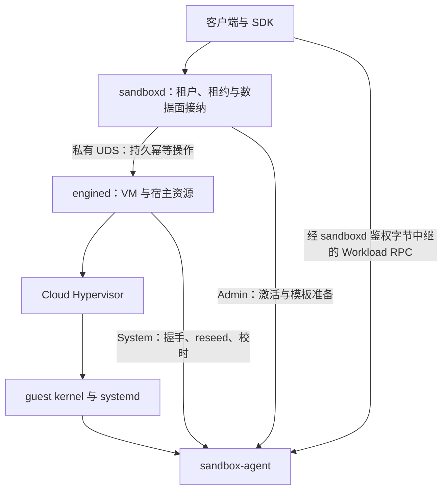

# Engine 架构

engine 是单宿主机 microVM 资源协调者：管理 VM、镜像、磁盘、整机快照与宿主隔离资源。上层 [sandboxd](sandbox-architecture.md) 管理租户、模板、租约和任务接纳；两层分别拥有 SQLite 数据库与单写者锁。

本文解释当前实现的职责、协议与不变量。API 字段和持久步骤见 [Engine 集成契约](engine-integration.md)，镜像语义见 [镜像物化](image-materialization.md)，运行证据见 [验收记录](acceptance.md)。计划及历史验收不定义当前能力，入口见 [文档索引](README.md)。

## 1. 系统边界

| 组件 | 权威范围 | 不负责 |
|---|---|---|
| `engined` | VM/operation、镜像导入、磁盘版本、快照发布、资源引用、VMM 与宿主网络生命周期 | 租户授权、模板选择、TTL、Workload 接纳 |
| Cloud Hypervisor（CH） | 执行 guest、虚拟设备、暂停与机器状态保存/加载 | 跨 SQLite/文件/内核资源的一致性 |
| `sandbox-init` | 在 initramfs 中识别块设备、挂载根并把 PID 1 交给 systemd | 内存恢复后的重新初始化 |
| `sandbox-agent` | System 基础协作、Admin 激活、非特权 Workload RPC | 证明 guest 可信或提供外部事务一致性 |
| 宿主部署 | KVM、权限、持久存储、共享出口防火墙、带宽/包速率及内核资源配额 | 推断未知资源的历史归属 |

调用与就绪边界如下；Workload 数据流不经过 engine 的生命周期 API。

Go 用于宿主控制面，Rust 用于静态 guest agent/init。生产入口使用真实 Linux 后端；替身仅用于明确注入的测试。`references/` 是机制参考，不是构建依赖或本项目契约。

### 后端选择与范围

需要独立 guest kernel 及机器级执行状态，因而采用 microVM，而非仅隔离用户空间的容器。当前只实现 CH；构建精确 revision 由 [版本文件](../deploy/host/cloud-hypervisor-revision) 固定，实际二进制、特性和配置由构建收据核验。升级须重新验证暂停排空、设备捕获、TAP 重绑定和 COW 恢复，不能用版本范围替代兼容性证据。

选择 CH 的关键是内置块设备暂停时排空已接纳 I/O，为磁盘版本捕获提供持续静止窗口；Firecracker v1.17.0 的 vCPU pause 与块设备排空/错误传播不能直接提供同一保证。历史机制依据分别见 [CH Block::pause](https://github.com/cloud-hypervisor/cloud-hypervisor/blob/038ce5a72d761380a02f714a4eb4ca63e0ea073d/virtio-devices/src/block.rs#L1306-L1334) 与 [FC prepare_save](https://github.com/firecracker-microvm/firecracker/blob/v1.17.0/src/vmm/src/devices/virtio/block/virtio/device.rs#L739-L756)；这些源码参考不替代当前固定构建的实际验收。

单机是当前范围。跨宿主迁移、跨 VMM 快照互换、IPv6 direct 网络、设备热插、在线 resize，以及其他内存恢复模式均不属于现有契约。CH 对 COW 二次快照的优化不等于 engine 对外提供增量快照 API。

## 2. 操作、身份与恢复

### 持久操作

operation 是带固定请求、幂等键、执行步骤和终态的持久意图。提交成功只表示接纳，调用方须查询或等待终态。

1. 在对应 VM 锁域中检查前置条件、归属与实际资源。
2. 持久化意图、候选资源和预算，再执行宿主副作用。
3. 核对实际效果，将结果与依赖交接提交到 SQLite。
4. 中断后沿原意图核对，继续可证明的步骤；不确定性保留为阻断与恢复证据。

同键同参数返回原 operation，同键异参冲突；终态成功或失败均不改写。超时或取消只停止调用方等待，不撤销已接纳工作。新意图使用新键，并先处理旧意图可能产生的资源。

| 操作 | 语义与完成边界 |
|---|---|
| `create` | 固定已发布镜像与 shape，准备独立可写盘和默认断网资源，完成到 `created` |
| `start` | 从开机入口启动；实际 VMM 与 System 握手核实后到 `running` |
| `stop` | 关闭接入并停止 VMM；确认退出才到 `stopped`，保留磁盘 |
| `snapshot` | 捕获独立机器状态，恢复源 VM，再持久发布新快照 |
| `restore` | 停止的目标 VM 切换到快照候选资源；保留 VM ID，产生新运行实例 |
| `clone` | 从已发布快照创建新 VM；可变资源独立，不依赖源 VM 仍存在 |
| `delete` / `delete_snapshot` | 先墓碑阻止新使用，再按实际归属与依赖回收 |
| `network_policy` / `network` | 为精确运行实例安装策略与控制接入，见第 5 节 |

phase 只有 `creating`、`created`、`running`、`stopped`，表示最后确认的阶段。诊断还必须读取当前 operation、运行实例、验证状态、agent 状态、网络实际状态及阻断原因；phase 不是实时进程证明。快照中的临时暂停不是长期休眠状态。

### 运行实例与完成证明

VM ID 标识逻辑机器，运行实例标识一次 VMM 执行；daemon 接管同一进程保留实例，新 start/restore 使用新实例。进程身份同时核对 PID、starttime 和资源记录，名称或 PID 本身不能授权信号、接管或删除。

实例条件 `ExpectedInstance` 在 admission 与执行锁内核验。start/restore 可接续**原 operation 自己**已记录的候选，但须完整匹配 operation、VM、候选与实际进程；这不是放宽其他动作的实例条件。

成功 start/restore/clone 的 `result_instance` 是原子完成事务发布的历史实例证明（witness），不是当前状态或删除许可。上层还须核验当前归属与依赖。旧成功 receipt 缺 witness 时保留原响应，不从当前 VM 查询补造历史身份。完成事务检查必要 SQL 写入的实际效果，避免零行更新被当作完成。

具体边界见 [分配结果](engine-integration.md#allocation-results-and-mixed-versions)，实现见 [完成事务](../engine/operation_completion.go#L14)。

### daemon 与恢复

daemon 是唯一写者，直接启动 VMM，通过 pidfd 降低退出检测延迟，以周期 reconcile 兜底。VMM 与 daemon 生命周期解耦；daemon 退出不自动终止 VM。接管核对失败保留现场，不自动重启未知或已丢失内存状态的机器。

SQLite 事务不能回滚进程、挂载或 nftables。元数据丢失、损坏或已知回退时走显式人工恢复；普通启动不新建空库解释遗留资源。一致备份只含元数据与收据，不含 VM 磁盘、镜像或 RAM。恢复确认不重建丢失历史，也不自动授予 GC 权限。DB 与本地 HEAD 一起回退无法在本机可靠检测，操作流程见 [备份与恢复](engine-integration.md#backup-and-explicit-recovery)。

## 3. 存储与启动

### 不可变镜像与独立可写盘

输入是本地 OCI layout 中精确的原生 Linux manifest 摘要；registry 拉取、认证和任意平台选择不在导入契约内。镜像提供 kernel、initramfs、systemd、agent 及启用的 unit，应用由 systemd 启动；OCI `ENTRYPOINT`/`CMD` 不定义整机启动。

| 数据 | 当前表示 | 生命周期 |
|---|---|---|
| 启动材料 | 从最终已验证文件视图提取的 kernel/initramfs | 随镜像不可变发布 |
| 默认只读根 | 每 `diff_id` 的共享 EROFS payload + 镜像级 `fsmeta` 元数据 | 镜像固定完整层序、builder 与设备映射 |
| 显式兼容只读根 | umoci 物化后生成的自包含 EROFS | 独立 profile，不自动替代默认格式 |
| 可写层 | 每 VM 独立 raw 稀疏文件，内部 ext4 | guest OverlayFS 的 upper/work |

`fsmeta` 复用各层数据块而仅生成最终命名空间元数据；相比逐镜像复制完整根，可共享不可变数据。当前仍为有界的外部设备表，不是任意层数的单块设备抽象。两种格式的支持语义、工具要求、层数与元数据上限以 [镜像物化](image-materialization.md) 为唯一详细契约；同摘要发布后格式固定，错误不触发自动 fallback。

宿主以只读绑定、文件权限和 VMM 只读块设备共同保护 lower。guest 按 serial 和设备表顺序识别 lower/data/upper，不依赖 `/dev/vd*` 顺序。`sandbox-init` 挂载 EROFS、ext4 和 OverlayFS，迁移必要挂载并切换根，把 PID 1 交给 systemd。恢复内存状态直接继续原 kernel、挂载与进程，不再执行 initramfs。启动细节见 [Guest 契约](../guest/README.md#kernel-and-block-roles)。

### I/O 与容量

guest 文件修改先按 OverlayFS 规则 copy-up，再写 ext4/virtio-blk/宿主文件。OverlayFS 的文件级 copy-up、宿主 reflink 的块级分离、RAM 的私有映射 COW 是三个不同机制。普通写入完成不等于断电持久化，文件及目录同步必须贯通实际存储路径。

准入使用保守预算而非当前 RSS、稀疏文件物理大小或预计共享收益。VM 后续写入、导入、捕获与恢复均需计入资源；snapshot 在暂停前原子检查空间并预留。失败或未知写入者继续持有责任。预算不能替代宿主配额，也不能排除外部写者或存储故障；精确公式见 [持久化契约](engine-integration.md#snapshot-and-restore-persistence)。

## 4. 快照与恢复协议

### 捕获和发布是两个边界

整机快照关联同一静止窗口中的 RAM、CPU、设备状态和独立磁盘版本。CH 内置 virtio-blk 的 pause 排空为捕获提供静止边界；engine 仍负责独立磁盘、产物持久化和原子发布。vhost-user 等外部设备不由此获得捕获保证。

1. 暂停前预留空间，持久记录捕获目录身份与源 VM 待恢复标记。
2. 暂停 vCPU/设备，核实已接纳 I/O 排空，保存机器状态并建立独立可写盘副本。
3. 独立捕获完成即恢复源 VM；耗时的复制、hash、文件同步与发布放在暂停窗口之后。
4. 将 VMM 可写叶子中的输出复制/reflink 到新的 root 私有 inode；固定 checksum 证明在文件和目录落盘后才提交。
5. 密封产物、原子 rename、同步父目录，最后发布 SQLite 可用引用。

目录描述符固定路径归属，独立 inode 隔离 VMM 保留的写 FD；两者缺一不可。恢复时只验证已持久的完成证明，不对可能损坏的旧字节重新 hash 后赋予发布资格。捕获未证明落盘时，即使目录看似完整也保守失败，恢复源执行并保留材料。状态与失败矩阵见 [捕获持久化](engine-integration.md#snapshot-and-restore-persistence)。

该一致性只覆盖 VM 本地状态。guest 脏页可随 RAM 保存；外部数据库事务、远端副作用及旧网络连接不随快照回滚。

### COW 恢复与依赖交接

基线显式请求 CH `CopyOnWrite`，以 `MAP_PRIVATE` 映射不可变 RAM backing。只接纳已验证的静态私有 RAM/设备配置；拒绝会导致 eager-copy fallback 的布局。恢复前与接管时均核验真实 `/proc/PID/maps` 的完整私有可写范围、设备/inode 和偏移，API 成功不等于 COW 成功。

恢复协议如下：

1. 在同一元数据协议中检查快照已发布且未墓碑，取得临时读取租约。
2. 在目标 operation 私有目录准备 config/state、独立磁盘，以及同文件系统上的 RAM hardlink。
3. 文件、目录及固定身份/摘要证明完成落盘后，原子提交长期 backing 引用与源租约释放。
4. 绑定候选资源、加载状态、核验实际映射，在 guest 恢复执行前收紧 CPU 配额。
5. System 通道完成 ping、内核 reseed 和校时，再提交 `running`；网络仍关闭。

租约保护准备期读取，长期 backing 引用保护运行期缺页。源快照、源 VM 和 clone 可独立删除；删除目录不表示共享 inode 已释放。可写盘不能用 hardlink 作为快照，RAM hardlink 则必须始终不可变。

不完整候选保留源租约、预算和 `restore_blocked` fence；显式 delete 在证明已知实例全部退出后才能回收。失败 operation 的公开结果不因清理成功而改写。完整规则见 [恢复持久化与显式清理](engine-integration.md#snapshot-and-restore-persistence)。

### GC

GC 从镜像目录、VM 当前资源、快照（含墓碑）、在途/未解决操作、租约和 backing 构造可达图。只有证明无引用且归属明确的缓存、已完成工作与退役资源版本才可收集；每次 unlink 前持久记录精确 inode 删除意图，中断后重核可达性。

发布镜像和幂等历史当前持续保留；不按年龄清未知目录，不以 inventory 缺项代替实际不存在。后台删除批次有界不代表恢复扫描已有持久有界队列。算法与阻断原因见 [GC 契约](engine-integration.md#reference-aware-garbage-collection)。

## 5. 网络与宿主隔离

### 固定 guest 地址，独立宿主接入

每 VM 的 VMM、点对点 TAP 和 veth 一端位于同一 network namespace；veth 另一端进入宿主。固定网关直接配置在 TAP，不引入 bridge。

出站路径是 guest → virtio-net/TAP → namespace SNAT 为唯一映射 IP → veth → 宿主出口 NAT；返回按 conntrack 和映射 IP 的 `/32` 路由进入对应 namespace。固定 guest IP/MAC/CID 允许 clone 沿用捕获状态，独立 namespace、映射地址与 UDS 区分宿主身份。宿主主动访问映射地址不自动构成公共入口。

CH 从冷启动即使用稳定设备 ID 的 fd-backed 网卡，恢复经 `SCM_RIGHTS` 重绑目标 TAP，不复用旧 fd 数字。stop/故障关闭接口但保留归属，删除依次撤销集合、路由、veth，最后删除 netns 锚点；失败保留锚点与地址，避免回收后失去重试依据。

### 策略权威

| 层次 | 职责 |
|---|---|
| sandboxd | 选择 `none`/`relay`/`direct`、租户策略、代理与凭据规则 |
| engine | 生命周期与 namespace NAT、宿主动态准入集合、精确实例绑定的 IPv4 CIDR/连接策略安装及核验 |
| 宿主部署 | 常驻共享防火墙、现有 iptables/nft hook 兼容、出口与带宽/包速率/conntrack 分配配额 |
| Linux 内核 | 路由、邻居解析、过滤、conntrack 与 NAT |

`network(true)` 要求实际 verified/agent-ready、当前实例的已提交策略、namespace 归属收据和完整规则核验。策略仅在实际/期望接口均关闭时安装或撤销；新 start/restore/clone 不继承授权。direct 拒绝 hostname 策略及私有/保留/metadata 目标，阻断 IPv6 和 VMM 主动 IP socket；L7 域名与凭据处理属于 relay。

接管和 reconcile 检出策略或规则不匹配时尝试关闭接口，不自动重装策略或开网；不存在管理员篡改瞬间的内核 watcher。接口关闭和策略撤销均不等于清空 conntrack，也不保证旧连接恢复。详见 [Direct 策略契约](network-policy.md)。

### VMM 隔离

VMM 通过 `CLONE_INTO_CGROUP` 自创建进入专属 cgroup v2；限制 CPU、内存、pids 和块 I/O。状态加载期可暂放宽 CPU bandwidth，执行 guest 前必须收紧，其余限制持续生效。

私有 mount namespace 与受限根固定可见路径，只读绑定共享材料；network/PID/IPC/UTS namespace、非 root UID/GID、清空补充组和 capabilities、no-new-privileges 与 CH seccomp 共同约束进程。namespace 本身不构成授权。VMM OOM 表示 VM 已死亡，reconcile 报告并收敛，不自动重启。部署前提见 [宿主部署](../deploy/host/README.md)。

## 6. 跨模块不变量

编号保留为架构评审与历史计划的稳定引用；机制细节以以上对应章节及专项契约为准。

| 编号 | 不变量 |
|---|---|
| I1 | 同 VM 的生命周期、捕获、网络变更和删除共享互斥域 |
| I2 | 持久意图先于宿主副作用，结果以实际效果核对 |
| I3 | phase 是已确认阶段；未确认退出不能报告 stopped |
| I4 | 可写资源独占，共享 lower/快照不可变且受宿主写保护 |
| I5 | 镜像及恢复固定摘要、完整层序、builder 与设备映射 |
| I6 | 捕获点一致；独立副本完成后恢复源，再持久发布 |
| I7 | 文件及目录落盘先于可用引用，恢复不重造缺失完成证明 |
| I8 | 新使用与删除同协议协调，租约/长期引用连续覆盖实际依赖 |
| I9 | 接管与回收核验能区分复用的身份，未知归属保留现场 |
| I10 | 固定 guest 地址先映射再进入宿主共享 conntrack；接入、策略和回收均按归属执行 |
| I11 | clone 的可变宿主资源独立；删除源不破坏受保护 backing |
| I12 | VMM 自创建受资源隔离约束，恢复执行前收紧运行预算 |
| I13 | System 就绪不等于 sandbox 就绪；恢复须完成 reseed/校时 |
| I14 | 幂等请求与终态固定，调用方取消不撤销已接纳操作 |
| I15 | 单 daemon 写者，周期核对兜底，事件只降低延迟 |
| I16 | 迟到结果和实例条件均在当前 operation/运行实例边界核验 |
| I17 | 以保守预算准入；snapshot 拒绝发生在暂停前 |
| I18 | 原键与完整查询可重建关联；查询错误不等于不存在 |
| I19 | daemon 与 VMM 生命周期解耦，重启不连坐销毁机器 |

## 7. 验证边界

行为测试应贯通持久意图、真实文件/SQL 效果与恢复；替身不能证明内核隔离。真实 Rust fixture 验证跨语言传输，required-native 验证镜像工具路径，KVM 验证 guest/COW，kernel-isolation 验证内核规则与限额，production 验证实际 launcher、两 daemon 与完整 sandbox 生命周期。

这些证据互补而非替代。运行命令和材料前提见 [项目入口](../README.md#build-and-local-verification) 与 [测试输入](../scripts/README.md)；历史结果只绑定其源码、材料和宿主条件，见 [验收记录](acceptance.md)。当前不承诺未经基准测量的启动延迟、密度或吞吐 SLO。
