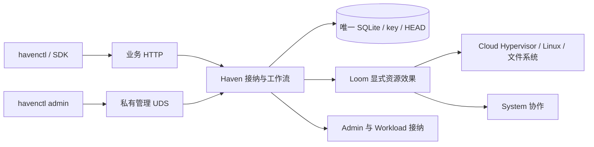
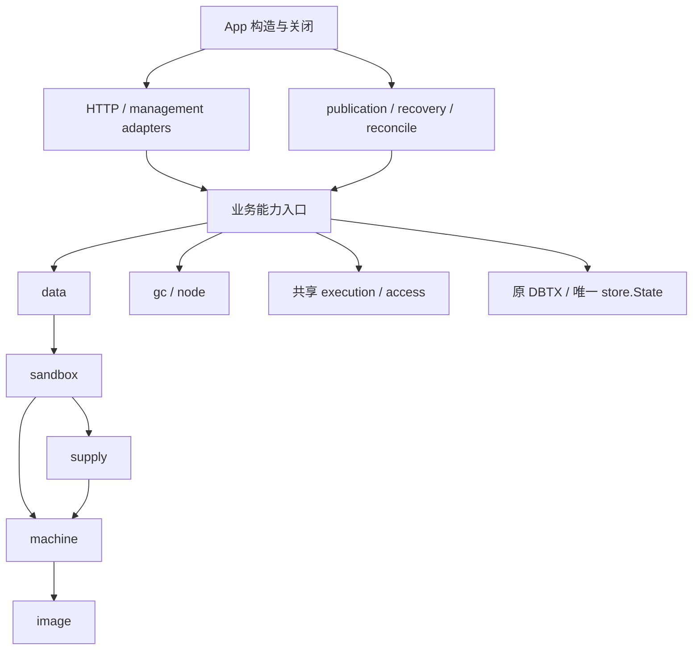
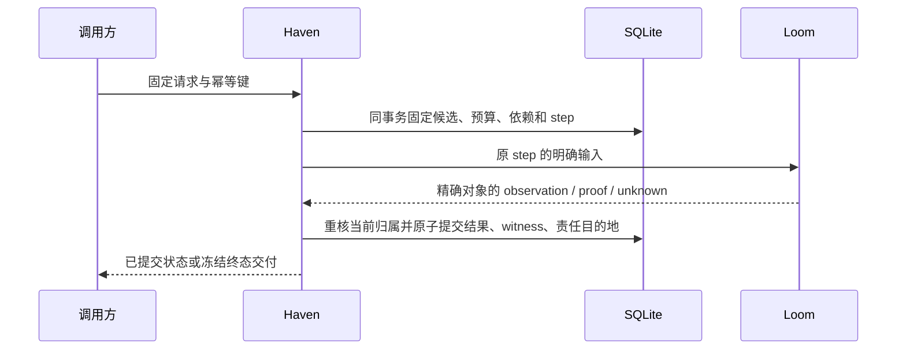

# Haven / Loom 资源架构

Haven 是单宿主唯一持久控制面。`haven/cmd/haven` 同时提供业务 HTTP 与私有管理 UDS；`haven/` 独占一份 SQLite、node key 和 HEAD，统一授权、资源/业务工作流、恢复、配额与 GC。`loom`、`loom/host`、`loom/imageimport` 接收明确资源及冻结证明，执行一次宿主效果并返回现场证据，没有控制数据库、自主重试或恢复循环。

内部职责按业务能力组织，App 只构造组件并管理最终关闭顺序。业务 HTTP 通过 `api.Services` 接收用例，管理 UDS 由 `api/management` 分派节点状态、镜像、GC、供给清理和 operation 查询。两类 controller 的依赖均限于所需用例。

image 拥有镜像导入与 cleanup；machine 拥有 generation、snapshot、capture、物理 policy 和资源回收；supply 拥有模板、pool、build/refill 与供给 cleanup；sandbox 拥有 claim/configuration、activation、lifecycle、warm claim、fork 和 provisioning coordinator。dataplane 保持 live 接纳、连接、lease 与 preview；gc 组合各 owner 的 GC 事实，node 提供管理员节点状态查询与 drain。internal/reconcile 保留固定恢复次序，internal/recovery 在原只读阶段校验冻结记录，internal/publication 在调用方事务内为显式完成的 operation 冻结业务视图。

私有 sqlc 位于 authorization、operation、quota、image、machine、supply、sandbox 和 store。生成行不越过 owner；semantic loader 保留 JSON 解码与历史证明。GC root reader 借用同一 read transaction；跨能力事务参与者不能提交、checkpoint、派发效果或获取额外 workflow lock。`machine.Provisioning.Continue` 从冻结的资源步骤选择 VM，在同一 VM 生命周期内重读意图、推进物理 generation 并调用 sandbox activation。v0 baseline 以整数列保存租户预算。冻结 JSON/hash、NULL owner 以及当前/历史身份的区分保持，见 [machine 契约](../haven/machine/README.md) 和 [store 契约](../haven/store/README.md)。

旧 services、template/pool/vm/snapshot 包及迁移期间的持久 facade 已删除。业务能力直接消费私有 dbgen，operation 只保留公共请求、通用链接头与 publication/recovery 协议。step namespace 与 cleanup ID 前缀区分共享物理表的写入责任；实施和环境验收分别记录在 [027 证据](../plans/evidence/027-capability-map.md)。

`store.State` 独占数据库、writer lock、node key 与 HEAD。各能力构造函数显式接收必需协作者，包括原 guards、Lifetime/Workers、证明与协作端口，运行配置由独立 options 或故障注入参数传入；构造过程只装配这些依赖，不从通用容器查找或回填缺失端口。`execution` 持有关闭接纳、在途计数与 worker 结果，并提供按键互斥。App 为跨服务协议注入同一锁实例，各服务持有其私有工作流的锁。数据登记和 Close 共用服务接纳短锁；`ephemeral.Registry` 唯一持有内存凭据、binding、连接和 daemon epoch。数据最终交接在对应 sandbox 的配置锁下重检，关闭等待原 Lifetime，见 [执行契约](../haven/execution/README.md)。egress factory 只接收绑定到 dataplane.Audits、dataplane.ProxySockets、sandbox.DirectBindings 的四项 `EgressCallbacks`。宿主 Guest port 与真实客户端见 [guest](../haven/guest/README.md)。

controller 不得绕过用例或回指 App，业务层不得手写 SQL、跨领域导入 dbgen 或恢复根兼容 facade。SQLite 维护操作的范围见 [store 契约](../haven/store/README.md)。当前实施证据见 [027](../plans/evidence/027-capability-map.md)，剩余验收见 [未完成索引](../plans/README.md#待完成验收)，实际镜像工具、guest 启动与部署验证各自记录运行结果。

业务 API 与客户端契约见 [Sandbox](sandbox-api.md)，配置、管理和备份见 [Haven control](haven-control.md)，资源步骤、引用和回收见 [集成契约](engine-integration.md)。旧双 daemon 的历史验收单列在 [历史验证记录](verification-history.md)，不作为当前源码的通过证据。源码删除、部署材料更新与实际宿主切换是独立事项。

## 职责与执行边界

| 组件 | 权威与职责 |
|---|---|
| Haven | 接纳与幂等、永久授权来源、operations/steps、候选身份、预算/引用/费用、工作流恢复、GC 资格、最终数据交付 |
| Loom | 明确对象上的 prepare/launch/inspect/stop、capture/copy/hash/fsync/seal、restore COW 验证、network/nft、精确 inode 删除 |
| Cloud Hypervisor | guest 执行、虚拟设备、pause/drain、机器状态保存与加载 |
| sandbox-init | initramfs 内按 serial 挂载 EROFS/ext4/OverlayFS，再将 PID 1 交给 systemd |
| sandbox-agent | System 基础协作、Admin 激活、非特权 Workload RPC；回复不证明 guest 可信 |
| 宿主部署 | KVM 权限、存储/网络硬限额、cgroup parent、可信工具与材料、实际宿主资格验收 |

Go 用于宿主控制，Rust 用于静态 guest。生产入口使用真实 Linux/CH runtime；替身仅在测试中显式注入效果。SDK 与 `havenctl` 不依赖 Haven 控制、Loom 或 SQLite。管理 UDS 的内核 peer credential 是本地管理员身份边界，不是第二套资源 API。

当前仅支持固定 revision 的 CH，版本与 build receipt 见 [宿主部署](../deploy/host/README.md)。选择它依赖内置块设备 pause 排空已接纳 I/O 的能力；vhost-user 外部设备不获得同样捕获保证。更换 revision、格式或隔离限制须另行验证。跨宿主迁移、跨 VMM 快照、IPv6 direct、热插与在线 resize 不在当前范围。

## 持久操作、身份与原子交接

统一顺序为 **持久意图 → 外部效果 → 实际核验 → 原子责任交接**。

operation 的请求、认证 scope、幂等身份与已提交终态固定。资源 step 固定输入 hash、candidate 和 expected instance；同键异参冲突。取消调用方等待不会撤销已接纳意图。未知或部分效果保留候选、费用和依赖，不换新身份掩盖原结果。

VM ID 标识逻辑资源，instance 标识一次 VMM 执行。接管同时核对 PID/starttime/boot/executable/cgroup 与现场 receipt；PID、路径或当前 phase 不能单独授权信号与删除。原成功 step 的非空 witness 与当前归属共同核验，当前查询不能补造缺失历史证明。原失败也不会因 cleanup 成功而改成成功。

公开终态交付在原工作流事务内冻结；operation 查询在一个 SQLite snapshot 中读状态和 publication，不用后来 renew/configure/release 的当前 sandbox 重建历史结果。branch 终态同样固定，fork parent 消费原 branch delivery。

## 锁、事务与生命周期

sandbox 接纳、VM 长期生命周期、artifact 发布和短 SQLite 事务是不同边界。start/stop/capture/restore/network/delete 使用相同 VM 互斥域。多对象锁按稳定类别/ID 排序；长 syscall、guest RPC、hash/copy 与 CH 等待在全局 admission/ownership 短锁外进行。事务中不嵌套获取同连接事务。

副作用和完成核验位于同一生命周期保护内。最终发布短 guard 重核 operation、实例、settings generation、lease 与 fence。所有必要 SQL 写入检查实际影响行数；ABORT、IGNORE、COMMIT 失败均不能交付或退费。删除先建立持久 fence 和原 inode receipt，再执行 unlink/fsync，最后原子退休责任。

Haven 退出先停接纳、撤销连接/代理并等待已接纳数据 setup、HTTP handoff 和 worker 安全收尾，writer lock 最后释放。同步返回等待原 worker 释放 workflow guard 并写完 HEAD。VMM 无 parent-death signal，位于独立 cgroup；daemon Close 不决定其生命周期。重启只接续可信原步骤，不重启未知机器。

## 存储、捕获与恢复

镜像的 OCI 语义、EROFS builder/设备表/限额由 [镜像物化](image-materialization.md) 单独定义。默认 shared layered 和显式 merged 保持独立不可变身份，同 digest 不自动转换。可写盘为独立 inode，guest copy-up、宿主 reflink 和 RAM private COW 是不同机制。

捕获先预留保守预算并记录原实例与 resume-required，再 pause CH、capture 和独立磁盘；独立捕获完成即恢复源。hash/fsync/seal/rename 在暂停窗口之外。root-owned 0711 父目录与 VMM-owned `ch` 叶分离；publication 是新的 root-private inode，保留源 write FD 不能修改它。Captured、Materialized、ArtifactsSynced 和 catalog 发布分别留有持久边界。

restore/clone 固定 source manifest、读取 lease、候选和复制预留。独立可写盘、私有 config/state 与不可变 RAM hardlink 完整持久后，来源 lease 同事务交给长期 backing。运行前及接管核验全部 writable-private RAM 映射的范围、device/inode/offset，不接受 eager fallback。已运行磁盘不能按旧交付 digest 重建。源 snapshot 目录删除不退休仍被 clone backing 持有的 D+M。

停止目标 restore 保留 generation 链、每代盘与 RAM backing，沿用逻辑 VM/slot。release/discard 核验所有已记录旧/当前/候选实例后才触碰设备；unknown sibling 阻断。捕获 raw、failed candidate、已发布 snapshot 与最后 backing 的退休使用各自原意图和删除证明，不由路径消失推导。

## 网络与数据授权

新实例默认 NIC off，不继承 snapshot 网络授权。Haven 持久保存 desired policy、实例绑定和退休责任；Loom 实装/核验 netns、TAP/veth/nft 与 receipt。direct 顺序为 off → policy → Admin/Workload ready → on → final admission。旧 callback 只能退休原 activation/policy/instance，不得撤销后继实例。

System ready 只证明资源协作；业务 running 还要求 Admin 激活、Workload、lease、settings/fence 与代理接纳。`configure` 的持久 fence 在新 settings 保存前撤权；任何失败保持阻断。secret 真值仅内存，重启后需显式重供。数据 setup 和最终 HTTP Hijack 同属服务关闭与配置撤权的连接 registry。详细协议见 [Sandbox 架构](sandbox-architecture.md)、[网络策略](network-policy.md) 和 [Egress](../haven/egress/README.md)。

## 回收、备份和证据

Haven 构造可信根、可达性、回收候选和持久删除责任；Loom 只处理明确候选。未知引用、损坏根、inspection 失败、开放 FD/mapping 和替换 inode 均保留责任。dry-run 不写 epoch、fence 或清理状态。未知文件枚举仅用于诊断，不能从名称或当前内容产生回收资格。

离线备份取得同一 writer lock，将 DB/key/HEAD 作为同一点保存。旧 schema、缺证明或恢复回退在 writable startup/effects 前拒绝。review 只授权元数据诊断，不重放 pending、不恢复数据授权、不补 GC witness；整个 DB 和本地历史一起回退超出本地 HEAD 检测范围。

组件 Service/SQLite、Rust transport、原生 OCI、跨 UID capture、宿主网络与 cgroup 策略、guest 镜像与快照恢复、Haven 生命周期分别提供证据。包的行为测试与实现同目录。`haven/integration/workflows` 使用真实 App/SQLite 和注入的宿主效果验证跨服务场景，带 `guest_image` 标签的 guest 启动与恢复测试位于 `haven/integration`。夹具分层与 Go 测试归属见 [Haven](../haven/README.md#测试归属)。Go 包使用 `-p=1` 串行调度且生命周期场景仍限四个。生产包不得导入任一 fixture 包；HTTP/管理 controller 也不得反向依赖 `internal/application`。host fixture 不证明 guest boot 或 Linux 隔离。当前镜像/测试调整记录在 [归档计划 026](../.agents/archive/026-direct-image-tools-and-tests.md)，VM 缺项见 [计划 024](../plans/024-haven-loom-single-control-design.md)；历史通过不挪用到新树。
