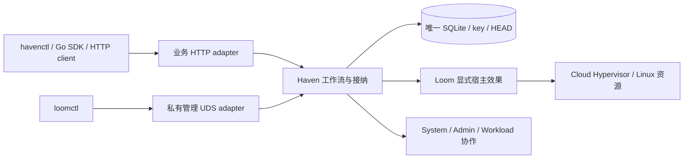

# Haven 启动、协议与管理入口

默认构建产物为 `bin/haven`、`bin/havenctl`、`bin/loomctl`。Haven 同时持有业务与资源控制事实，只有一份 `haven.db`、node key、HEAD 和 writer lock。Loom 执行明确指定的宿主效果，不打开控制数据库。

旧 Go 控制模块、daemon 与 engine UDS facade 已删除；workspace、CI、VM runner 和部署示例使用单 Haven。业务 API 与配额契约见 [Sandbox API](../haven/sandbox/api.md)，代理契约见 [Egress](../haven/egress/README.md)。既有部署没有切换，旧 state 不自动迁移。业务接口称为 Sandbox API，提供模板、租约、分支和配额操作。宿主上的 VM 生命周期由 `runtime-e2e` 单独验证，旧双 daemon 的运行结果见[历史验证记录](verification-history.md)。



## 启动与配置

字段和默认值以 [daemon 配置](../haven/config/daemon.go)、[daemon flags](../haven/cmd/haven/config.go)、[业务 CLI](../sdk/cmd/havenctl/config.go) 和 [Loom CLI 配置](../loom/config/cli.go) 为准。配置文件只接受已声明的平面、连字符 key；YAML、JSON、TOML 均可。优先级为显式 flag → 对应前缀的环境变量 → 显式文件 → 默认值。没有隐式文件发现、热更新或旧品牌变量代理。未知 key、null、非整数预算、溢出及不完整 TLS 配置会拒绝启动。

| 程序 | 环境前缀 | 文件选择 | 示例 |
|---|---|---|---|
| `haven` | `HAVEN_` | `HAVEN_CONFIG` / `--config` | `HAVEN_STATE_DIR`、`HAVEN_LISTEN`、`HAVEN_IO_MAX` |
| `havenctl` | `HAVENCTL_` | `HAVENCTL_CONFIG` / `--config` | `HAVENCTL_ENDPOINT`、`HAVENCTL_TOKEN_FILE` |
| `loomctl` | `LOOMCTL_` | `LOOMCTL_CONFIG` / `--config` | `LOOMCTL_SOCKET`、`LOOMCTL_KEY` |

`ENGINE_`、`SANDBOXD_`、`SANDBOXCTL_` 不参与新入口的配置；`--engine-socket` 等旧 flag 明确拒绝。CLI 配置 flag 放在命令之前，避免解释 guest 命令自己的参数。

daemon 的 `--log-level` 接受 debug/info/warn/error，`--log-format` 接受 text/json，默认 info/text。两者遵循相同配置优先级，日志写 stderr；`common/logging` 只初始化标准 slog handler。CLI flags 的注册与解析分别位于各自 `cmd`，通用文件/env/flag 解码在 `common/config`。

首次启动只对新的空私有 state 目录使用 `--init`：

```nu
haven --state-dir /private/haven-state --socket /private/haven-run/management.sock --listen 127.0.0.1:7777 --root-token-file /private/root.token --init
```

后续启动删除 `--init`。`--root-token-file` 是业务 HTTP 管理员 bearer token 的启动输入：从私有文件读取，trim 后至少 32 字符；该 token 以 root 身份调用业务 API，并通过 `POST /v1/tenants` 创建首个租户。本机管理 socket 不使用该 token，而是按连接 peer UID 鉴权。TLS cert/key 必须成对提供。生产启动固定使用真实 `loom/host.CloudHypervisor` 和 `guest.Client`。`--internal-launch`、`--internal-device-check` 在配置解析和打开数据库之前转入原 launcher/device-check 机制。

默认 state 为 `/var/lib/haven`，管理 socket 为 `/run/haven/management.sock`，HTTP 为 `127.0.0.1:7777`。默认宿主 memory ceiling 为物理 RAM 的 80%，CPU ceiling 为逻辑 CPU 数，存储安全余量为 256 MiB。VMM UID/GID 必须为非零 32 位值；CH receipt、host policy、cgroup 与 I/O 限额继续由真实后端核验。新入口没有降低 VM 或宿主限制。

Haven 先取得 writer lock，再创建管理 listener 或执行恢复。代理 factory 在启动 reconcile 之前绑定 socket ownership、direct retirement 和审计回调。后台维护通过同一服务处理工作流、重绑、租约和 warm refill；GC 使用同一节点管理操作。shutdown 关闭接纳与数据连接，等待已登记的工作及连接建立过程，再关闭代理、后端观察器、数据库和 writer lock；退出不代表删除或终止 VM。

## 业务 HTTP 与 SDK

JSON 类型位于 [types](../types/types.go)，错误 payload 为 `types.ApiError`，定义位于 [types/errors.go](../types/errors.go)，只承载 `code/message` 数据，不实现 `error`、不包装 cause。SDK 将失败响应转换为普通 Go error。Go 客户端为 `github.com/woxQAQ/haven/sdk`。HTTP adapter 位于 [haven/api](../haven/api/http.go)，不拥有 catalog 或独立 operation store。

| 路由 | 用途 |
|---|---|
| `GET/HEAD /healthz` | liveness |
| `GET/HEAD /metrics` | root 指标；保留原指标名 |
| `GET /v1/status` | root 查询同一 store identity、epoch 与 recovery 状态 |
| `POST /v1/tenants`、`POST /v1/node/drain` | root 管理 |
| `GET /v1/sandboxes`、`/v1/templates`、`/v1/checkpoints` | 租户列表 |
| `GET /v1/sandboxes/:id`、`GET /v1/operations/:id` | 对象或操作查询 |
| `POST /v1/sandboxes` | 领取 sandbox |
| `POST /v1/templates`、`POST /v1/templates/:id/build` | 模板登记、模板构建 |
| `POST /v1/sandboxes/:id/{configure,renew,checkpoint,pause,resume,rollback,fork}` | 已有对象的生命周期命令，URL 显式决定动作与目标 |
| `DELETE /v1/sandboxes/:id` | release。可省略 body，或用 `lease_deadline` 指定必须匹配且已到期的租约 |
| `DELETE /v1/checkpoints/:id`、`POST /v1/checkpoints/:id/fork` | 删除 checkpoint binding、从 checkpoint fork |
| `GET /v1/sandboxes/:id/connect` | HTTP/1.1 `sandbox-v1` Upgrade 字节中继 |
| `POST /v1/sandboxes/:id/preview`、`/preview/<capability>/...` | 有 lease 上限的签名 Preview 路径 |

Bearer 鉴权、root 的 `X-Tenant-ID`、未知与 foreign 对象同为 404 的边界保持。sandbox token 只能读取自身对象并提交 renew/release；操作查询只允许自身 renew/release。已终止 token 仅能通过对应操作 GET 读取历史结果，不能重新访问业务或数据面。root fork 通过 `X-Tenant-ID` 指定资源租户；模板 root 发布必须提供显式 target owner。

mutation 使用 1–256 字节稳定 `Idempotency-Key`。同键异参返回 409；取消只结束等待，已接纳工作仍按服务生命周期推进。`Prefer: respond-async` 返回 202、原 operation JSON 与 `Location`；同步请求返回 Result。状态与冻结结果在同一 SQLite 读 snapshot 中查询，避免完成并发被误判为历史缺失。终态视图与工作流终态在同一事务冻结，后续 configure、续租、release 或重启不重新投影旧结果。冻结记录不包含 HTTP 错误 DTO、诊断或 bearer token；HTTP 错误在响应时生成，token 在已授权查询时派生。包含 transport 字段的旧/损坏记录明确拒绝，不在原数据库中自动改写。

HTTP body 上限为 1 MiB，解码拒绝未知字段和多余 JSON 值。业务和本机管理 HTTP 共同选择失败响应的状态、`code` 和公开 `message`。常规分类为 invalid→400、forbidden→403、not_found→404、conflict→409、resource_exhausted→429、incompatible→422、result_unknown/manual_recovery_required→503、internal→500。业务路由 method 不受支持时返回 405/invalid，Upgrade 缺头返回 426/invalid，Preview 上游不可用返回 502/internal。

业务入口在确认公开对象缺失或对当前身份不可见时返回 `ErrNotFound`。内部记录查询遇到未分类的 `sql.ErrNoRows` 只公开 500/internal。服务通过 `errors.Is` 保留原始错误分类。HTTP 边界为每种失败选定公开消息；业务输入校验可通过 `errs.InvalidInput` 显式选择一条固定的纠错提示。包装错误附带的诊断保留在服务内。取消等待与已接纳待恢复都返回 503/result_unknown，消息分别为 `operation wait ended` 与 `accepted operation retained for recovery`。已接纳 operation 的终态失败在同步响应中返回 500，GET operation 返回 200，两者使用同一 `internal/internal service error` payload。

默认新 lease 为 300 秒。暂停中的 checkpoint 复用原 pause receipt 和睡眠 publication，只增加 checkpoint binding，不唤醒或重新捕获。fork 的 count 为 1–32，省略取 1；支持 running/paused sandbox 或 checkpoint。running 来源只捕获一次供整批分支使用。接纳事务固定全部目标与业务 birth identity，并同时预留整批 slot、磁盘及宿主峰值；资源分配事务将整批 forecast 交给每个真实候选后才 dispatch。失败分支使用原 failed intent 的 discard，成功分支使用正常业务 release；父工作流持久链接各清理子操作，核验回收后才完成失败。各分支原激活结果独立冻结，父结果不会被后来续租或配置覆盖。

```nu
havenctl --endpoint http://127.0.0.1:7777 --token-file /private/tenant.token list
havenctl --endpoint http://127.0.0.1:7777 --token-file /private/tenant.token --key claim-001 --request-file /private/claim.json claim
havenctl --endpoint http://127.0.0.1:7777 --token-file /private/tenant.token --key fork-001 --request-file /private/fork.json fork-checkpoint checkpoint_id
havenctl --endpoint http://127.0.0.1:7777 --token-file /private/sandbox.token exec sandbox_id 'printf hello'
```

连接建立后，HTTP Hijack 再核对原 instance、configuration generation、lease、binding 与 activation witness；上下游都登记到同一撤权和 lease registry。Preview 绑定 tenant/sandbox/creation epoch/port/expiry，转发前去除 Authorization/Cookie，并固定 `Referrer-Policy: no-referrer`。guest schema、portal 编号、frame 上限、流式 backpressure、half-close 与 keyed exec 契约不变。

## 本地管理协议

管理 socket 所在目录必须由 daemon UID 控制且不可被 group/other 写入，socket 为 `0600`。HTTP header 不能构造管理身份；server 的 `ConnContext` 使用 Linux `SO_PEERCRED`，只接纳同 daemon UID 或 root。已有 listener 可达或身份不明时拒绝替换；死 socket 的恢复和 Close 都检查原 inode，保留被替换的路径。

管理 adapter 只提供 `GET /v1/status`、`POST /v1/manage`、`GET /v1/operations/:id`。请求类型见 [management DTO](../types/management.go)；操作属于稳定 store identity 的 node scope，不出现在 tenant operation scope。业务与管理的 status 可核对同一个 store ID/epoch。

`loomctl` 只依赖配置、DTO 和 UDS HTTP 客户端，不能依赖 Haven 控制实现、Loom 或 SQLite。支持 `status`、`operation ID`、`import`、`gc`、`supply-cleanup`、`image-cleanup`、`request`。除只读 GC 外必须显式提供稳定 key；`request` 使用 `--request-file FILE` 显式读取一个管理 intent，不读取 stdin。业务 `tenant`、`claim`、`template`、`change ID`、`fork-checkpoint ID` 也使用此 flag；文件必须是普通文件，严格 JSON 上限 1 MiB，拒绝未知字段和多个值。

```nu
loomctl --socket /private/haven-run/management.sock status
loomctl --socket /private/haven-run/management.sock --dry-run gc
loomctl --socket /private/haven-run/management.sock --key gc-001 gc
loomctl --socket /private/haven-run/management.sock --key import-001 --oci-layout /private/oci --digest 'sha256:<manifest-digest>' import
loomctl --socket /private/haven-run/management.sock --key cleanup-001 --source-operation original_operation_id supply-cleanup
```

GC dry-run 不接纳 operation、不改变 epoch。import/cleanup/GC 的持久意图、冻结材料、删除证明和费用均仍由 Haven 工作流处理。`loom/unixsocket` 使用已打开父目录上的 descriptor path 执行 bind/dial，支持长物理 runtime 路径；绑定身份和 teardown 仍使用原 canonical path/inode，不将临时 descriptor path 当作持久归属。

## 统一离线备份与恢复

备份使用正常 writer lock，运行中的 Haven 会拒绝第二个 writer。备份目录只包含一个 SQLite snapshot、`node.key`、`store.json`、匹配的 `HEAD.json` 与 checksum receipt，不包含镜像数据、VM 磁盘或 RAM。

```nu
haven --state-dir /private/haven-state --mode backup --backup /private/new-metadata-backup
haven --state-dir /private/new-recovery-state --mode restore-backup --backup /private/new-metadata-backup
haven --state-dir /private/new-recovery-state --mode recover --recovery-note 'Reviewed private metadata against separately retained resource evidence'
haven --state-dir /private/new-recovery-state --mode doctor
```

restore 只写新目录，先建立 `RECOVERY_REQUIRED`。review 验证备份组件未变并记录人工说明；它只解除 metadata 打开 gate，不授予重放、接管、数据面或 GC 权限。`doctor` 在独占锁下核验 metadata，不创建 runtime 或启动工作流；它没有承诺只读文件系统打开或有界恢复扫描。017/020/021 仍暂停。

Haven 发布前的 store schema 版本固定为 **0**，表结构直接维护在同一份 baseline SQL 中。空库在 writer lock 下原子写入 schema、application ID、store identity 和 Goose 的零号记录，随后执行 checkpoint/HEAD 协议。正常 reopen 先在只读阶段核验数据库与节点身份。详见 [store 契约](../haven/store/README.md)。

## 验证范围

`just integration` 显式使用 `integration` build tag 和刚构建的 Rust Unix fixture；缺少 fixture 环境是 FAIL。fixture 仅替代 VM/System/Admin 效果，并离线预置私有不可变输入镜像；不插入操作、成功结果、witness 或费用记录。所有接纳、终态、权限与资源责任使用真实 Haven/SQLite，Workload RPC 使用真实 Rust dispatcher。原四项 transport 断言保留，另测 HTTP 契约和长 runtime 路径。

`just smoke` 只启动一个真实 Haven，验证两个 CLI、配置优先级/更名拒绝、writer 排他、重启幂等、GC dry-run 的 epoch 和同一份离线 backup。它不启动 VM。当前源码的命令、结果与未运行项见 [计划 024](../plans/024-haven-loom-single-control-design.md)；[阶段 E 证据](../plans/evidence/024-stage-e-entrypoints.md) 只绑定 E 完成树。
