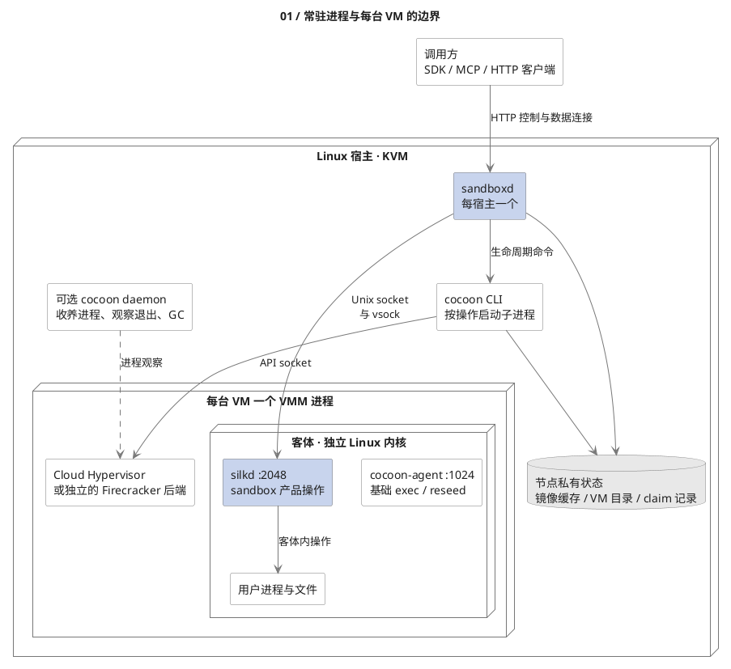
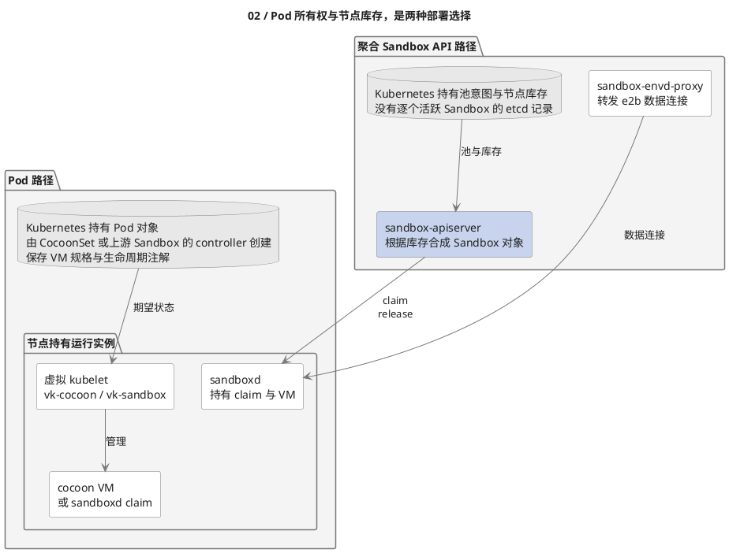
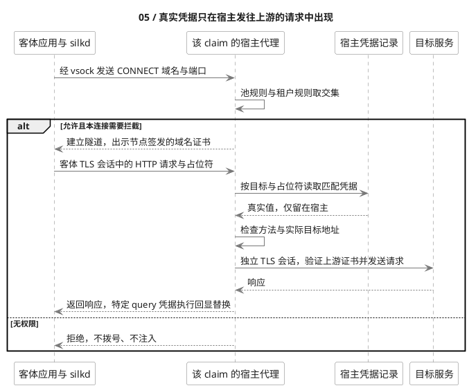
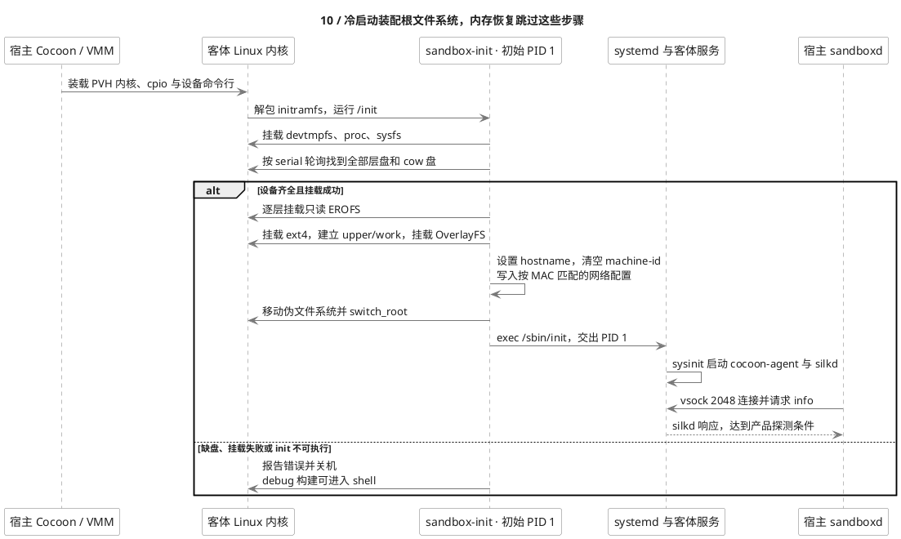

# Cocoonstack 深入剖析

Cocoonstack 有两条相互连接、但职责不同的主线。Cocoon 管一台 VM 的进程、设备、磁盘和快照；sandboxd 在这些 VM 之上管理热池、租约、租户、出站代理和检查点。Kubernetes 组件提供另一套入口，不是运行本地 VM 的必需条件。

最容易混淆的是网络和镜像。普通 Cocoon VM 可以拥有可路由的网卡，sandboxd 的受控出站却主要通过 vsock。OCI 在这里是 VM 引导材料和文件系统层的分发格式，不意味着把普通容器镜像直接当作 microVM 启动。

参考版本为 Cocoon `b3b40f3`、sandbox `421e475`、Cloud Hypervisor fork `a02b114bd`，以及同目录的 cocoon-agent、cocoon-common、cocoon-net、两个 operator 和 cocoon-macos。各仓库独立发布，不能把相邻 checkout 当成已经锁定的一套发布组合。例如 cocoon-macos 依赖 Cocoon v0.7.0，cocoon-operator 依赖 cocoon-common v0.3.7。

## 1. 部署架构

### 1.1 组件不都部署成服务

| 组件 | 部署位置与生命周期 | 实际职责 |
|---|---|---|
| cocoon | Linux 宿主上的 CLI，可选常驻 daemon | 创建、启动、停止、克隆 VM，组织网络、磁盘、元数据和 GC |
| Cloud Hypervisor | 每台 VM 一个宿主进程，默认后端 | KVM vCPU、RAM、virtio 设备、暂停、捕获和恢复 |
| Firecracker | 每台 VM 一个宿主进程，可选后端 | OCI VM 的另一套设备与快照实现，不与 CH 快照通用 |
| cocoon-agent | 客体内的服务 | vsock 1024 上的基础 exec、标准流转发和 Linux reseed |
| sandboxd | 每个宿主一个常驻服务 | 热池、claim、租约、模板、检查点、HTTP 数据转发、出站策略 |
| silkd | sandbox 客体内的 Rust 服务 | vsock 2048 上的 exec、PTY、文件、会话、git、端口转发和 LSP |
| cocoon-net | 可选的节点服务，另有一次性 init/adopt | 云 IP 池、DHCPv4、宿主路由和部分网络隔离 |
| cocoon-operator | Kubernetes 控制面 Deployment | 调谐 CocoonSet 与 CocoonHibernation，管理 Pod 意图与状态 |
| sandbox-operator | Kubernetes 聚合 API、热池控制器、envd 代理等进程 | 将节点 sandboxd 的资源映射为 Sandbox API，也提供 e2b 兼容入口 |
| cocoon-common | 编译进消费者的 Go 库 | CRD、Pod 注解、OCI 快照格式与传输，不是单独 daemon |
| cocoon-macos | Linux/KVM 宿主上的另一套 CLI | 用 QEMU、OpenCore、OVMF 运行 x86 macOS 客体 |

### 1.2 单机部署的进程边界

图 1 的嵌套表示部署位置。CLI 退出不等于 VM 停止；常驻的是每台 VM 的 VMM。sandboxd 调用 cocoon 子进程管理生命周期，数据流则直接连接该 VM 的 Unix/vsock 通道，不让每次 exec 都经过一次 CLI。



cocoon daemon 是可选的观察者，不是所有命令必须经过的中央调度器。sandboxd 可订阅它的退出事件，否则依靠轮询发现 VMM 退出。Cocoon 的新状态根默认使用 SQLite，旧 JSON 状态根有单独的保留与转换逻辑。sandboxd 的 claim、池配置和租户状态又是另一层，不能把这些存储统称为一个数据库。

客体同时安装 cocoon-agent 和 silkd 并不重复。前者是 VM 管理协议，后者是 sandbox 产品协议。它们监听不同的 vsock 端口，具有不同的操作集合和就绪语义。

### 1.3 Kubernetes 有两种资源模型

图 2 对比的是资源归属，不是两个连续的处理步骤。左边将 VM 生命周期放在 Pod 路径上；右边直接把节点库存合成为 Sandbox 对象。右边没有为每个活跃 sandbox 创建一份 etcd Sandbox 记录。



Pod 路径也能来自上游 agent-sandbox controller。它把 Sandbox 的 pod template 原样交给调度器，模板作者必须写对节点选择、toleration 和 provider 注解。虚拟节点不运行 CRI，`runtimeClassName` 不是选择 Cocoon 后端的开关。普通 kubelet 路径则仍然是普通 Pod，隔离方式由其 RuntimeClass 决定。

聚合 API 路径通过 APIService 接管对应 Sandbox API 版本，不能同时把同一资源版本按普通 CRD/controller 路径部署。它按节点库存选取热容量，实际 claim 仍由 sandboxd 决定。库存可能滞后，选中的节点没有交付资源时会尝试其他候选；这不是把缓存中的数字当作预留。

`vk-cocoon`、`vk-sandbox` 和 admission webhook 属于外围组件，当前参考目录没有它们的源码。这里可以确定 operator 写什么意图、等待什么状态，也能确定聚合 API 如何调用 sandboxd，不能把 provider 内部动作补写成已经实现的本地代码。

### 1.4 多节点不复制活跃 VM

sandboxd 的 memberlist mesh 传播节点地址、热池容量和模板位置，客户端收到重定向后连接拥有该 claim 的节点。gossip 不是 RAM 复制，也不是租约共识数据库。节点失联不会让另一台节点接管其活跃进程。

可选 PostgreSQL 共享的是租户集合，以及指定 cell 的池配置。它不保存运行中 VM 的 RAM，也不把所有 claim 变成跨节点可恢复的数据库记录。跨节点的持久内容来自检查点或模板存储。

控制面默认是内部 HTTP。反向代理、客户端到每个节点的 TLS 可达性、预览域名，是部署层需要配置的独立关系，不能只保护入口节点而忽略重定向目标。

## 2. 网络架构

### 2.1 普通 VM 的 CNI 数据面

Cocoon 没有在 VMM 旁放一个解析 TCP、DNS 和 UDP 的用户态通用网络栈。客体内核产生以太网帧，virtio-net 和 TAP 交付给宿主内核，CNI 决定其余网络拓扑。

图 3 把 IP 所在位置画出来。CNI 先配置 namespace 内的 veth；Cocoon 读取地址、MAC 和 MTU，再移除 veth 自身的地址，把地址配置交给客体。TC 在 TAP 与 veth 之间双向重定向帧。这里省掉的是 namespace 内额外的一座桥，不是保证宿主和 CNI 后端完全没有 bridge。

```vega
{
  "$schema":"https://vega.github.io/schema/vega/v6.json",
  "width":1000,"height":590,"padding":16,
  "data":[
    {"name":"zones","values":[
      {"x":20,"y":112,"w":270,"h":345,"fill":"#ffffff"},
      {"x":315,"y":112,"w":315,"h":345,"fill":"#e8e8e8"},
      {"x":655,"y":112,"w":325,"h":345,"fill":"#ffffff"}
    ]},
    {"name":"devices","values":[
      {"x":60,"y":264,"w":190,"h":70,"label":"virtio-net\n客体 MAC 与 IP"},
      {"x":355,"y":264,"w":100,"h":70,"label":"TAP"},
      {"x":500,"y":264,"w":95,"h":70,"label":"veth"},
      {"x":700,"y":264,"w":220,"h":70,"label":"veth 对端\nCNI bridge / 路由后端"}
    ]},
    {"name":"labels","values":[
      {"x":16,"y":16,"t":"03 / IP 属于客体，TC 搬运的是以太网帧","s":24,"b":"bold"},
      {"x":40,"y":134,"t":"客体网络 namespace","s":18,"b":"bold"},
      {"x":335,"y":134,"t":"宿主内的每 VM netns","s":18,"b":"bold"},
      {"x":675,"y":134,"t":"宿主根 netns / CNI 后端","s":18,"b":"bold"},
      {"x":60,"y":194,"t":"TCP / UDP / ICMP / DNS\n由客体协议栈处理","s":16,"b":"normal"},
      {"x":355,"y":194,"t":"VMM 进程在此 namespace\n打开 TAP 队列","s":16,"b":"normal"},
      {"x":700,"y":194,"t":"转发、路由、NAT\n取决于 CNI 与宿主配置","s":16,"b":"normal"},
      {"x":380,"y":360,"t":"TC ingress 双向重定向","s":16,"b":"normal"},
      {"x":355,"y":398,"t":"veth 不保留客体 IP\nMAC 与 MTU 传递给客体","s":15,"b":"normal"},
      {"x":60,"y":370,"t":"连接状态仍在客体内核\n不是宿主 TCP 代理","s":15,"b":"normal"},
      {"x":700,"y":370,"t":"CNI 插件可另设隔离规则\n不能由 TAP 自动推导策略","s":15,"b":"normal"},
      {"x":30,"y":501,"t":"直接 bridge 模式会跳过中间的 netns / veth / TC，宿主 TAP 直接加入已有桥。","s":17,"b":"normal"},
      {"x":30,"y":543,"t":"CH 按启动 vCPU 配置多队列；Firecracker 使用单队列对。图中连线为数据链路。","s":15,"b":"normal"}
    ]}
  ],
  "marks":[
    {"type":"rect","encode":{"enter":{"width":{"signal":"width"},"height":{"signal":"height"},"fill":{"value":"#f4f4f4"}}}},
    {"type":"rect","from":{"data":"zones"},"encode":{"enter":{"x":{"field":"x"},"y":{"field":"y"},"width":{"field":"w"},"height":{"field":"h"},"fill":{"field":"fill"},"stroke":{"value":"#787878"}}}},
    {"type":"rule","encode":{"enter":{"x":{"value":250},"x2":{"value":920},"y":{"value":299},"stroke":{"value":"#0043ce"},"strokeWidth":{"value":3}}}},
    {"type":"rect","from":{"data":"devices"},"encode":{"enter":{"x":{"field":"x"},"y":{"field":"y"},"width":{"field":"w"},"height":{"field":"h"},"fill":{"value":"#c8d4ed"},"stroke":{"value":"#003bb5"}}}},
    {"type":"text","from":{"data":"devices"},"encode":{"enter":{"x":{"signal":"datum.x+datum.w/2"},"y":{"field":"y","offset":22},"align":{"value":"center"},"text":{"field":"label"},"lineBreak":{"value":"\n"},"lineHeight":{"value":23},"fontSize":{"value":15},"fill":{"value":"#1e1e1e"}}}},
    {"type":"text","from":{"data":"labels"},"encode":{"enter":{"x":{"field":"x"},"y":{"field":"y"},"text":{"field":"t"},"baseline":{"value":"top"},"lineBreak":{"value":"\n"},"lineHeight":{"value":25},"fontSize":{"field":"s"},"fontWeight":{"field":"b"},"fill":{"value":"#1e1e1e"}}}}
  ]
}
```

普通 CNI 路径记录第一个 IPv4 地址与网关，不能把它描述为已经完整管理双栈地址。默认 DNS 配置提供 `8.8.8.8` 与 `1.1.1.1`，可覆盖，直接启动的 `ip=` 参数携带前两个地址。DNS 请求本身仍是客体发出的网络流量，不存在 Cocoon 自动拦截所有 53 端口请求的规则。

MAC 传递是为了匹配 CNI 的反欺骗规则，MTU 传递是为了让 TAP、veth、客体与实际出口一致。它们不同于安全策略。TC 的匹配是全协议帧重定向，不承担域名白名单或 TLS 解密。

### 2.2 cocoon-net 给谁分配地址

cocoon-net 解决的是云 VPC 地址如何进入 VM，而非给 sandboxd 的代理增加 DNS 功能。

- 云侧 init/adopt 确认节点拥有的 alias IP 段或 ENI secondary IP，写入本地池状态。
- 节点 daemon 配置 cni0、转发、MTU、CNI conflist，并在 cni0 上提供 DHCPv4。
- DHCP offer 暂占地址，request 成功后保存 MAC/IP 租约。分配路径先安装 `/32` 宿主路由，再交付租约。
- 租约释放或到期时撤掉对应路由。控制 socket 还允许节点管理器按 MAC 回收已销毁 VM 的地址。

生成的 CNI 配置不做 IPAM 分配，地址由客体 DHCP 获取。`portIsolation` 阻断同一 bridge 上 VM 端口之间的二层转发，`macspoofchk` 固定源 MAC。跨节点流量经过宿主三层转发，另由 `drop-cidr` 控制。

这两种隔离不能互相替代。访问节点自身地址走 INPUT，不经过 FORWARD，所以 `drop-cidr` 不能顺带保护节点上的 kubelet 或其他监听服务。默认 setup 还安装子网出站 MASQUERADE；“VPC 可路由、没有端口 DNAT”不等于“没有任何 NAT”。

### 2.3 sandboxd 的受控出站不走网卡

`net=none` 的含义是没有虚拟 NIC，不是客体完全不能与宿主交换数据。它仍有 virtio-vsock，silkd 在客体回环地址提供 HTTP 和 SOCKS 入口，再把字节送到宿主按 claim 创建的代理。

图 4 展示同一台受控 sandbox 的两种出站尝试。允许的连接穿过 vsock；绕过代理的原始 IP 包在 bridge 模式下遇到 TAP ingress 限制。none 模式则连这张 NIC 都没有。

```vega
{
  "$schema":"https://vega.github.io/schema/vega/v6.json",
  "width":1000,"height":645,"padding":16,
  "data":[
    {"name":"boxes","values":[
      {"x":25,"y":115,"w":405,"h":420,"fill":"#ffffff"},
      {"x":475,"y":115,"w":500,"h":420,"fill":"#ffffff"},
      {"x":60,"y":220,"w":280,"h":82,"fill":"#c8d4ed"},
      {"x":560,"y":220,"w":345,"h":82,"fill":"#c8d4ed"},
      {"x":60,"y":395,"w":230,"h":60,"fill":"#e8e8e8"}
    ]},
    {"name":"labels","values":[
      {"x":16,"y":16,"t":"04 / 有网卡，也不能绕过受控出站","s":24,"b":"bold"},
      {"x":16,"y":60,"t":"适用于 none 与受保护的 bridge egress；普通 CNI direct 是另一种部署。","s":15,"b":"normal"},
      {"x":45,"y":137,"t":"客体","s":19,"b":"bold"},
      {"x":495,"y":137,"t":"宿主 sandboxd","s":19,"b":"bold"},
      {"x":80,"y":237,"t":"silkd 回环代理\nHTTP :3128 / SOCKS5 :1080","s":16,"b":"normal"},
      {"x":580,"y":237,"t":"每 claim 独立的代理 socket\n规则交集 / 地址检查 / 凭据注入","s":16,"b":"normal"},
      {"x":346,"y":320,"t":"vsock 2049 / 2050\n不需要客体 IP 或 DNS","s":15,"b":"normal"},
      {"x":80,"y":415,"t":"绕过代理的 TCP / UDP / ICMP","s":14,"b":"normal"},
      {"x":560,"y":374,"t":"TAP ingress 上的 nftables 限制","s":17,"b":"bold"},
      {"x":560,"y":447,"t":"只例外放行 IPv4 广播 DHCP\n没有通用 UDP、ICMP 或 QUIC 出口","s":16,"b":"normal"},
      {"x":45,"y":496,"t":"none 模式：不创建 NIC","s":16,"b":"normal"},
      {"x":30,"y":574,"t":"蓝线接宿主网络连接；虚线尝试走客体 NIC，在交付 claim 前被锁住。","s":17,"b":"normal"},
      {"x":30,"y":610,"t":"warm / golden 阶段尚未执行租户代码；这些 bridge VM 在 claim 前并不持有该锁。","s":15,"b":"normal"}
    ]}
  ],
  "marks":[
    {"type":"rect","encode":{"enter":{"width":{"signal":"width"},"height":{"signal":"height"},"fill":{"value":"#f4f4f4"}}}},
    {"type":"rect","from":{"data":"boxes"},"encode":{"enter":{"x":{"field":"x"},"y":{"field":"y"},"width":{"field":"w"},"height":{"field":"h"},"fill":{"field":"fill"},"stroke":{"value":"#787878"}}}},
    {"type":"rule","encode":{"enter":{"x":{"value":340},"x2":{"value":560},"y":{"value":260},"stroke":{"value":"#0043ce"},"strokeWidth":{"value":4}}}},
    {"type":"rule","encode":{"enter":{"x":{"value":290},"x2":{"value":760},"y":{"value":425},"stroke":{"value":"#787878"},"strokeDash":{"value":[6,5]},"strokeWidth":{"value":2}}}},
    {"type":"path","encode":{"enter":{"path":{"value":"M 530,409 L 562,441 M 562,409 L 530,441"},"stroke":{"value":"#750e13"},"strokeWidth":{"value":4}}}},
    {"type":"text","from":{"data":"labels"},"encode":{"enter":{"x":{"field":"x"},"y":{"field":"y"},"text":{"field":"t"},"baseline":{"value":"top"},"lineBreak":{"value":"\n"},"lineHeight":{"value":25},"fontSize":{"field":"s"},"fontWeight":{"field":"b"},"fill":{"value":"#1e1e1e"}}}}
  ]
}
```

HTTP 入口监听客体 `127.0.0.1:3128`，经宿主 CID 2 的 vsock 2049 接到该 VM 的专用 Unix socket。SOCKS5 使用客体 1080 和 vsock 2050。claim 身份来自宿主选择的 socket 路径，不靠客体提交一个可伪造的租户字段。

bridge egress 的锁在宿主根 netns 中安装，默认丢弃 TAP 上客体发出的帧。例外仅匹配 IPv4、UDP 源端口 68、目标端口 67、目标地址广播。它按报文头而非 DHCP payload 判断，因此不能让该桥与不可信的二层监听者共享广播域。

CNI 模式的 TAP 位于每 VM netns，根 netns 的这套锁不能直接控制它。配置将受控 egress policy 与 CNI `networks` 的组合拒绝掉。未走受控 bridge 的 CNI direct 模式仍可存在，不能把所有 `net=egress` 都宣传成相同的代理隔离。

### 2.4 各协议实际经过哪里

| 协议或请求 | 普通 Cocoon / CNI direct | sandboxd 受控出站 |
|---|---|---|
| DNS UDP/TCP 53 | 客体 resolver 发普通网络包，交给宿主路由 | HTTP 代理和 SOCKS 域名目标由宿主解析，不提供通用客体 DNS 转发 |
| 普通 TCP | 客体 TCP 状态通过 TAP 连外部 | HTTP CONNECT 或启用的 SOCKS5 CONNECT，宿主建立独立 TCP 连接 |
| 明文 HTTP | 普通 TCP | forward proxy 按域名、端口、方法检查 |
| HTTPS | 客体 TLS 端到端 | CONNECT 字节隧道，或对指定域名终止 TLS 并检查内部 HTTP |
| 非 HTTP 的 TLS | 普通 TCP/TLS | 可走不拦截的 TCP 隧道；不能套用 HTTP MITM |
| UDP | virtio-net/TAP/CNI 正常承载，受部署策略限制 | SOCKS5 不支持 UDP ASSOCIATE，没有通用 UDP relay |
| QUIC / HTTP/3 | 与其他 UDP 一样取决于网络配置 | 没有 UDP 出口，也没有 QUIC 解密能力 |
| ICMP | 由客体与宿主网络栈处理 | 没有 ping 代理；bridge NIC 锁也不放行普通 echo |
| ARP / IPv6 ND | 普通二层路径 | 不是 TAP 锁的允许项 |
| DHCP | CNI IPAM 或客体 DHCP，取决于网络方案 | bridge 锁仅留 IPv4 广播 DHCP 例外 |
| vsock | 独立的宿主与客体通道 | 产品 RPC、受控出站、客体端口转发均可使用 |

这里不需要 Microsandbox 式的 DNS 名称到 IP 绑定缓存。代理已经拿到 HTTP CONNECT authority 或 SOCKS DOMAINNAME，宿主负责解析目标；地址检查放在实际拨号处，避免把域名许可自动变成私网访问许可。

直连时，拨号器在 socket 建立前检查解析后的具体地址。经上游代理时，宿主先选择并检查目标 IP，再把 IP 交给 HTTP CONNECT 或 SOCKS5 上游，不把目标域名留给外部代理重新解析。特许的内部服务直接连接；上游失败不回退直连。

地址限制覆盖 loopback、私网、链路本地、CGN 和多种保留区间，并识别标准 NAT64 等 IPv4 嵌入形式。`egress_internal_allow` 可以按 CIDR 与端口重新允许内部服务，但不会跳过域名规则。它也无法推断运营者自定义 NAT64 前缀中的 IPv4 含义。

### 2.5 TLS 与密钥的实际边界

有效策略是池规则与租户 egress class 的交集，二者都允许才可通过。`intercept=true` 始终拦截指定目标；`intercept="inject"` 仅在该 claim 对目标持有可注入凭据时拦截。SOCKS5 不负责 HTTP 注入，强制 HTTP 拦截的规则不能借 SOCKS 隧道绕过。

图 5 保留时序图，因为这里需要区分两次 TLS 握手和密钥出现的时刻。客体始终不持有节点 CA 私钥，也不会因为一次 claim 自动获得真实凭据。



PKI 分成离线集群根 CA 与每节点 intermediate CA。客体镜像或 golden 内安装的是根证书，节点只持有自己的 intermediate 私钥，给域名签发 leaf。更换同根的 intermediate 不需要重建客体；换根则会影响已经捕获进 RAM/磁盘的信任库，旧 claim、checkpoint 和 promoted template 不会自动刷新。

拦截当前只协商 HTTP/1.1。证书固定、非 HTTP TLS 与 HTTP/2-only 服务不能据此假定可用。解密后的请求固定发向 CONNECT 目标，内部 Host 不匹配时会重写，不能让一次 CONNECT 转为访问任意新 authority。

凭据可来自节点环境，也可来自 claim 的 `guest:false` 环境记录。后者保存在节点的私有 claim journal，不进入客体环境文件或快照。`guest:true` 值则可能留在客体进程内存中，fork 后不会因新 claim 的环境配置而从旧进程里消失。

query 凭据支持对本次响应中若干原样、URL 编码和路径编码形式做回显替换。它不是信息流追踪：上游变换过的值、先保存后通过另一请求返回的值，都超出这个替换范围。header 凭据也没有同等响应 scrub。宿主注入不能被理解为任意上游都无法把秘密泄露回客体。

### 2.6 入站与预览不依赖客体公网 IP

SDK 的 exec/files/session 等操作经 sandboxd 的 HTTP upgrade 转成到 silkd 的字节流。客体端口转发也是由 silkd 在客体内部连接端口，再经 vsock 返给宿主。预览服务使用签名 URL 和 claim 租约约束，并可转发到拥有该 claim 的其他节点。

因此，一个无 NIC 的 sandbox 仍可运行 Web 服务并被预览。它获得的是宿主代转的某个客体端口，不是一张可接收任意公网报文的网络接口。e2b 的 envd proxy 是另一种协议入口，不能与 silkd 的 JSON 帧协议混用。

## 3. 镜像与运行磁盘

### 3.1 OCI 镜像必须携带引导材料

Cocoon 拉取 OCI VM image 后逐层读取未压缩 tar，同时将其送给 `mkfs.erofs` 并寻找 `/boot` 或根目录中的 kernel/initrd 文件。普通容器镜像没有这两类文件会被拒绝。

当前 registry layer 缓存按 OCI layer 的 descriptor digest 命名，不是按 `diff_id`。这与前一份 Microsandbox 分析中的缓存键不同。EROFS 转换使用 lz4hc、4 KiB cluster、固定时间戳和由 digest 派生的 UUID；缓存文件是转换结果，文件名中的 digest 仍代表输入层身份。

镜像记录还保存 manifest digest、有序层列表、kernel 所在层和 initrd 所在层。启动前从宿主缓存取出 kernel/initrd，不需要先启动客体再读取它自己的 `/boot`。

### 3.2 每个 EROFS 层都是一块独立设备

图 6 将三个文件的来源沿层展开。与 Microsandbox 合成一个 EROFS lower 的设计不同，Cocoon 把每个 OCI 层分别接成只读 virtio-blk 盘，由 initramfs 挂载为多个 lower。可写盘是另一个 ext4 raw 文件。

<div class="cc-disk" style="max-width: 1040px; box-sizing: border-box; position: relative;">
  <style>
    .cc-disk { background: #f4f4f4; color: #1e1e1e; }
    .cc-disk svg { display: block; width: 100%; height: auto; }
    .cc-disk text { fill: #1e1e1e; font-size: 16px; }
    .cc-disk .cc-disk-title { font-size: 24px; font-weight: 700; }
    .cc-disk .cc-disk-small { font-size: 13px; }
    .cc-disk .cc-disk-muted { fill: #565656; font-size: 14px; }
    .cc-disk .cc-disk-guide { fill: none; stroke: #787878; stroke-width: 2; stroke-dasharray: 4 5; }
  </style>
  <svg viewBox="0 0 1040 800" role="img" aria-labelledby="cc-disk-title cc-disk-desc">
    <title id="cc-disk-title">多个 EROFS lower 与私有 ext4 upper 的展开剖面</title>
    <desc id="cc-disk-desc">客体按从上到下的优先级找到文件内容。每个只读层对应独立宿主 EROFS 文件和 virtio-blk 设备，可写 upper 来自该 VM 的 cow.raw。</desc>
    <defs>
      <g id="cc-disk-slab">
        <path d="M 45,35 L 610,35 L 665,0 L 100,0 Z" fill="#ffffff" stroke="#787878"/>
        <path d="M 45,35 L 610,35 L 610,48 L 45,48 Z M 610,35 L 665,0 L 665,13 L 610,48 Z" fill="#e8e8e8" stroke="#787878"/>
      </g>
    </defs>
    <text x="24" y="38" class="cc-disk-title">06 / 客体自己叠加 OCI 层，宿主不合成一个 lower</text>
    <text x="24" y="72" class="cc-disk-muted">示例文件按列对齐；连线止于优先级最高的可见内容。每个存储文件的容量不按比例绘制。</text>
    <text x="50" y="118">客体 · OverlayFS 文件名空间</text>
    <text x="760" y="118">宿主 · 独立文件</text>
    <path d="M 720,138 L 720,675" stroke="#787878" stroke-dasharray="6 5"/>
    <use href="#cc-disk-slab" transform="translate(0 160)"/>
    <use href="#cc-disk-slab" transform="translate(0 290)"/>
    <use href="#cc-disk-slab" transform="translate(0 420)"/>
    <use href="#cc-disk-slab" transform="translate(0 550)"/>
    <path d="M 125,190 L 240,190 L 270,170 L 155,170 Z M 305,190 L 420,190 L 450,170 L 335,170 Z" fill="#e8e8e8" stroke="#787878"/>
    <path d="M 485,190 L 600,190 L 630,170 L 515,170 Z" fill="#c8d4ed" stroke="#003bb5"/>
    <text x="195" y="185" text-anchor="middle" class="cc-disk-small">基础库</text>
    <text x="375" y="185" text-anchor="middle" class="cc-disk-small">应用新版本</text>
    <text x="555" y="185" text-anchor="middle" class="cc-disk-small">用户修改的配置</text>
    <text x="60" y="232" class="cc-disk-small">/ · 合并后的可见根</text>
    <path d="M 125,320 L 240,320 L 270,300 L 155,300 Z M 305,320 L 420,320 L 450,300 L 335,300 Z" fill="#f4f4f4" stroke="#787878" stroke-dasharray="3 4"/>
    <path d="M 485,320 L 600,320 L 630,300 L 515,300 Z" fill="#c8d4ed" stroke="#003bb5"/>
    <text x="555" y="315" text-anchor="middle" class="cc-disk-small">配置 · 新内容</text>
    <text x="60" y="362" class="cc-disk-small">ext4 upper / work · 当前实例可写</text>
    <path d="M 125,450 L 240,450 L 270,430 L 155,430 Z" fill="#f4f4f4" stroke="#787878" stroke-dasharray="3 4"/>
    <path d="M 305,450 L 420,450 L 450,430 L 335,430 Z" fill="#e8e8e8" stroke="#787878"/>
    <text x="375" y="445" text-anchor="middle" class="cc-disk-small">应用新版本</text>
    <text x="60" y="492" class="cc-disk-small">较新的 OCI 层 · EROFS lower · 优先读取</text>
    <path d="M 125,580 L 240,580 L 270,560 L 155,560 Z M 305,580 L 420,580 L 450,560 L 335,560 Z M 485,580 L 600,580 L 630,560 L 515,560 Z" fill="#e8e8e8" stroke="#787878"/>
    <text x="195" y="575" text-anchor="middle" class="cc-disk-small">基础库</text>
    <text x="375" y="575" text-anchor="middle" class="cc-disk-small">应用旧版本</text>
    <text x="555" y="575" text-anchor="middle" class="cc-disk-small">镜像默认配置</text>
    <text x="60" y="622" class="cc-disk-small">基础 OCI 层 · EROFS lower · 最低优先级</text>
    <path d="M 195,208 L 195,300 M 195,338 L 195,430 M 195,468 L 195,560 M 375,208 L 375,300 M 375,338 L 375,430" class="cc-disk-guide"/>
    <path d="M 555,208 L 555,300" fill="none" stroke="#0043ce" stroke-width="2.5"/>
    <circle cx="195" cy="560" r="5" fill="#787878"/>
    <circle cx="375" cy="430" r="5" fill="#787878"/>
    <circle cx="555" cy="300" r="5" fill="#0043ce"/>
    <path d="M 665,310 L 760,310 M 665,440 L 760,440 M 665,570 L 760,570" stroke="#787878"/>
    <path d="M 760,277 L 970,277 L 990,297 L 990,346 L 760,346 Z" fill="#c8d4ed" stroke="#003bb5"/>
    <path d="M 760,407 L 970,407 L 990,427 L 990,476 L 760,476 Z M 760,537 L 970,537 L 990,557 L 990,606 L 760,606 Z" fill="#ffffff" stroke="#787878"/>
    <text x="780" y="303">cow.raw · 该 VM 私有</text>
    <text x="780" y="330" class="cc-disk-small">稀疏 raw，内部格式为 ext4</text>
    <text x="780" y="434">更新层.erofs</text>
    <text x="780" y="460" class="cc-disk-small">独立只读块设备</text>
    <text x="780" y="564">基础层.erofs</text>
    <text x="780" y="590" class="cc-disk-small">多个 VM 共享这一文件</text>
    <text x="758" y="666" class="cc-disk-muted">设备由 serial 识别</text>
    <text x="758" y="690" class="cc-disk-muted">不依赖固定 /dev/vdX 顺序</text>
    <text x="30" y="735">这里没有 VMDK 区段拼接，也没有为 OCI upper 自动增加 qcow2 历史层。</text>
    <text x="30" y="771" class="cc-disk-muted">快照复制 cow.raw 的文件内容；宿主文件系统支持 reflink 时，复制可以共享底层 extent。</text>
  </svg>
</div>

客体收到的 `cocoon.layers` 已按 OverlayFS lowerdir 优先级排列，较新的层在前。init 为每层建立挂载点，再使用 ext4 盘里的 `upper/` 与 `work/` 组装根。文件修改触发客体 OverlayFS copy-up；删除通过上层删除语义遮蔽下层，不修改共享 EROFS。

每个 OCI 层都增加一个设备和挂载工作。sandbox 的 `base` 保留分层构建形式，`rt` 则把 base squash 为单层运行镜像。两者的区别不是单纯标签，运行时 lower 数量和引导装配成本也不同。

### 3.3 三种写时复制不能混为一谈

1. 客体 OverlayFS 按文件名合并只读镜像和私有修改。
2. 宿主 reflink 让两个 raw 文件的独立 inode 暂时共享物理 extent，任意一方写入后分离。
3. cloud image 的 qcow2 overlay 按块查找 backing image，属于另一条镜像路径。

Cocoon 的 OCI 可写根是 ext4 格式的稀疏 raw 文件。snapshot/clone 优先尝试 reflink，文件系统不支持时退回 sparse copy。因此快照文件逻辑上是独立完整的盘，不是每次捕获都追加一个必须向祖先逐层查找的 qcow2 链。

cloud image 则先准备 qcow2 base，再为 VM 创建指向它的 qcow2 overlay。Linux cloud image 还有 cloud-init 的 cidata，负责主机名、网络和数据盘初始化；Windows 不套用这份 Linux cidata 逻辑。

### 3.4 存储由谁持有

| 内容 | 归属与共享方式 |
|---|---|
| OCI EROFS 层、提取的 kernel/initrd | Cocoon 镜像缓存，按镜像与 VM 引用维持依赖 |
| OCI cow.raw | 每 VM 私有；快照复制时可通过 reflink 共享 extent |
| cloud image qcow2 base | 共享不可变输入，实例 overlay 仍依赖它 |
| 运行目录中的控制 socket、console、vsock | 单台 VM 的宿主运行对象，不属于客体文件系统 |
| 内存快照文件 | 捕获时固定，mmap 克隆的干净页可共享宿主页缓存 |
| golden 导出目录 | sandboxd 的热池种子，绑定模板、网络模式和资源档位 |
| checkpoint / promoted template | sandboxd store 的记录，可落本地目录、共享挂载或 S3 |
| dataset volume | operator 配置的外部磁盘，不归普通根盘快照隐式接管 |

dataset 的只读模式保护共享内容完整性，不提供保密性；读者仍可能经获准的代理出口发送数据。可写 dataset 需要写者排他与卸载处理，内容能跨 claim 留存。当前 sandboxd 对挂载了 dataset 的实例拒绝 fork、checkpoint、promote 和 hibernate，不能把外部磁盘误当成已经封装进快照。

## 4. Snapshot 的制作、保存与恢复

### 4.1 同一个词对应不同层的产物

| 名称 | 保存什么 | 谁管理 |
|---|---|---|
| Cocoon snapshot | VMM 内存、执行与设备状态，可写盘，VM 构造信息 | Cocoon 本地快照存储 |
| golden | 已完成启动、服务就绪、可选 warmup 的 VM 快照导出 | sandboxd 的一个池 |
| checkpoint | 某个 sandbox 的可分支捕获，加产品元数据 | sandboxd checkpoint store |
| promoted template | 将捕获发布为可命名、可复用的模板 | sandboxd template/store |
| hibernate snapshot | 暂停点与停止点一致的恢复材料 | Cocoon 捕获，sandboxd 保留 claim |
| archive | 已把恢复材料放入 store，并删除本地 VM 的 claim 状态 | sandboxd 生命周期 |
| OCI snapshot artifact | Cocoon 导出文件的 OCI 分发表示 | cocoon-common 传输库及其消费者 |
| macOS snapshot | 停机后的 qcow2 内部磁盘快照 | cocoon-macos / qemu-img |

checkpoint 不等于 OCI image，archive 不等于正在运行的 VM 换了节点。它们分别增加持久化、分发或身份管理语义，底层材料仍来自具体 hypervisor。

### 4.2 暂停窗口里到底做什么

Cloud Hypervisor 捕获先检查设备，当前不接受带 vhost-user-fs、VFIO 或热附加盘的 Cocoon 快照。普通创建时声明的数据盘与后来热插入的盘不能混淆，前者属于受管理的捕获集合。

存在 balloon 时，Cocoon 先让运行中的客体完成一轮 inflation，避免捕获一个尚在改变内存占用的状态。随后暂停 VM，调用 CH snapshot 保存 RAM、设备和执行状态，并在暂停期间复制 cow 及受管理数据盘。磁盘复制并行进行，优先 reflink，不支持时就必须真的读写数据。

图 7 对齐普通 snapshot 和 hibernate 的客体运行状态。长度只表示逻辑阶段，不代表测得的耗时。关键差别是普通捕获完成后客体可以继续运行，hibernate 必须在同一个暂停窗口内完成持久化，然后终止 VMM。

```vega
{
  "$schema":"https://vega.github.io/schema/vega/v6.json",
  "width":1000,"height":500,"padding":16,
  "data":[
    {"name":"bands","values":[
      {"x":190,"y":170,"w":80,"h":58,"fill":"#ffffff","text":"运行"},
      {"x":270,"y":170,"w":285,"h":58,"fill":"#c8d4ed","text":"暂停 · 捕获内存与磁盘"},
      {"x":555,"y":170,"w":405,"h":58,"fill":"#ffffff","text":"已经恢复运行"},
      {"x":190,"y":330,"w":80,"h":58,"fill":"#ffffff","text":"运行"},
      {"x":270,"y":330,"w":285,"h":58,"fill":"#c8d4ed","text":"暂停 · 捕获内存与磁盘"},
      {"x":555,"y":330,"w":210,"h":58,"fill":"#c8d4ed","text":"仍暂停 · 持久化"},
      {"x":765,"y":330,"w":195,"h":58,"fill":"#e8e8e8","text":"VMM 已停止"}
    ]},
    {"name":"lines","values":[{"x":270},{"x":555},{"x":765}]},
    {"name":"labels","values":[
      {"x":16,"y":16,"t":"07 / Hibernate 不能拆成先 snapshot、再 stop","s":24,"b":"bold"},
      {"x":16,"y":61,"t":"两种操作的逻辑阶段对照，横向距离不代表持续时间。","s":15,"b":"normal"},
      {"x":248,"y":112,"t":"暂停","s":15,"b":"bold"},
      {"x":510,"y":112,"t":"捕获完成","s":15,"b":"bold"},
      {"x":720,"y":112,"t":"持久化完成","s":15,"b":"bold"},
      {"x":25,"y":184,"t":"普通 snapshot","s":17,"b":"bold"},
      {"x":25,"y":344,"t":"hibernate","s":17,"b":"bold"},
      {"x":566,"y":249,"t":"补齐元信息并发布快照\n客体的新写入不属于这个暂停点","s":15,"b":"normal"},
      {"x":280,"y":414,"t":"捕获或持久化失败：尝试恢复客体运行，不把失败捕获当作成功休眠。","s":15,"b":"normal"},
      {"x":25,"y":466,"t":"快照冻结的是 VM 状态；数据库事务、外部服务和对端 TCP 状态不随它一起冻结。","s":16,"b":"normal"}
    ]}
  ],
  "marks":[
    {"type":"rect","encode":{"enter":{"width":{"signal":"width"},"height":{"signal":"height"},"fill":{"value":"#f4f4f4"}}}},
    {"type":"rule","from":{"data":"lines"},"encode":{"enter":{"x":{"field":"x"},"y":{"value":140},"y2":{"value":395},"stroke":{"value":"#787878"},"strokeDash":{"value":[3,5]}}}},
    {"type":"rect","from":{"data":"bands"},"encode":{"enter":{"x":{"field":"x"},"y":{"field":"y"},"width":{"field":"w"},"height":{"field":"h"},"fill":{"field":"fill"},"stroke":{"value":"#787878"}}}},
    {"type":"text","from":{"data":"bands"},"encode":{"enter":{"x":{"signal":"datum.x+datum.w/2"},"y":{"field":"y","offset":34},"align":{"value":"center"},"text":{"field":"text"},"fontSize":{"value":16},"fill":{"value":"#1e1e1e"}}}},
    {"type":"text","from":{"data":"labels"},"encode":{"enter":{"x":{"field":"x"},"y":{"field":"y"},"text":{"field":"t"},"baseline":{"value":"top"},"lineBreak":{"value":"\n"},"lineHeight":{"value":24},"fontSize":{"field":"s"},"fontWeight":{"field":"b"},"fill":{"value":"#1e1e1e"}}}}
  ]
}
```

CH 产物包含 `config.json`、`state.json`、`memory-range-*`，Cocoon 增补记录磁盘角色与引导参数的 `cocoon.json`。Firecracker 使用自己的 `vmstate` 与 `mem`，不能把 CH 的配置改个路径就交给它恢复。

本地快照存储先建立构建记录，再接纳目录或 tar，完成文件同步后发布终态。同文件系统可把捕获目录移动进 store；跨文件系统会改走流式路径。snapshot save 的快照发布与 VM 继续运行并不冲突，因为复制得到的磁盘和内存已固定在暂停点。

这个过程没有向业务数据库发起应用级事务提交，也没有协调外部队列、远端文件系统或已经发出的 HTTP 请求。恢复后某个进程仍在内存里，不代表外部操作可以安全重放。

### 4.3 mmap 共享的是干净内存页

CH 的普通私有 RAM 快照默认可用 mmap CoW 恢复。不同克隆映射同一份不可变内存文件，读到相同的宿主页缓存页；写入时由宿主为该克隆产生私有页。

图 8 只画三个示意页。克隆甲写了页 1，克隆乙写了页 2，因此这两个位置不能继续共享。其余位置仍引用同一份基底，不必在创建 VM 时复制整块 RAM。

```vega
{
  "$schema":"https://vega.github.io/schema/vega/v6.json",
  "width":1000,"height":610,"padding":16,
  "data":[
    {"name":"pages","values":[
      {"x":55,"y":180,"w":205,"h":65,"t":"页 0 · 读基底","fill":"#ffffff"},
      {"x":55,"y":285,"w":205,"h":65,"t":"页 1 · 甲的新内容","fill":"#c8d4ed"},
      {"x":55,"y":390,"w":205,"h":65,"t":"页 2 · 读基底","fill":"#ffffff"},
      {"x":392,"y":180,"w":216,"h":65,"t":"页 0 · 捕获内容","fill":"#e8e8e8"},
      {"x":392,"y":285,"w":216,"h":65,"t":"页 1 · 捕获内容","fill":"#e8e8e8"},
      {"x":392,"y":390,"w":216,"h":65,"t":"页 2 · 捕获内容","fill":"#e8e8e8"},
      {"x":740,"y":180,"w":205,"h":65,"t":"页 0 · 读基底","fill":"#ffffff"},
      {"x":740,"y":285,"w":205,"h":65,"t":"页 1 · 读基底","fill":"#ffffff"},
      {"x":740,"y":390,"w":205,"h":65,"t":"页 2 · 乙的新内容","fill":"#c8d4ed"}
    ]},
    {"name":"links","values":[{"x":260,"x2":392,"y":212},{"x":608,"x2":740,"y":212},{"x":608,"x2":740,"y":317},{"x":260,"x2":392,"y":422}]},
    {"name":"labels","values":[
      {"x":16,"y":16,"t":"08 / 同一份捕获内存，不同克隆只保留自己的修改","s":23,"b":"bold"},
      {"x":16,"y":62,"t":"示意页，不代表实际页数或内存占比。连线表示仍共享基底页，蓝色为私有写入。","s":15,"b":"normal"},
      {"x":92,"y":127,"t":"克隆甲的 RAM","s":19,"b":"bold"},
      {"x":380,"y":127,"t":"不可变内存文件与页缓存","s":18,"b":"bold"},
      {"x":777,"y":127,"t":"克隆乙的 RAM","s":19,"b":"bold"},
      {"x":55,"y":501,"t":"各自的运行目录保存内存文件链接\n同文件系统优先 hard link，跨文件系统可退为 symlink","s":16,"b":"normal"},
      {"x":55,"y":562,"t":"删除目录项不等于修改 inode；截断或原地改写基底会破坏仍在使用它的映射。","s":16,"b":"normal"}
    ]}
  ],
  "marks":[
    {"type":"rect","encode":{"enter":{"width":{"signal":"width"},"height":{"signal":"height"},"fill":{"value":"#f4f4f4"}}}},
    {"type":"rect","encode":{"enter":{"x":{"value":368},"y":{"value":158},"width":{"value":264},"height":{"value":320},"fill":{"value":"#ffffff"},"stroke":{"value":"#787878"}}}},
    {"type":"rule","from":{"data":"links"},"encode":{"enter":{"x":{"field":"x"},"x2":{"field":"x2"},"y":{"field":"y"},"stroke":{"value":"#787878"},"strokeWidth":{"value":2}}}},
    {"type":"rect","from":{"data":"pages"},"encode":{"enter":{"x":{"field":"x"},"y":{"field":"y"},"width":{"field":"w"},"height":{"field":"h"},"fill":{"field":"fill"},"stroke":{"value":"#787878"}}}},
    {"type":"text","from":{"data":"pages"},"encode":{"enter":{"x":{"signal":"datum.x+datum.w/2"},"y":{"field":"y","offset":38},"align":{"value":"center"},"text":{"field":"t"},"fontSize":{"value":16},"fill":{"value":"#1e1e1e"}}}},
    {"type":"text","from":{"data":"labels"},"encode":{"enter":{"x":{"field":"x"},"y":{"field":"y"},"text":{"field":"t"},"baseline":{"value":"top"},"lineBreak":{"value":"\n"},"lineHeight":{"value":26},"fontSize":{"field":"s"},"fontWeight":{"field":"b"},"fill":{"value":"#1e1e1e"}}}}
  ]
}
```

Cocoon 在克隆目录中给内存文件建立 hard link，跨文件系统链接失败时使用 symlink；磁盘走 reflink/sparse copy；小型配置文件普通复制。三类文件分别处理，不能把“克隆没有复制 RAM”推成“克隆没有复制任何文件”。

创建期间的共享读租约防止 snapshot rm/GC 删除正在被 clone、restore、export 使用的源。mmap 的生命周期更长，整个 VM 存活期间都依赖所映射的 inode 内容不变。同文件系统 hard link 保护目录项删除后的 inode 存活，symlink 不具备相同的独立路径保留能力。

`copy` 模式预先装载全部 RAM。`ondemand` 使用 userfaultfd，缺页时把内容送入客体内存。`mmap` 直接让干净页保持文件后备。hugepages、shared RAM 以及 CH 不支持的内存/设备组合会导致 mmap 回退或拒绝，不能只依据 CLI 选项判断最终映射形式。

参考 CH fork 还优化了对 mmap 恢复 VM 的再次捕获：在支持 reflink 的同文件系统上，先复制原内存文件的 extent，再写入已经变化的页。新内存文件仍是完整可恢复的快照，不要求恢复者遍历内存增量链；不能 reflink 时写出全部内存。

### 4.4 Clone 与原地 restore 的身份不同

clone 创建新 VM、新运行目录和网络归属。CH 先用临时 TAP 接住恢复设备状态，在恢复与 resume 之间替换 NIC，然后恢复执行。新的客体 MAC 不会自动改掉 RAM 里的旧 IP 配置，普通 Cocoon clone 仍会给出客体重配网络的步骤。

原地 restore 保留目标 VM 的网络身份，但从快照重建 VMM。它要求同一 base image lineage、兼容的设备布局和 NIC 数量。CPU、内存与存储大小来自快照，不是恢复时任意可调的参数。

Firecracker MMIO 快照更严格地固定 NIC 拓扑，网络 override 主要改宿主绑定，不能自动改掉保存的 guest MAC。PCI 模式有另一组热插入能力。Firecracker 的目标网络 MTU也需要与捕获值相容，不能把 CH 换 NIC 的行为直接套过来。

恢复之后还有两种独立的随机数处理：

- CH fork 提供 VM Generation ID 设备，恢复时改变值。客体必须有相应驱动和可用的 ACPI 发现路径，才能触发内核 reseed。
- Cocoon CLI 还通过 cocoon-agent 发送宿主生成的熵。clone 可重建 machine-id，原地 restore 保留机器身份。

CLI 这条 reseed 默认在 resume 后异步启动，失败记录告警，不是阻止 clone 返回的确认屏障。sandboxd 等待 silkd 可用，也不等于验证 cocoon-agent 已完成 reseed。用户态自己保存的 PRNG、业务 ID、会话令牌和外部租约，更不会被内核 reseed 自动替换。

### 4.5 为什么 egress claim 不允许恢复捕获状态

sandboxd 只能在 cocoon 返回 VM 后安装宿主 TAP 限制。底层 restore 在返回前已经 resume 客体，这两者之间存在尚未重新锁住 NIC 的时间窗口。对已经包含租户进程的捕获状态，窗口内就可能发出不经过代理的报文。

因此当前产品直接拒绝 egress claim 的 hibernate、fork、checkpoint、promote 和 archive。none 模式没有 NIC，不存在这条绕过路径，仍可通过 vsock 恢复代理。

这并不禁止用 golden 补充 egress 热池。golden/warm 阶段运行的是受信任镜像服务，未交付租户执行；claim 在返回前才安装锁。它依赖的是不同的执行阶段，而不是恢复中的 TAP 已经安全。

### 4.6 检查点的发布点是 metadata

sandboxd 先从 Cocoon 取得捕获材料并导出，再写产品元数据。目录 store 和 S3 store 都把每次发布放在独立代次下，最后让 `meta.json` 指向新代次。

图 9 将提交前后放在同一视角。新内存文件已经上传，并不意味着新 checkpoint 已经可见。读者依据 metadata 选定一代，不能自行拼接“最新的 RAM”和“最新的磁盘”。

```vega
{
  "$schema":"https://vega.github.io/schema/vega/v6.json",
  "width":1000,"height":565,"padding":16,
  "data":[
    {"name":"folders","values":[
      {"x":45,"y":280,"w":190,"h":155,"fill":"#c8d4ed","title":"旧代甲 · 当前可见","body":"RAM\n磁盘\n设备与 VM 配置"},
      {"x":265,"y":280,"w":190,"h":155,"fill":"#ffffff","title":"新代乙 · 未发布","body":"RAM 已到\n磁盘上传中\n配置未齐"},
      {"x":545,"y":280,"w":190,"h":155,"fill":"#e8e8e8","title":"旧代甲 · 暂时保留","body":"已选择它的读者\n仍使用整份旧代\n不混用新文件"},
      {"x":765,"y":280,"w":190,"h":155,"fill":"#c8d4ed","title":"新代乙 · 当前可见","body":"RAM 完整\n磁盘完整\n设备与 VM 配置完整"}
    ]},
    {"name":"meta","values":[{"x":125,"y":160,"t":"meta.json 指向甲"},{"x":625,"y":160,"t":"meta.json 指向乙"}]},
    {"name":"labels","values":[
      {"x":16,"y":16,"t":"09 / 文件先就位，metadata 最后切换","s":24,"b":"bold"},
      {"x":16,"y":61,"t":"同一条记录的两个时刻；甲、乙表示不同发布代次，不是两个不同 checkpoint。","s":15,"b":"normal"},
      {"x":45,"y":113,"t":"提交之前","s":20,"b":"bold"},
      {"x":545,"y":113,"t":"提交之后","s":20,"b":"bold"},
      {"x":45,"y":475,"t":"上传失败时读者继续看到甲\n未提交的乙只是未完成材料","s":16,"b":"normal"},
      {"x":545,"y":475,"t":"新读者选乙，旧读者仍可能持有甲\n保留旧代是为了允许读者完成","s":16,"b":"normal"}
    ]}
  ],
  "marks":[
    {"type":"rect","encode":{"enter":{"width":{"signal":"width"},"height":{"signal":"height"},"fill":{"value":"#f4f4f4"}}}},
    {"type":"rule","encode":{"enter":{"x":{"value":500},"y":{"value":100},"y2":{"value":535},"stroke":{"value":"#787878"},"strokeDash":{"value":[4,5]}}}},
    {"type":"path","encode":{"enter":{"path":{"value":"M 235,215 L 235,245 L 140,245 L 140,280 M 735,215 L 735,245 L 860,245 L 860,280"},"stroke":{"value":"#0043ce"},"strokeWidth":{"value":3}}}},
    {"type":"rect","from":{"data":"meta"},"encode":{"enter":{"x":{"field":"x"},"y":{"field":"y"},"width":{"value":220},"height":{"value":55},"fill":{"value":"#ffffff"},"stroke":{"value":"#003bb5"}}}},
    {"type":"text","from":{"data":"meta"},"encode":{"enter":{"x":{"field":"x","offset":18},"y":{"field":"y","offset":33},"text":{"field":"t"},"fontSize":{"value":17},"fill":{"value":"#1e1e1e"}}}},
    {"type":"rect","from":{"data":"folders"},"encode":{"enter":{"x":{"field":"x"},"y":{"field":"y"},"width":{"field":"w"},"height":{"field":"h"},"fill":{"field":"fill"},"stroke":{"value":"#787878"}}}},
    {"type":"rect","from":{"data":"folders"},"encode":{"enter":{"x":{"field":"x"},"y":{"field":"y","offset":-10},"width":{"value":65},"height":{"value":10},"fill":{"field":"fill"},"stroke":{"value":"#787878"}}}},
    {"type":"text","from":{"data":"folders"},"encode":{"enter":{"x":{"field":"x","offset":12},"y":{"field":"y","offset":28},"text":{"field":"title"},"fontSize":{"value":16},"fontWeight":{"value":"bold"},"fill":{"value":"#1e1e1e"}}}},
    {"type":"text","from":{"data":"folders"},"encode":{"enter":{"x":{"field":"x","offset":15},"y":{"field":"y","offset":65},"text":{"field":"body"},"lineBreak":{"value":"\n"},"lineHeight":{"value":27},"fontSize":{"value":15},"fill":{"value":"#1e1e1e"}}}},
    {"type":"text","from":{"data":"labels"},"encode":{"enter":{"x":{"field":"x"},"y":{"field":"y"},"text":{"field":"t"},"baseline":{"value":"top"},"lineBreak":{"value":"\n"},"lineHeight":{"value":25},"fontSize":{"field":"s"},"fontWeight":{"field":"b"},"fill":{"value":"#1e1e1e"}}}}
  ]
}
```

目录后端先安装完整代次目录，再通过 rename 切换 metadata。旧代在宽限期和后续 sweep 之后回收。S3 后端先上传该代文件，最后上传 metadata；旧代对象保留到 Delete，本地下载缓存另有闲置清理。

这里保证的是发布可见性的顺序，不应把每次 rename 都等同于断电持久性。Cocoon 本地快照明确同步数据；sandboxd claim journal 的每次 fsync 则由 `sync_claims` 控制，默认未开启。目录 checkpoint 的发布代码也不能仅凭原子 rename 推导出同等级的断电承诺。

共享 store 不要求每次读写做跨节点文件锁，但同一模板名仍要求单写者。显式删除可能让尚未完成取数的读者失败，旧代宽限不是无条件的删除屏障。

### 4.7 跨节点搬迁仍依赖基础镜像

Cocoon export 保存 RAM、可写盘和配置，不自动把所有共享 EROFS base 都装入包。目标机器必须具有相同基础镜像与可用路径。`--pull` 按捕获记录的 digest 拉取 OCI 镜像，避免同名 tag 变化后恢复到另一套文件。

tar 可选 gzip，稀疏文件使用 Cocoon 自己的 PAX 记录保存空洞。随意用普通 tar 工具重新打包会丢掉这些语义。快照 envelope 还列出预期文件，导入不仅检查 tar 能否读到 EOF，也检查文件集合是否完整。

cocoon-common 另外提供 OCI snapshot artifact。v1 以文件为 blob，v2 可按固定大小分块并使用 zstd，config 保存文件与 chunk 顺序。上传在所有 blob 与 config 成功后才发布 manifest，下载验证 media type 和大小，再重组 Cocoon 导入流。

这条 OCI registry 路径服务于其消费者，不是 sandboxd 的 S3 store 自动套用的格式。cocoon-operator 在 hibernate 时写 Pod 意图，等待匹配代次的节点生命周期状态，再确认 registry 中的快照 manifest；真正执行节点捕获与上传的是外围 provider。

共享 checkpoint store 或 peer heal 可以把捕获材料送到新节点，但不能修复不同 CPU/设备状态格式、缺失的 base image、错误的宿主绝对路径或不可重建的外部连接。

## 5. 系统引导

### 5.1 通用 Cocoon 与 sandbox 镜像使用不同 initramfs

Cocoon 的 OCI 引导契约是 kernel、initrd、层设备、可写盘和命令行。内核与 initramfs 的具体内容由 VM image 提供。通用 Ubuntu/Debian 镜像带发行版用户空间与 overlay 引导脚本，sandbox 镜像则替换成自己的精简 boot artifact。

sandbox boot 当前固定 Linux `6.18.37`。x86_64 产物虽然叫 `vmlinuz-sandbox`，内容是未压缩的 PVH ELF vmlinux；arm64 使用 flat Image。initramfs 是未压缩 cpio，默认 userland 只有静态 Rust `sandbox-init`，BusyBox shell 只进入 debug 构建。

驱动直接编入内核，运行时不加载内核模块。这样避免了 initramfs 解压、模块发现和 udev 等待链，但最终根仍可以使用 systemd、udev 和普通发行版服务。

### 5.2 从空白客体到 silkd 可用

图 10 展示 sandbox 的 x86_64 冷启动。它和恢复 RAM 是两条不同入口：恢复不会再次运行 initramfs 去组装一套新根，也不会重新执行已经启动过的 systemd 服务。



磁盘等待以整组设备的统一 deadline 计算，默认 10 秒，轮询间隔 2 ms。CH 路径按 virtio-blk serial 找盘；Firecracker 路径也可以传入直接设备名。不能把 `/dev/vda` 永远认作某个固定 OCI 层。

静态网络配置不在这个 initramfs 中发起完整 networkd。init 根据 `ip=` 保存按 MAC 匹配的 unit，交给真实根中的 systemd-networkd；缺少静态配置时由镜像 DHCP fallback 接管。寻找 NIC MAC 使用更短的独立等待，不让缺一张网卡拖住整组磁盘等待预算。

基础 sandbox 镜像把 agent 和 silkd 提前到 sysinit，mask 掉 network-online 等阻塞启动的服务。silkd 就绪只表示产品 RPC 可以工作，不表示 SSH、DHCP、DNS、全部发行版服务或用户 warmup 都已完成。

### 5.3 固件不是所有路径都能省掉

| 启动路径 | 内核与根从哪里来 | 固件或引导器 |
|---|---|---|
| x86_64 sandbox OCI / CH | 提取的 PVH ELF、initramfs、多块 EROFS 与 cow | 直接装载内核，不从磁盘 GRUB 起步 |
| arm64 OCI / 当前 Cocoon CH | kernel/initrd 经 fw_cfg 提供 | EDK2 固件接收并通过 EFI stub 启动，提供 ACPI 支持 |
| Firecracker OCI | 提取的 kernel/initrd，自己的 virtio 设备布局 | 直接内核启动，不复用 CH 的固件路径 |
| Linux cloud image | 完整 qcow2 磁盘中的 OS | UEFI、磁盘引导器、发行版 init；cloud-init 接收 cidata |
| Windows | Windows 磁盘与相应驱动 | UEFI 与 Windows 引导链 |
| macOS | APFS 所在系统磁盘 | OVMF、OpenCore、Apple 启动链 |

sandbox 的 x86 内核没有启用 8250 UART，而 Cocoon Firecracker 路径使用 `console=ttyS0`。因此不能把“支持 Firecracker 后端”继续推成“这份 sandbox boot artifact 的启动诊断也与 CH 一样可见”。sandboxd 主路径选择的是 CH。

## 6. 热池、租约与恢复后的产品状态

### 6.1 热池中的 VM 已经在运行

池键由模板、网络模式和资源档位组成。golden 先冷启动，等待 silkd，写入出站模式与 CA 等客体配置，执行可选 warmup，再捕获并导出。补池从 golden 克隆，等待 guest 就绪，并可再次执行 warmup，让将要使用的页已经进入该克隆的 RAM。

warm claim 的主要操作是把一个已经运行的 VM 交给调用方，添加 claim 身份、期限和环境，再完成策略安装与记录发布。没有 warm 时可从 golden 克隆，缺少 golden 时才冷启动。三种路径的成本不能混成一个“VM 启动时间”。

golden stamp 包含镜像身份、网络 verdict、根证书指纹、磁盘大小与 warmup 等输入。输入变化时重建 golden，已有 live claim 和历史 checkpoint 不会因此自动变成新镜像。

释放后的 VM 会销毁，不是把跑过用户代码的实例清理几个目录后直接放回热池。热池补充来自可控种子，这也决定了“warm pool”不是一组循环借用而不重置的 shell。

### 6.2 Claim 记录先于对外交付

claim 先校验凭据配置、交付 guest-visible 环境并登记身份，写入 claim journal，再安装受控出站。任何安装失败都不会把一个正常 claim 结果交给调用方。失败清理若不能删除 VM，会保留清理责任；不能把“调用方没拿到句柄”当成“资源必然已经释放”。

API token 有三层作用域，分别是节点 operator、租户和单 sandbox。预览 URL 与 checkpoint ID 又有自己的能力语义。删除 checkpoint 的跨节点广播是尽力而为，离线节点可能继续持有副本，直到到期清理，不是瞬时全局撤销。

### 6.3 Hibernate、archive 和故障重启

hibernate 保留 claim 与本地恢复材料，释放运行 RAM。archive 再把材料发布到 store，移除本地 VM。唤醒 archive 时重新构造 VM，但仍回到原有产品 claim 身份；普通 checkpoint branch 则创建新的 claim。

sandboxd 在休眠前先写 pending snapshot 意图。若 Cocoon 已经停止 VM，而 claim 终态尚未来得及提交，启动 reconcile 可以根据 pending 记录检查并接纳已完成捕获，而不是盲目再次操作。

VMM 意外退出的默认处理是对可支持的 claim 从自身磁盘冷启动。它保留产品 ID/token，但丢失内存、进程、会话和临时内存数据。这不等同于 hibernate wake。egress、带 dataset 的 claim、缺失 VM 记录以及频繁崩溃的实例走失败状态，不能一概自动重启。

活跃会话的客体状态可能随内存恢复，但宿主 HTTP 连接、vsock relay 与外部 TCP 对端没有跟着回滚。数据连接需要重新建立，调用方还要区分“进程继续存在”和“上一条 RPC 是否已经完成”。

## 7. macOS 是另一种 VM 产品

### 7.1 macOS 客体，不是 macOS 宿主

cocoon-macos 在 x86 Linux/KVM 上运行 QEMU。OVMF 提供 UEFI，OpenCore 提供 macOS 所需的启动环境和设备/身份配置，系统盘内部是 macOS 的分区与 APFS。

它复用 Cocoon 的 cloud image 存储和部分网络代码，但不复用 CH 的 virtio-blk 根盘布局。macOS 系统盘与数据盘使用 AHCI/SATA；OpenCore 与系统盘占用固定 SATA 槽位，剩余可配置的数据盘最多四块。

golden image 来自真实的 macOS 安装流程。构建脚本通过 QEMU monitor、屏幕截图和 OCR 驱动安装器，再离线配置用户、SSH 与首启脚本，最终发布 qcow2。这里没有把 macOS 的普通容器文件层转换成 EROFS 的步骤。

### 7.2 macOS 的 clone 不复制源 VM 的系统盘修改

当前 clone 以源记录中的共享 base digest 为依据，创建新的 qcow2 overlay，不以源 VM 当前 overlay 为 backing，也不把源系统盘的写入内容复制进新 overlay。它另外复制 data disks 与 OVMF variables，并按配置生成新的 OpenCore/SMBIOS 身份。

所以这里的 clone 更接近“按源配置和共享基础镜像派生新实例”。它不是 Cocoon Linux snapshot clone 那样连同源进程、RAM 和根盘现场分支。源基础 blob 消失时还有按 image ref 重新解析并告警的回退，也不能等同于 Linux 快照 digest 固定的恢复契约。

`--random-smbios` 或继承源的随机身份配置会生成新的 serial、MLB、UUID 和 ROM。CNI 下 NIC MAC 必须使用 provider 分配的值以通过反欺骗校验，不能强行把 SMBIOS ROM 当成所有模式下的 NIC MAC。

### 7.3 快照只在停机后制作

macOS snapshot 使用 `qemu-img snapshot`，保存系统盘、数据盘，以及 qcow2 格式的 OVMF VARS。raw `.fd` NVRAM 没有对应的内部快照能力，所以不能保证与磁盘一起回滚。

当前 CPU 配置包含 `invtsc`，这条路径不支持 live RAM save/restore。强制 restore 的含义是停止 QEMU、应用磁盘快照、重新启动，不是把 WindowServer、应用进程和内存页面恢复到某一时刻。

默认 `user` 网络由 QEMU SLIRP 提供，SSH 可做宿主端口转发；tap/bridge/CNI 则可接入 Cocoon 网络。CNI 模式下 VNC 经宿主代理暴露到所有接口，因此必须有密码。其他模式默认仅监听 loopback。这些控制台和网络差异都不能套用 silkd/vsock sandbox 的访问模型。

## 8. 设计边界放在一起看

Cocoonstack 的高密度 sandbox 路径依赖三种共享：不可变镜像层共享、内存 mmap 页缓存共享、磁盘 reflink extent 共享。它们分别由镜像引用、内存文件生命周期和宿主文件系统维护。某一层失去共享不会自动破坏逻辑正确性，但会改变内存、磁盘和捕获成本。

网络选择则直接限制生命周期。none 模式把可达能力收束到宿主代理，因而更容易保留内存快照与分支语义。带 NIC 的 direct 模式把协议处理交回客体和宿主网络，支持更多网络行为，也引入外部连接、网卡身份和策略重装的恢复问题。受控 bridge egress 当前选择禁止租户状态恢复，而不是声称已经消除这些问题。

| 维度 | Microsandbox 主路径 | Cocoonstack sandbox 主路径 |
|---|---|---|
| VMM 组织 | 运行时与其 VMM 集成 | cocoon CLI 管理独立 CH 进程，sandboxd 再管理 VM 池 |
| IP 网络 | 宿主用户态协议处理与代理 | 普通 VM 走内核 TAP/CNI；受控 sandbox 出站走 vsock 应用代理 |
| OCI lower | fsmeta 与层文件组合成一个 guest lower | 各层独立块设备、独立 EROFS 挂载，客体 OverlayFS 叠加 |
| OCI 可写盘 | 可管理 raw/qcow2 层链 | 每 VM ext4 raw，捕获复制文件，支持宿主 reflink |
| 客体控制 | 项目自己的客体控制协议 | cocoon-agent 与 silkd 分工，分别监听管理与产品端口 |
| 无网卡实例 | 取决于运行时配置 | none 是产品默认，仍可经 vsock 访问受控代理与预览 |
| 快照分发 | 项目自己的闭包与 archive | Cocoon export、sandboxd store、OCI artifact 三层格式各有归属 |

最后一个边界在宿主进程。KVM 隔离不等于 VMM 自身已经以最小权限运行。sandbox 的安全模型明确把宿主、sandboxd 和 Cocoon 视为可信侧，当前 VMM 进程也没有因此自动获得另一层完整沙箱。客体里的 silkd 是操作接口，不是抵御恶意客体内核的安全边界。
