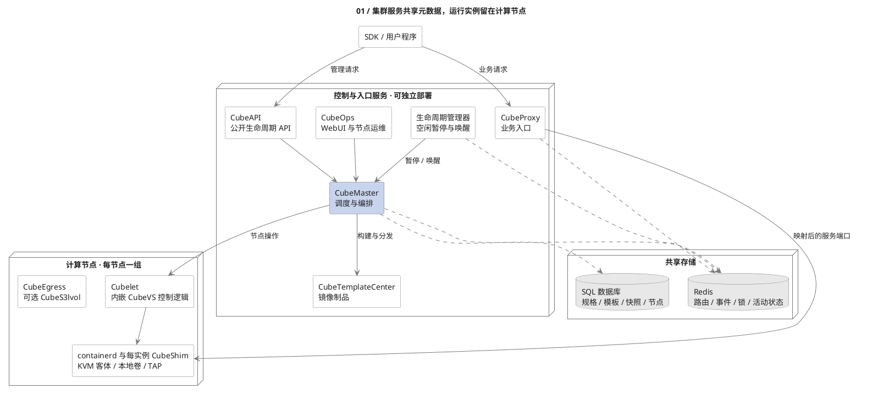
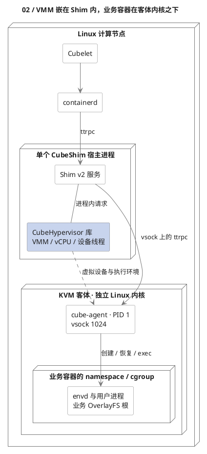
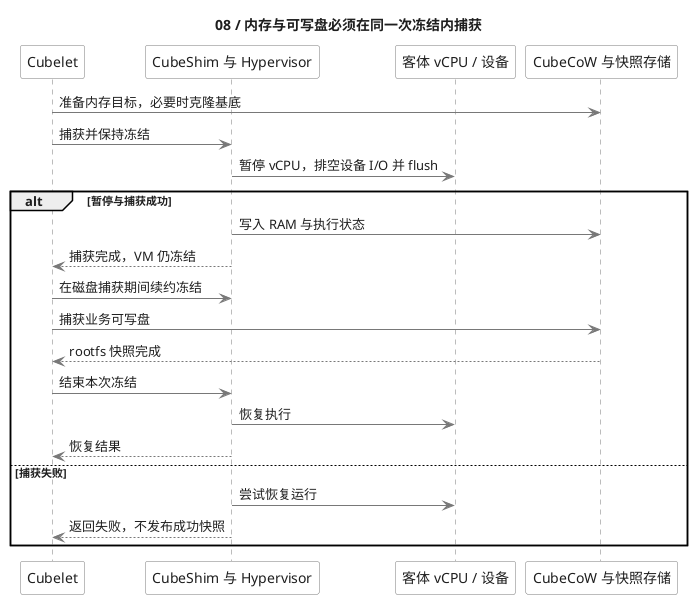
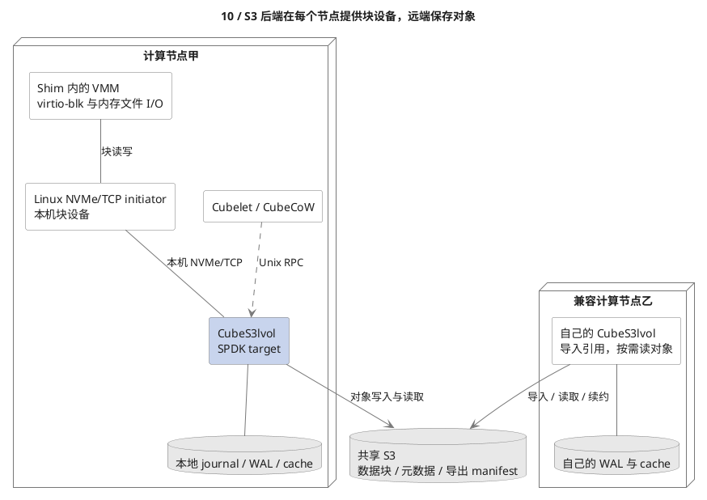
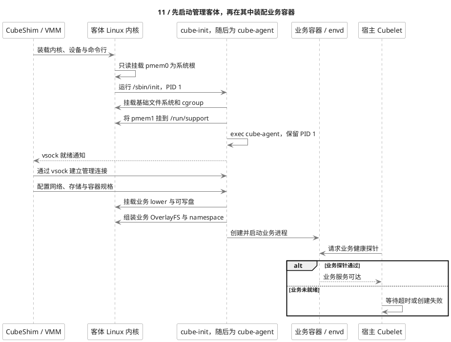

# CubeSandbox 深入剖析

CubeSandbox 把容器接口、microVM 和快照模板组合成一个集群产品。CubeMaster 选择节点，Cubelet 管理节点上的实例，containerd 通过 CubeShim 调用虚拟化实现。用户程序仍按 OCI 容器的方式组织，但运行在独立 Linux 客体里。

它与 Cocoonstack 的一个明显区别是 VMM 的部署方式。CubeHypervisor 编译为库，运行在 CubeShim 进程内。另一个区别在磁盘：VM 的系统根、agent、业务镜像和业务可写层是不同的设备。业务镜像不负责引导 VM，业务容器看到的 `/` 也不是 VM 最初挂载的 `/`。

以下以参考目录中的 `5741deb433b7` 为准。该版本同时保留本地 XFS/reflink 和 S3 块存储后端。模板构建、运行时快照、自动暂停使用相近的材料，但完成条件和恢复方式并不相同。

## 1. 部署架构

### 1.1 集群入口、节点服务与每实例进程

| 组件 | 部署单位 | 职责 |
|---|---|---|
| CubeAPI | 可扩展的 Rust/Axum 服务 | E2B 兼容入口，将 SDK 请求转成内部调用 |
| CubeMaster | 集群级 Go 服务 | 调度、实例操作、模板与快照元数据、节点间分发 |
| CubeOps | 独立 Go 服务 | WebUI 后端、节点管理、组件仓库、管理员认证 |
| CubeTemplateCenter | 模板构建与制品服务 | 拉取 OCI、生成 ext4 制品、提供下载与物理删除 |
| CubeProxy | OpenResty 入口代理，可多副本 | 将业务请求路由到沙箱，处理流量 token 和自动唤醒入口 |
| cube-lifecycle-manager | 独立服务 | 空闲检测、自动暂停、唤醒协调和代理状态同步 |
| Cubelet | 每计算节点一个 | 实例生命周期、存储、网络、containerd 与节点状态 |
| CubeVS | Cubelet 内嵌控制逻辑与宿主 eBPF 程序 | TAP、地址转换、会话、出站策略和 DNS 学习 |
| CubeEgress | 每计算节点上的 OpenResty 服务 | 被选中流量的 HTTP/TLS 处理、策略和凭据注入 |
| CubeShim + CubeHypervisor | 每 sandbox 的运行时进程 | Shim v2 接口、KVM、vCPU、设备、快照与客体控制 |
| cube-agent | 客体内 PID 1 | 管理客体中的容器、挂载、进程和 vsock RPC |
| envd | 业务环境中的服务 | E2B 的进程与文件操作入口，常用端口为 49983 |
| CubeCoW | 链入调用方的 Rust 库，Go 经 FFI 使用 | 将卷与快照操作统一到 reflink 或 S3 后端 |
| CubeS3lvol | 可选的每节点块存储服务 | 本地 WAL、对象缓存、S3 持久块与 NVMe/TCP 导出 |

图 1 按部署位置分组。实线是服务调用，虚线是共享状态访问。控制面可以与计算节点同机，也可以独立部署；并不是图中的每一个框都要单独购买一台机器。



CubeMaster 当前已经使用 SQL 保存 sandbox 创建规格、模板、快照和任务。Redis 保存路由、事件与协调状态，因此不能再把整个系统描述为“Redis 是唯一状态源”。节点还保存 containerd 状态、实例记录、卷目录和快照 catalog。SQL、Redis 与节点文件系统之间也没有一个覆盖所有写入的事务。

部分创建后的规格落库和生命周期事件发布采用记录错误后继续的方式。这意味着 VM 已经创建、业务路由已经可用、控制面恢复记录已经齐全，是三个不同的事实。

### 1.2 一个 sandbox 里面仍然有容器

CubeShim 实现 containerd Shim v2，但它不是将 OCI 进程直接放进宿主 namespace。它先获得 VM，再通过 vsock 上的 ttrpc 请求客体 agent 创建或接管容器。

图 2 区分了宿主进程与客体内核。CubeHypervisor 的 VMM、vCPU 和设备工作线程属于 Shim 进程。客体中的 cube-agent 管理另一套 namespace、cgroup 和进程树。



cube-agent 与 envd 的分工不能合并。前者负责 VM 内的运行时管理，后者面向 E2B 的业务接口。envd 健康检查成功比“vsock 已经监听”多了一层应用条件；同样，VMM 已恢复也不等于客户端原有 HTTP 连接仍然可用。

### 1.3 裸机与 Kubernetes

单机安装把控制面、数据面和依赖放在同一宿主，systemd 管理多项服务，部分服务以容器运行。增加计算节点时，计算节点只需接入控制面、下载组件与模板，不需要复制完整控制面。

Kubernetes 部署的计算单位是节点 DaemonSet 的 Big Pod，包含 Cubelet、CubeEgress、网络初始化容器和可选 CubeS3lvol。它使用宿主网络及特权或所需宿主能力，并挂载 KVM、BPF、设备、containerd socket 和节点数据目录。另有节点 bootstrap、installer 等 DaemonSet 准备宿主环境。

因此，Kubernetes 管的是这套节点基础设施的 Pod，不是为每个业务 sandbox 都创建一个普通 Kubernetes Pod。沙箱放置仍由 CubeMaster 与 Cubelet 决定。宿主文件系统、TC/BPF 挂载和 VM 进程也不会因为用了 Helm 就变成普通无状态 Pod 数据。

TemplateCenter 的多副本需要共享制品字节。单副本可以使用本地目录或 PVC；多副本必须能读到相同的 S3 制品或共享文件系统。只扩展 HTTP 副本、却让各副本持有不同的本地 ext4，会使下载请求命中没有文件的副本。

## 2. 网络架构

### 2.1 相同客体 IP，为什么不会串流

默认客体地址是 `169.254.68.6`，网关是 `169.254.68.5`。多台 VM 可以使用相同的地址和 MAC，因为它们各有独立 TAP，没有共享的 Linux bridge 广播域。

Cubelet 再从节点配置的 sandbox CIDR 中为每台 VM 分配一个节点内地址，默认 CIDR 是 `192.168.0.0/18`。CubeVS 在 TAP ingress 根据 ifindex 找到实例元数据，把固定客体源地址改成这个独有地址。普通出站随后再转换成 SNAT 地址和端口。

图 3 中两台 VM 故意使用相同源端口。中间的节点内地址和最终 NAT 端口消除了歧义。地址仅为示例，回包按会话反向转换。

```vega
{
  "$schema":"https://vega.github.io/schema/vega/v6.json",
  "width":1040,"height":480,"padding":20,
  "data":[
    {"name":"boxes","values":[
      {"x":20,"y":145,"w":280,"h":100,"fill":"#ffffff","a":"客体甲 · TAP 甲","b":"169.254.68.6:41000"},
      {"x":20,"y":295,"w":280,"h":100,"fill":"#ffffff","a":"客体乙 · TAP 乙","b":"169.254.68.6:41000"},
      {"x":380,"y":145,"w":280,"h":100,"fill":"#c8d4ed","a":"节点内身份甲","b":"192.168.0.2:41000"},
      {"x":380,"y":295,"w":280,"h":100,"fill":"#c8d4ed","a":"节点内身份乙","b":"192.168.0.3:41000"},
      {"x":740,"y":145,"w":280,"h":100,"fill":"#ffffff","a":"外部可见连接甲","b":"192.0.2.10:30000"},
      {"x":740,"y":295,"w":280,"h":100,"fill":"#ffffff","a":"外部可见连接乙","b":"192.0.2.10:30001"}
    ]},
    {"name":"links","values":[{"x":300,"x2":380,"y":195},{"x":660,"x2":740,"y":195},{"x":300,"x2":380,"y":345},{"x":660,"x2":740,"y":345}]}
  ],
  "marks":[
    {"type":"rect","encode":{"enter":{"x":{"value":0},"y":{"value":0},"width":{"value":1040},"height":{"value":480},"fill":{"value":"#f4f4f4"}}}},
    {"type":"text","encode":{"enter":{"x":{"value":20},"y":{"value":36},"text":{"value":"03 / 客体地址相同，TAP 身份与两次地址转换不同"},"fontSize":{"value":26},"fontWeight":{"value":"bold"},"fill":{"value":"#1e1e1e"}}}},
    {"type":"text","encode":{"enter":{"x":{"value":20},"y":{"value":80},"text":{"value":"两条连接均访问同一目标服务；连线表示地址改写，不表示额外的代理进程。"},"fontSize":{"value":17},"fill":{"value":"#565656"}}}},
    {"type":"rule","from":{"data":"links"},"encode":{"enter":{"x":{"field":"x"},"x2":{"field":"x2"},"y":{"field":"y"},"stroke":{"value":"#787878"},"strokeWidth":{"value":2}}}},
    {"type":"rect","from":{"data":"boxes"},"encode":{"enter":{"x":{"field":"x"},"y":{"field":"y"},"width":{"field":"w"},"height":{"field":"h"},"fill":{"field":"fill"},"stroke":{"value":"#787878"}}}},
    {"type":"text","from":{"data":"boxes"},"encode":{"enter":{"x":{"signal":"datum.x+140"},"y":{"signal":"datum.y+34"},"text":{"field":"a"},"align":{"value":"center"},"fontSize":{"value":19},"fill":{"value":"#1e1e1e"}}}},
    {"type":"text","from":{"data":"boxes"},"encode":{"enter":{"x":{"signal":"datum.x+140"},"y":{"signal":"datum.y+72"},"text":{"field":"b"},"align":{"value":"center"},"fontSize":{"value":21},"fill":{"value":"#1e1e1e"}}}},
    {"type":"text","encode":{"enter":{"x":{"value":20},"y":{"value":450},"text":{"value":"TAP 代次还参与会话校验，避免设备复用或回滚后把旧连接交给新实例。"},"fontSize":{"value":18},"fill":{"value":"#1e1e1e"}}}}
  ]
}
```

客体 ARP 请求由 TAP 上的 BPF 就地回答，不需要真实网关 VM。宿主主动探测业务服务时，可以访问节点内地址，再经 cube-dev 转到相应 TAP。Cubelet 还维护 TAP 池，并通过 Unix socket 的文件描述符传递把 TAP 交给 Shim，不要求每次都由 VMM 重新配置宿主网络。

### 2.2 三个 BPF 挂载点，不是一套用户态 TCP/IP 栈

| 挂载点 | 处理 |
|---|---|
| 每 TAP 的 TC ingress | 客体源地址改写、出站判定、DNS 查询学习、NAT、ARP 应答 |
| 宿主物理网卡的 TC ingress | 外部回包反向 NAT、服务端口映射、DNS 响应学习 |
| cube-dev 的 TC egress | 宿主探测与透明代理回包转向目标 TAP，恢复固定客体地址 |

TCP/IP 协议栈仍在客体 Linux 和宿主 Linux 中。CubeVS 修改和转发报文，跟踪流状态，但不会替客体终止每条 TCP 连接。只有被送进 CubeEgress 的流量会由宿主代理终止 TCP/TLS，再发起上游连接。

普通出站有两种部署方式。默认 direct 模式直接把改写后的报文送到选定物理网卡，主要依靠预先发现的网关 MAC；同网段目标还有邻居缓存、FIB 查询与宿主邻居学习。可选 route-aware 模式把报文重新注入 cube-router 的 ingress，让 Linux 路由和策略路由决定后续出口，并配置宿主转发与 NAT 规则。

图 4 表达的是三个不同的出站连接方式。虚线框中的两条普通出站路径互为配置选择；下方 L7 路径只接收策略选中的 TCP 流。

```vega
{
  "$schema":"https://vega.github.io/schema/vega/v6.json",
  "width":1040,"height":620,"padding":20,
  "data":[
    {"name":"boxes","values":[
      {"x":20,"y":215,"w":205,"h":100,"a":"客体网卡与 TAP","b":"CubeVS 策略入口","fill":"#c8d4ed"},
      {"x":365,"y":125,"w":300,"h":80,"a":"direct · 直接重定向","b":"BPF NAT 与二层目的地址","fill":"#ffffff"},
      {"x":365,"y":285,"w":300,"h":80,"a":"route-aware · cube-router","b":"宿主路由 / 转发 / NAT","fill":"#ffffff"},
      {"x":365,"y":465,"w":300,"h":80,"a":"cube-dev 与 TPROXY","b":"CubeEgress 终止应用连接","fill":"#c8d4ed"},
      {"x":805,"y":215,"w":215,"h":100,"a":"外部网络","b":"实际目标服务","fill":"#ffffff"}
    ]},
    {"name":"paths","values":[
      {"p":"M225,245 L285,245 L285,165 L365,165","c":"#787878"},
      {"p":"M225,275 L285,275 L285,325 L365,325","c":"#787878"},
      {"p":"M120,315 L120,505 L365,505","c":"#0043ce"},
      {"p":"M665,165 L740,165 L740,245 L805,245","c":"#787878"},
      {"p":"M665,325 L740,325 L740,285 L805,285","c":"#787878"},
      {"p":"M665,505 L915,505 L915,315","c":"#0043ce"}
    ]}
  ],
  "marks":[
    {"type":"rect","encode":{"enter":{"x":{"value":0},"y":{"value":0},"width":{"value":1040},"height":{"value":620},"fill":{"value":"#f4f4f4"}}}},
    {"type":"text","encode":{"enter":{"x":{"value":20},"y":{"value":36},"text":{"value":"04 / 直接转发、宿主路由和 L7 代理不是同一条路径"},"fontSize":{"value":25},"fontWeight":{"value":"bold"},"fill":{"value":"#1e1e1e"}}}},
    {"type":"rect","encode":{"enter":{"x":{"value":340},"y":{"value":85},"width":{"value":350},"height":{"value":310},"fill":{"value":"#f4f4f4"},"stroke":{"value":"#787878"},"strokeDash":{"value":[6,5]}}}},
    {"type":"path","from":{"data":"paths"},"encode":{"enter":{"path":{"field":"p"},"stroke":{"field":"c"},"strokeWidth":{"value":2},"fill":{"value":null}}}},
    {"type":"rect","from":{"data":"boxes"},"encode":{"enter":{"x":{"field":"x"},"y":{"field":"y"},"width":{"field":"w"},"height":{"field":"h"},"fill":{"field":"fill"},"stroke":{"value":"#787878"}}}},
    {"type":"text","from":{"data":"boxes"},"encode":{"enter":{"x":{"signal":"datum.x+datum.w/2"},"y":{"signal":"datum.y+32"},"text":{"field":"a"},"align":{"value":"center"},"fontSize":{"value":18},"fill":{"value":"#1e1e1e"}}}},
    {"type":"text","from":{"data":"boxes"},"encode":{"enter":{"x":{"signal":"datum.x+datum.w/2"},"y":{"signal":"datum.y+61"},"text":{"field":"b"},"align":{"value":"center"},"fontSize":{"value":16},"fill":{"value":"#1e1e1e"}}}},
    {"type":"text","encode":{"enter":{"x":{"value":365},"y":{"value":250},"text":{"value":"普通出站二选一"},"fontSize":{"value":18},"fill":{"value":"#565656"}}}},
    {"type":"text","encode":{"enter":{"x":{"value":140},"y":{"value":445},"text":{"value":"蓝线仅表示被选中做 L7 检查的连接"},"fontSize":{"value":18},"fill":{"value":"#0043ce"}}}},
    {"type":"text","encode":{"enter":{"x":{"value":20},"y":{"value":595},"text":{"value":"L7 使用 fwmark、iptables TPROXY 与策略路由；不能把整个网络概括为“不用 iptables”。"},"fontSize":{"value":17},"fill":{"value":"#1e1e1e"}}}}
  ]
}
```

direct 模式减少了宿主常规转发路径上的工作，但不能据此假定宿主全部策略路由都会参与。route-aware 模式增加一次进入宿主网络栈的过程，换取多出口、VPN 或自定义路由的适配能力。两者都与业务是否要求 HTTP 检查不同，不能用一个“代理开关”代替所有网络配置。

### 2.3 TCP、UDP、ICMP 与 IPv6 的边界

| 协议 | 当前处理方式 | 不能据此推导的能力 |
|---|---|---|
| ARP | 在 TAP 上回答客体网关请求 | 没有 VM 间共享广播域 |
| IPv4 TCP | 会话跟踪、源端口分配、双向 NAT；按策略选择 L7 | 普通 TCP 不自动接受 HTTP 层检查 |
| IPv4 UDP | 独立会话与 NAT；UDP/53 有额外 DNS 逻辑 | 不终止 QUIC，不解密 UDP 应用协议 |
| ICMP | NAT 路径处理 Echo Request/Reply，改写并恢复 identifier | 不是完整 ICMP 错误报文转译，不能按完整路由器理解 PMTU 与 traceroute |
| IPv6 | 客体 TAP 的非 IPv4/ARP 报文被丢弃 | 没有通用 IPv6 出站、NDP 或 IPv6 DNS 地址学习 |
| TLS | 普通 TCP 可透传；L7 路径由 CubeEgress 做 MITM | 不是所有 TLS 都必经代理，也不是所有 TLS 应用都可解析 |
| vsock | Shim 与 agent 的管理通道 | 不是用户互联网出站的承载路径 |

双向 NAT 使用正向会话和反向查找表。TCP 会话区分握手、建立、关闭等状态；UDP 与 ICMP 使用较简单的状态和超时。TCP 已建立状态的超时可达数小时，因此“沙箱没有发新请求”与“宿主没有任何连接状态”并不等价。

服务端口映射又有独立的正反向表。当前入站 TCP 映射也会参与会话代次检查，并不是永久不记状态的静态 DNAT。默认端口规划把宿主临时端口、业务映射端口、沙箱 SNAT 端口分开，分别使用 10000–19999、20000–29999、30000–65535。

### 2.4 CIDR 策略与 DNS 学习

当前判定顺序是 allow 优先，其次 deny，最后默认允许。`allowInternetAccess=false` 通过安装全地址 deny 来收紧默认行为，再用 allow 打开例外。

私网、loopback 和链路本地段作为默认 deny 条目安装，并不是独立于 allow 的不可覆盖硬拒绝。allow 命中后不会再检查 deny。因此“默认阻止私网”与“无论配置如何都不能访问私网”是两种不同保证。

客体网关还有单独限制。发往网关的 ICMP 可以进入宿主，TCP 允许非初始 SYN 的报文，但客体主动发起的新 TCP SYN 和 UDP 不会被这一分支无条件放行。网关不应被理解成任意宿主服务的开放入口。

域名允许规则先写入按 TAP 隔离的反向域名 trie。UDP/53 的标准 IPv4 A 查询进入过滤流程，允许的查询记录 DNS ID、源端口、服务器地址和问题名哈希。响应匹配后，将 A 记录地址学习为临时 IP 允许条目。

几个细节决定了它实际表达的权限：

- 普通域名 allow 学到的是 IP 的任意端口允许，不是每个后续 TCP 请求都重新核对域名。同一 IP 上其他服务也可能落入这个允许范围。
- L7 域名规则学习成 IP、端口、HTTP/HTTPS scheme 的组合，默认端口集合为 80/http 和 443/https，也支持显式端口。
- TTL 有 300 秒下限，并非原样使用 DNS TTL。短 TTL 记录仍可能留下至少五分钟的允许项。
- 非 A 查询、非标准或不能解析的查询不走这套域名过滤，但仍受一般网络策略约束。TCP DNS、DoH、DoT 不会自动生成相同的学习记录。
- 运行中删除域名规则会阻止新的学习；已经学习的地址条目留到 TTL 过期。普通流的策略代次更新不等于立即撤销这些已有条目。

所以 DNS 学习适合将域名规则落到 L3/L4 数据面，但它不提供持续的 TLS 主机名认证。需要约束 HTTP 方法、路径或凭据去向时，还要使用 CubeEgress。

### 2.5 L7 分流与 TLS 凭据注入

BPF 首包判定可得到拒绝、普通 SNAT、HTTP 代理或 HTTPS 代理。L7 判定将 scheme 写入报文 mark，重定向到 cube-dev，再由 TPROXY 分别送至 HTTP 或 HTTPS listener。后续报文复用会话中的结果。

L7 标记只让 TCP 进入应用代理。UDP 命中相同允许条目时仍按 UDP NAT 处理，不会接受 HTTP 规则检查。这也是不能把配置了 L7 规则直接等同于“所有协议都只能经代理出站”的原因。

图 5 把 HTTPS 拆成两段独立会话。客体仍连接原始目标 IP 和端口，不需要先发送显式 CONNECT；CubeEgress 的透明 socket 保留原始目的地址。

```vega
{
  "$schema":"https://vega.github.io/schema/vega/v6.json",
  "width":1040,"height":500,"padding":20,
  "data":[
    {"name":"boxes","values":[
      {"x":20,"y":180,"w":230,"h":140,"fill":"#ffffff","a":"客体应用","b":"信任模板内的代理 CA","c":"请求中不必带真实密钥"},
      {"x":375,"y":145,"w":290,"h":210,"fill":"#c8d4ed","a":"CubeEgress","b":"终止 TLS，解析 HTTP","c":"在宿主内注入请求头"},
      {"x":790,"y":180,"w":230,"h":140,"fill":"#ffffff","a":"上游服务","b":"出示真实服务证书","c":"接收真实凭据"}
    ]}
  ],
  "marks":[
    {"type":"rect","encode":{"enter":{"x":{"value":0},"y":{"value":0},"width":{"value":1040},"height":{"value":500},"fill":{"value":"#f4f4f4"}}}},
    {"type":"text","encode":{"enter":{"x":{"value":20},"y":{"value":36},"text":{"value":"05 / 一个 HTTPS 请求，被代理分成两段 TLS 会话"},"fontSize":{"value":26},"fontWeight":{"value":"bold"},"fill":{"value":"#1e1e1e"}}}},
    {"type":"rule","encode":{"enter":{"x":{"value":250},"x2":{"value":790},"y":{"value":250},"stroke":{"value":"#0043ce"},"strokeWidth":{"value":9}}}},
    {"type":"rect","from":{"data":"boxes"},"encode":{"enter":{"x":{"field":"x"},"y":{"field":"y"},"width":{"field":"w"},"height":{"field":"h"},"fill":{"field":"fill"},"stroke":{"value":"#787878"}}}},
    {"type":"text","from":{"data":"boxes"},"encode":{"enter":{"x":{"signal":"datum.x+datum.w/2"},"y":{"signal":"datum.y+38"},"text":{"field":"a"},"align":{"value":"center"},"fontSize":{"value":23},"fontWeight":{"value":"bold"},"fill":{"value":"#1e1e1e"}}}},
    {"type":"text","from":{"data":"boxes"},"encode":{"enter":{"x":{"signal":"datum.x+datum.w/2"},"y":{"signal":"datum.y+78"},"text":{"field":"b"},"align":{"value":"center"},"fontSize":{"value":18},"fill":{"value":"#1e1e1e"}}}},
    {"type":"text","from":{"data":"boxes"},"encode":{"enter":{"x":{"signal":"datum.x+datum.w/2"},"y":{"signal":"datum.y+112"},"text":{"field":"c"},"align":{"value":"center"},"fontSize":{"value":18},"fill":{"value":"#1e1e1e"}}}},
    {"type":"text","encode":{"enter":{"x":{"value":310},"y":{"value":130},"text":{"value":"代理签发的叶证书"},"align":{"value":"center"},"fontSize":{"value":17},"fill":{"value":"#565656"}}}},
    {"type":"text","encode":{"enter":{"x":{"value":735},"y":{"value":130},"text":{"value":"上游自己的证书"},"align":{"value":"center"},"fontSize":{"value":17},"fill":{"value":"#565656"}}}},
    {"type":"text","encode":{"enter":{"x":{"value":520},"y":{"value":321},"text":{"value":"按实例 IP 查策略与密钥"},"align":{"value":"center"},"fontSize":{"value":18},"fill":{"value":"#1e1e1e"}}}},
    {"type":"text","encode":{"enter":{"x":{"value":20},"y":{"value":412},"text":{"value":"规则拒绝：不连接上游。注入条件失败：可继续允许请求，但去掉待注入的请求头。"},"fontSize":{"value":18},"fill":{"value":"#1e1e1e"}}}},
    {"type":"text","encode":{"enter":{"x":{"value":20},"y":{"value":455},"text":{"value":"控制响应日志中的敏感字段，不等于保证上游响应永远不会回显密钥。"},"fontSize":{"value":18},"fill":{"value":"#565656"}}}}
  ]
}
```

CubeEgress 用宿主上的 CA 私钥动态签发叶证书，模板预置 CA 公钥。上游连接保持证书验证，使用原始目的 IP/端口以及请求 SNI。应用若固定证书、忽略系统信任库，或使用非 HTTP 的 TLS 协议，就不能按普通 HTTPS 代理路径处理。

代理按顺序选择第一条匹配规则，检查 SNI、Host、方法、路径、scheme 和端口。没有策略或没有允许规则时拒绝；启动期间策略尚未完成 bootstrap 时也拒绝。

凭据直接保存在宿主策略中。注入前先清除客户端提供的同名请求头，再核对 HTTPS 的 Host 与 SNI。核对失败会放弃注入并记录安全事件，但一条已经判定为 allow 的请求仍可以继续，不是统一返回拒绝。普通 HTTP 也允许配置凭据注入，因此注入能力本身不保证上游链路加密。

审计和 debug 输出有敏感字段脱敏逻辑，但这不等于对响应正文建立完整的秘密不泄露保证。允许访问的服务如果把收到的凭据回显给客体，仍须单独考虑这一行为。

### 2.6 入站代理、端口映射与自动唤醒

CubeProxy 支持 `<port>-<sandbox_id>.<domain>` 和 `/sandbox/<id>/<port>/...` 两种寻址。它从 Redis 或本地缓存读取节点、节点内地址和端口映射。同节点访问可直接使用 sandbox 地址与业务端口；跨节点则使用节点 IP 与分配的 host port。

流量 token 在代理层检查，包括缓存命中路径。限制公开访问时，缺失或错误 token 返回 403。这个检查不是 BPF 端口映射的功能，直接暴露计算节点的映射端口不能自动获得同一套 HTTP token 保护。

对启用了自动暂停的实例，CubeProxy 先看生命周期缓存。已暂停时同步请求生命周期管理器唤醒，再继续解析业务后端；正在暂停时返回可重试的 503，已删除时返回 410。状态缓存缺失则继续普通转发，不会仅凭未知状态尝试恢复。

生命周期管理器订阅 Redis 事件，发现在线 CubeProxy 副本，并向它们推送状态与路由失效通知。Kubernetes 部署可用两个副本，只有持有 leader lease 的副本执行空闲扫描等单实例工作。这里协调的是实例状态，不是复制客体内存。

## 3. 镜像与磁盘

### 3.1 OCI 先合成业务 ext4，不直接引导 VM

当前 TemplateCenter 默认使用原生 registry 客户端拉取 OCI。它并行下载层，按层顺序应用内容和 whiteout 语义，形成业务 rootfs。随后制作 ext4 文件，并将它发布为可下载的 artifact。可选路径使用 skopeo/umoci 或 Docker 导出；BuildKit 并不是当前所有 from-image 构建的必经组件。

OCI 的 Entrypoint、Cmd、Env、WorkingDir 和 User 保留为业务启动配置。普通镜像里的内核、init 或 systemd 不因此成为 VM 引导程序。Cube 自己的 guest kernel 与系统镜像仍独立存在。

ext4 先写到临时名称，完成后 rename 为最终名称，再计算制品摘要。节点获取业务 ext4 后，创建构建 VM，启动业务容器，等待探针或预热条件，再捕获 APP snapshot。最终可快速恢复的模板包含已经运行过的进程状态，并不只是一个 OCI 镜像名称。

### 3.2 两个根文件系统，四类盘

主路径的设备关系如下：

| 客体设备或接口 | 内容 | 用途 |
|---|---|---|
| `/dev/pmem0` | Cube 系统 ext4 | VM 引导根，包含 `/sbin/init` |
| `/dev/pmem1` | 独立 cube-agent ext4 | 挂到 `/run/support`，提供 agent 与辅助程序 |
| `/dev/pmem2` 起 | 业务镜像 ext4 | 业务 OverlayFS 的只读 lower |
| virtio-blk，常见 `/dev/vda` | 私有可写 ext4 卷 | 业务根的 upper/work，与其他可写内容 |
| virtio-fs | 显式宿主目录、网络配置文件或插件挂载 | 提供 VM 磁盘之外的文件系统依赖 |

图 6 的左侧是客体运行时，右侧是业务容器根的展开剖面。系统盘和 agent 盘没有叠进业务 OverlayFS；它们提供运行这个容器所需的管理环境。

<div class="cube-disks" style="max-width: 1100px; box-sizing: border-box; position: relative;">
  <style>
    .cube-disks { background: #f4f4f4; color: #1e1e1e; }
    .cube-disks svg { display: block; width: 100%; height: auto; }
    .cube-disks text { fill: #1e1e1e; font-size: 17px; }
    .cube-disks .cube-disks-small { font-size: 14px; }
    .cube-disks .cube-disks-title { font-size: 25px; font-weight: 700; }
  </style>
  <svg viewBox="0 0 1100 730" role="img" aria-labelledby="cube-disks-title">
    <title id="cube-disks-title">系统根与业务容器根分离，业务根由只读 ext4 和私有 upper 叠加</title>
    <defs>
      <g id="cube-disks-slab">
        <path d="M0,40 L480,40 L545,0 L65,0 Z" fill="#ffffff" stroke="#787878"/>
        <path d="M0,40 L480,40 L480,55 L0,55 Z M480,40 L545,0 L545,15 L480,55 Z" fill="#e8e8e8" stroke="#787878"/>
      </g>
    </defs>
    <text x="25" y="40" class="cube-disks-title">06 / VM 的系统根，与业务容器看到的根相互独立</text>
    <text x="25" y="80">左侧负责引导与管理；右侧是用户文件的合并视图。</text>
    <path d="M385,110 L385,615" stroke="#787878" stroke-dasharray="6 6"/>
    <rect x="25" y="145" width="320" height="170" fill="#e8e8e8" stroke="#787878"/>
    <text x="45" y="180">系统根 · pmem0</text>
    <text x="45" y="218">只读 ext4 与 DAX</text>
    <text x="45" y="255">cube-init 是最初的 PID 1</text>
    <text x="45" y="289" class="cube-disks-small">内核直接挂载，不是业务镜像中的 /</text>
    <rect x="25" y="385" width="320" height="170" fill="#e8e8e8" stroke="#787878"/>
    <text x="45" y="422">agent 盘 · pmem1</text>
    <text x="45" y="460">只读挂载到 /run/support</text>
    <text x="45" y="497">cube-agent 接替 PID 1</text>
    <text x="45" y="531" class="cube-disks-small">管理容器、挂载、vsock 与进程</text>
    <path d="M185,315 L185,385" stroke="#787878" stroke-width="2"/>
    <use href="#cube-disks-slab" transform="translate(440 145)"/>
    <use href="#cube-disks-slab" transform="translate(440 325)"/>
    <use href="#cube-disks-slab" transform="translate(440 505)"/>
    <path d="M490,178 L675,178 L710,155 L525,155 Z" fill="#e8e8e8" stroke="#787878"/>
    <path d="M745,178 L930,178 L965,155 L780,155 Z" fill="#c8d4ed" stroke="#003bb5"/>
    <text x="600" y="173" text-anchor="middle" class="cube-disks-small">镜像中的程序与库</text>
    <text x="855" y="173" text-anchor="middle" class="cube-disks-small">用户修改的配置</text>
    <text x="450" y="235">业务容器的 / · OverlayFS 合并结果</text>
    <path d="M490,358 L675,358 L710,335 L525,335 Z" fill="#f4f4f4" stroke="#787878" stroke-dasharray="4 4"/>
    <path d="M745,358 L930,358 L965,335 L780,335 Z" fill="#c8d4ed" stroke="#003bb5"/>
    <text x="855" y="353" text-anchor="middle" class="cube-disks-small">upper 中的新内容</text>
    <text x="450" y="415">私有 ext4 可写盘 · virtio-blk · upper/work</text>
    <path d="M490,538 L675,538 L710,515 L525,515 Z M745,538 L930,538 L965,515 L780,515 Z" fill="#e8e8e8" stroke="#787878"/>
    <text x="600" y="533" text-anchor="middle" class="cube-disks-small">程序与库</text>
    <text x="855" y="533" text-anchor="middle" class="cube-disks-small">原始配置</text>
    <text x="450" y="595">业务 ext4 镜像 · pmem2 起 · 只读 lower</text>
    <path d="M600,200 L600,335 M600,380 L600,515" stroke="#787878" stroke-width="2" stroke-dasharray="4 5"/>
    <path d="M855,200 L855,335" stroke="#0043ce" stroke-width="3"/>
    <circle cx="600" cy="515" r="5" fill="#787878"/>
    <circle cx="855" cy="335" r="5" fill="#0043ce"/>
    <text x="25" y="660">pmem 表示虚拟持久内存设备，不要求宿主拥有物理持久内存条。</text>
    <text x="25" y="698">同一业务镜像的 OCI 层已经合成 ext4；不会在客体里逐层挂载成一排 EROFS。</text>
  </svg>
</div>

pmem 是设备呈现方式，DAX 让客体直接访问映射内容，减少经客体页缓存再复制的过程。系统和 agent 的内置 pmem 配置还设置了丢弃写入；业务镜像按只读方式挂载。不能把 pmem 的名称理解为“所有客体写入都会持久保存到该镜像”。

另一条普通 OCI 运行路径可以把宿主解包层通过 virtio-fs 暴露给客体，再组装业务 OverlayFS。虽然部分结构仍含 EROFS 字段，当前开源创建路径明确拒绝相应镜像类型，不能把字段存在当成可用产品路径。

### 3.3 OverlayFS 与 CubeCoW 处理不同粒度

业务修改文件时，客体 OverlayFS 将内容写到私有 upper。CubeCoW 不参与 pathname 查找，而是在宿主块文件层管理卷与快照。

本地后端要求支持 FICLONE 的文件系统，初始化时会探测能力；不支持时拒绝启动，不退化成完整复制。XFS/reflink 是默认部署选择，API 本质依赖的是 reflink 能力，不是 guest ext4 的功能。

图 7 区分文件身份和物理 extent。快照是独立文件，不需要逐层读取父快照；共享的是宿主底层块。写入后只有被修改的 extent 分离。具体元数据成本受 extent 数量影响，不能把 O(1) 宣传理解成任意碎片程度下耗时恒定。

```vega
{
  "$schema":"https://vega.github.io/schema/vega/v6.json",
  "width":1040,"height":490,"padding":20,
  "data":[
    {"name":"files","values":[
      {"x":30,"name":"快照甲 · 独立 inode"},
      {"x":380,"name":"运行卷 · 独立 inode"},
      {"x":730,"name":"快照乙 · 独立 inode"}
    ]},
    {"name":"blocks","values":[
      {"x":80,"name":"共享 extent A","fill":"#e8e8e8"},
      {"x":400,"name":"旧 extent B","fill":"#e8e8e8"},
      {"x":720,"name":"新 extent B′","fill":"#c8d4ed"}
    ]},
    {"name":"links","values":[
      {"p":"M165,195 L165,310","c":"#787878"},
      {"p":"M200,195 L200,265 L485,265 L485,310","c":"#787878"},
      {"p":"M500,195 L500,240 L180,240 L180,310","c":"#787878"},
      {"p":"M535,195 L535,285 L835,285 L835,310","c":"#0043ce"},
      {"p":"M850,195 L850,220 L205,220 L205,310","c":"#787878"},
      {"p":"M885,195 L885,270 L860,270 L860,310","c":"#0043ce"}
    ]}
  ],
  "marks":[
    {"type":"rect","encode":{"enter":{"x":{"value":0},"y":{"value":0},"width":{"value":1040},"height":{"value":490},"fill":{"value":"#f4f4f4"}}}},
    {"type":"text","encode":{"enter":{"x":{"value":20},"y":{"value":36},"text":{"value":"07 / 本地快照共享物理块，不靠一条父盘链拼回内容"},"fontSize":{"value":25},"fontWeight":{"value":"bold"},"fill":{"value":"#1e1e1e"}}}},
    {"type":"text","encode":{"enter":{"x":{"value":20},"y":{"value":80},"text":{"value":"先捕获甲，再修改 B，最后捕获乙。示例只画两个逻辑区段。"},"fontSize":{"value":18},"fill":{"value":"#565656"}}}},
    {"type":"path","from":{"data":"links"},"encode":{"enter":{"path":{"field":"p"},"fill":{"value":null},"stroke":{"field":"c"},"strokeWidth":{"value":2}}}},
    {"type":"rect","from":{"data":"files"},"encode":{"enter":{"x":{"field":"x"},"y":{"value":130},"width":{"value":280},"height":{"value":65},"fill":{"value":"#ffffff"},"stroke":{"value":"#787878"}}}},
    {"type":"text","from":{"data":"files"},"encode":{"enter":{"x":{"signal":"datum.x+140"},"y":{"value":169},"text":{"field":"name"},"align":{"value":"center"},"fontSize":{"value":20},"fill":{"value":"#1e1e1e"}}}},
    {"type":"rect","from":{"data":"blocks"},"encode":{"enter":{"x":{"field":"x"},"y":{"value":310},"width":{"value":240},"height":{"value":75},"fill":{"field":"fill"},"stroke":{"value":"#787878"}}}},
    {"type":"text","from":{"data":"blocks"},"encode":{"enter":{"x":{"signal":"datum.x+120"},"y":{"value":355},"text":{"field":"name"},"align":{"value":"center"},"fontSize":{"value":20},"fill":{"value":"#1e1e1e"}}}},
    {"type":"text","encode":{"enter":{"x":{"value":25},"y":{"value":445},"text":{"value":"删除甲只释放甲的引用。A 仍被运行卷与乙引用，不能随甲一起回收。"},"fontSize":{"value":19},"fill":{"value":"#1e1e1e"}}}}
  ]
}
```

模板 rootfs、运行 rootfs 和快照文件拥有独立身份。目录可能按起源卷归组，但这不代表读数据时要沿目录关系找父盘。删除起源运行卷时，只要还有快照引用，共享 extent 就仍由文件系统保存。

### 3.4 S3 后端不是给 reflink 文件加一个上传按钮

当前 S3 实现通过 CubeCoW 的 S3 adapter 调用 CubeS3lvol。该服务建立逻辑卷，向本机导出 NVMe/TCP namespace，Linux 侧出现可打开的块设备。S3 sandbox 的可写 rootfs 可以直接来自这些设备，不应概括为“可写盘始终留在本地 XFS，只有快照上传”。

guest 的设备形式仍然是 virtio-blk。它不知道宿主背后是普通文件，还是 NVMe/TCP 连接的 S3 逻辑卷。OS、agent、业务只读 ext4 等基础制品仍需在目标节点准备好，不会因为启用 S3 就自动进入每份快照包。

本地后端和 S3 后端都能提供 snapshot/clone，但不能套用同一套回收模型。本地文件由文件系统 extent 引用计数维持共享；S3 还要处理导出 manifest、远端读者 lease、外部父快照和后台物化。

## 4. 快照的制作与一致性

### 4.1 一份快照有三种材料

| 材料 | 内容 | 谁产生 |
|---|---|---|
| memory | 客体 RAM 字节 | CubeHypervisor 写入 Cubelet 准备的目标 |
| rootfs | 业务可写盘的捕获版本 | Cubelet 调用 CubeCoW |
| metadata | CPU/设备配置与状态、资源规格、版本、catalog、恢复请求 | Hypervisor、Shim 与 Cubelet 分别补齐 |

只读 OS、agent、业务 lower 是恢复依赖，通常不在每次 rootfs 快照里重复复制。显式 host-mount、插件 Volume 的内容也不自动成为 VM 快照的一部分。

宿主 NAT 表、代理 TCP 连接、上游服务状态、控制面 SQL 和 Redis 不在客体 RAM 中。即使把 memory 与 rootfs 对齐，也不能回滚外部世界。

### 4.2 运行中捕获需要同一个冻结窗口

当前协调路径先暂停 vCPU，再暂停设备。virtio-blk 等待在途 I/O 完成并执行暂停期 flush；失败会阻止快照继续。Hypervisor 保存 RAM 和 CPU/设备状态后不立即恢复，Shim 等待 Cubelet 完成 rootfs CoW 捕获，再接受恢复请求。

图 8 重点是冻结窗口跨越了 Shim 与 Cubelet。RAM 写完并不是窗口终点。



冻结带有超时恢复机制。捕获期间使用较长 deadline，捕获返回后通过短 lease 续约。Cubelet 丢失时，Shim 尝试恢复客体并将这次冻结标记为 expired，防止迟到的恢复请求把已经失去一致性窗口的捕获当作成功。

这份代码仍保留旧路径。按记录的 Shim 版本选择协调能力，边界是 `v0.7.2-rc2`；未知、旧版本或不能比较的版本走 legacy。旧 CLI 自行暂停、捕获 RAM、恢复 VM，之后 Cubelet 才捕获 rootfs。两者之间存在运行窗口，不能赋予与协调路径相同的内存/磁盘一致性保证。

即使使用协调路径，捕获的也只是 VM 执行状态。客体应用没有因此获得跨外部数据库、外部 Volume 和远端事务的统一提交点。

### 4.3 增量内存的基底必须与脏页范围对应

恢复的 RAM 使用私有 mmap。未改写页面继续读取捕获文件，写入页面变成匿名 CoW 页。这使“全量内存容量”与“捕获时需要写出的字节数”分离。

当前实现有三种捕获方式：

1. Full 把所需内存范围完整写到新目标，适合没有可用基底的初次捕获。
2. Incremental 写出相对最近一次恢复映射产生的匿名 CoW 页。目标必须已包含对应恢复基底。
3. Soft-dirty 在有效追踪周期内，只覆盖匿名页与本周期写脏页的交集。目标必须是上一次对应快照的克隆。

图 9 用三个页面说明为何不能随意更换基底。第二轮只写页 2，前提是目标中已经有第一轮写入的页 1。

```vega
{
  "$schema":"https://vega.github.io/schema/vega/v6.json",
  "width":1040,"height":520,"padding":20,
  "data":[
    {"name":"groups","values":[{"x":20,"title":"恢复基底"},{"x":375,"title":"快照甲"},{"x":730,"title":"快照乙"}]},
    {"name":"pages","values":[
      {"x":20,"y":160,"t":"页 0 · 原内容","f":"#e8e8e8"},
      {"x":20,"y":235,"t":"页 1 · 原内容","f":"#e8e8e8"},
      {"x":20,"y":310,"t":"页 2 · 原内容","f":"#e8e8e8"},
      {"x":375,"y":160,"t":"页 0 · 沿用基底","f":"#e8e8e8"},
      {"x":375,"y":235,"t":"页 1 · 第一轮修改","f":"#c8d4ed"},
      {"x":375,"y":310,"t":"页 2 · 沿用基底","f":"#e8e8e8"},
      {"x":730,"y":160,"t":"页 0 · 沿用甲","f":"#e8e8e8"},
      {"x":730,"y":235,"t":"页 1 · 沿用甲的新内容","f":"#c8d4ed"},
      {"x":730,"y":310,"t":"页 2 · 第二轮修改","f":"#c8d4ed"}
    ]},
    {"name":"links","values":[{"x":310,"x2":375,"y":190},{"x":310,"x2":375,"y":340},{"x":665,"x2":730,"y":190},{"x":665,"x2":730,"y":265}]}
  ],
  "marks":[
    {"type":"rect","encode":{"enter":{"x":{"value":0},"y":{"value":0},"width":{"value":1040},"height":{"value":520},"fill":{"value":"#f4f4f4"}}}},
    {"type":"text","encode":{"enter":{"x":{"value":20},"y":{"value":36},"text":{"value":"09 / 只写本轮脏页，必须先复制正确的上一份内容"},"fontSize":{"value":25},"fontWeight":{"value":"bold"},"fill":{"value":"#1e1e1e"}}}},
    {"type":"text","encode":{"enter":{"x":{"value":20},"y":{"value":80},"text":{"value":"蓝色表示已发生的内容修改；连线表示本次不必重写的页面。"},"fontSize":{"value":18},"fill":{"value":"#565656"}}}},
    {"type":"text","from":{"data":"groups"},"encode":{"enter":{"x":{"signal":"datum.x+145"},"y":{"value":133},"text":{"field":"title"},"align":{"value":"center"},"fontSize":{"value":23},"fontWeight":{"value":"bold"},"fill":{"value":"#1e1e1e"}}}},
    {"type":"rule","from":{"data":"links"},"encode":{"enter":{"x":{"field":"x"},"x2":{"field":"x2"},"y":{"field":"y"},"stroke":{"value":"#787878"},"strokeWidth":{"value":2}}}},
    {"type":"rect","from":{"data":"pages"},"encode":{"enter":{"x":{"field":"x"},"y":{"field":"y"},"width":{"value":290},"height":{"value":60},"fill":{"field":"f"},"stroke":{"value":"#787878"}}}},
    {"type":"text","from":{"data":"pages"},"encode":{"enter":{"x":{"signal":"datum.x+145"},"y":{"signal":"datum.y+37"},"text":{"field":"t"},"align":{"value":"center"},"fontSize":{"value":19},"fill":{"value":"#1e1e1e"}}}},
    {"type":"text","encode":{"enter":{"x":{"value":20},"y":{"value":420},"text":{"value":"第二轮只写页 2。若错误地克隆最初基底，页 1 就会退回原内容。"},"fontSize":{"value":20},"fill":{"value":"#1e1e1e"}}}},
    {"type":"text","encode":{"enter":{"x":{"value":20},"y":{"value":465},"text":{"value":"基底不可用时改用匹配恢复点的匿名页捕获，或做全量捕获，不能留下错误的空洞。"},"fontSize":{"value":18},"fill":{"value":"#565656"}}}}
  ]
}
```

Soft-dirty 不在每次启动时预先清理整个进程页表。第一次请求该模式时，先保存完整匿名页集合，再尝试启用追踪；后续才使用周期性交集。宿主不支持或清理失败时退回匿名页捕获。

Cubelet 优先克隆最近快照作为 soft-dirty 目标；找不到时，尝试最近恢复基底并改用 incremental；仍不可用才创建空目标做 full。这里降级的是写入量，不应降级成使用不匹配的基底。

输出仍是逻辑完整的内存镜像，不是要求恢复器依次重放每一份 delta 的日志链。reflink 共享块和少写脏页分别减少克隆成本与捕获写放大。

### 4.4 Pause 与运行中 Snapshot 不同

运行中 Snapshot 完成后继续执行原 VM。Pause 则捕获 RAM 后删除 VM 对象，再捕获仍保留的可写盘，保存恢复规格和 catalog，最后回收 Shim 与运行资源，保留暂停记录。

Pause 的“暂停”因此不是长期把 KVM vCPU 停在内存里。它释放运行 RAM，后续 Resume 重新创建运行实例。若 VM 已删除、rootfs 捕获随后失败，系统不能再简单恢复原来那台 VM；该实例也不能被当作成功的可恢复暂停。

暂停是否向调度器释放全部额度另由配置决定。默认 `paused_resource_release_ratio=0` 保留 CPU/内存调度额度；设为 1 才完全释放。物理 RAM 已释放与调度承诺已释放是两件事，后者决定以后是否可能因节点无容量而无法恢复。

## 5. 快照存储与跨节点加载

### 5.1 本地包的目录与引用

本地后端把物理 CoW 文件放在统一 objects 池，snapshot 目录保存 metadata、catalog 与规格链接。catalog 记录 rootfs 和 memory 的对象名、类型、版本及大小。恢复不能只复制一层看起来完整的 metadata 目录，遗漏它引用的物理对象。

S3 包则把 rootfs、memory 和 metadata 分成独立逻辑对象。metadata 自己也放在文件系统卷里，包含 Hypervisor 状态和恢复请求。发布前先写最终对象引用、卸载 metadata 文件系统，再把 memory 与 metadata 的工作卷封成只读快照，避免页缓存里的文件尚未进入捕获块设备。

### 5.2 CubeS3lvol 的本地与远端职责

图 10 区分控制 RPC、块 I/O 与对象传输。NVMe/TCP 默认在本机 loopback 使用；它不是 guest 直接连接远端 S3。目标节点仍有自己的逻辑卷和写入状态。



本地默认 WAL 镜像逻辑大小为 512 GiB，按 journal、WAL 和 chunk cache 划分，通常先建成稀疏文件。它不是 512 GiB 的立即物理占用，但也不是可以随手删掉的缓存：尚未上传的写入和待恢复日志依赖它。布局大小在初始化时确定。

存储服务使用 SPDK reactor 轮询，默认占用所选的两个 CPU 核，并有本地磁盘缓存与可选整对象 RAM cache。这个成本属于节点级存储服务，不能与单 VM 的额外内存数字混在一起。

S3 prefix 的 owner 和本地恢复过程依赖节点身份。重复 hostname 或重复 lvstore 身份会使两个节点争用同一远端状态。Kubernetes sidecar 使用完整节点名派生身份，是为了让 Pod 重建与节点身份分开。

### 5.3 已捕获、已导出、可跨节点不是一个状态

创建 snapshot 可以先在源节点完成。随后分别提交 rootfs、memory、metadata 的导出任务，得到 export UUID。UUID 表示任务已受理，不表示数据已经能在另一节点恢复。

Cubelet 查询各对象导出状态，CubeMaster 再持久化 `remote_status`。只有 S3 后端且远端状态为 ready，才允许离开源节点。pending、inprogress 或 failed 的快照仍可尝试源节点恢复，但不能因为“已经有 ID”就跨机。

放置优先回到源节点。源节点无法调度时，才考虑兼容节点，匹配保存的 CPU 特征哈希和宿主内核 release，并排除不满足 KVM 模块状态要求的目标。这里是停机状态转移，不是保留网络连接的 live migration。

目标节点导入包后，不必先下载全部内存内容才启动。它建立元数据和块设备关系，后续读取可以按需获取对象。RAM mmap 的缺页与块存储缺失读取可能把网络 I/O 推迟到 VM 已进入 running 之后。

因此，“恢复接口返回耗时”“业务第一次访问耗时”和“全部工作集已经到本地”不能用同一个数字表示。

### 5.4 导出引用也有生命周期

引用型导出可以继续依赖源快照对象。导入方定期写读者 lease，源端轮询观察，决定能否回收；后台 decouple 将外部父快照逐步物化到本地卷。

快照被读者、clone、导出过程或物化任务引用时，删除可能延后。部分删除意图先存在内存，再写入 S3，进程在两者之间退出会丢掉尚未持久化的意图。导出 lease 也有轮询与观察窗口，不是一次删除请求中的跨节点同步事务。

本地 reflink 的“删除一个快照不影响其他独立文件”不能原样套用到这种引用型远端导出。判断可删除时必须考虑对象引用，而不只是快照目录是否存在。

## 6. 系统引导与恢复

### 6.1 内核直接挂载 pmem0

x86_64 主路径直接加载带 PVH 入口的 ELF 内核，缺少 PVH 入口时拒绝。它不从业务 ext4 中运行 GRUB。默认 payload 给出 kernel 和命令行，不依赖先用 initramfs 拼出业务根。

内核命令行指定 `root=/dev/pmem0`、ext4、只读与 DAX。内核挂载 Cube 系统镜像后运行 `/sbin/init`，即 cube-init。arm64 走对应内核装载与平台初始化路径，不能把 x86 的 PVH 入口直接搬过去。

cube-init 挂载 proc、sysfs、tmpfs、devpts 和 cgroup，执行系统镜像内的 rc.local，设置基础环境，挂载 pmem1，再 exec cube-agent。exec 保留 PID 1，因此不是额外常驻一个 init 守护进程，也不是默认进入 systemd。

### 6.2 从系统根到业务进程

图 11 展示真正的冷启动。模板恢复跳过前半段的内核与 PID 1 启动，而是接续已捕获的客体执行状态。



开源 cube-init 不执行“启动后向 SysCtrl 写 SysStart，再等待恢复”的 OS 模板握手。产品模板来自已经运行的 APP snapshot。agent 仍通过 SysCtrl 报告 vsock 就绪，但这与闭源 init 的 OS 捕获握手不是一回事。

恢复时 Shim 重新提供宿主侧 TAP、磁盘、pmem、virtio-fs 与 vsock 路径，并校验快照版本和资源布局。内存中保留的 guest container ID 也要继续使用，否则宿主新句柄无法对应 agent 的旧进程表。

### 6.3 恢复后需要重置的状态

Shim 在连接恢复后的 agent 后，同步设置客体时间并补充随机数，等待 RPC 结果。agent 写入随机源并请求重播种。它比只启动一个后台 reseed 任务更明确，但已经恢复执行的用户进程仍可能先运行，不能据此声称客体恢复后的第一条指令就已获得全新随机状态。

Pause Resume 与 FromSnap 保留客体中已经挂载的文件系统，宿主重新建立对应 virtio-fs backend，而不是再次在相同 guest mountpoint 上挂一遍。恢复保存了挂载状态，却没有复制外部文件内容，这是两个独立问题。

版本兼容检查包含 Hypervisor、内核、系统镜像及 VM 资源。agent 版本在双方都有记录时才比较；旧材料缺少 agent 版本会跳过这一项。跨机兼容过滤与快照元数据校验共同作用，但都不能把任意架构、任意内核或任意组件组合变成可迁移格式。

## 7. 分支、回滚与外部资源

FromSnap 创建新的产品 sandbox 身份，但客体 RAM 中可以保留原来的进程、应用状态和内部容器身份。新实例必须获得新的宿主网络与存储对象，不能简单复制原实例的宿主 socket 路径和 TAP 引用。

Rollback 在现有 Shim 中删除当前 VM，再用目标快照恢复。当前实现不先为被替换的运行态额外做一次保险快照。目标恢复失败时，旧 VM 已经不存在，不能承诺自动回到回滚前。

网络会话不随 RAM 一起回滚。CubeVS 通过实例代次检查旧流，遇到过期 TCP 会话时发送 reset 或删除会话，UDP/ICMP 则按相应路径丢弃。这是在主动终止不再匹配的外部连接，而不是恢复它们。

host-mount 将恢复固定在原节点。另一个节点上名字相同的目录没有相同的数据身份。Plugin Volume 可以跨节点重新 Attach，但目标必须具备对应驱动与后端可达性；恢复不能忽略缺失的 Volume。

从运行中的源实例分支时，外部读写 Volume 可能被两个实例同时使用。VM 内存快照不会自动把外部 Volume 分支成独立副本。需要共享一致性的应用，必须按该 Volume 后端的真实并发语义工作。

## 8. 与前两套实现的差异

| 维度 | Microsandbox | Cocoonstack sandbox 主路径 | CubeSandbox 主路径 |
|---|---|---|---|
| VMM 组织 | 运行时集成 VMM | CLI 管独立 Cloud Hypervisor 进程 | CubeShim 进程内链接 CubeHypervisor |
| 产品编排 | 自有 sandbox 运行时 | sandboxd 热池与 claim | CubeMaster、Cubelet、containerd 与模板副本 |
| 业务根 | 镜像 lower 与可写层 | 客体叠加多个 EROFS 层 | 业务 ext4 lower 与私有 ext4 upper；另有系统根 |
| 网络 | 宿主用户态协议处理与代理 | TAP/CNI 与 vsock 应用代理分工 | 客体内核协议栈、TC/eBPF NAT、可选透明 L7 |
| 内存共享 | 依运行时捕获与恢复机制 | 私有 mmap 与宿主页缓存 | 私有 mmap，匿名页与 soft-dirty 捕获 |
| 本地快照盘 | 可组织 raw/qcow2 历史层 | 文件复制，支持 reflink | CubeCoW 强制 reflink，独立文件共享 extent |
| 跨节点恢复 | 自有归档闭包 | store 与 OCI artifact 分发 | 三对象 S3 包、远端 ready、兼容节点放置 |
| 客体管理 | 自有 guest 协议 | cocoon-agent 与 silkd 分工 | cube-agent 管容器，envd 提供 E2B 业务接口 |

CubeSandbox 将“启动业务环境”的主要成本提前到模板构建和节点准备。常规创建恢复的是已经启动过的客体与业务进程，所以它与从零加载内核、运行 init、装配业务根的冷启动不同。

它的低成本共享也有明确依赖。内存共享依赖不可变捕获内容，磁盘共享依赖宿主 reflink 或 S3 卷引用，快速恢复依赖目标节点已有正确的基础制品。网络策略、外部 Volume 和组件版本则决定这份状态能否在新的运行位置继续工作。
