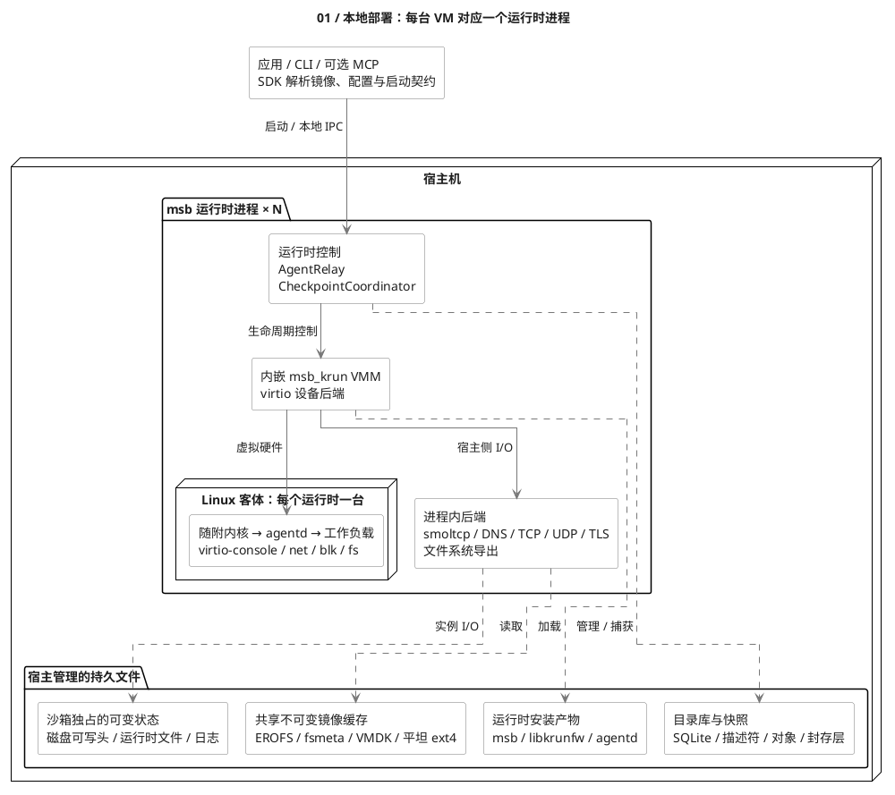
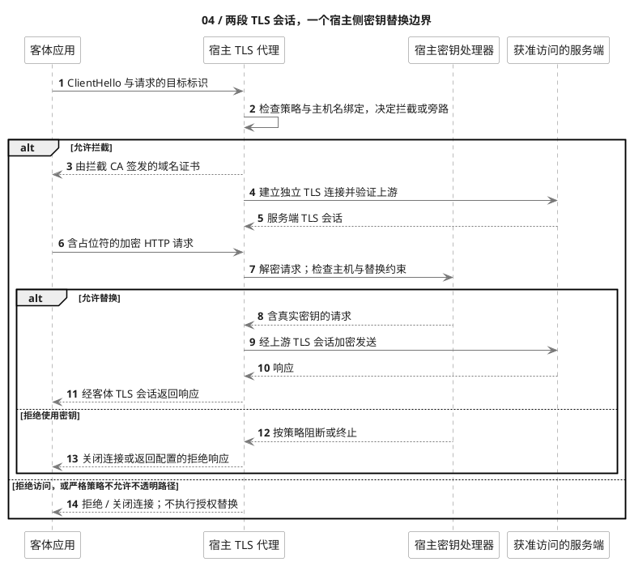
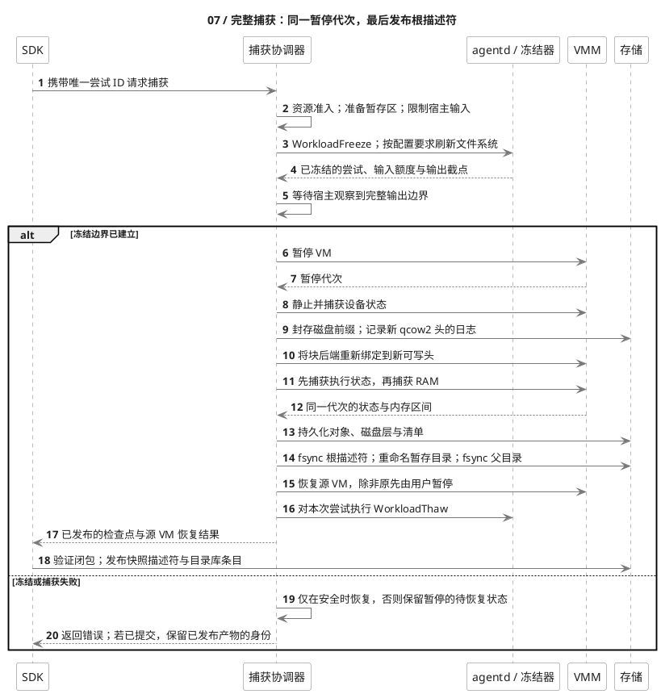
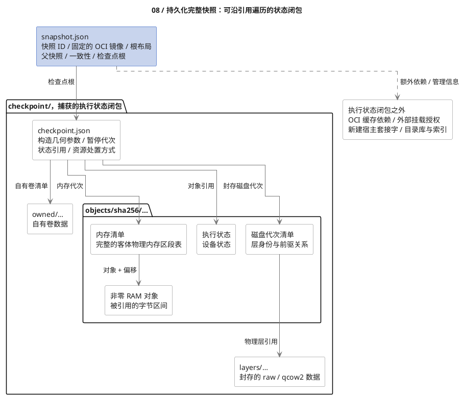
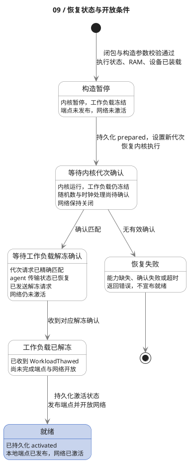
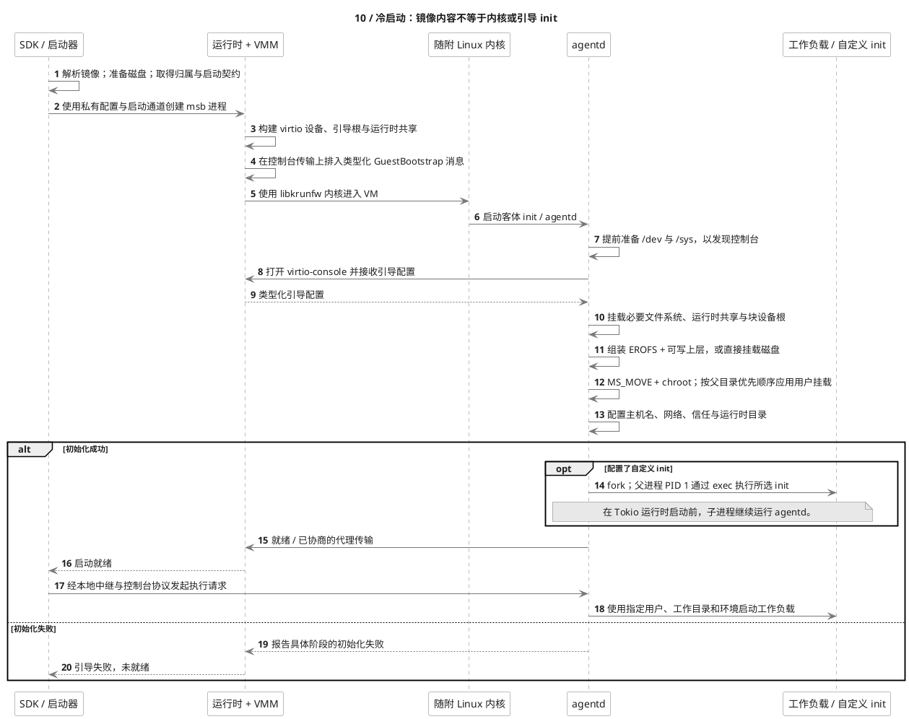

# Microsandbox 架构分析

本文分析 `references/microsandbox` 的部署、网络、磁盘、快照和引导实现。

源码版本为 `0feec23228e3fd2a94ae5e4719acf5e5667365ec`，对应 `v0.7.8-23-g0feec232`，workspace package version 为 `0.7.8`。固件子模块版本为 `21f169f7e94798c8916315f8ac6f5999d5b88566`，使用 Linux `6.12.111`。VMM 依赖为 `msb_krun = 0.1.41`，其内部实现仅讨论调用接口和固件补丁能确认的部分。

图形可用 docu.md Markdown Viewer 查看，建议使用浅色页面。组件名、协议名和源码标识保留原文。

## 阅读导航

1. [整体结构](#1-整体结构)
2. [部署架构](#2-部署架构)
3. [网络架构](#3-网络架构)
4. [镜像与磁盘](#4-镜像与磁盘)
5. [快照与恢复](#5-快照与恢复)
6. [系统引导](#6-系统引导)
7. [工程取舍](#7-工程取舍)

## 1. 整体结构

SDK/CLI 为每台 VM 创建一个宿主进程。该进程嵌入 VMM、用户态网络和文件系统后端，运行一个 Linux guest。guest 内的 agentd 负责初始化和管理请求。宿主目录保存镜像、磁盘和快照数据，SQLite catalog 保存管理记录。

| 术语 | 在此实现中的含义 |
|---|---|
| 没有 daemon | 没有启动本地 VM 所必需的中央 daemon；每个存活 VM 仍有长期运行的宿主进程，detached VM 不依赖最初的交互终端 |
| OCI compatible | 复用 OCI 文件内容、镜像配置与 layer 语义；不启动 Docker daemon，也不使用镜像里的内核 |
| 用户态网络 | guest 仍运行 Linux 网络栈；宿主侧用 smoltcp 和协议专用 relay 处理虚拟网卡流量，不等于 guest 绕过内核直接调用宿主 socket |
| VMDK root | 默认 layered OCI 的 VMDK 是映射多个文件的文本描述符，无需把所有 OCI 数据复制到一个文件 |
| 完整快照 | 在同一暂停边界捕获 RAM、执行状态、设备状态和受管理存储；不回滚外部服务器、宿主 TCP socket 或外部绑定挂载的内容 |
| fork | 创建独立的 VM 执行分支；不是简单 `fork()` 一个宿主 VMM 进程，也不是把两台 VM 接到同一可写盘 |
| application-consistent | 此实现把可连贯恢复的执行状态标成这个值；不表示已与外部数据库、消息队列或支付服务做了分布式事务协调 |

闭包指一个描述符及其引用的全部对象、磁盘层和必需数据。只有入口 JSON 而缺少被引用的文件，不能构成完整闭包。epoch / generation 标识捕获代次，用来检查各组件的状态是否来自同一次捕获。

## 2. 部署架构

### 2.1 组件与部署位置

图 1 展示组件的部署位置。每台 VM 有独立的 runtime 进程、guest 内存和可写根盘，镜像缓存与 catalog 可以共享。



| 单元 | 部署位置 / 粒度 | 职责与边界 |
|---|---|---|
| SDK、CLI | 调用方宿主进程 | 解析配置、管理 catalog、准备 image/volume、启动或连接 runtime |
| `msb` runtime | 每个 VM 的宿主进程 | 拥有 VM 生命周期、控制 socket、agent relay、checkpoint 协调和宿主资源 |
| `msb_krun` | runtime 内的 Rust VMM 依赖 | 构造 vCPU、RAM、virtio 设备，调用宿主虚拟化能力 |
| `libkrunfw` | 宿主安装的动态库文件 | 携带 Linux kernel 字节供 VMM 装载 |
| `agentd` | guest 内，默认 PID 1 | 初始化根文件系统、网络、证书；处理 exec、文件和生命周期协议 |
| network engine | runtime 进程内 | 每 VM 的 smoltcp 状态、poll loop、Tokio proxy/relay tasks |
| filesystem backends | runtime 进程内 | virtio-fs 的宿主文件访问和 checkpoint handle state；没有另一个必需的 virtiofsd 进程 |
| SQLite / cache / snapshots | 宿主磁盘 | catalog 与实际数据分开存储；backend 配置可修改目录位置 |

### 2.2 管理通道与工作负载网络

SDK/CLI 通过本地 IPC 连接 runtime control endpoint，提交暂停、快照和资源修改等宿主管理请求。

guest 管理请求由 SDK agent client 发送给本地 AgentRelay，再经 virtio-console ring 交给 agentd。relay 为客户端分配互不重叠的 correlation ID 范围。控制消息和大块数据可使用独立端口，也可共用 combined transport。

工作负载的网络请求经过 guest Linux TCP/IP 栈和 virtio-net，由宿主用户态网络引擎转发到宿主网络。

禁用 guest 网络不会关闭 agent 管理通道，exec 和文件操作仍可通过 virtio-console 完成，无需 SSH。显式配置的 vsock routes 则提供另一种宿主与 guest 通道，与 agent transport 独立。

### 2.3 本地、容器与 cloud backend

- Linux 使用 KVM，macOS 面向 Apple Silicon，Windows 使用 WHP。这些后端依赖宿主虚拟化能力，不提供跨 ISA 的 CPU 仿真。镜像须匹配目标 Linux 架构。
- 发布容器将 `msb` 与 `libkrunfw.so.*` 装入 Ubuntu 镜像，以 `msb` 为入口。容器没有内置调度器，仍依赖宿主的 KVM。部署到 Docker/Kubernetes 时，需要配置设备权限、资源限制、持久目录、租户认证和节点调度。
- `Dockerfile.agentd` 用于构建 guest 二进制，不是宿主 sidecar 的部署文件。
- cloud backend 提供 HTTP/WebSocket 客户端。仓库中的客户端代码不足以确定远端服务的部署结构。

### 2.4 生命周期所有权

launcher 在创建子进程前准备私有启动配置、启动通道、生命周期锁、磁盘锁和可选的父进程监视器。Unix 子进程使用显式 FD 映射，Windows 使用命名管道和句柄。detached runtime 可以在 SDK 退出后继续运行，其生命周期不依赖最初的 SDK 对象。

默认 home 为 `~/.microsandbox`，可通过 `MSB_HOME` 或 backend 路径配置改变。catalog 默认在 `db/msb.db`；`sandboxes`、`volumes`、`snapshots`、`cache`、`logs` 等是不同的持久化域。共享 cache 是复用优化，sandbox 的可写盘、runtime 身份和生命周期锁才是实例所有权的一部分。

## 3. 网络架构

### 3.1 用户态网络后端

此基线把自定义 network backend 接到 virtio-net。以太帧通过宿主 ring 交给 poll loop；smoltcp 维护 guest 这一侧的 TCP/IP 状态，Tokio socket 对外建立另一条宿主连接。没有在这条主路径上配置 TAP、Linux bridge 或宿主 NAT 规则。

图 2 按状态所在的位置对齐各协议。客体内核与宿主内核各自维护网络状态，中间的用户态后端终止或重建协议数据。蓝色区域是宿主运行时的处理范围，不属于客体内存。

```vega
{
  "$schema": "https://vega.github.io/schema/vega/v6.json",
  "width": 960,
  "height": 646,
  "padding": 16,
  "data": [
    {"name": "bands", "values": [
      {"x": 126, "y": 78, "w": 824, "h": 138, "fill": "#ffffff"},
      {"x": 126, "y": 248, "w": 824, "h": 142, "fill": "#c8d4ed"},
      {"x": 126, "y": 416, "w": 824, "h": 66, "fill": "#ffffff"},
      {"x": 126, "y": 510, "w": 824, "h": 62, "fill": "#ffffff"},
      {"x": 126, "y": 596, "w": 824, "h": 46, "fill": "#e8e8e8"}
    ]},
    {"name": "columns", "values": [
      {"x": 229, "title": "TCP / TLS", "app": "应用 socket / TLS"},
      {"x": 435, "title": "DNS", "app": "客体解析器"},
      {"x": 641, "title": "UDP", "app": "应用数据报 / QUIC"},
      {"x": 847, "title": "ICMP / 链路", "app": "ping / 邻居发现"}
    ]},
    {"name": "cells", "values": [
      {"x": 229, "y": 276, "label": "smoltcp 客体侧 TCP\nTcpProxy 对接宿主连接\n可选 TLS 终止与密钥替换\nIP、域名与 HTTP 目标校验"},
      {"x": 435, "y": 276, "label": "UDP/53、TCP/53 拦截\nDoT 解密后交 DNS 转发器\n查询策略、缓存、重绑定防护\n主机名与地址绑定"},
      {"x": 641, "y": 276, "label": "分片重组与端口策略\nUdpRelay 按流维护会话\n响应重新封装为客体帧\nQUIC 可按拦截配置丢弃"},
      {"x": 847, "y": 276, "label": "网关回显在本地回答\nARP / ND 留在虚拟链路\n仅外部回显使用 ping socket\n不是任意 ICMP 转发"},
      {"x": 229, "y": 433, "label": "独立的宿主 TCP socket\n与客体 TCP 状态分离"},
      {"x": 435, "y": 433, "label": "DNS 上游传输\n不等于普通 UDP relay"},
      {"x": 641, "y": 433, "label": "宿主 UDP socket\n或 SOCKS5 UDP 通道"},
      {"x": 847, "y": 433, "label": "宿主 ping socket\n受权限与平台限制"},
      {"x": 229, "y": 525, "label": "目标服务 / TCP 上游代理"},
      {"x": 435, "y": 525, "label": "配置或获准访问的解析器"},
      {"x": 641, "y": 525, "label": "目标服务 / SOCKS5 代理"},
      {"x": 847, "y": 525, "label": "外部回显目标"}
    ]},
    {"name": "labels", "values": [
      {"x": 8, "y": 142, "label": "客体 VM\n应用与内核"},
      {"x": 8, "y": 310, "label": "宿主用户态\nmsb 运行时"},
      {"x": 8, "y": 439, "label": "宿主内核"},
      {"x": 8, "y": 534, "label": "外部网络"},
      {"x": 8, "y": 610, "label": "入站端口发布"}
    ]},
    {"name": "separators", "values": [{"x":332},{"x":538},{"x":744}]}
  ],
  "marks": [
    {"type": "rect", "encode": {"enter": {"x":{"value":0},"y":{"value":0},"width":{"signal":"width"},"height":{"signal":"height"},"fill":{"value":"#f4f4f4"}}}},
    {"type": "text", "encode": {"enter": {"x":{"value":8},"y":{"value":12},"text":{"value":"02 / 网络栈分层与状态归属"},"fontSize":{"value":23},"fontWeight":{"value":"bold"},"baseline":{"value":"top"},"fill":{"value":"#1e1e1e"}}}},
    {"type": "rect", "from":{"data":"bands"}, "encode": {"enter": {"x":{"field":"x"},"y":{"field":"y"},"width":{"field":"w"},"height":{"field":"h"},"fill":{"field":"fill"},"stroke":{"value":"#787878"}}}},
    {"type": "text", "from":{"data":"columns"}, "encode": {"enter": {"x":{"field":"x"},"y":{"value":54},"text":{"field":"title"},"align":{"value":"center"},"fontWeight":{"value":"bold"},"fontSize":{"value":17},"fill":{"value":"#1e1e1e"}}}},
    {"type": "text", "from":{"data":"columns"}, "encode": {"enter": {"x":{"field":"x"},"y":{"value":109},"text":{"field":"app"},"align":{"value":"center"},"fontSize":{"value":15},"fill":{"value":"#1e1e1e"}}}},
    {"type": "rule", "encode": {"enter": {"x":{"value":146},"x2":{"value":930},"y":{"value":133},"stroke":{"value":"#787878"}}}},
    {"type": "text", "encode": {"enter": {"x":{"value":538},"y":{"value":159},"text":{"value":"客体 Linux TCP/IP 栈 · socket 状态 · 路由与邻居缓存"},"align":{"value":"center"},"fontSize":{"value":16},"fill":{"value":"#1e1e1e"}}}},
    {"type": "text", "encode": {"enter": {"x":{"value":538},"y":{"value":192},"text":{"value":"virtio-net 虚拟网卡"},"align":{"value":"center"},"fontSize":{"value":16},"fill":{"value":"#1e1e1e"}}}},
    {"type": "text", "encode": {"enter": {"x":{"value":538},"y":{"value":237},"text":{"value":"VM 边界：以太网帧经 ring 交给帧检查与 smoltcp 轮询循环"},"align":{"value":"center"},"fontSize":{"value":14},"fill":{"value":"#1e1e1e"}}}},
    {"type": "rule", "from":{"data":"separators"}, "encode": {"enter": {"x":{"field":"x"},"y":{"value":260},"y2":{"value":378},"stroke":{"value":"#787878"}}}},
    {"type": "text", "from":{"data":"cells"}, "encode": {"enter": {"x":{"field":"x"},"y":{"field":"y"},"text":{"field":"label"},"align":{"value":"center"},"baseline":{"value":"top"},"lineBreak":{"value":"\n"},"lineHeight":{"value":24},"fontSize":{"value":14},"fill":{"value":"#1e1e1e"}}}},
    {"type": "text", "from":{"data":"labels"}, "encode": {"enter": {"x":{"field":"x"},"y":{"field":"y"},"text":{"field":"label"},"baseline":{"value":"top"},"lineBreak":{"value":"\n"},"lineHeight":{"value":23},"fontSize":{"value":15},"fontWeight":{"value":"bold"},"fill":{"value":"#1e1e1e"}}}},
    {"type": "text", "encode": {"enter": {"x":{"value":538},"y":{"value":620},"text":{"value":"宿主 TCP/UDP listener 接受外部流量，经入站策略映射到客体端口，不给客体 IP 添加宿主路由"},"align":{"value":"center"},"fontSize":{"value":14},"fill":{"value":"#1e1e1e"}}}}
  ]
}
```

宿主 TCP 连接、DNS 缓存和 TLS 会话属于 runtime，不在 guest RAM 中。网络后端支持 TCP、UDP 和特定 ICMP 行为，但不提供任意 IP 协议、组播或隧道协议的透明转发。

### 3.2 地址、路由与 host alias

普通冷启动按 sandbox slot 派生地址：

| 项目 | 默认派生方式 |
|---|---|
| IPv4 pool | `172.16.0.0/12`，每 slot 分配一个 `/30`；gateway 为块内 `+1`，guest 为 `+2` |
| IPv6 pool | `fd42:6d73:62::/48`，每 slot 一个 `/64`；gateway `::1`，guest `::2` |
| MAC | locally administered 地址，slot 写入 guest/gateway MAC |
| MTU | 未覆盖时为 1500 |
| DNS | bootstrap 给 guest 配置对应 gateway 地址为 resolver |
| host alias | `host.microsandbox.internal`，由 hosts/DNS 指向 gateway；是否允许连接仍由 policy 决定 |

IPv4/IPv6 是否启用取决于宿主路由探测、显式地址和端口发布配置，VM 不一定启用双栈。agentd 用 ioctl/netlink 配置接口与路由，无需 DHCP。

guest 访问 gateway 的普通 TCP/UDP 端口时，网络后端先检查策略，再将目标重写为宿主 loopback。TCP 连接还可回退到另一地址族的 loopback。该映射只处理 gateway 地址，guest 的 `127.0.0.1` 仍指向自身。默认 Public profile 不因此放行宿主服务。

### 3.3 协议处理矩阵

| 协议 / 场景 | 实际路径 | 策略与限制 |
|---|---|---|
| ARP / IPv6 ND | smoltcp 虚拟链路处理 | 不把所有广播转发到宿主 LAN |
| TCP | SYN 预检查 → smoltcp socket → proxy task → host TCP | IP/port 拒绝通常在拨号前；域名规则可能先完成 guest 侧握手以读取首包，再决定是否拨号 |
| UDP | 专用 relay，以 flow 建立宿主 session，重构响应帧 | 分片重组后再检查端口策略；有 session、队列和 MTU/PMTU 处理 |
| UDP/53、TCP/53 | DNS interceptor/proxy → 同一 forwarder | 不是无条件放行 DNS：查询名和 resolver 选择仍接受应用层检查 |
| TCP/853（DoT） | 配置 TLS interception 时解密 DNS 帧并走 forwarder | 无 interception 时拒绝；应用是否回退到其他 DNS 传输方式，取决于自身实现 |
| UDP/853（DoQ） | 拒绝 / 丢弃 | 没有 QUIC DNS MITM |
| UDP/5353、5355、137 | 拒绝 / 丢弃 | mDNS、LLMNR、NetBIOS-NS 不转发为 LAN 发现 |
| HTTPS / TLS | 正常 TCP 透明 relay，或可选 TLS MITM | TLS interception 默认关闭；默认目标端口集合是 443；bypass 不等于绕过 policy |
| QUIC / HTTP/3 | 普通 UDP，或按 interception 端口丢弃 | interception 启用且 `block_quic_on_intercept=true` 时丢对应 UDP；不是 QUIC 解密 |
| DoH | 普通 HTTPS 路径 | 不在 DNS 端口分类中，不由 DNS forwarder 统一解析和过滤 |
| ICMP echo 到 gateway | 本地构造 echo reply | 仍检查策略；不是发给外部网络 |
| ICMP echo 到外部 | 宿主 `SOCK_DGRAM + IPPROTO_ICMP/ICMPV6` ping socket | 依赖宿主权限和平台；Windows 此路径标为 unavailable；不是任意 ICMP 透明代理 |
| PMTU / packet-too-big | UDP relay 处理可识别的宿主 MTU 错误并构造 guest 错误 | 支持范围不涵盖完整的 traceroute 和 ICMP 错误转发语义 |
| vsock | 独立的 virtio-vsock route backend | 不属于 smoltcp；MultiTenant 禁用 host routes，Windows 不支持此处的 datagram route |

### 3.4 DNS：同时承担解析、过滤与域名绑定

图 3 用两个共用 IP 的域名说明绑定的作用。示例只允许 `api.example.test`，没有单独放行目标 IP。DNS 建立的是带有效期的域名与地址关联，不是对该 IP 上所有服务的授权。解析器选择与响应地址检查仍独立执行。

```vega
{
  "$schema": "https://vega.github.io/schema/vega/v6.json",
  "width": 1000,
  "height": 660,
  "padding": 16,
  "data": [
    {"name":"routes","values":[
      {"path":"M 270,260 C 390,260 570,260 745,260","color":"#0043ce","dash":[]},
      {"path":"M 270,410 C 365,410 440,410 535,410","color":"#787878","dash":[7,5]},
      {"path":"M 605,410 L 745,410","color":"#787878","dash":[2,7]},
      {"path":"M 480,208 L 480,260","color":"#0043ce","dash":[3,4]}
    ]},
    {"name":"packets","values":[
      {"path":"M 40,226 L 250,226 L 270,260 L 250,294 L 40,294 Z","fill":"#c8d4ed","stroke":"#003bb5"},
      {"path":"M 40,376 L 250,376 L 270,410 L 250,444 L 40,444 Z","fill":"#ffffff","stroke":"#787878"}
    ]},
    {"name":"labels","values":[
      {"x":16,"y":16,"text":"03 / 同一个 IP，不能共用一份域名授权","size":24,"weight":"bold","color":"#1e1e1e"},
      {"x":16,"y":61,"text":"示例策略只允许 api.example.test；两个域名都指向同一地址。","size":16,"weight":"normal","color":"#565656"},
      {"x":40,"y":176,"text":"客体发出的连接","size":17,"weight":"bold","color":"#1e1e1e"},
      {"x":58,"y":238,"text":"目标名  api.example.test\n目标 IP  与 DNS 答案一致","size":15,"weight":"normal","color":"#1e1e1e"},
      {"x":58,"y":388,"text":"目标名  admin.example.test\n目标 IP  仍是同一个地址","size":15,"weight":"normal","color":"#1e1e1e"},
      {"x":354,"y":124,"text":"宿主保存的 DNS 绑定","size":17,"weight":"bold","color":"#1e1e1e"},
      {"x":354,"y":158,"text":"api.example.test  ↔  目标 IP\n附带 TTL，只关联这个域名与地址","size":15,"weight":"normal","color":"#1e1e1e"},
      {"x":354,"y":284,"text":"域名、地址与有效期相符\n继续核验 SNI / HTTP authority","size":15,"weight":"normal","color":"#1e1e1e"},
      {"x":375,"y":452,"text":"admin 不能借用 api 的绑定\n同 IP 不能替代域名授权","size":16,"weight":"normal","color":"#1e1e1e"},
      {"x":756,"y":146,"text":"同一目标 IP","size":21,"weight":"bold","color":"#1e1e1e"},
      {"x":765,"y":244,"text":"api.example.test\n获准的服务","size":16,"weight":"normal","color":"#1e1e1e"},
      {"x":765,"y":394,"text":"admin.example.test\n另一个虚拟主机","size":16,"weight":"normal","color":"#1e1e1e"},
      {"x":40,"y":538,"text":"绑定还受时间限制","size":17,"weight":"bold","color":"#1e1e1e"},
      {"x":40,"y":621,"text":"DNS 绑定写入","size":14,"weight":"normal","color":"#565656"},
      {"x":603,"y":621,"text":"TTL 到期","size":14,"weight":"normal","color":"#565656"},
      {"x":238,"y":582,"text":"有效绑定可参与后续连接核验","size":15,"weight":"normal","color":"#1e1e1e"},
      {"x":705,"y":582,"text":"过期关联不能继续授权","size":15,"weight":"normal","color":"#1e1e1e"}
    ]},
    {"name":"ticks","values":[{"x":40},{"x":635},{"x":960}]}
  ],
  "marks": [
    {"type":"rect","encode":{"enter":{"width":{"signal":"width"},"height":{"signal":"height"},"fill":{"value":"#f4f4f4"}}}},
    {"type":"rect","encode":{"enter":{"x":{"value":725},"y":{"value":114},"width":{"value":255},"height":{"value":380},"cornerRadius":{"value":20},"fill":{"value":"#e8e8e8"},"stroke":{"value":"#787878"}}}},
    {"type":"rect","encode":{"enter":{"x":{"value":745},"y":{"value":220},"width":{"value":215},"height":{"value":80},"fill":{"value":"#c8d4ed"},"stroke":{"value":"#003bb5"}}}},
    {"type":"rect","encode":{"enter":{"x":{"value":745},"y":{"value":370},"width":{"value":215},"height":{"value":80},"fill":{"value":"#ffffff"},"stroke":{"value":"#787878"}}}},
    {"type":"rect","encode":{"enter":{"x":{"value":335},"y":{"value":108},"width":{"value":345},"height":{"value":100},"cornerRadius":{"value":6},"fill":{"value":"#ffffff"},"stroke":{"value":"#003bb5"},"strokeDash":{"value":[5,3]}}}},
    {"type":"path","from":{"data":"routes"},"encode":{"enter":{"path":{"field":"path"},"stroke":{"field":"color"},"strokeWidth":{"value":2.5},"strokeDash":{"field":"dash"}}}},
    {"type":"path","from":{"data":"packets"},"encode":{"enter":{"path":{"field":"path"},"fill":{"field":"fill"},"stroke":{"field":"stroke"}}}},
    {"type":"symbol","encode":{"enter":{"x":{"value":735},"y":{"value":260},"shape":{"value":"triangle-right"},"size":{"value":140},"fill":{"value":"#0043ce"}}}},
    {"type":"path","encode":{"enter":{"path":{"value":"M 550,394 L 582,426 M 582,394 L 550,426"},"stroke":{"value":"#750e13"},"strokeWidth":{"value":4}}}},
    {"type":"rect","encode":{"enter":{"x":{"value":40},"y":{"value":572},"width":{"value":595},"height":{"value":32},"fill":{"value":"#c8d4ed"}}}},
    {"type":"rect","encode":{"enter":{"x":{"value":635},"y":{"value":572},"width":{"value":325},"height":{"value":32},"fill":{"value":"#e8e8e8"}}}},
    {"type":"rule","from":{"data":"ticks"},"encode":{"enter":{"x":{"field":"x"},"y":{"value":568},"y2":{"value":610},"stroke":{"value":"#787878"}}}},
    {"type":"text","from":{"data":"labels"},"encode":{"enter":{"x":{"field":"x"},"y":{"field":"y"},"text":{"field":"text"},"fontSize":{"field":"size"},"fontWeight":{"field":"weight"},"fill":{"field":"color"},"baseline":{"value":"top"},"lineBreak":{"value":"\n"},"lineHeight":{"value":23}}}}
  ]
}
```

DNS forwarder 按以下规则处理查询与响应。

1. 对查询名执行 network policy；拒绝时用合成 `NXDOMAIN`，避免某些 stub 对 `REFUSED` 长时间重试。
2. 对 inactive address family 返回无地址答案，不制造当前 VM 无法使用的地址。
3. host alias 的 A/AAAA 可本地合成。
4. 发往 gateway 的请求选择配置的 upstream；guest 指定其他 resolver 时，额外检查该 resolver 的 IP、协议与端口。
5. 配置 upstream 按顺序 failover；全部不可用返回 `SERVFAIL`。
6. 默认启用 rebind protection。private/reserved 答案不是一律允许或一律禁止：要有显式 IP 类许可，并满足平台 policy floor。`allow_all` 本身不被当成明确授权 private DNS answer 的意图。
7. 从相关 answer/CNAME 链提取地址与 TTL，写入 hostname binding；容量耗尽返回 `SERVFAIL`，而不是返回一个无法可靠关联的地址。
8. UDP 响应大于 guest EDNS 容量时设置 `TC=1`，让 resolver 有机会重试 TCP。

DNS allowlist 控制可查询的域名，IP policy 控制目标地址，TLS/HTTP authority 检查请求实际声明的目标。一个 IP 可能承载多个域名，允许查询其中一个域名并不授权访问该 IP 上的其他服务。

### 3.5 TCP、TLS 和 HTTP authority

TCP proxy 分别维护 guest 连接和宿主连接。按 IP 授权时，可以先连接上游，再推进 guest 握手。按域名授权时，需要先读取 guest 首包，结合 SNI 或缓存绑定作出判断，然后决定是否连接目标。

默认 `strict=true` 要求按域名授权的流量具有可检查的应用层 authority。实现会验证明文 HTTP 的 `Host` 和 HTTP/2 的 `:authority`。TLS bypass 或无法检查的 TLS 流量若仅靠域名规则授权，会受到 strict 限制。SNI 仍须结合目标地址绑定判断，不能单独授权任意 IP。

图 4 展示 TLS 拦截与密钥替换。代理终止 guest 的 TLS 会话，在宿主侧替换密钥，再通过独立的 TLS 会话连接上游。



proxy 对 guest 是 TLS 服务端，对上游是 TLS 客户端。启动前，runtime 将 CA 公钥证书放入共享目录，由 agentd 安装到 guest 信任库。真实密钥留在宿主处理器中，bootstrap 只向 guest 传递占位符。上游证书验证默认开启，配置可覆盖这一行为。

secret handler 在支持的 HTTP header/body 范围内替换密钥，不对任意二进制协议执行全局字符串替换。它逐请求检查 authority，并维护流状态，以处理 HTTP keep-alive、分段输入和 HTTP/2 HPACK。密钥更新后，新连接读取新值，已有连接不会立即切换凭据。

这条注入路径不向 guest 提供真实密钥，但上游服务器仍可能在响应中回显凭据，应用也可能通过其他通道接收密钥。

### 3.6 内部代理、应用隧道与上游代理

| 名称 | 谁配置 / 谁连接 | 意义 |
|---|---|---|
| 内部 TCP/TLS proxy | runtime 自动组织 | guest TCP 与宿主 socket 的桥接和可选 MITM |
| guest 发起的 HTTP CONNECT | guest 应用 | 应用自己请求隧道；实现解析 CONNECT authority、处理已有 upstream stream，并限制 CONNECT 元数据中的 secret placeholder |
| host 配置的 outbound proxy | SDK/backend 配置 | runtime 对外拨号再经 HTTP CONNECT、SOCKS4 或 SOCKS5；不要求 guest 自己设置代理环境变量 |

宿主上游代理支持 TCP。非 DNS UDP 仅能使用 SOCKS5，HTTP CONNECT/SOCKS4 会阻止这类流量。以宿主 gateway 为目标的连接不使用同一套外部代理选择逻辑。DNS 转发和 ICMP relay 各有独立路径，上游代理配置不统一接管所有协议。

### 3.7 Published ports、policy 与多租户边界

端口发布在宿主创建 TCP/UDP listener，将流量转发到 guest 指定端口，不为 guest IP 添加宿主路由。入站规则的 address 匹配外部 peer，port 匹配 guest 监听端口，而非 peer 的临时源端口。宿主监听地址决定哪些网络可以接入。

policy 是一个有序规则列表，按方向 first-match-wins，再落到该方向默认值：

- 默认 policy 是 `Public` profile，不是裸 `allow_all`。
- profile 展开为 gateway DNS 窄许可、所需 destination groups 和默认拒绝 egress；profile 构造器的 ingress 为允许，以保留 published-port 行为。
- CIDR、Domain、DomainSuffix、Host/Private/Public 等分类具有不同语义。分类器将 IPv4-mapped IPv6 和配置的 NAT64 `/96` 地址还原为 IPv4 后分类，但不执行通用 NAT64 转换。
- `MultiTenant` 在租户规则之外叠加平台 public-network floor，并清除自定义 interface、published ports、nameservers、host CA trust、outbound proxy，强制 rebind protection，设置默认连接数量上限。租户规则不能扩大平台允许集。

这是进程内的安全策略，不是 Kubernetes NetworkPolicy，也不是宿主 nftables 防火墙。若要将本地 SDK 封装成多租户服务，仍须提供 API 授权、宿主进程隔离、文件权限和资源预算。

## 4. 镜像与磁盘

### 4.1 OCI 拉取与根文件系统物化

镜像拉取先为各 OCI 层生成 EROFS，再合成分层或平坦根文件系统。两种表示共享逐层 EROFS 缓存。

图 5 用两个镜像展示层复用。甲和乙共享基础层，甲的更新层覆盖配置并删除文档，乙的工作层只新增程序。上方文件旁的色标表示内容来源，下方每张纸代表宿主实际缓存的一份 EROFS 层文件。甲不再显示文档，不会删除基础层中的文档数据。

```vega
{
  "$schema": "https://vega.github.io/schema/vega/v6.json",
  "width": 1000,
  "height": 780,
  "padding": 16,
  "data": [
    {"name":"origins","values":[
      {"path":"M 440,478 C 440,420 400,420 400,360","kind":"基础层"},
      {"path":"M 560,478 C 560,420 600,420 600,360","kind":"基础层"},
      {"path":"M 170,478 L 170,360","kind":"更新层"},
      {"path":"M 830,478 L 830,360","kind":"工作层"}
    ]},
    {"name":"papers","values":[
      {"path":"M 25,100 L 425,100 L 465,140 L 465,360 L 25,360 Z M 425,100 L 425,140 L 465,140","fill":"#ffffff"},
      {"path":"M 535,100 L 935,100 L 975,140 L 975,360 L 535,360 Z M 935,100 L 935,140 L 975,140","fill":"#ffffff"},
      {"path":"M 35,478 L 275,478 L 305,508 L 305,700 L 35,700 Z M 275,478 L 275,508 L 305,508","fill":"#cbd9cf"},
      {"path":"M 365,478 L 605,478 L 635,508 L 635,700 L 365,700 Z M 605,478 L 605,508 L 635,508","fill":"#c8d4ed"},
      {"path":"M 695,478 L 935,478 L 965,508 L 965,700 L 695,700 Z M 935,478 L 935,508 L 965,508","fill":"#ddcbcc"}
    ]},
    {"name":"files","values":[
      {"x":56,"y":176,"name":"/bin/tool","detail":"基础版本","kind":"基础层"},
      {"x":56,"y":220,"name":"/etc/app.conf","detail":"更新版本","kind":"更新层"},
      {"x":566,"y":176,"name":"/bin/tool","detail":"基础版本","kind":"基础层"},
      {"x":566,"y":220,"name":"/etc/app.conf","detail":"基础版本","kind":"基础层"},
      {"x":566,"y":264,"name":"/worker","detail":"新增程序","kind":"工作层"},
      {"x":566,"y":308,"name":"/doc.txt","detail":"仍然可见","kind":"基础层"}
    ]},
    {"name":"labels","values":[
      {"x":16,"y":16,"text":"05 / 两个镜像，只有一份基础层数据","size":24,"weight":"bold","color":"#1e1e1e"},
      {"x":16,"y":59,"text":"示意文件名与版本；色标表示内容来源，连线表示层引用。每层按 diff_id 缓存。","size":15,"weight":"normal","color":"#565656"},
      {"x":56,"y":121,"text":"镜像甲 · 基础层＋更新层","size":20,"weight":"bold","color":"#1e1e1e"},
      {"x":566,"y":121,"text":"镜像乙 · 基础层＋工作层","size":20,"weight":"bold","color":"#1e1e1e"},
      {"x":80,"y":264,"text":"/doc.txt","size":17,"weight":"normal","color":"#565656"},
      {"x":275,"y":264,"text":"已被 whiteout 遮蔽","size":14,"weight":"normal","color":"#565656"},
      {"x":56,"y":505,"text":"更新层","size":20,"weight":"bold","color":"#1e1e1e"},
      {"x":56,"y":548,"text":"/etc/app.conf  新版本\n/doc.txt 的删除标记","size":16,"weight":"normal","color":"#1e1e1e"},
      {"x":56,"y":637,"text":"覆盖配置，隐藏文档\n不改写基础层","size":15,"weight":"normal","color":"#1e1e1e"},
      {"x":386,"y":505,"text":"基础层 · 两个镜像共用","size":18,"weight":"bold","color":"#1e1e1e"},
      {"x":386,"y":548,"text":"/bin/tool\n/etc/app.conf  基础版本\n/doc.txt","size":16,"weight":"normal","color":"#1e1e1e"},
      {"x":386,"y":653,"text":"原始内容仍全部保留","size":15,"weight":"normal","color":"#1e1e1e"},
      {"x":716,"y":505,"text":"工作层","size":20,"weight":"bold","color":"#1e1e1e"},
      {"x":716,"y":548,"text":"/worker  新增程序","size":16,"weight":"normal","color":"#1e1e1e"},
      {"x":716,"y":637,"text":"未覆盖配置\n继续引用基础版本","size":15,"weight":"normal","color":"#1e1e1e"},
      {"x":35,"y":734,"text":"分层根用 fsmeta 记录可见文件及其数据位置；平坦根则将合并结果物化为完整 ext4。","size":16,"weight":"normal","color":"#1e1e1e"}
    ]}
  ],
  "scales":[{"name":"color","type":"ordinal","domain":["基础层","更新层","工作层"],"range":["#0043ce","#0e6027","#750e13"]}],
  "marks":[
    {"type":"rect","encode":{"enter":{"width":{"signal":"width"},"height":{"signal":"height"},"fill":{"value":"#f4f4f4"}}}},
    {"type":"path","from":{"data":"origins"},"encode":{"enter":{"path":{"field":"path"},"stroke":{"scale":"color","field":"kind"},"strokeWidth":{"value":3}}}},
    {"type":"path","from":{"data":"papers"},"encode":{"enter":{"path":{"field":"path"},"fill":{"field":"fill"},"stroke":{"value":"#787878"},"strokeWidth":{"value":1.5}}}},
    {"type":"rect","from":{"data":"files"},"encode":{"enter":{"x":{"field":"x"},"y":{"field":"y","offset":2},"width":{"value":12},"height":{"value":18},"fill":{"scale":"color","field":"kind"}}}},
    {"type":"text","from":{"data":"files"},"encode":{"enter":{"x":{"field":"x","offset":24},"y":{"field":"y"},"text":{"field":"name"},"fontSize":{"value":17},"fill":{"value":"#1e1e1e"},"baseline":{"value":"top"}}}},
    {"type":"text","from":{"data":"files"},"encode":{"enter":{"x":{"field":"x","offset":250},"y":{"field":"y","offset":2},"text":{"field":"detail"},"fontSize":{"value":14},"fill":{"value":"#1e1e1e"},"baseline":{"value":"top"}}}},
    {"type":"text","from":{"data":"labels"},"encode":{"enter":{"x":{"field":"x"},"y":{"field":"y"},"text":{"field":"text"},"fontSize":{"field":"size"},"fontWeight":{"field":"weight"},"fill":{"field":"color"},"baseline":{"value":"top"},"lineBreak":{"value":"\n"},"lineHeight":{"value":27}}}},
    {"type":"rule","encode":{"enter":{"x":{"value":74},"x2":{"value":170},"y":{"value":274},"stroke":{"value":"#787878"},"strokeWidth":{"value":2}}}}
  ]
}
```

物化过程使用以下标识区分压缩数据、层内容、镜像组合和输出产物。

| Identity | 标识什么 | 解决什么问题 |
|---|---|---|
| compressed descriptor digest | registry 压缩 blob | 下载字节完整性 |
| OCI `diff_id` | 解压后的 tar 流 | 不同压缩编码仍可复用同一层内容 |
| manifest digest | 一组有序 layers 和 image config | `fsmeta`/VMDK 的组合身份 |
| flat derivation / artifact digest | 物化算法输入，以及最终 ext4 字节 | 区分不同 materializer ABI，并验证输出 |

这些摘要用于检查内容完整性和关联产物，不验证发行者签名。

### 4.2 分层根文件系统的设备映射

图 6 将两种不同的覆盖关系展开。上半部按文件名对齐，展示未修改、已修改和已删除的文件。下半部按块地址对齐，展示可写盘从不同磁盘层取块。这里的文件和块都是示例，两组列没有一一对应关系，ext4 文件也不一定只占一个块。图示磁盘链已经历轮转，新实例可以只有一个可写 raw 盘。

<div class="msb-cutaway" style="max-width: 1040px; box-sizing: border-box; position: relative;">
  <style>
    .msb-cutaway { background: #f4f4f4; color: #1e1e1e; }
    .msb-cutaway svg { display: block; width: 100%; height: auto; }
    .msb-cutaway text { fill: #1e1e1e; font-size: 16px; }
    .msb-cutaway .msb-cutaway-title { font-size: 25px; font-weight: 700; }
    .msb-cutaway .msb-cutaway-head { font-size: 18px; font-weight: 700; }
    .msb-cutaway .msb-cutaway-small { font-size: 13px; }
    .msb-cutaway .msb-cutaway-muted { fill: #565656; font-size: 14px; }
    .msb-cutaway .msb-cutaway-line { fill: none; stroke: #787878; stroke-width: 1.5; }
    .msb-cutaway .msb-cutaway-projection { fill: none; stroke: #787878; stroke-width: 2; stroke-dasharray: 4 5; }
    .msb-cutaway .msb-cutaway-write { fill: none; stroke: #0043ce; stroke-width: 2.5; }
  </style>
  <svg viewBox="0 0 1040 1130" role="img" aria-labelledby="msb-cutaway-title msb-cutaway-desc">
    <title id="msb-cutaway-title">文件覆盖与块覆盖的展开剖面</title>
    <desc id="msb-cutaway-desc">上方三张展开的平面分别是合并视图、可写 upper 和只读 lower。下方左侧展示 VMDK 的文件区段拼接，右侧展示三个逻辑块分别命中可写头、封存层和 raw 基底。</desc>
    <defs>
      <g id="msb-cutaway-sheet">
        <path d="M 70,40 L 650,40 L 720,0 L 140,0 Z" fill="#ffffff" stroke="#787878"/>
        <path d="M 70,40 L 650,40 L 650,54 L 70,54 Z M 650,40 L 720,0 L 720,14 L 650,54 Z" fill="#e8e8e8" stroke="#787878"/>
      </g>
      <g id="msb-cutaway-disk">
        <path d="M 0,30 L 380,30 L 430,0 L 50,0 Z" fill="#ffffff" stroke="#787878"/>
        <path d="M 0,30 L 380,30 L 380,43 L 0,43 Z M 380,30 L 430,0 L 430,13 L 380,43 Z" fill="#e8e8e8" stroke="#787878"/>
      </g>
    </defs>
    <text x="28" y="40" class="msb-cutaway-title">06 / 文件覆盖之下，还有一套块覆盖</text>
    <text x="28" y="73" class="msb-cutaway-muted">展开剖面 · 蓝色为实例修改 · 虚线向下寻找内容，遇到已有内容或删除标记即停止</text>
    <text x="28" y="120" class="msb-cutaway-head">客体 · 按同一文件名对齐</text>
    <text x="224" y="152" text-anchor="middle" class="msb-cutaway-small">未修改</text>
    <text x="414" y="152" text-anchor="middle" class="msb-cutaway-small">已修改</text>
    <text x="604" y="152" text-anchor="middle" class="msb-cutaway-small">已删除</text>
    <use href="#msb-cutaway-sheet" transform="translate(0 166)"/>
    <use href="#msb-cutaway-sheet" transform="translate(0 296)"/>
    <use href="#msb-cutaway-sheet" transform="translate(0 426)"/>
    <path d="M 145,201 L 280,201 L 312,177 L 177,177 Z" fill="#e8e8e8" stroke="#787878"/>
    <path d="M 335,201 L 470,201 L 502,177 L 367,177 Z" fill="#c8d4ed" stroke="#003bb5"/>
    <path d="M 525,201 L 660,201 L 692,177 L 557,177 Z" fill="#f4f4f4" stroke="#787878" stroke-dasharray="4 4"/>
    <text x="228" y="195" text-anchor="middle" class="msb-cutaway-small">/bin/tool</text>
    <text x="418" y="195" text-anchor="middle" class="msb-cutaway-small">配置 · 新内容</text>
    <text x="608" y="195" text-anchor="middle" class="msb-cutaway-small">文档不可见</text>
    <path d="M 145,331 L 280,331 L 312,307 L 177,307 Z" fill="#f4f4f4" stroke="#787878" stroke-dasharray="4 4"/>
    <path d="M 335,331 L 470,331 L 502,307 L 367,307 Z M 525,331 L 660,331 L 692,307 L 557,307 Z" fill="#c8d4ed" stroke="#003bb5"/>
    <text x="228" y="325" text-anchor="middle" class="msb-cutaway-small">没有上层副本</text>
    <text x="418" y="325" text-anchor="middle" class="msb-cutaway-small">copy-up 后修改</text>
    <text x="608" y="325" text-anchor="middle" class="msb-cutaway-small">删除标记</text>
    <path d="M 145,461 L 280,461 L 312,437 L 177,437 Z M 335,461 L 470,461 L 502,437 L 367,437 Z M 525,461 L 660,461 L 692,437 L 557,437 Z" fill="#e8e8e8" stroke="#787878"/>
    <text x="228" y="455" text-anchor="middle" class="msb-cutaway-small">/bin/tool</text>
    <text x="418" y="455" text-anchor="middle" class="msb-cutaway-small">配置 · 原内容</text>
    <text x="608" y="455" text-anchor="middle" class="msb-cutaway-small">文档仍在镜像中</text>
    <path d="M 224,220 L 224,305 M 224,350 L 224,437" class="msb-cutaway-projection"/>
    <path d="M 414,220 L 414,307 M 604,220 L 604,307" class="msb-cutaway-write"/>
    <circle cx="224" cy="437" r="5" fill="#787878"/>
    <circle cx="414" cy="307" r="5" fill="#0043ce"/>
    <path d="M 595,294 L 613,312 M 613,294 L 595,312" class="msb-cutaway-write"/>
    <path d="M 720,188 L 756,188 M 720,318 L 756,318 M 720,448 L 756,448" class="msb-cutaway-line"/>
    <text x="770" y="187" class="msb-cutaway-head">合并根 /</text>
    <text x="770" y="213" class="msb-cutaway-muted">OverlayFS 可见结果</text>
    <text x="770" y="312" class="msb-cutaway-head">ext4 upper · 可写</text>
    <text x="770" y="338">/dev/vdb</text>
    <text x="770" y="361" class="msb-cutaway-muted">实例修改，不改镜像</text>
    <text x="770" y="442" class="msb-cutaway-head">EROFS lower · 只读</text>
    <text x="770" y="468">/dev/vda</text>
    <text x="770" y="491" class="msb-cutaway-muted">客体只挂载一个 lower</text>
    <text x="100" y="518" class="msb-cutaway-muted">工具读取落到 lower；配置读取止于 upper；删除标记阻止继续查找文档。</text>
    <path d="M 28,556 L 1012,556" stroke="#787878" stroke-dasharray="7 5"/>
    <text x="28" y="582" class="msb-cutaway-muted">VM 边界 · 两个 virtio-blk 设备 · 下方按块地址与宿主文件展开</text>
    <text x="36" y="625" class="msb-cutaway-head">/dev/vda · 文件区段拼接</text>
    <text x="550" y="625" class="msb-cutaway-head">/dev/vdb · 同一块地址逐层查找</text>
    <text x="36" y="653" class="msb-cutaway-muted">VMDK 提供连续的虚拟块地址空间</text>
    <path d="M 36,680 L 472,680 L 472,724 L 36,724 Z" fill="#ffffff" stroke="#787878"/>
    <path d="M 36,680 L 156,680 L 156,724 L 36,724 Z" fill="#e8e8e8" stroke="#787878"/>
    <path d="M 156,680 L 314,680 L 314,724 L 156,724 Z" fill="#ffffff" stroke="#787878"/>
    <text x="96" y="707" text-anchor="middle">fsmeta</text>
    <text x="235" y="707" text-anchor="middle">层 A 区段</text>
    <text x="393" y="707" text-anchor="middle">层 B 区段</text>
    <path d="M 96,724 L 96,788 M 235,724 L 235,860 M 393,724 L 393,788" class="msb-cutaway-line"/>
    <path d="M 42,788 L 142,788 L 162,808 L 162,876 L 42,876 Z M 142,788 L 142,808 L 162,808" fill="#e8e8e8" stroke="#787878"/>
    <path d="M 175,860 L 275,860 L 295,880 L 295,948 L 175,948 Z M 275,860 L 275,880 L 295,880" fill="#ffffff" stroke="#787878"/>
    <path d="M 334,788 L 434,788 L 454,808 L 454,876 L 334,876 Z M 434,788 L 434,808 L 454,808" fill="#ffffff" stroke="#787878"/>
    <text x="102" y="832" text-anchor="middle" class="msb-cutaway-small">fsmeta.erofs</text>
    <text x="102" y="856" text-anchor="middle" class="msb-cutaway-small">目录与位置</text>
    <text x="235" y="904" text-anchor="middle" class="msb-cutaway-small">层 A.erofs</text>
    <text x="235" y="928" text-anchor="middle" class="msb-cutaway-small">共享内容</text>
    <text x="394" y="832" text-anchor="middle" class="msb-cutaway-small">层 B.erofs</text>
    <text x="394" y="856" text-anchor="middle" class="msb-cutaway-small">共享内容</text>
    <text x="36" y="990">虚拟地址连续，宿主文件仍各自存放。</text>
    <text x="36" y="1018" class="msb-cutaway-muted">这里没有从新层向旧层查找的 backing chain。</text>
    <text x="655" y="660" text-anchor="middle" class="msb-cutaway-small">逻辑块 0</text>
    <text x="765" y="660" text-anchor="middle" class="msb-cutaway-small">逻辑块 1</text>
    <text x="875" y="660" text-anchor="middle" class="msb-cutaway-small">逻辑块 2</text>
    <use href="#msb-cutaway-disk" transform="translate(545 690)"/>
    <use href="#msb-cutaway-disk" transform="translate(545 810)"/>
    <use href="#msb-cutaway-disk" transform="translate(545 930)"/>
    <path d="M 600,716 L 678,716 L 710,696 L 632,696 Z M 820,716 L 898,716 L 930,696 L 852,696 Z M 710,836 L 788,836 L 820,816 L 742,816 Z M 820,836 L 898,836 L 930,816 L 852,816 Z" fill="#f4f4f4" stroke="#787878" stroke-dasharray="3 3"/>
    <path d="M 710,716 L 788,716 L 820,696 L 742,696 Z" fill="#c8d4ed" stroke="#003bb5"/>
    <path d="M 600,836 L 678,836 L 710,816 L 632,816 Z M 600,956 L 678,956 L 710,936 L 632,936 Z M 710,956 L 788,956 L 820,936 L 742,936 Z M 820,956 L 898,956 L 930,936 L 852,936 Z" fill="#e8e8e8" stroke="#787878"/>
    <text x="765" y="713" text-anchor="middle" class="msb-cutaway-small">新块</text>
    <text x="655" y="833" text-anchor="middle" class="msb-cutaway-small">旧块</text>
    <text x="655" y="953" text-anchor="middle" class="msb-cutaway-small">基底块</text>
    <text x="765" y="953" text-anchor="middle" class="msb-cutaway-small">基底块</text>
    <text x="875" y="953" text-anchor="middle" class="msb-cutaway-small">基底块</text>
    <path d="M 655,670 L 655,696 M 655,733 L 655,816 M 875,670 L 875,696 M 875,733 L 875,816 M 875,853 L 875,936" class="msb-cutaway-projection"/>
    <path d="M 765,670 L 765,696" class="msb-cutaway-write"/>
    <circle cx="765" cy="696" r="5" fill="#0043ce"/>
    <circle cx="655" cy="816" r="5" fill="#787878"/>
    <circle cx="875" cy="936" r="5" fill="#787878"/>
    <text x="555" y="760" class="msb-cutaway-small">qcow2 头 · 当前写入只落在这一层</text>
    <text x="555" y="880" class="msb-cutaway-small">封存 qcow2 · 只读祖先</text>
    <text x="555" y="1000" class="msb-cutaway-small">raw 基底 · 只读</text>
    <text x="550" y="1040" class="msb-cutaway-muted">空洞表示该层没有块，不表示内容全零。</text>
    <text x="28" y="1100">OverlayFS 按文件名决定读哪份文件；磁盘层链按块地址决定读哪份块数据。</text>
  </svg>
</div>

根文件系统按以下步骤装配。

1. 各层 EROFS 保存可共享的文件数据与元信息。
2. fsmeta 按 OCI 层顺序处理 whiteout 和 opaque directory，生成最终可见的目录与 inode 元信息，并记录数据所在的层和块位置。
3. VMDK 描述符将 fsmeta 与 EROFS 文件映射到连续的虚拟块地址空间。描述符类型为 `twoGbMaxExtentFlat`，单条 extent 不超过 2 GiB。同一物理文件可以由多条 extent 引用，各自使用不同偏移。
4. VMM 将 VMDK 映射作为只读 virtio-blk 设备接入 guest。
5. agentd 将 lower 设备挂载为 EROFS，将 upper 设备挂载为 ext4，并在后者建立 `upper/` 和 `work/`。随后把 OverlayFS 挂到 `/newroot`，再切换根目录。

各层机制分别处理不同的问题。

- EROFS/fsmeta 合并 OCI 文件命名空间。
- VMDK 将多个宿主文件映射为一个 guest 块设备。
- OverlayFS 合并不可变镜像与当前 VM 的文件修改。
- raw/qcow2 层链保存可写块设备的历史版本，并提供写时复制。

虽然 VMDK 描述符中的 extent 使用 `RW` 标记，runtime 装配设备时设置了 `read_only(true)`，guest 无法修改共享镜像。描述符包含宿主绝对路径，搬迁缓存时须保持这些路径或重建文件绑定。

### 4.3 宿主存储布局与读写路径

宿主按数据用途组织存储路径。

| 范围 | 典型内容 | 可变性 / 共享 |
|---|---|---|
| `cache/layers/<diff-id>.erofs` | 逐层 EROFS | 不可变，可跨镜像与 VM 复用 |
| `cache/fsmeta/<manifest>.erofs` | 合并后的根元信息 | 不可变，按 manifest |
| `cache/vmdk/<manifest>.vmdk` | fsmeta 与 layers 的映射 | 可重建；含宿主路径 |
| `cache/flat/refs/<manifest>.json` | flat 派生引用 | 发布完整 artifact 后再更新 |
| `cache/flat/blobs/<artifact>.raw` | 完整 ext4 镜像 | 不可变缓存输入 |
| sandbox 根盘文件 / chain | raw 或 qcow2 层 | 祖先只读，最终 head 可写 |
| sandbox `runtime/root-disk.json` | 当前权威根盘 chain journal | 管理 rollover / 恢复时的绑定 |
| sandbox runtime share | scripts、CA 证书、heartbeat 等 | host/guest 管理用途，有 guest 写入配额 |
| volume backing | directory/file export 或额外 disk | 与根盘分开；ownership 决定捕获方式 |

读取未修改的镜像文件时，请求经过 guest VFS、OverlayFS lower 和 EROFS，再通过 virtio-blk 和 VMDK extent 读取共享层文件。修改 lower 文件时，OverlayFS 按 copy-up 规则将内容或元信息复制到 upper，由 ext4 写入可写磁盘头。删除文件时，upper 记录删除标记并遮蔽 lower 中的文件，共享 EROFS 保持不变。

存储共享分为两部分。多个 VM 复用镜像 lower，多个快照复用已封存的磁盘祖先层。两者都不对任意写入执行全局内容去重。

### 4.4 其他 root 与 volume 形态

| 形态 | guest 根 | host backing | 与默认 layered 的差异 |
|---|---|---|---|
| Layered / managed | EROFS lower + ext4 upper 的 OverlayFS | shared layers + per-sandbox managed disk | 默认 OCI 路径 |
| Flat OCI | 直接挂载完整 ext4 根盘 | flat artifact 派生出的实例盘/chain | EROFS 是构建输入，运行时不挂 EROFS lower，也不需要 root OverlayFS |
| OCI + tmpfs upper | EROFS lower + tmpfs upper | 写入留在 guest RAM | full snapshot 必须携带内存；不能 disk-only 恢复 upper |
| Host directory root | virtio-fs root | PassthroughFs 等 backend | 宿主目录语义；不能据此假定拥有 OCI full snapshot 相同支持范围 |
| 显式 block image root | 直接 mount 目标 filesystem | raw/qcow2 等受支持格式 | 不自动附带 OCI provenance；构造 VM 可用不等于 SDK snapshot API 接受 |
| 附加 volume | 额外 mount | file/directory/disk/tmpfs | 外部绑定与生命周期 owned volume 的捕获承诺不同 |

SDK 的完整捕获要求固定版本的 OCI root，纯磁盘捕获也依赖受管理的 root provider。VMM 支持挂载某种磁盘格式，并不代表 SDK 快照接口支持捕获该根盘。

## 5. 快照与恢复

### 5.1 暂停、磁盘快照、完整快照与分支

| 操作 | 保存 / 保留什么 | 后续如何运行 |
|---|---|---|
| Resident pause/resume | VM 留在原 runtime，保留活状态 | 恢复原 VM；不产生一个可搬运 artifact |
| Disk snapshot | 根磁盘状态及已纳入捕获的 owned payload | 冷启动新 kernel/agentd；不保留用户进程和 RAM |
| Full snapshot | checkpoint 闭包：RAM、execution、devices、disk generations、resource plan | 构造目标 VM，安装状态，完成 activation 后恢复执行 |
| Live fork / branch | 本地完整执行分支；采用专用本地 handoff/内存 backing | 父、子之后独立运行；各有 writable disk head |

本地 fork 与持久快照归档使用不同格式，但共用冻结、暂停和捕获流程。本地分支可使用内存文件或 Linux memfd，并通过不可变引用和 FD 交接传递数据，无需先将全部 RAM 写成持久对象再读回。

### 5.2 捕获时的组件协调

图 7 展示完整捕获的顺序。runtime 协调 guest agent、VMM 和存储，使输入输出、设备、执行状态、RAM 和磁盘停在同一捕获边界。



每个步骤负责一项一致性约束。

1. 协调器枚举设备，检查其是否支持静止操作，以及是否有对应的状态和代次提供器。不支持的资源会导致捕获被拒绝。
2. 宿主输入 writer 停在完整记录边界，记录已输入位置和额度，避免恢复后重复执行半条 stdin 或控制消息。
3. agentd 通过 cgroup v2 freezer 冻结业务进程，自身继续处理管理请求。attempt ID 将解冻操作限定到对应的捕获尝试。
4. guest 报告 bulk 输出截点，宿主等待收到该截点之前的全部输出，使接收状态与 guest 内存中的发送状态一致。
5. VMM 暂停后，所有捕获对象绑定同一个 `pause_generation`。
6. 捕获先处理设备，再处理执行状态，最后读取 RAM。设备 worker 必须完成最后的请求；执行状态捕获也可能向 guest RAM 写回中断控制器状态，例如 ARM KVM 的 LPI pending table。
7. 对象、磁盘层和子清单全部就绪后，协调器发布检查点根描述符，再恢复源 VM。产物发布结果和源 VM 恢复结果分别返回。

### 5.3 GuestFlush 与一致性标签

| `GuestFlush` | 运行中 disk-only | Full / fork / pause |
|---|---|---|
| `auto`，默认 | 要求 guest writeback | 不额外刷盘，未落盘数据保留在捕获的 RAM 中 |
| `required` | 要求刷盘成功 | 也要求刷盘；适合稍后只使用 full snapshot 的磁盘冷启动 |
| `skip` | 不刷；可能丢失缓冲写入并需要 FS recovery | 不额外刷盘；依赖完整内存+磁盘联合恢复 |

已经暂停的 VM 不会为了刷盘而自动恢复。若无法确认所要求的刷盘已经完成，操作会失败。停止或崩溃的 VM 没有可用 guest，无法满足 `required`。

完整快照保存 page cache，因此可以在不额外刷盘的情况下联合恢复内存和磁盘。但若只提取磁盘用于冷启动，RAM 中的脏数据不会随之恢复。

冻结 guest 不会冻结外部数据库。恢复后，应用可能重复发送已产生外部副作用的请求，需要通过幂等请求或业务恢复协议处理。

### 5.4 磁盘轮转与写时复制

`RuntimeOwnedRootDisk::rollover` 在暂停边界捕获 block state，封存当前 chain 前缀，为 source 新建 qcow2 head。顺序是：

1. 核对 block state 属于当前 pause generation。
2. 为封存层形成稳定身份、大小、前驱关系及可选 integrity root。
3. 准备捕获所需 layer closure。
4. 创建以原 head 为 backing 的新 qcow2。
5. 先持久化新的 root-disk journal。
6. 再把正在运行的 block device rebind 到新 backend。

journal 采用 crash-forward 恢复规则。新层链一旦持久化，即使重新绑定设备时返回不确定错误，进程重启也按新 journal 打开新头。旧头已属于不可变快照，不能回退并继续写入。

目标 child 也不能写 sealed layer。restore 物化它自己的磁盘层路径，并附加新的 private qcow2 head；raw 与 qcow2 都是 host 物理格式，guest 看到的仍是同一个 ext4 block device。

快照历史与磁盘层链使用不同标识。

- snapshot ID 标识一个快照产物。
- parent snapshot ID 记录快照的逻辑父子关系。
- disk layer ID 和 predecessor 记录物理磁盘层的前驱关系。

逻辑 parent 不意味着可以省掉物理闭包中的某个 backing layer；做增量 archive 时，另有显式 base/层选择契约。

### 5.5 完整快照的存储结构

图 8 展示持久完整快照的目录与引用关系。本地分支使用的 memfd 交接不属于这一存储格式。



`MemoryManifest` 用完整、有序且不重叠的区段表描述 guest 物理内存。每段记录不可变对象及其偏移，或标记为全零区间。增量捕获只读取脏区间，其余区间复用旧对象引用。因此，RAM 无需存成单个大文件，最终清单仍能描述完整内存状态。

常规内容对象按 SHA-256 存在 `objects/sha256/<前两位>/<hex>`。物理磁盘文件可使用识别稀疏区段的 BLAKE3 Merkle 完整性校验。内存对象引用复用、宿主文件的 hardlink/reflink/copy 和 RAM 写时复制分别作用于不同层次。

发布由 runtime 和 SDK 分别完成。

- runtime 写入检查点根描述符，调用 `sync_all`，同步暂存目录，然后重命名目录并同步父目录。
- SDK 验证检查点闭包，在暂存区准备快照并写入规范描述符，再将其发布到正式位置，同时管理快照组与 catalog 条目。

快照索引用于查找和管理，数据完整性仍须通过实际文件校验。若快照发布成功后源 VM 恢复或解冻失败，返回结果会同时保留产物身份和恢复错误。

### 5.6 设备与外部资源的恢复方式

| 资源 | 捕获/恢复处理 | 不支持的行为 |
|---|---|---|
| vCPU、内存、相关执行状态 | serialize / 安装到目标 VM | 任意 CPU 架构、任意 VM geometry 都可恢复 |
| block device + owned disk generations | 序列化设备状态，绑定封存 backing | 两台 VM 共享同一可写 head |
| virtio-net | resource treatment 为 reconnect | 保存宿主 TCP socket、TLS session 或远端 peer 状态 |
| virtio-vsock | reconnect | 远端 UNIX socket server 也自动回滚 |
| virtio-fs | reconnect；需要 handle-state provider 与目标授权绑定 | 外部 host directory 的全部内容被复制进 snapshot |
| RNG | reset | 从同一随机数状态继续生成重复序列 |
| lifetime-owned volume | 按 owned inventory 捕获 disk 或 directory payload | 与任意 external bind 的语义相同 |
| 不支持 quiesce / 没有 provider 的资源 | reject | 静默遗漏后仍称 full snapshot |

外部挂载有严格和宽松两种恢复方式。严格模式要求可验证的绑定。宽松模式允许用返回错误的设备代替某些未授权或不可用的导出，保留设备拓扑，访问时返回 `EIO`，不替换成其他宿主路径。

网络恢复保留捕获时的 gateway MAC，使其与 guest RAM 中的 ARP/ND 缓存一致。宿主 socket、策略、队列和端口归属则由子实例重新建立，旧 TCP 连接无法依靠 guest 内存恢复而透明续接，应用需要处理重连。

### 5.7 状态装载与恢复激活

图 9 按内核、工作负载和网络是否可运行划分恢复状态。这些是对激活条件的归纳，不是源码枚举名。代次确认失败时不能进入解冻状态；工作负载已解冻，也不代表网络已经开放。



恢复首先检查 VM 的原始构造参数。初始与最大 vCPU 数量、初始与最大 RAM 容量必须匹配捕获布局，不能直接采用 catalog 中调整后的当前值。若要改变构造布局，可以从磁盘快照冷启动；tmpfs upper 的内容只在 RAM 中，无法单独从磁盘恢复。

RAM 有两条主要安装路径：

- 普通 durable restore：读取闭包中的 memory objects，提供给 VMM memory restore source。
- CoW restore：先物化/复用 immutable memory cache，构造 `PrivateMemoryBacking`；child 后续写入不修改共享基底。本地 branch 还可使用已准备的 backing / memfd。

写时复制仍需要准备内存基底。没有有效的脏页基线，或内存拓扑发生变化时，捕获会退回完整读取。

装载完成后，runtime 按以下顺序激活 VM。

1. 等目标 VM 达到 construction pause。
2. 写 activation prepared，安装新 VM Generation ID。
3. 允许内核运行，但业务仍受捕获的 workload latch 冻结。
4. 内核 generation driver 调用 `add_vmfork_randomness()`，按 clock policy 校正时间，并确认对应的 request sequence/ID。
5. host 验证 ACK，恢复 agent transport 状态，执行 attempt-scoped thaw。
6. 写 activated，发布本地 endpoint，最后打开 network activation gate。

这防止 clone 在随机数/时钟还停留于旧 generation 时就开始处理业务。它改善内核随机源的克隆安全，不自动重置所有用户态 PRNG、业务 ID 生成器和外部租约。

### 5.8 Snapshot archive 与搬迁

`.msb` bundle 是 tar + zstd，也支持显式 plain tar；不是 VM 内可 mount 的一种新文件系统。可选 `with_image` 把 image cache 依赖打包；不带 image 时，接收侧仍需解决 pinned OCI base。flat root 的数据闭包已经含完整根文件系统，但仍需保持其镜像配置/provenance 语义。

跨机器可搬运需要同时满足：

- artifact 的对象、层链与 integrity 完整；
- matching guest architecture、execution/device codec 和 must-understand extension；
- full restore geometry 可重建；
- 目标 external mount 授权、host-local runtime 配置与依赖可满足；
- host sockets 等 reconnect 资源能重新建立。

归档导入导出只解决产物搬运。跨操作系统或 kernel/VMM 版本恢复，仍受上述兼容条件约束。

## 6. 系统引导

### 6.1 内核与固件

普通路径使用 `libkrunfw` 中打包的 Linux kernel。固件库让 loader 映射 kernel sections，VMM 消费这些 kernel 字节；这和从 OCI image 读取 `/boot/vmlinuz` 不同。当前子模块 Makefile 的 kernel pin 是 `linux-6.12.111`，generic firmware ABI 是 5。

guest 配置启用 virtio-net、virtio-console、virtio-fs、EROFS、OverlayFS、cgroup freezer 等与上述路径对应的能力；补丁另外实现 upper metrics、CPU capacity 和 VM Generation 设备。

普通启动路径由 VMM 装载固件库中的内核，不经过 OCI 镜像中的引导器。

- microsandbox 提供 `krunfw_path`、内核命令行和可选 init 路径，再构造 VM。
- generic libkrunfw 提供内核包。
- SEV/TDX 的固件构建有 qboot/initrd 分支，普通 VM 不必经过这些阶段。
- x86 初始寄存器、boot parameter page 和 ARM DTB 的装载由 VMM 实现，不在此处调用接口能确认的范围内。

### 6.2 agentd 的注入与引导根

agentd 是独立构建的 Linux guest binary，发布/构建流程把它作为 payload 嵌入 filesystem 组件，也允许显式选择 artifact。runtime 对 block-root 路径提供 bootstrap trampoline filesystem，先运行 agent，再挂真实根盘；Windows 有专用 `AgentBootstrapFs` 路径。

bootstrap root 提供运行 agentd 所需的初始文件系统，OCI root 提供工作负载环境。因此，OCI 镜像无需自带 microsandbox agent，也无需预装 systemd。

### 6.3 冷启动完整链路

图 10 展示宿主准备、内核启动和 agentd 初始化的先后关系。guest 完成初始化与管理协议协商后，runtime 才报告就绪。



按实际入口顺序展开：

1. 宿主解析镜像配置和根文件系统，准备沙箱存储、运行时共享目录、网络和控制台后端。
2. VMM 配置机器参数、固件路径和 block/fs/net/vsock/console 设备。工作负载的环境变量与工作目录通过类型化 bootstrap/exec 消息传递，不写入内核命令行。
3. agentd 挂载 `/dev` 和 `/sys`，找到 virtio-console，再接收并校验宿主发送的引导配置。
4. agentd 应用资源限制，挂载 proc、sys、cgroup2、devpts 和运行时共享目录。
5. agentd 按根类型挂载文件系统。分层 OCI 组合 EROFS lower、可写 upper 与 OverlayFS；直接磁盘根挂载目标文件系统；宿主目录根沿用 virtio-fs。
6. `pivot_to_newroot` 将运行时共享目录绑定到新根，再执行 `chdir("/newroot")`、`MS_MOVE` 和 `chroot(".")`，随后挂载必要文件系统。该函数不调用 Linux `pivot_root(2)`。
7. 用户挂载按父目录优先排序，避免后挂载的父目录遮蔽子目录。文件挂载不能成为其他挂载的父节点。
8. agentd 配置主机名、hosts、loopback、网络、CA 信任、脚本路径和运行时目录。
9. 若配置了 init handoff，agentd 在单线程阶段 fork。父进程保留 PID 1 并执行用户 init，子进程继续运行 agentd，随后创建单线程 Tokio runtime。
10. agentd 绑定 bulk transport 并完成管理协议初始化，宿主收到就绪消息后确认启动成功。

完整恢复直接装载 guest 内存中的内核和 agent 状态，再执行激活与解冻，不重新挂载根文件系统或运行冷启动引导流程。替换宿主固件文件不会升级旧快照内存中的内核。

### 6.4 自定义 init 与退出

默认由 agentd 担任 PID 1。配置 init handoff 后，systemd 或其他 init 接管 PID 1，agentd 在子进程中继续运行。这次 guest 内部 fork 只改变进程职责，不创建新的 VM。

guest 关机经过系统清理和内核 poweroff。固件 x86 补丁支持宿主显式启用 `krun.poweroff=i8042`，在 poweroff 最终阶段使用该退出机制。它需要宿主和固件配合，恢复旧 RAM 快照不会自动获得新内核中的能力。

## 7. 工程取舍

### 7.1 本地嵌入的收益与成本

| 设计选择 | 收益 | 对应成本 / 边界 |
|---|---|---|
| 每 VM 一个 runtime，无中央 daemon | SDK 容易嵌入，实例生命周期相对独立 | shared catalog/cache 的并发、锁与 crash recovery 仍很复杂 |
| 用户态 netstack | 不需要默认 TAP/bridge 管理；跨平台；便于 TLS/secret policy | 协议 relay 非透明，CPU/拷贝/排队成本应实测；不是通用 IP router |
| EROFS lower + ext4 upper | 镜像共享与 guest 原生 filesystem 兼得 | fsmeta/VMDK/OverlayFS/block chain 四层语义需要分别维护 |
| Flat OCI | guest root 简化，避免运行时 lower/upper 合并 | 额外物化空间与构建成本；共享 EROFS 输入仍保留 |
| 同 epoch checkpoint | 避免混用不同时间点的 RAM 与磁盘状态 | capture 停顿包含冻结、设备边界和存储工作，不能只用 RAM memcpy 时间估算 |
| Generation-gated restore | kernel 随机数、时钟与 workload 解冻有明确顺序 | 与 kernel driver、VMM 能力、agent 协议形成版本耦合 |
| 外部资源显式 reconnect/reject | 区分可保存状态与需要重建的连接，拒绝不支持的资源 | 快照迁移依然需要目标授权、路径映射和应用重连 |

### 7.2 耗时的组成

启动、捕获和恢复分别包含不同阶段。

- 启动准备包括镜像拉取与物化，以及磁盘和 RAM 缓存准备。
- guest 引导包括内核启动、agent 初始化和就绪确认。
- 捕获停顿包括输入限制、工作负载冻结、VM 暂停、状态捕获和产物发布。
- 恢复激活包括构造暂停、代次确认、工作负载解冻，以及端点和网络开放。

checkpoint timing 字段分别记录捕获与恢复阶段的耗时。README 给出的百毫秒以内启动时间针对特定 guest boot 条件，不包含首次拉取镜像、完整内存快照物化或业务就绪时间。

### 7.3 能力边界

- MultiTenant profile 收紧网络策略，宿主进程和文件访问仍需独立隔离。
- TLS 密钥注入控制请求中的凭据替换，不控制所有响应和其他输入输出通道。
- 完整快照保存 VM 执行状态，不回滚外部挂载内容和远端事务，也不保留宿主 TCP 连接。
- 写时复制可以复用内存基底，但捕获与恢复仍有准备和扫描成本。
- guest 冻结只覆盖冻结域中的进程，自定义 init 启动的进程是否属于该域取决于其归属。
- 运行内核由固件包提供，OCI 镜像内的内核和驱动文件不会替换它。
- 归档可以搬运数据，恢复仍要求宿主、CPU、VMM 和资源配置兼容。
