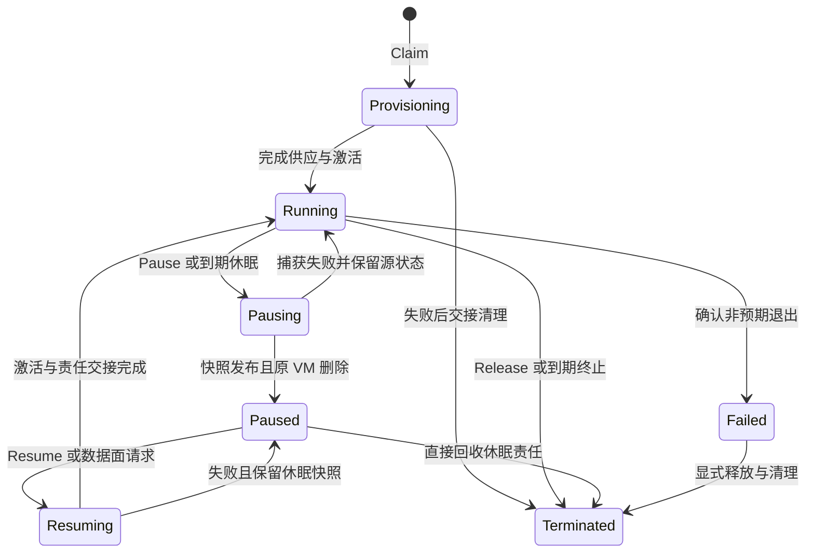

# Sandbox 架构

sandboxd 将 [engine 的 VM/快照原语](architecture.md) 编排为租户独占、可认领、休眠、分支和释放的编程环境。本文解释当前控制面、数据面及恢复模型；HTTP/SDK 使用见 [sandboxd API](../sandboxd/README.md)，协议与 guest 行为分别见 [RPC 协议](../protocol/README.md) 和 [Guest 契约](../guest/README.md)。

当前交付是单宿主服务。Warm/Golden/Cold 表达供应路径，不承诺毫秒级延迟；gossip 放置、跨节点恢复和远端快照归档均未实现。验收范围与精确历史结果见 [验收记录](acceptance.md)。

## 1. 权威与核心对象

| 对象/组件 | 职责与身份 |
|---|---|
| Template | 某租户永久拥有的模板名，发布镜像、完整资源 shape 与可选 golden snapshot |
| Warm VM | 由模板 clone 的未交付实例，网络关闭；ready、pending 和未知 cleanup 均占池目标 |
| Sandbox | 租户独占的逻辑身份，绑定 VM 运行实例或休眠快照、令牌、租约与策略 |
| Checkpoint | 租户可管理的一致状态点，引用已发布 engine snapshot |
| sandboxd | 独立 SQLite 单写者，负责授权、配额、持久编排、数据面接纳及 egress |
| engine | VM、快照、资源隔离与宿主网络的唯一生命周期权威 |
| sandbox-agent | 同一 Rust 进程中的 System、Admin、Workload 门户及本地代理桥接 |

sandboxd 通过私有 engine UDS 提交持久幂等请求，不绕过 engine 删除进程、磁盘、快照或网络设备。调用键由上层 operation 与步骤确定性派生；丢响应后查原 receipt，而不是换随机键重分配。

VM 的 `running` 只证明本层 System 协作；sandbox 的 `running` 还要求 Admin 激活、Workload 探测、有效租约与出网接纳完成。guest 回复是协作信号，不是可信证明。

## 2. 模板、供应与配额

### 模板构建与发布

模板名在首次 admission 即永久绑定 owner，失败不会转移，普通租户不能抢占尚未发布的名字。滚动构建期间继续服务旧发布版本。模板占位、operation 与发布目录的归属必须一致；缺失来源保留证据，不从标签或目录反推 owner。

构建流程：

1. 同事务预留 build slot、构建磁盘与捕获预算，冻结镜像、shape、owner 和步骤请求。
2. create/start 临时 VM，以确定性 keyed exec 执行可选 warmup。当前构建网络保持关闭，依赖须预先放入镜像。
3. Admin `prepare_template` 排空 Workload RPC/会话，清理 agent 身份、环境、日志和 exec ledger，再捕获 golden snapshot。
4. 用可信 start receipt 固定的精确实例回收构建 VM；磁盘/build slot 责任退休后，原子发布新模板、快照 holder 与旧快照 cleanup 交接。

`prepare_template` 保留分离应用进程，不能通用清理其内存、环境、用户态 RNG 或外部注册。构建方须选择可安全重复派生的捕获点。

快照 `published` 只表示完整可恢复，不授予租户访问权。授权由不可变 `snapshot_owners` 记录证明：本层捕获沿原 operation/receipt，外部 golden snapshot 仅由 root 显式导入给指定租户，既有 owner 不转移。授权记录不等于 GC 保活引用。

### 供应与预热池

| 路径 | 条件 | 分配与交付 |
|---|---|---|
| Warm Hit | 匹配模板与 shape 的 ready VM | 同事务领取 row、创建 sandbox slot、转交既有磁盘 holder，再激活 |
| Golden Clone | 无可用 warm，但有冻结的 golden snapshot | engine clone，保留源依赖与独立磁盘责任，再激活 |
| Cold Boot | 无 golden snapshot | engine create/start，再激活 |

池内实例不接触租户数据或凭据，保持 NIC 关闭且不绑定代理。领取后不归还池。坏 warm 先持久交接 cleanup，可信回收后才转入原 claim 的 fallback；未知结果保留费用和池位，不假装空位补建。

普通租户首次 target 为零，后续普通更新保持已发布 target。只有 root 明确选择永久 owner 才能改变 target。自动 refill 使用该 owner 的有限普通预算；缺 tenant row 不自动建账，拒绝或连续失败走持久退避。长 engine/guest 等待不放在池/归属短锁内。

### 持久责任，而非状态计费

`quota_resources` 是费用总量的唯一来源，`quota_refs` 表达真实使用、在途依赖和清理责任。访问状态、授权来源、费用与删除资格是四个不同维度。

令 D 为可写盘 MiB，M 为捕获 RAM MiB：

| 责任 | 保守费用 | 释放条件 |
|---|---|---|
| Sandbox/build slot | 各占一个 `MaxSandboxes` slot | 对应未知分配、VM 与必要独占清理已退休或有可信独立目的地 |
| 独立 VM/restore 磁盘 | 每份 D | 可信 VM 删除/实际 NotFound；没有公开单版本 GC 证明时保守保留 |
| Snapshot | 同 owner/SID 去重 D+M | 无活跃/在途/backing holder，且可信回收 |
| Pending allocation | 意图上界 | 原 receipt 原子转入实际身份，或证明未 dispatch/已回收 |

resume 清空 sleep 字段、删除 snapshot catalog、进入 `terminated` 或 root 绕过准入限制，均不自动退费。COW VM 的 RAM hardlink 仍在时保留相应 snapshot 费用；多个 holder 不重复计同 SID。root 请求仍计入可信资源 owner，维护/透明唤醒使用 owner 普通预算。

完整生命周期矩阵与 SQL 交接边界只维护在 [配额责任契约](../sandboxd/README.md#durable-quota-responsibility)，不在架构中重复枚举实现状态。

## 3. 租约、休眠与分支

### 状态与租约

| 状态 | 含义 |
|---|---|
| `provisioning` | 正在准备或激活，尚未交付 |
| `running` | 已交付；数据面仍须核验当前租约、fence 和实例 |
| `pausing` | 正在捕获并回收原 VM |
| `paused` | 休眠快照保留，无运行 VMM |
| `resuming` | 正在 clone/激活新运行实例 |
| `failed` | 非预期退出等故障，须检查诊断与清理责任 |
| `terminated` | 立即撤销访问；物理清理可能尚未完成 |

正常休眠、唤醒与释放的路径如下；状态转换不代替资源回收证明。

运行态有有限 deadline；reaper 按 `on_expire=kill` 终止或 `pause` 休眠，并在锁内重核预期 deadline，防止旧到期任务处理已续租对象。休眠失败保留原状态和诊断，不降级为丢状态删除。

`auto_renew` 在建立数据连接或接纳 Preview 请求时刷新，而非持续解析 raw stream 中的每个 RPC。过期租约不被活动复活；长连接使用显式 renew。

### Pause 与 Resume

pause 先阻断新接纳、处理现有连接与出网，捕获并绑定完整 sleep snapshot，再删除原 VM，最后提交 `paused`。销毁 paused sandbox 直接回收快照与持久责任，不为删除而启动 VM。

透明唤醒在 sandbox 级串行化接纳下合并为一次持久 resume；当前实现见 [DataReady](../sandboxd/data_admission.go#L48)，不是独立 `singleflight` 缓存。resume clone 休眠快照，保留 sandbox identity、machine-id、进程/会话及 guest ledger；重新激活最新环境与策略，更新租约后放行。运行发布同事务把旧 sleep holder 交给 cleanup，backing 仍按实际依赖保留。失败保留 sleep snapshot，新显式尝试不得改写旧失败结果。

### Checkpoint、Fork 与 Rollback

运行源先 snapshot 再 clone 分支，源捕获后恢复执行；paused 源/已有 checkpoint 可直接派生，无需唤醒源。fork 为每个分支分配独立 sandbox ID、token、可写盘和宿主网络身份，通过 Admin 激活重置 machine-id、环境和 agent 历史。

这些重置不通用更新已运行应用中的身份缓存、凭据和 RNG。guest 内存继承与“应用状态完全去重”不是同一保证。rollback 保留逻辑 sandbox 身份，但也回滚 guest exec ledger；跨任意 rollback 的副作用去重需要快照历史之外的 host ledger/fence。

## 4. 恢复、清理与数据面接纳

### 冻结来源，连续交接责任

sandboxd SQLite 保存 operation、模板占位、授权、配额与私有 allocation/recovery 描述。每次分配冻结原请求/key、可信 owner、完整 shape、receipt 与目标身份；恢复先对账原分配，再检查当前 sandbox operation，避免 release 或后继状态变化遮掉旧责任。

一个 durable `Resolution` 表达 unresolved、已知结果及其 active/cleanup/reclaimed/cancelled 目的地。采纳 receipt 不等于交付完成；只有真实目的地或可信回收允许父责任结束。短归属事务负责 holder/slot 交接，外部 engine/guest 调用在短锁外；sandbox 锁内的最终接纳再核验代次。

自动删除必须具备冻结的成功非空 `result_instance`，并核对当前 VM、owner 与完整依赖。created 状态、当前实例查询或缺 witness 的旧 receipt 都不能补造资格。缺证据继续观察原 receipt 与真实 GetVM absence，保留费用、slot/池位和人工恢复门禁；inventory 缺项或查询失败不是 NotFound。

daemon 意外退出后 reconcile 接续可证明的原步骤，不将“列表里没找到 owner”解释为删除许可。schema 版本与迁移边界以 [API/存储说明](../sandboxd/README.md#raw-protocol-and-sdk) 为准；旧库不通过标签或 JSON 自动推断账本。备份确认不授予新的删除权。

### 配置 fence 与最终接纳

fence 是持久的配置变更阻断：`configure` admission 即记录 fence 并撤销旧数据路径。撤权、NIC、guest 激活或最终持久化失败时保持阻断，`last_error` 仅作诊断，不充当安全门禁。

接纳遵循同一规则：

1. 先查权限、状态、租约、凭据及 fence，处理必要的透明唤醒/重绑。
2. 外部 Connect/Forward 返回后，在短 configuration guard 内重新读取并检查当前条件，同时登记连接。
3. 释放 guard 后才写 101、发送请求或开始字节流。新 configure 若先提交，旧接纳不得越过其撤权窗口。

健康 `none` 维护不无条件关闭 Workload；残留 egress cleanup 仍须真实确认。fence 读取失败直接拒绝，不因诊断写入失败而放行。只有匹配的显式 configure 完成交付才原子清 fence，自动 rebind/reconcile 不清除它。

## 5. Guest RPC 与数据面

统一 agent 的三条 RPC 通道保持权限分离：

| 门户 | 调用方 | 契约 |
|---|---|---|
| System 2047 | engine | ping、内核 reseed、直接系统调用校时 |
| Admin 2046 | sandboxd | activate、prepare_template、quiesce |
| Workload 2048 | 经鉴权中继的租户 SDK | 非特权 exec/process/session/PTY、文件/树、watch、port forward |

租户无法选择中继端口。帧为长度前缀 Protobuf，编码以 [共享协议](../protocol/README.md) 为准。HTTP/1.1 Upgrade 后宿主不解析业务帧，以有界缓冲和背压双向复制，保留 Upgrade 预读字节与 half-close；`io.Copy` 可走优化路径，但不保证所有传输均为内核零拷贝。当前没有 WebSocket/HTTP2 RPC 中继替代入口。

同连接可连续调用 RPC，SDK 串行接纳并区分排队取消与已发送取消；未确认副作用不自动重试。exec ledger、树传输原子发布/后置 cleanup 结果、FIFO 拒绝及非递归 watch 等详细行为归 [Guest 契约](../guest/README.md) 和 [SDK 契约](../sandboxd/README.md#raw-protocol-and-sdk)，架构不扩大其保证。

Guest 可见环境经 Admin 原子写入 `/run/sandbox.env`，供后续新进程加载；不修改已有进程环境。fork/新实例覆盖或清空激活环境，不意味着快照中旧应用内存已擦除。

## 6. 出网、凭据与 Preview

### 两条出网路径

| 模式 | NIC | 路径与限制 |
|---|---|---|
| `none` | 关闭 | 无 egress listener；客户端 Workload/端口转发仍可用 |
| `relay` | 关闭 | guest 本地 HTTP/SOCKS 代理经 vsock 进入实例专属宿主 UDS |
| `direct` | 策略验证后开启 | engine 的精确实例 IPv4 CIDR/flow 策略；不支持域名过滤或秘密代填 |

direct 顺序固定为 network off → 安装并核验 policy → guest 激活/Workload 就绪 → network on → 交付。策略不从快照继承，NIC 配置也不代替最终数据面 fence。

relay 在宿主解析并检查全部地址，再以已核验的数字地址拨号，防止 DNS rebinding。HTTPS CONNECT 校验外层 authority、SNI、内层 Host/port 与上游证书；连接、解析头和握手都有界。direct 的策略细节见 [Engine 网络策略](network-policy.md)，relay 规则见 [Egress 契约](../sandboxd/egress/README.md)。

### Host-only secret

`guest:false` 的真实值仅保存在宿主内存，不进入 SQLite、guest、日志或快照。可选 harmless placeholder 进入 guest；宿主只在授权 HTTPS host 的指定 header 代填，先写持久、脱敏的 audit。

URL/path/query 代填、secret-bearing SOCKS 和 direct secret 均拒绝。daemon 重启后须重新提供 secret 和新的代理 CA 信任；凭据未恢复时数据接纳阻断。响应反射过滤只降低字面泄露风险，获授权上游仍是信任边界。审计在本地链式存储，没有外部不可回滚锚点。

### 授权与浏览器入口

Root 管理全局租户/配额，Tenant 管理本租户资源，Sandbox token 仅限自身数据面与 renew/release；operation ID 不是权限凭据，异步结果也按原权限过滤。外国资源与不存在返回不可区分的 404。

Preview 是绑定 tenant、sandbox 创建代次、端口和到期时间的签名路径，期限不超过租约，terminated 立即拒绝；可触发 paused sandbox 唤醒。转发剥离认证/Cookie，并设置 no-referrer。它共享服务 origin，不提供每 sandbox 浏览器 origin 或绝对资源 URL 重写，需要这些隔离时另设 gateway。

## 7. Sandbox 不变量

P 编号与 [Engine I1–I19](architecture.md#6-跨模块不变量) 互补，作为评审与历史计划的稳定引用。

| 编号 | 不变量 |
|---|---|
| P1 | VM/快照/宿主网络生命周期只经 engine 幂等契约变更 |
| P2 | Engine System 就绪、Admin 激活、Workload 探测及策略接纳共同决定交付 |
| P3 | Warm 未交付实例不含租户数据，领取后不回池，未知清理继续占位 |
| P4 | 策略先于开网，最终接纳与配置 fence 同步核验 |
| P5 | Host-only secret 不进入 guest/持久元数据，代填只在授权 HTTPS header 生效 |
| P6 | Fork 分配新 sandbox 身份；resume/rollback 保留逻辑身份，不承诺重置任意应用缓存 |
| P7 | Paused 删除不启动 VMM |
| P8 | 完整休眠快照发布前不删除源 VM；捕获失败不丢状态 |
| P9 | 同 sandbox 并发唤醒收敛到一个持久恢复操作 |
| P10 | 帧、日志、代理与中继有界且保留背压 |
| P11 | 租约、reaper 和连接撤权不依赖客户端存活 |
| P12 | 授权按可信 owner 过滤；授权来源、计费 holder 与删除资格分别核验 |

新增行为应以实际 Service/HTTP/SQLite/guest/Engine 路径验证，特别覆盖丢响应、SQL 拒写/零效果、重启、configure 与接纳交错、保留 backing 和延迟清理。测试通过的具体范围由 [验收记录](acceptance.md) 说明；未来观测与诊断设计不作为已上线能力，见 [未完成计划](../plans/README.md)。
