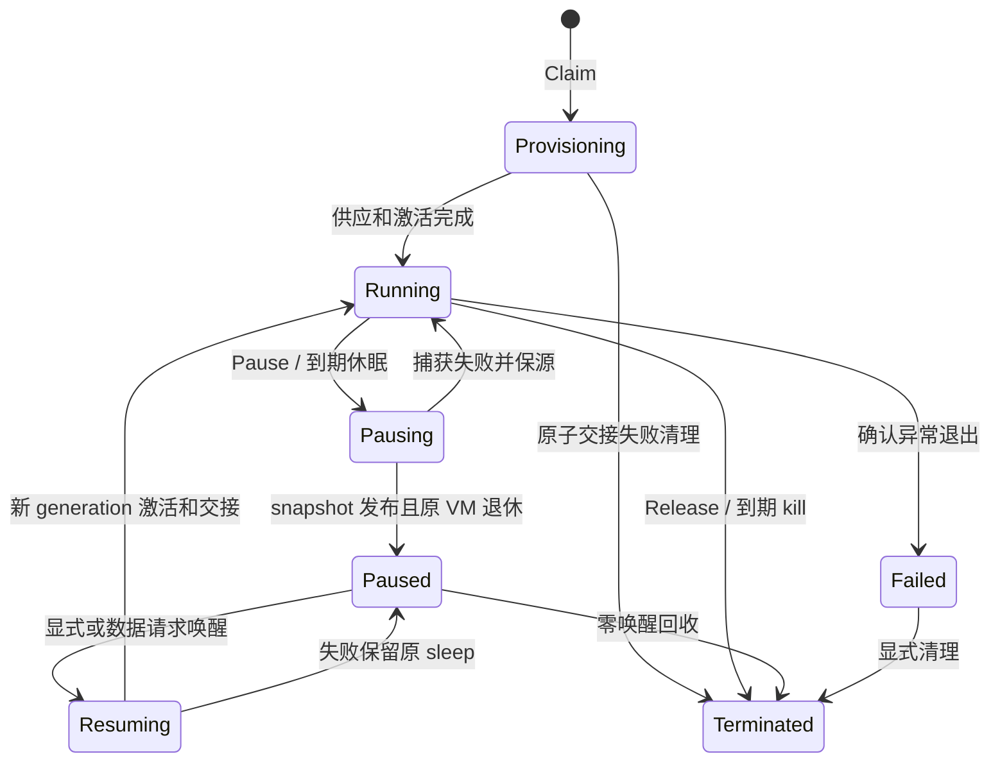

# Sandbox 架构

Haven 将 VM/快照资源编排为租户独占、可认领、休眠、分支和释放的环境。业务与资源事实共享唯一 SQLite；Loom 只执行明确宿主效果。当前入口见 [Haven control](haven-control.md)，HTTP/SDK 与配额矩阵见 [Sandbox 契约](../haven/sandbox/api.md)，资源持久协议见 [集成契约](engine-integration.md)。

当前范围为单宿主。Cold、Golden、Warm 表示供给路径，不承诺未实测的毫秒延迟；gossip、跨节点恢复、远端快照归档未实现。历史运行的源码与材料见[历史验证记录](verification-history.md)。

## 身份与授权

| 对象 | 不可替代的身份或职责 |
|---|---|
| Template | 首次接纳即永久绑定 tenant 的名字，发布完整 shape、镜像及可选 golden snapshot |
| Warm allocation | 模板 clone 的未交付实例；ready/pending/unknown cleanup 都占 target |
| Sandbox | 稳定 tenant/creation epoch/birth identity，绑定当前 VM generation 或 sleep snapshot、lease、settings |
| Checkpoint | 有永久授权来源的业务 binding，引用 canonical resource snapshot |
| Haven | 唯一持久权威，统一 operations/steps、归属、费用/引用、恢复与交付 |
| Loom | 显式资源效果与实际 inspection，不接纳业务或保存控制状态 |
| Guest agent | 分离的 System/Admin/Workload 门户 |

资源 running/System ready 与业务交付是两个边界。只有 Admin 激活、Workload 探测、有效租约、凭据与出网接纳完成，才能发布 sandbox running。guest 回复本身不证明可信。

## 模板、供给与持久责任

模板占位、发布 operation、固定版本与 catalog 必须一致。首次失败保留永久 owner，滚动 build 继续服务旧发布。root 更新明确选择该 owner，不转移授权，不从残存 catalog 或 labels 补造来源。

build 同事务固定镜像/shape、build slot、D 磁盘及 D+M capture 上界；准备临时 VM 后以固定 keyed exec intent 运行 warmup，未知 exec 不盲目重放。Admin prepare_template 排空 Workload/session、清理 guest 身份/env/ledger；golden 完整发布且临时 VM 实际退休后，原子交接模板 holder 与旧 SID cleanup。build 网络保持关闭，依赖须预置。

prepare_template/fork 的重置不通用清理已有应用进程的内存、身份缓存、RNG 或外部注册。模板作者负责选择可安全派生的捕获点。

| 供给 | 接纳与交接 |
|---|---|
| Cold | 固定已发布镜像、候选、slot/磁盘费用，执行资源步骤后激活 |
| Golden | 先持 source lease 与新盘责任，clone 完整持久后交接 backing，再激活 |
| Warm | 同库选中 ready row，分配真实 sandbox slot，并原子交接既有磁盘 holder 后激活 |

warm birth 是零 sandbox slot 的资源历史；claim 的 SlotAssignment 与 sandbox birth 独立记录。池内实例不接触租户凭据、NIC off。坏 warm 先固定 cleanup，精确退休后才转 fallback；unknown 保留原费用和池位。ordinary 首次 target=0，后续保持发布 target；root 显式 owner 才能修改。refill 使用 owner 的有限普通预算，缺 owner 不建账，失败走持久 backoff。

`quota_resources` 为总量来源，`quota_refs` 为真实 holder/依赖/cleanup。访问终止、字段清空、catalog/path 消失都不证明退款。D 为可写盘 MiB，M 为捕获 RAM；snapshot 同 tenant/SID 去重 D+M，clone backing 存在时保留。root 请求计可信 owner，maintenance 不绕普通 owner 预算。完整 [责任矩阵](../haven/sandbox/api.md#durable-quota-responsibility) 单独维护。

## 生命周期与分支

pause 先阻断接纳、撤销数据/出网，capture 完整 sleep snapshot，再删除原 VM，最后提交 paused。capture 失败保源，不降级为丢状态删除。paused release 不启动 VM。

dataplane Ready 在 sandbox 级接纳互斥下合并透明 resume；clone/激活后保留 sandbox identity、machine-id、进程/会话及 guest ledger，应用最新 settings/policy。running 发布同事务交接旧 sleep holder 给独立 cleanup；原 backing 费用继续存在。失败保留 sleep，新 intent 不修改旧失败结果。

checkpoint 在 running 源捕获新 SID，paused 源绑定原完整 sleep 而不唤醒。fork 接受 running/paused sandbox 或 checkpoint、count 1–32；running 源只捕获一次。整批 branch IDs、births、slot/storage/host peak 先冻结，并在一个 allocation 事务中承接责任后才执行。默认继承 source policy，不继承环境；分支通过 Admin 重置身份/env/ledger。失败 batch 沿原 branch 与 cleanup links 精确补偿，不凭当前对象推断未 dispatch。

rollback 保留逻辑 sandbox 身份与原 lease 规则，回滚 guest ledger；跨任意 rollback 的副作用去重须快照历史之外的 host fence。默认新 lease 为 300s。reaper 固定并重核预期 deadline，旧 expiry 不处理已 renew 对象；auto_renew 只在连接/Preview admission 刷新，不能复活到期 lease，raw RPC 流不连续续租。

## 恢复与独立 cleanup

每个资源分配在同库固定请求、候选、可信 owner、完整 shape、parent/dependency 和预算。child admission/完成与父责任目的地同事务交接，原 operation/step 历史只增不改。unknown/partial effect 保留费用与引用，不能用新 ID 绕开原结果。

删除同时要求冻结历史证明和当前归属，检查所有 known generation/instance 与 dependencies。当前 phase、查询出的新 instance、inventory 缺项或普通查询错误不补造成功 witness、NotFound 或删除许可。原失败 candidate 使用自己的 preparation/intent 证明走显式 discard，不伪造成功交付。

supply、import/cache、snapshot/capture、direct policy 与 source lifecycle 分别拥有独立持久 cleanup。释放业务引用不等于资源已回收。末个 backing 实际退休后才原子退出 D+M；cleanup 成功也不改原公开终态。恢复 metadata backup 的 acknowledgment 不增加任何授权。

## 配置和数据最终接纳

configure admission 原子记录持久 fence，并在保存新 settings 前撤销旧 proxy/数据连接。runtime、guest、bind 或 SQL/COMMIT 失败保留 fence；自动 rebind/reconcile 不清除它。只有匹配的显式 configure 完成最终交付才原子清 fence，迟到 worker 不能清新 fence。

数据接纳先查权限/state/lease/secret/fence，执行必要 resume/rebind；外部 Connect/Forward 后在短 configuration guard 中重核原实例、generation 与 policy，登记连接。最终核验整体接收原 `ephemeral.ConnectionIdentity`，不从当前 settings 更新既有连接的授权。readiness 通过最终核验后才在同一个 guard 下执行 auto-renew；下游挂接与连接的周期性核验不续租，也没有 `renew` 模式参数。HTTP downstream attach 同样 pin 原 admitted upstream，并受 guard 与 revocation registry 保护直到 Hijack。configure/expiry/shutdown 先发生时，迟到连接不能交付。正在 setup 与两个 handoff endpoint 都参与 shutdown custody，writer lock 最后释放。

## RPC、出网与 Preview

| 门户 | 宿主调用方 | 职责 |
|---|---|---|
| System 2047 | Loom 的明确资源协作 | ping、reseed、clock_sync |
| Admin 2046 | Haven | activate、prepare_template、quiesce |
| Workload 2048 | Haven 鉴权 byte relay / SDK | 非特权 exec/process/session/PTY、文件/树、watch、port forward |

租户不能选择 relay vsock port。HTTP/1.1 Upgrade 保留预读字节、half-close、有界缓冲与背压，宿主不解析 guest frame。SDK 串行 RPC，区分排队取消与已发送取消；未知副作用不自动重试。详细语义见 [Guest](../guest/README.md)、[Protocol](../protocol/README.md) 和 [SDK](../haven/sandbox/api.md#raw-protocol-and-sdk)。

none/proxy NIC off；direct 必须 off → policy → Admin/Workload → on → final admission。direct 只支持 canonical IPv4 CIDR/flow，拒绝 hostname 与 host-only secret；实例更换不继承授权，旧 callback 只能退休原实例。网络机制见 [网络策略](network-policy.md)。

proxy 在宿主解析核验全部地址，数字地址拨号，HTTPS 校验 CONNECT authority/SNI/inner Host/证书；secret 真值仅内存，guest 只得到 harmless placeholder，注入前写 durable sanitized audit。重启需要显式重供 secret，不靠 snapshot/DB 恢复。代理细节见 [Egress](../haven/egress/README.md)。

Preview HMAC 绑定 tenant/sandbox/creation epoch/port/expiry，且不超过 lease；转发移除 Authorization/Cookie，强制 no-referrer。当前为 service origin 上 signed path，不提供每 sandbox 浏览器 origin 或 absolute asset URL 重写。
