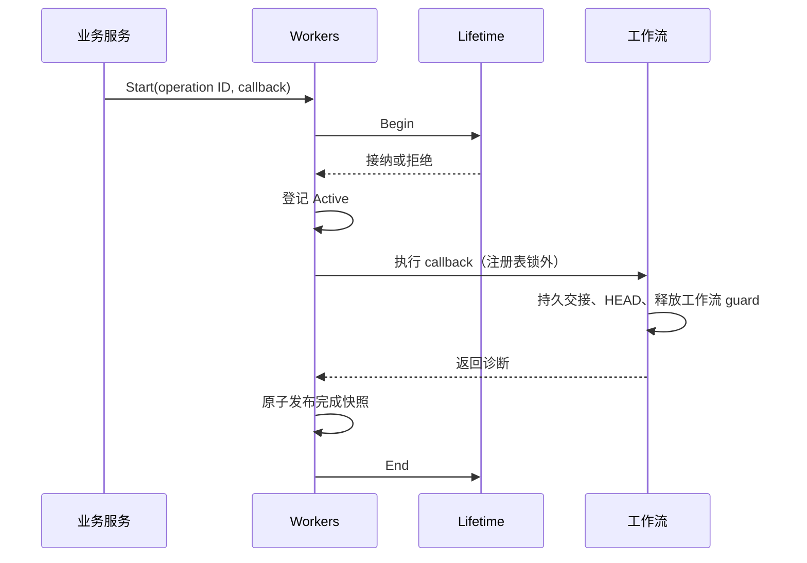

# 执行状态与共享 guard

`execution` 只管理进程内执行和互斥，不读取数据库、不选择恢复策略，也不调用 Loom。一个应用实例组装一份 `Lifetime`、`Workers` 和 `Guards`，各业务服务接收所需的能力；不能为每个服务另建同名锁域。

## Lifetime 与 worker 完成

`Lifetime.Begin` 与 Close 的关闭标记受同一 mutex 保护：关闭后不再增加在途计数。每次成功 Begin 必须匹配 End。Close 先关闭接纳并取消运行 context，在 mutex 外撤销连接，等待在途工作，然后调用唯一的最终关闭逻辑。调用方等待超时不会放弃后台收尾或释放 writer lock。

`Workers.Start` 对同一个 operation ID 拒绝并行重复执行，但允许已结束的 operation 再次派发以接续恢复。它在启动 callback 前登记 Lifetime custody；callback 返回后一次性发布 `WorkerState`，再退出 custody。工作流必须在返回之前释放自己的 guard 并完成 HEAD 更新。

`WorkerState.Active` 表示当前 runner 在途；`Completed` 区分“从未执行”与“已执行且 Err 为 nil”；`Err` 是最后一次返回的诊断。在新一次 runner 活跃期间，先前的 Completed/Err 仍可见，调用方必须同时检查 Active。这些字段不替代持久 operation 终态、授权或资源证明。公开终态与 worker 完成是两道条件，等待服务不能因为数据库已经提交成功就提前越过仍在收尾的 runner。

`Workers.Context` 仅返回同一 Lifetime 的运行 context；业务服务不另建取消源。`AdmissionGate` 借用原登记 mutex、Closing 读取能力和不可变 reviewed 状态，在原短互斥下检查能否接纳。它不登记工作、不另持关闭状态，也不替代调用方的 Admission guard。Images、VMProvisioning、Lifecycle、Supply、Forks 等接纳使用同一屏障。

## Guards 的锁域

`Guards` 用独立的种类、owner、ID 字段定位同一实例内的共享 guard，不使用业务代码拼接字符串前缀。条目在进程生命周期内不驱逐，防止已有持有者与新调用者得到不同 guard。返回的 `Guard` 仅提供 Lock/Unlock/TryLock，实际 mutex 与 map 保持私有。

| 能力 | 保护范围 |
|---|---|
| TenantRequest / NodeRequest | owner 与幂等 key 元组；两个请求域互不合并 |
| VM | 同一逻辑 VM 上的 start/stop/capture/restore/network/delete 与完成核验 |
| Configuration | 同一 sandbox 的 settings、binding、撤权与最终数据 handoff |
| Sandbox / AutoResume | sandbox 生命周期与透明 resume 合并；二者仍为不同锁域 |
| TemplateWork | 同一模板的 supply 与 supply cleanup |
| ImageImport / ImageCleanup / GCOperation / ForkGroup | 对应 operation 的工作流串行化 |
| SupplyCleanup / Snapshot | 对应 VM 的 supply cleanup 与对应 SID 的 snapshot 删除，保持各自原范围 |
| Admission | 短持久接纳/责任交接；tenant 写入与最终 store 关闭复用同一 guard |
| Artifacts | 镜像发布、清理与 GC inventory 之间的互斥 |
| GarbageCollection | GC 接纳与 inventory 的单 collector 保护 |
| Capture | 一个并发名额；等待支持 context 取消，成功后由调用者释放 |

具名 API 不重排获取顺序、不自动扩张持有范围，也不将 TryLock 改为排队等待。长 syscall、RPC、hash/copy 继续位于全局 Admission 之外。Capture 返回的释放函数应在原捕获保护范围结束时调用，不能因为工作流分包而提前释放。

Dataplane 与 App.Close 借用同一 `Registration` guard，保留连接登记和关闭快照的原短互斥；mutex 本身由 `Guards` 唯一持有。draining 决策属于 `execution.Availability`，查询和 Drain 使用同一 guard。关闭标记不能单独替代最后一次接纳/登记与连接快照的原子协议。`ephemeral.Registry` 生成并持有唯一 daemon epoch，activation 和 data 服务使用同一不可变值。
