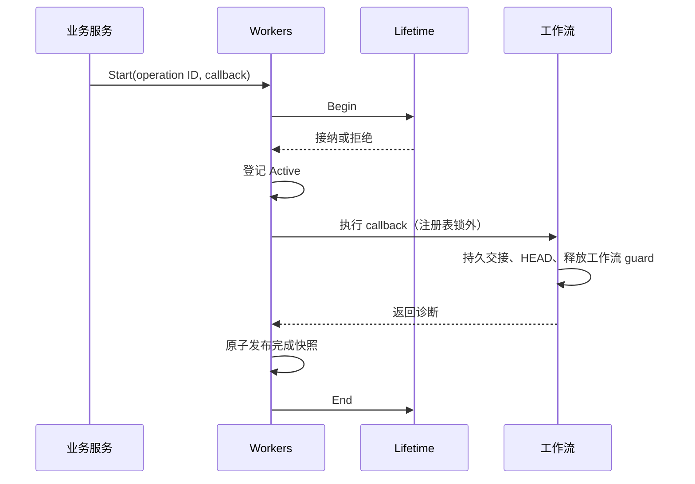

# 执行状态与共享 guard

`execution` 管理进程内的接纳、在途工作与互斥。每个应用实例共享一份 `Lifetime` 和 `Workers`。业务间共用的锁由 `application.Open` 装配，单个服务使用的锁由该服务持有。

## Lifetime 与 worker 完成

`Lifetime.Begin` 与 Close 的关闭标记受同一 mutex 保护：关闭后不再增加在途计数。每次成功 Begin 必须匹配 End。Close 先关闭接纳并取消运行 context，在 mutex 外撤销连接，等待在途工作，然后调用唯一的最终关闭逻辑。调用方等待超时不会放弃后台收尾或释放 writer lock。

`Workers.Start` 对同一个 operation ID 拒绝并行重复执行，但允许已结束的 operation 再次派发以接续恢复。它在启动 callback 前登记 Lifetime custody；callback 返回后一次性发布 `WorkerState`，再退出 custody。工作流必须在返回之前释放自己的 guard 并完成 HEAD 更新。

`WorkerState.Active` 表示当前 runner 在途；`Completed` 区分“从未执行”与“已执行且 Err 为 nil”；`Err` 是最后一次返回的诊断。在新一次 runner 活跃期间，先前的 Completed/Err 仍可见，调用方必须同时检查 Active。这些字段不替代持久 operation 终态、授权或资源证明。公开终态与 worker 完成是两道条件，等待服务不能因为数据库已经提交成功就提前越过仍在收尾的 runner。

`Workers.Context` 仅返回同一 Lifetime 的运行 context；业务服务不另建取消源。`AdmissionGate` 借用原登记 mutex、Closing 读取能力和不可变 reviewed 状态，在原短互斥下检查能否接纳。业务服务另外持有保护持久状态变更的 store 写锁。Images、VMProvisioning、Lifecycle、Supply、Forks 等接纳使用同一屏障。

## 锁的归属

`KeyedLocks[K]` 的一个实例对应一个锁域，相同的键在该域内串行。`Lock(key)` 返回释放函数；`TryLock(key)` 忙时返回 nil。`With` 在同步回调返回时释放锁。最后一个持有者和等待者退出后，该键的条目随之回收。

| 共享域 | 共同遵守的边界 |
|---|---|
| VM 生命周期 | 物理推进、激活、捕获、停止、回收和完成核验按逻辑 VM 串行 |
| sandbox 生命周期与配置 | 生命周期推进与就绪检查共用一组锁。配置、撤权、binding 和数据最终交付共用另一组锁 |
| tenant 与 node 请求 | `operation.IdempotencyLocks` 按 `(ownerID, key)` 固定查询到接纳的范围，两类请求使用独立实例 |
| template | 构建、补池与供给清理按模板串行 |
| 镜像制品 | Images 发布、清理与 GC inventory 共用一个 mutex |
| store 写入 | 节点内持久接纳、责任交接、tenant 写入及最终关闭共用一个短锁，长 syscall、RPC 和 hash/copy 在锁外执行 |
| 服务接纳 | 连接登记、drain 与关闭时的连接快照共用一个短锁 |

GC 持有本地 inventory 锁，各服务持有自己的 operation、回收与唤醒锁。`machine.Captures` 持有唯一的捕获名额，等待期间响应服务 context 的取消。

`Availability` 在共享接纳锁内查询或修改 draining。`App.Close` 持同一把锁获取连接快照，确保关闭标记生效前登记的连接进入撤销范围。`ephemeral.Registry` 持有该 daemon 的 epoch，activation 和数据服务读取同一个值。
