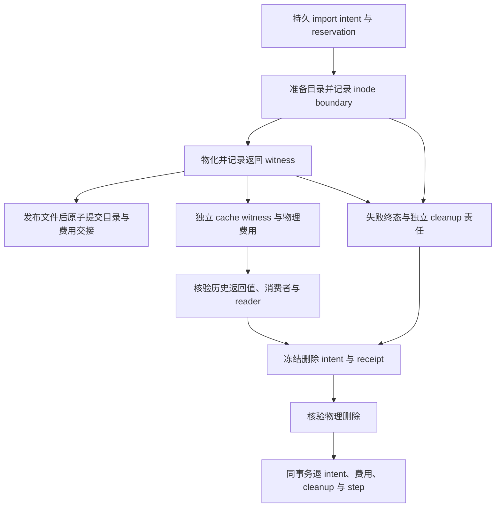

# 镜像目录、导入与回收责任

`image` 同时拥有导入、不可变发布、缓存与清理的用例和持久化。包内直接使用私有 sqlc 绑定，覆盖 `images`、`image_intents`、`image_caches` 及本能力的 step/cleanup/deletion 行族；没有公开 Repository。事务仍由原用例接纳或完成路径持有，资源效果、RequireOne、提交与 HEAD 的顺序不变。运行时和生成器读取同一 migration 目录。

`Cache` 关联原始 import operation 和按摘要保留的文件系统证明。按 source operation 查询 cache 使用资金归属列。清理前分别核验原 import step、返回的 witness 与独立物理费用。

`LoadManifest` 通过当前发布指针读取不可变 manifest，并核验身份及摘要。import 的输出证明保留同一 manifest 版本，目录撤下后仍可读取。`PublishedDigests` 提供已发布根。`LoadCacheRecord` 从不可变 witness 的列重建文件身份和收据，import 与费用证明仍由能力内部核验。

`VerifyFiles` 将目录中的 `image.json` 与冻结 manifest 逐字段比较，再执行 manifest 的文件核验。它不将文件系统扫描结果提升为目录发布权限。

## Images 用例

`image.Images` 负责接纳、导入、发布、失败留责、独立清理及 image GC 候选核验。它从唯一 store 借用数据库、不可变 origin 和 checkpoint 能力；通过 `ImageGuards` 为持久状态变更、镜像文件、节点幂等键及单次导入或清理操作取得对应的共享锁，并复用同一份 Workers。它没有根 Service/App 回指，也不拥有 writer 或 worker 生命周期。

`ImageOptions` 仅包含宿主空间安全余量和构造时注入的故障 hook。测试切换故障阶段时控制注入端的状态，不修改生产服务的配置快照。`Resume` 按已有冻结 step 选择 cleanup、import，保持原优先级、重新加载和 guard 范围；启动只读校验使用同一组 loader。同键请求的类型或参数冲突时返回 `ErrConflict`，匹配的请求才恢复其冻结工作。

cache 物理费用从 import reservation 扣出后独立持有。清理 import work 不代表可以同时释放 cache 费用；最后一个消费者和原始返回证明均须重新核验。发布或清理的责任写入必须恰好一行，保留原 owner、resource、证明摘要、费用值和 step 状态条件。任一条件失败回滚整笔元数据交接，即使文件已经删除也保留 receipt、原责任及费用，供明确恢复使用。提交后 checkpoint 失败不宣称事务已回滚。

`Images.Inventory` 提供 import work 与 cache 的 roots、候选和未知项；全局 GC 结合其他资源关系决定是否继续。`CollectCandidate` 先验证 GC 冻结的 cache body 摘要或 import input hash，独立接纳仍再次核验当前责任。

## 验证范围

`image/import_admission_test.go` 在外部测试包直接组装 Images、Workers 和私有 SQLite，验证冲突请求不派发、匹配请求恢复冻结输入。`haven/integration/workflows/image_service_test.go` 保留整笔完成写入被 IGNORE／费用不匹配时留责，以及全局 Reconcile 后恢复的跨能力场景。两者共享 testfixture 的冻结 import 输入；源在 staging 前已经缺失，不运行 EROFS 物化。

真实 OCI、cache、输出替换和回收测试继续经过 Loom importer；缺真实工具、UID 或文件元数据能力时普通入口按既有规则记录 SKIP/FAIL，required-native 必须报告失败或阻塞，不能由上述组件测试替代。Guest 启动和快照恢复由 `guest-image-e2e` 检查。
