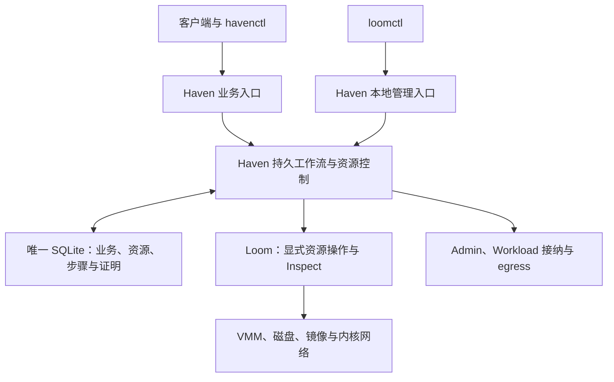
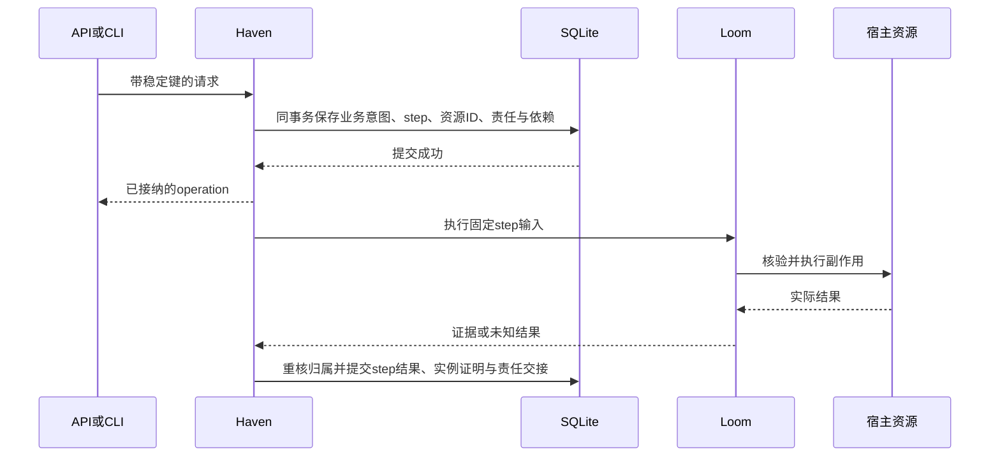

# Plan 024：将持久控制面收归 Haven，将 Loom 收敛为资源操作库

> 本文是目标设计与分阶段实施方案；实施进度与实际验证见下方状态及 [迁移证据](evidence/024-migration-map.md)。设计阶段不修改运行时代码；当前实施授权不包含启动旧计划、提交、推送或合入。
>
> 执行者先完整阅读本文与根 `AGENTS.md`。每阶段保留行为证据；遇到 STOP 条件先报告，不通过放宽身份核验、资源限制或恢复断言完成迁移。

## 1. 状态、决定与范围

- Status：STAGE_F_PARTIAL / VM_TESTS_BLOCKED。旧控制模块、双 daemon 与 engine UDS facade 已删除；workspace、CI、native gate、guest 镜像测试、Haven 生命周期测试和部署示例已迁到单 Haven。原 native/guest/生产断言保留，补上未知 cache 报告、跨 fork writer-lock handoff 与 capture runner TMPDIR 修复。当前 schema 仍为 9。最终组件、完整 race、六项 Rust integration、六组 smoke、静态及 required-native 均通过：`run.9exdrqy5` 为 **677 pass、0 fail/skip**，Haven **278.938s**，原 JSON/race/count=1/300s 不变；实际跨 UID capture、宿主网络与 cgroup 策略检查通过。当前 Haven 的 guest 镜像启动与 daemon 生命周期测试因未提供显式私有材料、rootfs、OCI 与 I/O 预算保持 BLOCKED。当前证据见 [阶段 F](evidence/024-stage-f-retirement.md)，[阶段 E](evidence/024-stage-e-entrypoints.md) 与 [阶段 D](evidence/024-stage-d-control-matrix.md) 的结果只绑定各自历史完成树。既有部署未切换；017/020/021 继续暂停，未提交、推送或合入，整体不标为实施全部完成。随后按命名约束将完整 daemon 生命周期入口改为 `runtime-e2e` / `SANDBOX_RUNTIME_*`，并完成受影响的定向验证；原全量数据仅绑定整理前的 F 树，当前命名映射与验证见 F 证据的“后续命名整理”。
- Priority：P1；Effort：L；Risk：HIGH；Category：architecture / migration。
- Planned at：`d6ced5b`，2026-11-12。
- Depends on：无；017、020、021 继续 PAUSED，不作为本任务自动执行的依赖。
- 设计输入：单宿主先做好；Haven 是唯一业务入口及持久控制面；Loom 管操作，不拥有元数据；独立部署与日后拆分不在本次范围。
- 当前工作区另有 `docs/README.md` 与 `docs/research/sandbox-comparison.md` 的用户改动，本设计不修改或覆盖它们。

**决定：不是把两个 daemon 合装，也不是让两个持久服务共享数据库。Haven 独占业务与资源元数据、工作流、恢复和回收资格；Loom 只提供显式输入驱动的宿主资源操作与实际效果核验。**

术语：

- **Haven**：项目及单机服务名，拥有“要做什么、谁负责、执行到哪里、如何恢复”。
- **Loom**：织机，VM 资源操作库，负责“如何对指定对象安全执行及核验”。一个 Go package tree，不单独发布 module，不运行控制循环。
- **operation**：Haven 接纳的持久请求，具有固定幂等身份、请求与公开终态。
- **step**：operation 内部有固定输入、候选资源与证据的持久执行步骤，不是另一个服务的 operation。
- **实例证明 / witness**：某个步骤实际交付的历史运行实例证明；不等于当前实例，也不独立授予删除权。
- **资源责任**：资源使用、在途依赖、容量预留、租户费用或清理义务；其退休必须有相应证明。

### 1.1 In scope

实施时允许重组以下路径及其直接依赖：

- `engine/`、`sandboxd/`：将控制逻辑迁入 Haven，将物理机制迁入 Loom；迁移已有行为测试。
- 新建根 `go.mod` / `go.sum`、`cmd/`、`api/`、`sdk/`、`loom/`、`internal/haven/`、`internal/egress/`、`internal/agent/`、`integration/`。
- `go.work` / `go.work.sum`、`Makefile`、`.golangci.yml`、`.github/workflows/check.yml`：同步宿主 module、二进制、检查及缓存路径。
- `scripts/`：适配既有 runner 与 gate；增加架构依赖检查，不降低原始检查范围。
- `deploy/host/`、`deploy/sandboxd/`、`deploy/client/`：收敛为一个服务的部署材料；具体目录移动集中在最后阶段。
- 当前架构、集成、镜像、网络、API、部署与 scripts 文档：代码完成相应阶段后更新。
- `plans/README.md`：本计划状态和旧计划映射。

### 1.2 Out of scope

- 不设计 `loomd`，不提供 standalone Loom 数据库或远程 Loom 服务。
- 不预建 repository 插件、通用工作流引擎、跨进程 leader election 或多数据库适配框架。
- 不实现集群调度、迁移、远端快照、镜像 registry 拉取或新的 VMM 后端。
- 不修改 guest 行为、RPC schema/门户、镜像内容、CH 固定 revision、EROFS 格式或资源限额。
- 不因为品牌更名修改 guest 内已有的路径、设备 serial、kernel 参数或 `Upgrade: sandbox-v1`。
- 不修改 `operator/` 实现、`references/` 或 `third_party/`；后两者不是可顺手重构的代码。
- 不自动迁移、清理或接管真实旧部署；不访问现有 daemon、`.local-run/`、旧数据库或未知资源。
- 不重命名历史验收材料，不把历史通过当成新架构通过。

若确认已有发布的 Go module、CLI 配置或外部契约必须兼容，先报告具体消费者及契约，再确定版本策略；不为未发布内部实现保留双路径。

## 2. 当前实现与迁移依据

以下是当前事实，不是目标接口。执行前做 drift check，并同时查看未提交改动：

```nu
git diff --stat d6ced5b..HEAD -- engine sandboxd Makefile go.work scripts deploy docs .github/workflows/check.yml
git diff --stat -- engine sandboxd Makefile go.work scripts deploy docs .github/workflows/check.yml
git status --short
```

若源码有变化，重新核对下列实际符号；不能照抄历史行号。

| 当前位置 | 当前职责 | 目标归属 |
|---|---|---|
| `engine/engine.go:40-61,101-164` | DB、writer lock、执行调度、恢复、资源 schema | Haven |
| `engine/admission.go`、`metadata.go`、`operations.go`、`operation_completion.go` | 接纳、journal、固定终态与实例证明 | Haven |
| `engine/lifecycle.go`、`snapshot.go`、`restore*.go` | 持久步骤与宿主操作交错 | 按“控制协议 / 执行机制”拆到 Haven / Loom |
| `engine/backend.go:17-66` | 宿主效果接口、资源描述、观察结果 | Loom 的起点，不直接保留为整套旧 Engine API |
| `engine/cloudhypervisor*.go`、`launcher_linux.go`、`device_linux.go`、`cow_linux.go` | VMM、launcher、设备、进程身份、COW 核验 | Loom |
| `engine/network*.go` | 内核机制与已提交策略管理 | 机制归 Loom；期望策略、代次、授权与发布归 Haven |
| `engine/image*.go`、`fsmeta*.go`、`storage.go`、`capture_linux.go` | 物化、完整性核验与资源 catalog 混合 | 物化机制归 Loom；catalog、预留与发布责任归 Haven |
| `engine/gc*.go`、`admin.go` | 引用图、删除 journal、备份与恢复 | 决策/持久协议归 Haven；精确删除与文件核验归 Loom |
| `sandboxd/store.go:28-155`、`service.go:44-83` | 第二份 DB、writer lock、恢复与维护 | Haven 的唯一 store/service 基础 |
| `sandboxd/allocation*.go`、`recovery*.go`、`quota.go` | 跨 daemon 分配结果采纳与责任交接 | 合并为 Haven step 的同库交接 |
| `sandboxd/configure.go`、`data_admission.go`、`bindings.go` | 持久 fence 与最终数据接纳 | Haven，保留行为 |
| `sandboxd/egress/`、`sandboxd/agent/`、`sandboxd/sdk/` | 代理、Admin/Workload 通道与客户端 | 归位到业务侧；不移入 Loom |
| `engine/cmd/engined/`、`engine/client/`、`engine/server/` | 独立 engine 服务与 UDS client / facade | 删除，不转成进程内“假远程服务” |

### 2.1 必须消除的交接窗口

当前 `sandboxd/allocation.go:239-260` 的真实结构：

```go
if err == nil {
	frozen.Dispatched = true
	r.Group.Steps[step] = frozen
	err = writeRecovery(s.ctx, tx, r)
}
```

事务提交后，再调用：

```go
proof, engineErr := api.Wait(s.ctx, s.opts.Engine, request)
engineErr = engineFailure(engineErr)
if proof.Key == "" {
	return proof, engineErr
}
if err = s.adoptGroupReceipt(r.ID, step, proof); err != nil {
	return proof, errors.Join(engineErr, err)
}
```

目标删除的是跨库 Submit/Find/Wait/adopt 协议，不是删除“执行完成、但责任尚未交接”的恢复义务。

### 2.2 不能在搬迁中丢掉的证明

`engine/metadata.go:25-40` 已经区分：

```go
CaptureFiles     map[string]string `json:"capture_files,omitempty"`
ArtifactsSynced  bool              `json:"artifacts_synced,omitempty"`
ResumeRequired   bool              `json:"resume_required,omitempty"`
Captured         bool              `json:"captured,omitempty"`
```

`captured` 不等于字节已落盘，`running` 不等于允许租户接入。不能把这些字段折成一个“成功”布尔值。

`engine/operation_completion.go:96-110` 核验候选归属、当前实例、VM phase、verified 与 agent-ready 后才固定 `ResultInstance`；其完成事务还核对必要 SQL 写入影响行数。迁移后保留这一原子性，测试参照 `engine/operation_completion_test.go:197-265` 的真实 SQLite 拒写、重启与不重启 VMM 断言。

### 2.3 容易遗漏的生产依赖

`engine/cloudhypervisor_process_linux.go:325-339` 使用：

```go
exe, err := os.Executable()
```

随后：

```go
cmd := exec.Command(exe, "--internal-launch", specPath)
```

因此 `haven` 二进制必须在普通配置解析和打开数据库之前处理内部 launcher / device-check 子进程入口。不能仅删除 `engined` 主程序，否则库能编译、实际 VMM 却无法启动。

## 3. 目标结构：一个程序、一个 store、一个恢复权威

下图回答“谁持久化，谁执行”，不是未来部署拓扑：



目标目录（不表示现在已经存在）：

```text
go.mod                         # github.com/woxQAQ/haven，单个宿主 module
cmd/haven/                     # 唯一常驻服务及内部 launcher 入口
cmd/havenctl/                  # 租户/业务客户端
cmd/loomctl/                   # 本地管理员客户端，不直接运行 Loom
api/                           # 业务 API 与客户端需要的 DTO，不含持久执行器
sdk/                           # 业务 HTTP 与 guest RPC 客户端
loom/                          # 资源描述、实际观察、Linux/VMM/文件机制
internal/haven/                # 业务、资源工作流、SQLite、reconcile、GC、恢复
internal/agent/                # 现有业务 Admin/Workload 宿主适配
internal/egress/               # 现有出站代理与内存 secret
integration/                   # 实际服务、CLI、Rust fixture 与 Haven 生命周期
```

先保留 `internal/haven/` 为一个可理解的控制模块，按 `vm_*`、`snapshot_*`、`image_*`、`gc_*` 等文件划分职责；不预拆独立 controller/store 服务。

`protocol/gen` 与 `operator` 暂时保留现有独立 module，`go.work` 使用根 module、这两个 module；本次只取消宿主 engine/sandboxd 两个 module 的部署与持久化边界。Rust workspace 不变。根 module 显式保留指向 `./third_party/go-erofs` 与 `./protocol/gen` 的本地 replace。

### 3.1 依赖约束

- `internal/haven` 可以依赖 Loom；Loom 不得依赖 Haven、业务 DTO、租户 SDK、SQLite 或管理 HTTP。
- Loom 可使用系统调用、CH API、EROFS/OCI 库及 System guest RPC；不感知租户、池、模板、租约和费用。
- Loom 的输入不含 `*sql.DB`、repository、持久操作调度器或回调式“帮我提交 step”接口。那会把控制面偷偷带回库中。
- 不保留 `api.Client.Submit/FindOperation/Wait` 作为 Haven 和 Loom 之间的接口。需要历史查询时直接读取 Haven 自己的 step。
- 允许 Loom 内部为一次调用启动 I/O worker、Wait 回收子进程或打开 pidfd；不允许隐藏的周期 reconcile、自动 GC、资源发现接管或自主重试工作流。
- 当前真实 Linux 后端与测试显式注入的效果替身保持分离；不要为未来后端制造一套庞大插件框架。

## 4. 元数据与文件证据

### 4.1 Haven 唯一拥有的事实

| 数据组 | 必须保存的内容 |
|---|---|
| 业务 | 租户/授权、模板永久 owner、池目标/成员、sandbox、checkpoint、TTL、配置 fence |
| 资源 | VM/实例、资源版本、路径与身份、网络 slot/token、镜像 catalog、快照、物理依赖 |
| 意图与结果 | operations、固定 step 输入、候选、期望实例、执行阶段、结果 witness、阻断与独立 cleanup |
| 责任 | 宿主容量预留、租户 quota_resources/quota_refs、源读取租约、长期 backing 与业务 holder |
| 回收与恢复 | 墓碑、精确删除意图、完成证明、schema/store identity、备份 receipt、恢复 gate 与审计 |

目标 state root 包含一个 `haven.db`、一个独占 `writer.lock`、稳定 node key、恢复 fence / HEAD 及资源目录。数据库不是 VM 磁盘、RAM、EROFS 等大对象的存储介质。

**“全部元数据归 Haven”表示权威及恢复解释权归 Haven，不表示每次写 manifest 都必须由业务层亲自调用 write。**

分清两类文件：

1. **控制事实**：owner、是否发布、当前实例、费用、引用、step 完成资格。只由 Haven 的持久协议决定。
2. **产物及现场证据**：镜像/快照 manifest、`process.json`、namespace/policy receipt、launch spec、设备与 inode 身份。可以由 Loom/launcher 按 Haven 指定的路径和版本协议物化，但其路径、关联与可采信条件必须由 Haven 预先记录和最后提交。

Loom 可以解析明确传入的 manifest 或核验 receipt；不能扫描这些文件重建一份自己的 VM catalog。数据库丢失时，不从文件名、标签或目录“恢复 owner”。缺少完成证明时，不通过重新 hash 把现有字节升级为可信发布物。

### 4.2 数据模型收敛规则

- 使用一套 `operations` 与 `operation_steps`，内部步骤可多级关联，但不是第二套独立操作服务。
- step 固定 `(operation_id, step_key)`、动作、规范化输入及 hash、完整输入/输出资源关联、候选实例和核验证据；同标识异参冲突。
- 同租户相同公开幂等键返回原 operation。节点维护操作使用明确的节点管理 scope，不伪造 tenant，也不与租户 key 冲突。
- `vms`、`instances/resource_versions`、`images`、`snapshots`、`resource_refs`、`deletion_intents` 等关系由 Haven store 管理；名称可随迁移细化，不能以单个含糊 JSON 状态取代必要的约束与查询关系。
- step 的完成、实际资源身份/引用注册、pending 责任转交必须能在同一短事务提交。先分配稳定资源 ID，避免依赖另一个服务返回 ID 才能记责任。
- 未知执行结果不等于未知资源 ID；即使预先固定 ID，进程、网络或文件副作用仍可能未知。
- 业务完成不必与 VM 步骤完成同时发生；已完成 step 的输出必须始终有业务 holder 或独立 cleanup 责任。
- cleanup 是独立、可接续的持久意图；不修改原公开终态。无论父 operation 是否终态，未解决副作用继续被保护。
- 授权 owner、物理引用、租户费用、清理资格分别建模。同库允许一起交接，不允许把它们混成一个 owner/ref 字段。
- 保留公开镜像与幂等历史的现有 retention，不借本次重构添加按年龄清理。

### 4.3 Schema 与备份

- 新 store 使用独立的 Haven format identity 与 schema version；不能将 engine 的 schema `1` 当作 Haven version `1`。
- 第一次初始化只接受显式 `--init` 和符合约束的新私有目录。缺库、旧格式、损坏、恢复 gate 均在启动 worker 和 schema DDL 前拒绝。
- 不在旧 engine state 或 sandboxd state 内自动新建 `haven.db`。即使其余文件名不同，也必须先拒绝非空遗留现场。
- 一个 metadata backup 覆盖完整 DB、node key、审计/幂等记录与一致 receipt；运行态目录、VM 磁盘和 RAM 仍需独立资源备份。
- 默认只提供停服后取得同一管理锁的备份/恢复；不扩展在线备份产品面。
- 恢复保留显式 review gate。回退的 pending 工作不自动重放，必要预留与引用保守保留；acknowledgment 不补造删除/GC 资格。
- 保留本地 HEAD 的可检测范围，不能声称它能检测 DB 与全部本地历史一起回退。

## 5. Loom 的调用边界

不一次性冻结所有方法签名，但每个方法都必须满足以下契约；执行阶段按现有 Backend 和真实调用点形成具体类型。

### 5.1 输入

- 明确 VM / operation-step / instance 标识，预先记录的候选资源描述。
- 由 Haven 分配的路径、slot/token、设备映射与期望资源身份。
- 已冻结配置、镜像/快照来源、必要的历史证明。
- 调用 context 与明确边界，不接收隐式“默认 state dir”后自行查找对象。

### 5.2 输出

- 对精确对象的 observation、实际效果证据、产物身份及完整性结果。
- 错误必须允许表示“效果未知或部分完成”；不能将普通 error 当成“没有副作用”。
- 返回成功只证明该执行边界成立，不表示 Haven 的 step 已提交或 sandbox 已交付。
- 停止/删除等操作必须自核实际对象身份。Haven 负责操作资格，Loom 核验被操作对象仍与输入匹配；SDK 不抵抗同权限恶意宿主程序。

### 5.3 创建、启动与退出

- Haven 在副作用前记录实例候选、运行路径、cgroup/netns 身份计划及 launch intent。
- Loom 以现有 `CLONE_INTO_CGROUP`、namespace、非 root UID/GID、capability/seccomp 和 CH FD 交接机制启动，不降低资源限制。
- spawn 成功但 DB 未提交时，Haven 沿原实例 inspect/adopt；没有足够证据则阻断，不能另分配实例掩盖原结果。
- 进程 PID/starttime/boot identity、可执行文件、scope 和运行 receipt 的核验仍需覆盖 PID 复用及未知 sibling。
- Haven 退出不默认杀 VM，不使用 parent-death signal 或连坐 service cgroup。Loom 的 Close 不决定 VM 生命周期。

## 6. Haven 的事务、锁与恢复

统一规则：**持久意图 → 外部效果 → 实际核验 → 原子责任交接。**



- 长期 VM 生命周期互斥、业务接纳 guard 和短数据库事务是不同边界。长 syscall、guest RPC、hash/copy 和 CH 等待不能放在数据库事务或全局 ownership/admission 锁内。
- 同一 VM 的 start/stop、capture、restore、network 与 delete 共用生命周期互斥域。snapshot/镜像发布与删除通过显式引用和删除 fence 协调。
- 不因锁域合并引入可重入锁或嵌套同连接事务；`SetMaxOpenConns(1)` 下不能在 tx 中调用另一个会独立 Begin 的旧方法。
- 业务资源/VM 多锁按固定类别与稳定 ID 排序；短发布 guard/事务中重核当前 operation、实例与配置代次。GC 不等待长期生命周期锁后再拿全局锁形成反向顺序。
- step 执行与完成在同一生命周期保护下核验；迟到 worker 不能仅凭旧 observation 提交到新的实例。
- 删除先在短事务中建立持久 fence，后执行外部删除。新引用发布检查同一 fence；重启和等待超时不解除 fence。
- SQLite 提交失败时，不宣称交付、退费或删除完成；SQL 零行更新不视为成功。
- 调用方取消只结束等待；已接纳 operation 按 Haven 的服务生命周期继续。服务退出留下可核对的原步骤，不写一个假定“未执行”的失败结果。
- 使用当前/未解决步骤与资源关系恢复，不把公开终态 operation 当成其所有副作用已解决。017 的历史扫描优化仍暂停，不顺手引入新队列平台或承诺恢复复杂度 SLO。

## 7. 关键工作流如何迁移

### 7.1 Cold / Golden / Warm 供应

1. 同事务固定模板与 shape、slot/磁盘预算、来源引用、目标 VM 身份和供应 step。
2. Haven 工作流调用 Loom 的准备、启动或恢复步骤，逐个持久化可信边界。
3. VM/System ready 后仍保持 NIC 默认关闭，执行 Admin 激活、Workload 探测与 egress 接纳。
4. 在最终业务发布事务中核验租约/fence/实例，交接 holder 与费用，发布 sandbox running。
5. Warm 领取仍是同库原子领取和责任转交；坏 warm 的 cleanup 未证明退休前不补造空位。

删除跨服务 receipt 采纳的冗余，但不删除候选、unknown dispatch、历史 witness 或 cleanup 描述。

### 7.2 Snapshot / pause

Haven 拥有并保留现有捕获协议的细粒度阶段：

- 暂停前预留现有保守预算，记录 capture/staging 身份与源 resume-required。
- Loom 执行 pause、CH capture 与独立磁盘副本；独立捕获完成后尽快恢复源。
- hash、产物 fsync 和密封发布不延长现有暂停窗口。
- 独立文件及目录落盘后，Haven 才提交固定摘要/身份完成证明；重启不得重新 hash 损坏材料以补造证明。
- rename 与父目录同步完成后才发布 snapshot catalog 与所需 holder。
- 业务 pause 仍要求快照完整发布、源 VM 可信删除后才到 paused；失败不能降级为丢状态删除。

文件机制可拆成若干 Loom 方法；恢复分支和步骤推进留在 Haven，不塞入一个内部自持久化的 `Loom.Snapshot()`。

### 7.3 Restore / clone

- Haven 固定源 manifest、读取租约、候选版本与预算；Loom 复制独立可写盘、私有 config/state、建立不可变 RAM hardlink。
- 保留目录/inode、大小、固定 digest、同步完成证明；未完整证明的候选保留引用、预算与阻断。
- 同事务把源读取租约交给长期 backing 引用，不能在其间丢失保护。
- 运行前及重启接管时，由 Loom 核验实际私有可写 RAM 映射、完整范围、device/inode/offset；不接受 eager-copy fallback。
- 新实例默认断网，System reseed/校时后固定实例 witness；业务激活完成才交付。
- 已经运行的可写盘不能再按交付时 digest 校验或重建；源快照删除后仍可依赖已交接的 backing。
- 失败后的显式 cleanup 检查所有已记录当前/旧/候选实例；未知 sibling 阻断。原失败 operation 不因 cleanup 成功而改写。

### 7.4 网络、配置与出站

- Haven 保存期望策略、绑定实例、NIC 期望状态与配置 fence；Loom 安装/核验实际 namespace/nft/link。
- 顺序保持 off → 安装并核验策略 → Admin/Workload ready → on → 最终接纳。
- 新实例不继承授权；过期实例的迟到清理不影响新实例。Inspect 失败不能当作 NotFound。
- relay/host-only secret、租户策略和 DNS/TLS/HTTP 授权均在 Haven；Loom 不持有这些业务凭据。
- 保留 configure admission 即撤权、失败持久阻断、最终接纳短 guard 重核、仅匹配显式配置成功才能清 fence 的行为。
- secret 真值仅在内存；统一元数据不意味着把它们加入 DB、备份、step 输入或日志。

### 7.5 GC

Haven 负责根集合、可达性、回收资格、批次调度与删除 journal。Loom 仅处理具体候选的现场检查及精确删除：

1. 根集合覆盖 VM/版本、已发布镜像、所有 snapshot 状态、未解决 step、源租约、backing 和实际业务使用关系。
2. 区分活跃使用/在途依赖与 cleanup 责任，不能让 collector 自己的 cleanup 永久挡住自己。
3. 在阻止新引用的同一协议中固定候选及精确 inode 删除意图。
4. Loom 在删除前再次核验现场；部分删除后记录剩余责任，文件与目录同步后才退休引用/预算。
5. 重启重核可达性和 inode；替换文件、未知材料、旧格式、缺证据、查询失败与恢复门禁均保留现场。

`loomctl gc --dry-run` 是 Haven 的真正只读查询，不通过 Open 顺手启动恢复、修复元数据或 dispatch 待执行操作。

## 8. 管理入口、后台维护与 shutdown

### 8.1 两个客户端，一个资源权威

- `havenctl` 面向业务 API；`loomctl` 面向 Haven 的 root-only 本地管理 UDS。
- 管理入口建议放在私有 runtime 目录，0600；不得把 VM 管理路由挂成租户可访问入口。
- `loomctl` 不 import 或调用 Loom 执行器，不直接打开在线 DB，不隐式创建 state root。
- 第一版管理面覆盖 VM/step 查询、诊断、显式 reconcile、GC dry-run/execute、镜像导入；mutation 记录为 Haven 管理 scope 的 operation，断开客户端不撤销接纳。
- 不提供可绕过业务责任的 raw stop/delete/restore/network。需要更改已有 sandbox/池成员时走 Haven 业务操作；故障维修先另行确定显式维护工作流。
- 不新增“无归属裸 VM”产品模式或独立 Loom store，以免重新制造两种资源管理规则。
- 第一版不做 `loomctl --offline` 的第二套执行路径。停服备份/恢复由 `haven` 明确管理模式执行，取得同一 writer lock，且不启动普通 worker。

### 8.2 后台与关闭

- Haven 托管资源 reconcile、业务租约/池维护与自动 GC；分别有可取消执行边界，未知结果保留责任。
- reconcile 调用 Loom Inspect，随后由 Haven 判断并记录；不因未观察到进程而自动重启丢失内存状态的 VM。
- shutdown 先停止新接纳/refill，关闭或撤销本进程数据连接与代理，停止派发新工作；必要安全收尾可执行已记录的 network-off / resume-required。
- 停止接纳的请求 context 与安全收尾 context 分开，避免先 cancel 全局 context 后才尝试必需收尾。
- 等待有界；未完成步骤和 cleanup 持久保留，恢复所需记录落盘后才关闭 DB/释放锁。
- 默认保留 VMM 与宿主锚点；不将 Haven 停服等同于租户 release 或整机停机。
- 出网凭据重启丢失后的 fail-closed 行为不变。服务进程合并不构成权限隔离改进，也不宣称消除了数据面/控制面的共同故障域。

## 9. 实施顺序与阶段门槛

以下是本设计的实施交接，不是本轮已执行记录。每阶段是一个可审查变更；前一阶段失败不继续。所有目标命令中尚不存在的路径/测试都明确属于待实现项。

### 阶段 A：建立行为基线与迁移清单

1. 对照第 2 节逐个映射控制协议、物理机制、文件证据和测试；输出到 `plans/evidence/024-migration-map.md`。
2. 每个旧行为测试标注目标位置、保留的断言；不以“旧文件删除”代替行为迁移。
3. 记录工具与材料可用性。只在私有状态运行基线，不接触用户已有 daemon。

当前树已核对的入口（下列命令未在本轮运行）：

```nu
with-env {GOWORK: 'off'} { go -C engine test ./... -count=1 -timeout=120s }
with-env {GOWORK: 'off'} { go -C sandboxd test ./... -count=1 -timeout=120s }
make integration
make smoke
```

**门槛**：记录真实 exit/FAIL/SKIP；失败先区分既有问题与迁移问题。若缺少可用工具不能声称基线通过；不安装工具或降低断言掩盖缺失。

### 阶段 B：抽取 Loom 的效果边界

1. 在新宿主 module 中搬迁第 2 节所列 Linux/VMM/文件机制和描述类型，保持现有 CH/镜像/隔离格式。
2. 将旧代码对 catalog、journal、路径分配与发布判断的隐式读取改成显式输入；控制阶段先由旧实现维持，不双写。
3. 搬迁跨 UID、内核、实际文件与 COW 测试；不保留测试用的伪生产默认后端。
4. 新增 `scripts/check-architecture.py`：读取实际 `go list` 包依赖，检查 Loom 的直接与传递依赖不包含 Haven 控制模块、`database/sql`、SQLite driver、管理路由或业务 SDK；同时检查 `loomctl` 不导入执行库。不能只扫直接 import 字符串。

目标门槛：

```nu
with-env {GOWORK: 'off'} { go test ./loom/... -count=1 -timeout=120s }
python3 -I scripts/check-architecture.py
```

预期全部 exit 0。该阶段最终目录尚未齐备时，架构 gate 应明确区分分阶段检查与最终检查，不能把缺失包视为最终通过。

### 阶段 C：建立 Haven 唯一 store 与资源步骤

1. 将旧业务 store 和资源 schema 合成新 Haven store；使用同一独占锁、format/version/recovery gate。
2. 迁入资源接纳、step/journal、实例候选、固定终态、引用/预留和完成事务。
3. 先贯通冷启动、停止/删除与同键重放；再覆盖外部效果完成但 DB 失败的重启路径。
4. 用真实 SQLite trigger 验证拒写、零效果更新与提交前中断；不能通过替身返回“写成功”证明原子性。

目标门槛：

```nu
with-env {GOWORK: 'off'} {
    go test ./internal/haven -run '^TestHaven(Store|Step|Instance|Terminal)' -count=1 -timeout=120s
}
```

必须存在并运行第 10 节对应测试，不能接受正则零匹配的成功。

### 阶段 D：迁入完整生命周期与原子责任交接

1. 按第 7 节迁入 snapshot/restore/clone、镜像发布、网络和 GC 控制协议。
2. 将现有 claim/build/warm/pause/resume/checkpoint/fork/rollback/release 改为调用同一 Haven 资源工作流。
3. 删除跨库 allocation receipt 采纳与 Find/Wait 轮询；共享事务只能收敛冗余，不能删掉未知资源责任和不可变历史证明。
4. 保留 configure/data admission/secret 的全部已有安全断言，验证业务与资源引用在一库中原子交接。

目标门槛：

```nu
with-env {GOWORK: 'off'} { go test ./internal/haven/... -count=1 -timeout=120s }
with-env {GOWORK: 'off'} { go test -race ./internal/haven/... -count=1 -timeout=10m }
```

必须有迁移清单中每项行为的实际映射和结果；编译通过不足以进入下一阶段。

### 阶段 E：唯一启动入口、CLI 与维护

1. 实现 `cmd/haven`，整合配置、真实 runtime、内部 launcher/device-check、服务管理和 shutdown。
2. 建立本地管理 adapter 与薄 `loomctl`，两类 CLI 进入同一工作流/数据库。
3. 将 `smoke.py` 改为只启动一个 Haven，检查两个 CLI、writer 排他、重启幂等、只读 dry-run 及同一 metadata backup。
4. 将实际 Rust fixture integration 迁至根 `integration`；fixture 注入 Loom 的效果边界，不能继续用一个能伪造所有持久成功结果的独立 engine 客户端。
5. 业务 HTTP 路由、JSON/错误类别、鉴权、guest RPC 与 Upgrade 契约保持；CLI/环境变量的品牌更名在配置测试中明确列出，不添加内部旧入口兼容代理。

目标门槛：

```nu
make build
make integration
make smoke
python3 -I scripts/check-architecture.py
```

`make build` 此时构建 `bin/haven`、`bin/havenctl`、`bin/loomctl` 与原 Rust workspace；不得再构建或启动 `engined` / `sandboxd`。

阶段 E 已完成。四个目标入口命令、workspace/tagged integration lint、vet 与最终 required-native 已通过；完整记录及失败修复见 [阶段 E 证据](evidence/024-stage-e-entrypoints.md)。`run.d6zrkslx` 为 940 pass、0 fail/skip，当前 Go/Rust fixture 与原 native gate 的证明范围分别记录。F 不随 E 完成自动开始。

### 阶段 F：清除旧边界并做真实路径验收

1. 删除旧 daemon、UDS engine client/facade、旧模块与双库运行路径；迁移必要测试后再删文件。
2. 更新 Makefile、CI、native gate、runner 模块/测试定位与部署材料；保留原 gate 的 required-native、超时、JSON 输出及必须观察 pass 的语义。
3. 当前文档改为 Haven/Loom；专项契约仍分别维护。历史验收与研究不做全局替换。017/020/021 保持暂停，在索引注明后续实施前需映射新架构。
4. 最后运行下节全量与真实路径门槛；单独记录 Haven 启动和接管 VM 的结果。

F 的旧边界清除、入口/测试/部署迁移已实现；最终组件、Rust/smoke、静态与完整 required-native 通过（677 pass、0 fail/skip，Haven 278.938s），跨 UID capture 与宿主策略检查通过。当前 guest 镜像与 Haven 生命周期测试材料缺失，整体为 PARTIAL/BLOCKED。完整检查与失败修复见 [阶段 F 证据](evidence/024-stage-f-retirement.md)，不由历史 E/D 的通过代替。

构建/组件门槛：

```nu
make test check test-race
make integration
make smoke
python3 -I scripts/check-architecture.py
python3 -I scripts/test_runner_environment.py
python3 -I scripts/test_native_gate.py
golangci-lint run ./... ./operator/... ./protocol/gen/...
```

根 Makefile 的 `test/check/test-race` 循环同步根宿主 module 与原 protocol module；`go.work` 的 operator 包检查范围不得因目录变化消失。上面的 golangci-lint 命令是目标 workspace 路径，当前树仍应使用原显式 module 路径。当前 `make lint` 会执行 `go fix`，不是只读检查；若执行，必须检查其 diff，并重新运行受改动影响的验证。

真实路径门槛沿用当前入口，runner 内部必须适配到新包与单进程：

```nu
python3 scripts/check-native-gate.py --negative
python3 scripts/check-native-gate.py
just capture-isolation-e2e
just host-policy-e2e
```

native gate 内仍必须设置 `SANDBOX_REQUIRE_EROFS_TESTS=1`，要求实际 pass，缺工具/namespace/mapping 不能变成通过。

VM 材料齐备后，使用显式准备的私有材料目录；两个入口从环境读取 `VM_MATERIALS_DIR`，其余输入按[测试说明](../scripts/README.md#vm-test-inputs)分别提供。guest 镜像测试目前在同一进程内导入并启动 VM。merged OCI 导入要求有效 UID 0，而独立 VMM 测试要求普通用户，完整运行还需解决这两步的身份交接。

```nu
just guest-image-e2e
just runtime-e2e
```

完整 daemon 生命周期还需按现有 runner 提供 `SANDBOX_RUNTIME_IO_MAX`，保留原 512 MiB shape、launcher/接管、golden/warm、fork/resume 后真实 TAP/SNAT 断言。缺少任何条件标记 BLOCKED；不得由本计划推导 sudo、生产宿主操作、停止旧服务或额外材料下载的授权。

## 10. 行为测试与验收矩阵

新增测试围绕真实 Haven Service/HTTP/SQLite 和实际资源边界，不写镜像 helper 实现的函数单测。下面名称对应当前执行测试；源行为与补充迁移见 [F 证据](evidence/024-stage-f-retirement.md)。测试按职责放在 `internal/haven/*_test.go`、`integration/*_test.go`，物理机制测试放 `loom/*_test.go`；名称发现不替代实际运行结果。

| 目标测试/场景 | 必须证明 | 现有范例或来源 |
|---|---|---|
| `TestHavenStoreExclusiveOwner` | 两个 Haven/离线管理者不能同时拥有一份 store；CLI 在线不另开 store | engine 与 sandboxd 的 writer-lock 行为 |
| `TestHavenStoreRejectsForeignStateBeforeDDL` | 旧 engine schema、旧 sandboxd schema、缺库/损坏/非空初始化均拒绝且不修改现场 | `sandboxd/backup_test.go` |
| `TestHavenStepAdmissionAtomicity` | 业务意图、step、稳定资源身份、预算/依赖全有或全无；未提交无副作用 | `sandboxd/instance_cleanup_test.go:73` |
| `TestHavenStepCrashRecovery` | 意图后、外部效果后、结果提交前分别退出，重启接续原步骤、不重复分配 | `engine/lifecycle_test.go`、`sandboxd/allocation_recovery_test.go` |
| `TestHavenInstanceAtomicCompletion` | witness、资源状态、step 与责任交接原子；拒写/零行更新不能半完成 | `engine/operation_completion_test.go:197-275` |
| `TestHavenTerminalResultImmutable` | 同键请求/结果固定；新实例和 cleanup 不改旧终态，不从当前状态补 witness | `engine/operation_completion_test.go`、`sandboxd/error_boundary_test.go` |
| `TestHavenSnapshotDurability` | 暂停边界、源恢复、独立 inode、固定 hash/落盘证明、rename 恢复 | `engine/snapshot_test.go`、`capture_isolation_linux_test.go` |
| `TestHavenRestoreResponsibility` | 源租约/backing 连续，失败候选阻断，显式 cleanup 核验所有已知实例 | `engine/restore*_test.go`、`sandboxd/allocation_recovery_test.go` |
| `TestHavenSupplySlotBudgets`、`TestHavenWarmClaimAndFallback`、`TestHavenTemplateBuildAndGoldenClaim` | build/warm/claim 的 pending/slot/磁盘/snapshot 责任和 owner 原子交接；失败不假补池位 | `sandboxd/allocation*_test.go`、`warm_*_test.go` |
| `TestHavenSnapshotDeleteFence`、`TestHavenSnapshotDeleteLeaseFence` | 回收与新引用不能交错；部分 unlink 重启、替换 inode、未知根、dry-run 不写 | `engine/gc*_test.go` |
| `TestHavenConfigureAdmission` | revoke/fence/最终短 guard、迟到接纳与 stale instance 均 fail-closed | `sandboxd/configure_test.go`、`data_admission_test.go` |
| `TestHavenSecretRestart` | 真值不进入 DB/step/audit/快照；重启后未重供凭据不接纳 | `sandboxd/configure_test.go:2414` |
| `TestHavenHTTPContractAndIdempotency` + 单 daemon smoke | UDS 身份及权限；租户不能调用；raw 业务绕过拒绝；两 CLI 查询同一 operation/VM | 当前 HTTP/CLI 行为，新增同进程断言 |
| `TestHavenStepShutdownKeepsWriterUntilWorkersExit`、`TestHavenStepShutdownBackendDeadline` | 停接纳/撤连接、安全收尾顺序、deadline 后责任保留、重启不连坐杀/重启 VM | 现有 Close/restart 与 Haven 接管存活 VM 场景 |
| `TestHavenBackupRecoveryFence` | 同一备份覆盖两类事实；恢复阻断、ack 不授予 GC、不重放回退意图 | `sandboxd/backup_test.go`、`engine/admin_test.go` |
| 真实 Rust fixture | Upgrade 预读、half-close、keyed exec、Preview 与 guest 门户权限不退化 | `sandboxd/integration/transport_test.go` |
| 原生 OCI / 宿主网络与 cgroup / guest 镜像与快照恢复 / Haven 生命周期 | 各自真实边界全部保留，新宿主实际执行 launcher 与接管 | `scripts/README.md` 及现有 runners |

执行新增测试前先确认发现结果：

```nu
with-env {GOWORK: 'off'} { go test ./internal/haven -list '^TestHaven' }
with-env {GOWORK: 'off'} { go test -tags=integration ./integration -list '^Test(Haven|Rust)' }
```

两组发现结果的并集须包含上表列出的实际 `TestHaven...`；smoke 通过其真实进程入口执行。缺失不是 SKIP，不允许空集合绿灯，也不为匹配旧设计标签添加空 wrapper。真实 Rust/native/VM 测试结果单列，不混入纯替身组件结果。

## 11. Done criteria、STOP 与交付

### 11.1 全部完成才算实施完成

- [x] 只有 Haven 打开控制数据库并托管资源/业务工作流；新私有部署只有一个持久资源权威。
- [x] Loom 及传递依赖不含 SQL/store/业务控制层；无自主恢复、GC、资源 catalog 或后台控制循环。
- [x] `loomctl` 只经 Haven 管理入口操作；无第二份数据库、无业务生命周期旁路。
- [x] 跨 engine Submit/Find/Wait/adopt 路径和第二 daemon 从生产依赖、构建、部署和 runner 中删除。
- [ ] 第 10 节全部行为在新树有对应测试与结果；物理证明及费用/引用规则不因重构变弱。
- [x] 同库责任交接拒写/零行更新、崩溃重启、迟到实例及回收 fence 的测试通过。
- [x] 根 Makefile、CI、CLI smoke 和实际 Rust fixture 使用新目录及唯一服务，本地门槛通过；GitHub CI 未运行。
- [ ] 原生镜像、跨 UID capture、宿主策略、guest 镜像和 Haven 生命周期绑定新源码和材料重新验证；缺条件则整体交付保持 PARTIAL/BLOCKED，不能声称生产完成。
- [x] 旧库明确拒绝、不被覆盖；无默认自动合库/目录发现接管；备份和恢复门禁覆盖完整控制状态。
- [x] 当前契约、部署与计划状态同步；历史材料不被改写成新树证据。

### 11.2 STOP conditions

- 上述基准与实际实现不一致，或用户并行编辑了正在迁移的同一协议：先重核映射和任务范围。
- 需要删除/迁移真实旧资源或正在运行的实例：先停下请求明确迁移范围与授权，不执行默认清理。
- 发现已发布消费者必须兼容：先确认公开契约，不能用内部重构理由破坏它，也不自行保留永久双路径。
- 无法保留 snapshot/restore/GC 的完整证明，或试图通过目录扫描、当前 phase、重新 hash 补缺失证明：设计不成立，停止实现该路径。
- 必须把 DB/repository 回调传给 Loom，或需要 Loom 自己记住未完成步骤才能继续：重新拆步骤边界，不引回第二控制面。
- 需要修改 guest 协议/CH pin/EROFS 格式/隔离限制才能通过：超出本计划，先说明原因。
- 依赖链要求修改 `operator/` 或第三方机制：先说明具体编译/运行依赖，遵循各目录约束后另定范围。
- 同一验证连续失败且没有新的定位证据：记录失败、保留私有现场并报告，不循环放宽检查。

### 11.3 Git 与维护

- 本计划不要求切换、提交或推送分支；仅在明确实施任务中按阶段保留可审查 diff。
- 如获提交授权，沿用最近历史中的 `refactor: ...` / `refactor(scope): ...` 风格；不把机械更名、协议迁移和验收材料混成不可审查的大提交。
- 持久字段变化首先影响恢复与回收资格；评审先看事务及证据链，再看目录/命名。
- 017 不再按旧跨 daemon 协议原样执行；024 实施后如恢复它，必须重新设计当前 store 的待核对集合与预算。020/021 同样重新映射，仍不自动恢复。
- 日后确需独立 Loom 产品时，另立设计说明存储、锁与恢复权威，不将本次内部接口视为已经承诺的远程协议。

## 12. 本轮设计验证记录

- 已静态核对当前架构、资源与业务契约、宿主/业务入口、journal/完成事务、文件/launcher、GC、相关测试位置及构建/runner/CI 入口。
- 未运行 Go/Rust 测试、build、原生镜像、guest 镜像、宿主策略或 Haven 生命周期测试；上文是实施时的门槛，不是本轮通过记录。
- 本轮仅新增本设计并更新未完成计划索引；不更改当前架构文档，避免把目标设计写成已实现事实。
