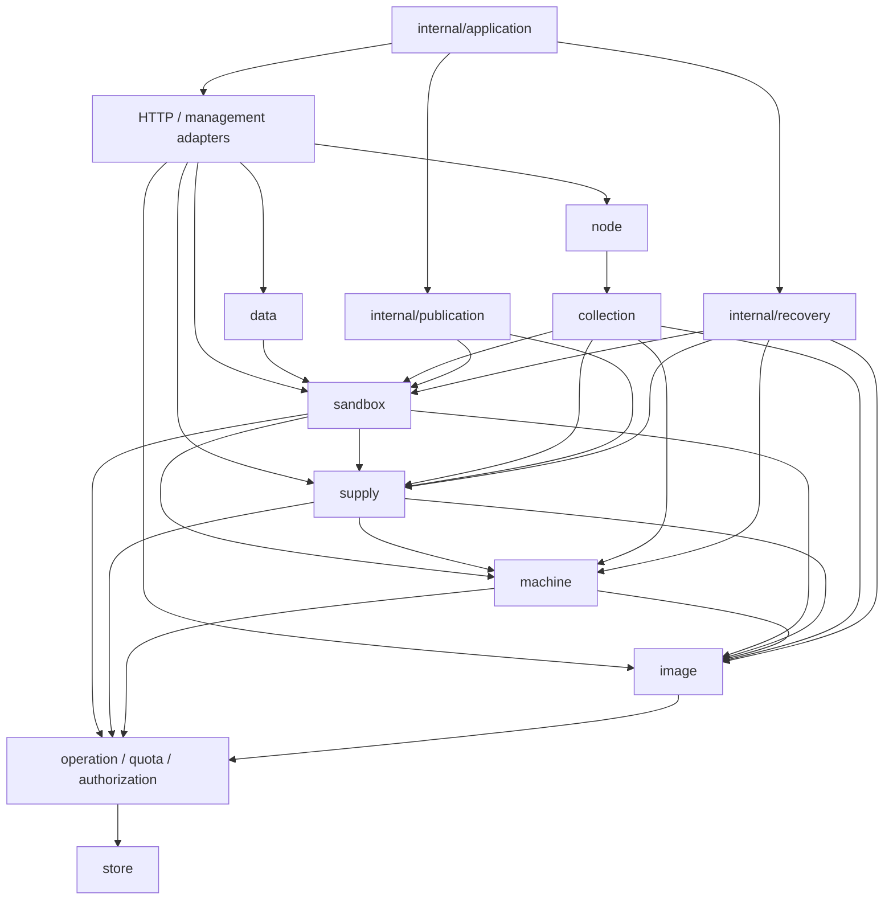

# 027：按业务能力重组 Haven

## 状态与范围

**IMPLEMENTED / VALIDATION_BLOCKED**。包边界、私有 SQL、测试归属与文档收尾已实施。027 交付树的普通入口超时和 native runner 缺项记录在[实施证据](evidence/027-capability-map.md)。后续测试归位后的运行与剩余缺项见[计划索引](README.md#待完成验收)。优先级 P1，工作量 L，变更风险 HIGH。

下文的旧源码路径、175 文件统计和设计片段记录实施前基准；当前声明、查询和测试去向以证据中的最终映射为准。后续测试整理已将共享辅助代码移到 `haven/tests/fixtures`，并删除架构检查脚本及其回归入口；下文相关门禁命令仅记录原实施要求，不再是当前验证入口。

设计基准：2026-11-16，HEAD `6162397`，以当前未提交工作树为准，包含 025/026 的实现和 goose v3.30.1 接入。不能仅用 `git diff HEAD..HEAD` 判断设计是否过期。设计读取的 424 个输入（`haven/` 下 Go/SQL/YAML/mod/sum，加架构门禁两个实现、其回归脚本和 justfile），按路径排序、`path + NUL + bytes + NUL` 的 SHA256 为：

```text
8a8c8d8af2d359fb3bb89329065fca9a19ccce2165383566b43a43df14d5438a
```

实施前核对下面的源码片段和原工作树差异。沿用现有未提交修改，不 reset、不覆盖既有工作，不提交、推送、部署、迁移真实旧库或启动真实 VM。017/020/021 继续暂停，024 的 VM 验收不属于本计划。

实施文件范围为 `haven/` 中上述业务包、共享基础设施必要接口、adapters 和测试，以及 `haven/sqlc.yaml`、`scripts/check-architecture.py`、`scripts/check-haven-shape.go`、`scripts/test_architecture.py`、生成/runner 回归、类型感知门禁所需的 `tools/go.mod`/`go.sum`、`justfile` 和对应当前契约文档。CI 仅随验证入口调整。`store` 的修改限于借用能力声明和测试，不改 goose/migration SQL 或持久语义；Loom、types、SDK、guest、protocol 生产实现不在范围内。

本计划只处理 Haven 包边界、存储所有权、model 与测试归属，不重设计业务协议、不改持久 schema、不增加微服务/RPC/event bus，不修改 Loom/guest 的实际机制、第三方代码或参考项目。

## 问题与设计结论

当前 `haven/services` 有 **175 个 Go 文件、24,574 行**。原大 Service 被拆成多个对象，但对象仍在同一包中共享大量 loader、proof、completion 和模型；编译器没有保护这些边界。`template`、`vm` 等包主要是 queries 的适配层，一次业务修改仍会穿过 services、repository、手写投影和生成结构。

目标是形成按业务能力组织的模块：**用例、状态推进、证明核验和本模块持久化放在同一所有者内；模块内直接使用 sqlc，模块外只调用业务 API。** 不要求每个模块都再创建 Service/Repository/Model 三层。

这次设计刻意不把每张表变成一个领域。VM generation、canonical snapshot、source lease 和 backing 共同证明资源归属，先归为一个物理机器资源模块。业务 sandbox 与物理机器仍分开，避免重建一个换名的 services 大包。

## 已核实的依赖

| 源码 | 当前事实 | 对设计的影响 |
|---|---|---|
| `haven/internal/application/app.go:48` | App 显式组装多种 `services.*` | 保留唯一组装与关闭；最终不再依赖 services 包 |
| `haven/services/forks.go:35` | ForkDependencies 同时依赖 Lifecycle、Captures、Provisioning 等 | fork 属于 sandbox 用例，跨能力以显式事务参与方法协调 |
| `haven/services/vm_provisioning.go:86` | Continue 持有 VM guard，完成资源后继续 activation | 不能整文件机械下沉；资源推进与业务 activation 拆开，但原 guard 必须连续持有 |
| `haven/services/snapshot_backings.go:16`、`resource_proofs.go:23` | backing 核验依赖 generation，generation 又核验 snapshot 关系 | VM 与 canonical snapshot 合并为 machine 能力 |
| `haven/services/network_retirement.go:13` | 物理回收需要核验原 activation 的 instance/resource/hash | 存在真实的跨能力证明读取，不能把当前 instance 当替代 |
| `haven/services/publication_commit.go:12` | 提交前枚举所有未冻结终态，projectOperation 后再 Commit | operation 不能直接 import sandbox/supply；需明确只读投影端口 |
| `haven/services/operation_projection.go:20` | 投影读取 sandbox/checkpoint/template；fork 读取子 publication | 投影不能降为通用存储 helper，也不能移到提交后的异步事件 |
| `haven/services/recovery.go:37`、`workflow_validation.go:15` | 所有 startup/offline 入口共用纯读取证明校验 | 把 owner validator 分散，保留统一 fail-closed 分派 |
| `haven/services/warm_claim_completion.go:26` | pool selected 的移除与 activation 完成在原事务内 | warm claim 分为供给所有者的原子方法和 sandbox 的业务协调 |
| `haven/template/repository.go:26`、`record.go:11` | body 解码为 JSON Record；Publisher 另复制生成 row | 区分协议模型与无语义的 row wrapper，不能统一替换 |

当前事务提交示例必须保留其含义：

```go
// haven/services/publication_commit.go
ids, err := repository.UnpublishedTerminals(ctx)
// 对每个 id 在 tx 中投影并保存 publication
return tx.Commit()
```

当前资源与 activation 的连接也不能只保留调用关系而改变锁范围：

```go
// haven/services/vm_provisioning.go
lock := service.guards.VM(step.Candidate)
lock.Lock()
defer lock.Unlock()
// ...runCold/runClone...
return service.activations.Continue(id)
```

## 目标包结构

```text
haven/
  authorization/             # 身份认证、tenant、授权原语
  operation/                 # 不可变请求、幂等身份、通用步骤头、终态与 publication 存储
  quota/                     # 容量、费用、holder/ref、预算交接规则
  image/                     # 导入、验证、发布、cache 与其 cleanup
  machine/                   # 物理 VM、generation、capture、canonical snapshot、backing、物理网络归属
  supply/                    # template 发布/build、golden、warm pool/refill 与 supply cleanup
  sandbox/                   # claim、activation、configure、lease、pause/resume、checkpoint binding、fork
  data/                      # Connect/Forward/AttachData、preview、透明 resume、连接交付
  collection/                # 全局 GC 可达性和跨能力回收协调
  node/                      # status/drain/管理用例；不包含 HTTP transport
  internal/
    application/             # 唯一构造、依赖连接、Close
    publication/             # 跨能力、只读的终态投影
    recovery/                # 只读 validator 分派，供 startup/offline 共用
    maintenance/             # 固定顺序的恢复/定时任务调度
    testfixture/             # 显式 store/runtime 材料与效果替身，不依赖 App
    testapp/                 # 完整 App 组装与重启 fixture
  store/                     # SQLite、goose、writer/key/HEAD、事务和 checkpoint 基础设施
  execution/                 # 唯一 guards/lifetime/workers/admission
  access/                    # 唯一凭据、binding、连接登记和 epoch
  guest/ egress/             # 保留原 port/transport 与代理边界
  httpapi/ httpwire/ management/ # transport adapters
```

有查询的能力包内部采用 `queries.sql`、`internal/dbgen/`；必要时用多个 SQL 文件，而非再建立一个公开 repository 包。文件按具体行为命名，如 `claim.go`、`capture.go`、`proof.go`、`read.go`。`repository.go` 只有确实存在持久化语义组合时才保留。

新增名称含义：`machine` 是物理 VM 及其可捕获/恢复材料的所有者，不是 Loom runtime，也不拥有租户 sandbox 生命周期；`collection` 负责全局回收的资格与协调，不拥有物理删除机制；`node` 是已有管理业务的归属，不是另一套控制面。

### 职责、数据与源码迁移

| 目标 | 现有来源 | 所有权与禁止事项 |
|---|---|---|
| authorization | 原 authorization；services/authentication、tenants | tenant/token/principal；具体 sandbox/checkpoint 权限由对象所有者核验，认证包不 import sandbox |
| operation | 原 operation；公共请求身份、通用 publication 存储、资源父子链接头 | 不解码每种业务 payload，不投影当前 sandbox/template，不承担各业务阶段 SQL 的仓库 |
| quota | 原 quota；跨包通用容量/费用核验 | 占用、exact-one 写、持有关系、费用转换；不得凭资源不存在直接退款 |
| image | 原 image；services/images、image_import_*、image_cleanup*、image_inventory | images/image_intents/image_caches 及对应步骤；实际工具仍委托 Loom |
| machine | 原 vm + snapshot；resource、capture、stop、discard、vm release/restore、snapshot delete、generation、source/backing proof、direct policy 的物理部分 | vms/instances/resource_versions、canonical snapshots/owners/source_leases/backing、network_policies；不读取或改写 sandbox settings/lease/pool 状态 |
| supply | 原 template + pool；templates、supply*、refill* 与 warm pool 部分 | templates/template_intents/pool_slots/warm；不直接修改 sandbox 的 business state |
| sandbox | 原 sandbox；Sandboxes、Lifecycle、Forks、Commands、claim、lease、configure、activation、checkpoint binding | sandboxes/settings/fences/checkpoints/checkpoint_bindings、业务凭据接纳和业务步骤；operation_credentials 的公共持久写由 operation 负责；消费 image/supply/machine 的明确能力 |
| data | Data、auto_resume、preview、binding_reconcile、data_* | 连接接纳、延迟交付、透明唤醒；调用 sandbox 用例，sandbox 只经 access.Registry 撤销连接，不反向依赖 data |
| collection | GarbageCollection、gc_* | 全局根图、候选、GC step；从各 owner 读取同一事务 snapshot，调用 owner 的持久 cleanup，不绕过证明直接 unlink |
| node / internal 调度与投影 | Management、Maintenance、Recovery、publication/projectOperation | 管理与组合职责；不把业务状态机重新集中进这些包 |

`Availability` 的 draining 状态移入共享 execution，继续使用同一 Registration guard；node 只调用它执行管理命令，supply/sandbox 读取同一实例。不能把 Availability 的实现放进 node 后让低层业务 import node，形成 `node → collection → supply → node`。

`Operations` 拆开通用授权查询/Wait 与业务结果交付：operation 保留 scope/credential/terminal 和 worker settle 观察；需要 sandbox capability/token 的交付由 sandbox/读取 adapter 处理。authentication 同样拆分 token/principal 识别与具体对象授权，不能把原 Authentication 对 sandbox repository 的依赖原样带入 authorization。

`SandboxCommands` 中幂等键、作用域、request MAC 等公共部分归 operation/authorization；sandbox env/settings/secret admission 归 sandbox。supply 的 template command 接纳使用前者，不反向调用 sandbox.Commands。既有请求 envelope、MAC 输入和 nil 规则保持，不引入新的泛型 command bus。

`Audits` 的 durable sanitized audit 写入仍由 store journal 承担；实际业务适配与 `ProxySockets` 一起归 data，因为二者直接服务于 egress/data 交付，不引入 node 的反向依赖。egress factory 继续接收窄 method values，不接收 App。

**表与步骤行族要分别定义所有权。** `operation_steps`、`cleanup_intents`、`deletion_intents` 是共享容器，不应使 operation 再成为所有业务的查询仓库。基于已有 action/key/resource_kind 划分 payload 和行族：业务模块持有自身阶段查询、解码和条件更新，operation 保留公共 identity/terminal/link 协议。迁移前清单必须列出每个查询能写哪些行族；禁止无 key/action/归属约束的跨行族写。现有 SQL 谓词、SET 列和 `UPDATE OF` 语义不随所有权搬迁而重写。

### 编译依赖



图中省略共享 execution/access 和显式 Loom/guest 效果依赖。业务包不 import application、transport、recovery、maintenance 或 publication 组合包；任意包不得导入另一个所有者的 `internal/dbgen`。authorization/operation/quota 不反向依赖业务模块。

## 事务、锁和跨能力 API

### 不新增事务框架

继续使用原 `*sql.Tx`、store.DBTX 与 checkpoint。发起一次业务接纳/完成的用例拥有 Begin/Commit；参与者的 `...Tx` 方法只消费这个事务，不提交、不 checkpoint、不启动 worker、不获取新的 workflow 锁、不执行 Loom/guest 效果。读取同样借用原 snapshot。

所有者 API 按语义命名，例如：

```go
// 目标形状，不是已存在的接口；命名以真实调用点最终核对。
func (s *Supply) TakeReadyTx(ctx context.Context, tx *sql.Tx, claim WarmClaim) (WarmSelection, error)
func (s *Supply) CompleteClaimTx(ctx context.Context, tx *sql.Tx, selection WarmSelection, proof ClaimCompletion) error
func (m *Machine) RetainSourceTx(ctx context.Context, tx *sql.Tx, request SourceLease) (Source, error)
func (q *Quota) TransferTx(ctx context.Context, tx *sql.Tx, transfer Transfer) error
```

`WarmSelection` 是冻结 pool/version/instance/原责任身份，不是一个可绕过复核的内存 token。完成时必须重读同事务当前归属与历史 witness。接口不能退化成 `Save(any)`、通用 repository registry 或一组来自 App 的任意回调。

### Warm claim 的责任交接

1. sandbox 用例在原 request/admission guard 下固定身份、幂等请求与同一事务。
2. supply.TakeReadyTx 核验并固定 pool selected 身份；machine 方法核验原 generation/instance；quota 接纳 sandbox slot 和原 disk holder 转换；sandbox 写自身 birth/状态。
3. 与原操作/step 一起 commit，checkpoint 后才派发外部效果。
4. activation 完成时，sandbox 在原 configuration/VM 保护下重开原完成事务；调用 supply.CompleteClaimTx、machine 的 generation/lease 交接、quota 转移，再保存业务 running 与 publication。
5. 任意条件写 IGNORE/ABORT 或 publication 失败，整笔交接回滚；不能先删 pool row 再另事务交付。fallback 必须读取原 warm retirement receipt。

不要整文件移动 `warm_claim_completion.go`：pool 行归 supply，activation/业务 result 归 sandbox，source lease/generation 核验归 machine，共同使用调用者事务。

### Provisioning 与 guard 连续性

`VMProvisioning.Continue` 目前既执行物理资源推进又继续业务 activation。拆分后：sandbox 的 provisioning coordinator 持有原 VM guard，调用 machine 的物理推进及 sandbox activation；中间不释放 guard、不重拿同一把不可重入锁。被调用方法必须明确“已持锁”前置条件，保留现有锁实例和顺序，不为此创建新的锁管理器。

supply 的临时 build/refill 只消费物理资源部分及其原有 guest 操作，不反向 import sandbox。必须先核实各现有 Continue 调用在有/无 activation step 下的行为，逐项移交，不能将“原先最终会调用 activation”默认为可删除的空操作。

### 一处明确的跨能力证明读取

machine 的网络回收需要原 activation 的 resource_operation/resource_hash/expected_instance，但完整 ActivationInput 包含 sandbox.Settings。将 ActivationInput 全部搬进 machine 会反向耦合业务配置；只解析几个 JSON 字段又会弱化现有完整解码核验。

因此允许一个**命名、只读的 ActivationProofReader 端口**：接口和返回的最小归属证明声明在 machine，sandbox 的独立 proof reader 实现它。application 在打开 store 前即可构造这个无运行态 reader，注入 machine；它只借用传入的 DBTX，执行原 LoadActivation 的完整 hash/key/action/JSON 核验，再返回原绑定。machine 继续将结果与原 generation 历史逐项匹配。

该 reader 不持有 sandbox.Service、App、worker 或 runtime，不调用写入、Commit 或新事务 API，不修改设置、不补造 witness。现有 DBTX 接口含 Exec，因此这里的只读是明确的行为约束，不声称仅靠接口类型就获得 SQLite 只读隔离；为 proof/projector 的实现增加禁止写路径的门禁和真实事务不变性测试。startup 的 immutable probe 则继续使用实际只读连接。这是显式的语义依赖，不宣称接口让依赖消失。新增类似跨能力端口必须逐个说明不可合并/不可上移的原因，不推广为通用 callback 总线。

## publication 与恢复：先处理再搬业务

### publication

operation 提供具体 Committer，接受只读 Projector；其实现由 `internal/publication` 提供，依赖 owner 的读取 API。业务用例拿到同一个 Committer，不 import 组合包。接口只覆盖：在调用者 tx 中为指定 operation 产生当前已应冻结的 `types.Operation`。

保留现有顺序：枚举 UnpublishedTerminals → 每项投影 → Publish → tx.Commit → 调用者原 checkpoint/fault 点。不能改成 after-commit callback，也不能缩小为“只冻结本次 operation”而漏掉同事务完成的 child。fork 父继续消费冻结的子 publication，不读取当前 sandbox 重建成功历史。

Projector 不调用活动 Service 或任何写方法；公共查询的 token 交付仍在读结果后按原权限执行，不能进入持久 publication。这个窄端口与 ActivationProofReader 都不允许捕获 App。

### recovery

每个 owner 提供无副作用的冻结步骤 validator，使用和执行路径相同的 loader。`internal/recovery` 显式注册现有 key/action 的校验者；重复匹配、未知种类、缺历史证明均拒绝。通用 checksum、public terminal/publication 关联仍集中核验。

registry 是编译时明确构造的集合，不自动发现 package/init 插件。打开数据库前即能构造验证器，不能依赖已打开的 store.State、业务 Service 或 backend。reviewed 状态的原分支保持，不借重构扩大 review 的效果权限。

`internal/maintenance` 保持原恢复优先级：direct → images → GC → supply cleanup → fork → warm → supply → capture cleanup → lifecycle → snapshot delete → capture discard → stop → discard → capture → standalone activation → release → provisioning Continue。分包不重新排序，也不按 map 遍历分派。

## model 与 sqlc

| 数据形态 | 规则 |
|---|---|
| 表行、查询参数、查询投影 | sqlc 生成；在所属能力内直接使用，不逐项复制成同形 Publisher/Identity 等结构 |
| JSON BLOB 的内容、请求、step input/state、witness | 继续有明确的 Go 协议类型和解码核验；SQL 无法生成内部 schema |
| 跨能力契约 | 仅声明调用所需、语义完整的值；不是为了隐藏 dbgen 而再复制全部列 |
| 公共 HTTP/SDK DTO | 保持 types 契约；在明确边界转换，不直接暴露数据库行 |

保留 `omit_unused_structs: true`；不要为填满 models.go 生成所有未使用表结构。删除纯转发 `Repository.New(q).GetX → dbgen.New(q).GetX`。保留有真实语义的 proof loader、JSON 解码、精确影响行数验证、条件责任转换，但让这些方法服务于所属能力，不机械保留 Repository 类名。

vm.Record 与 snapshot.Record 合并到 machine 后的同名冲突要显式命名，如 VMRecord/SnapshotRecord；包/类型名变化不允许改变 JSON 字段顺序、tag、nil/omitempty 或 hash。不要增加兼容别名。对冻结 JSON 使用迁移前的固定字节/摘要证据验证，不能同时修改实现与期望值掩盖变化。

sqlc 配置按能力组织：machine 合并现有 vm/snapshot 查询，supply 合并 template/pool；业务专属 operation_steps 查询迁入各自 owner。允许重命名发生冲突的内部生成查询名称，但 SQL 语句及返回值语义必须保持。goose v9 baseline、版本 journal、初始化事务和只读旧格式拒绝保持，**本计划不新增 migration**。

## 分阶段实施

### 0. 建立可核对的迁移清单

在 `plans/evidence/027-capability-map.md` 记录所有现存 services 声明、queries 和测试的旧路径/新 owner/调用者/行族/事务与 guard 前置条件。每项恰好一个最终 owner；列出需要拆函数而非搬文件的 VMProvisioning、WarmClaims、activation policy、publication/recovery。记录当前工作树指纹和原测试名清单。

核对上述证据并运行最窄现行门禁，保留已有 FAIL/SKIP，不将缺权限或 120 秒超时当作迁移通过。这个清单是后续每批变更的检查输入，不允许以“其余放 common”收尾。

验证：`python3 -I scripts/check-architecture.py`、`python3 -I scripts/test_architecture.py`、`just check-sql` 应通过；全量基线命令与限制见后表。

### 1. 拆出提交投影、只读恢复和 operation 基础

先明确 Committer/Projector、owner validator 和 ActivationProofReader 的契约，迁出跨能力组合，确保 image 等模块不再经 CommitPublications 隐式依赖整个 services。暂未迁移 owner 可以由过渡接线调用原函数，但接线必须只存在 application/组合层，列明删除批次，不能让新能力 import services。

验证：publication/recovery 的原组件场景、只读 store 拒绝场景和架构正负例通过；证明 UNKNOWN/缺 validator 不会放行。此阶段不改变一次 Commit 内的终态枚举范围。

### 2. 完成 image 垂直切片

一次移动 image 用例、步骤协议、loader、cleanup、内部 queries、专属测试；删除 image 中纯查询 wrapper。更新 HTTP/管理接线、恢复路由和 GC 的能力调用。

这是首个验收样板：包内能直接消费 sqlc、包外只能使用 image API，新增包没有 services 依赖。验证 ImageReplay、ImageCleanup 两个组件场景及既有 native 场景；真实工具/权限不足如实 BLOCKED，不用替身声称 EROFS 通过。

### 3. 建立 machine 的完整资源边界

合并 vm/snapshot 持久所有权，迁入资源证明、capture/stop/delete/restore/backing/source lease 和物理 policy。拆开资源推进与业务 activation，以证明读取端口打断反向 import。以 source lease → backing、最后 backing 退休、原 generation witness、迟到 completion 为重点检查，不能只验证冷启动。

验证 VM history/ownership、capture/discard/snapshot delete、SQL ABORT/IGNORE 原子交接场景，检查同一 VM guard 覆盖原执行全程。禁止机器包 import sandbox/supply 或查看其当前状态来替代历史证明。

### 4. 迁移 supply 与 sandbox

先将 template/pool/refill/build 与供给责任方法收拢到 supply；然后迁移 sandbox claim/lifecycle/fork/configure/activation。按上文事务参与方式拆 WarmClaims。资源方法与 supply 方法不提交调用者事务。

这一步必须重查每个跨包 completion 的调用前后：同一 tx、同一 guard、同一 fault/checkpoint 顺序。fork 仍一次冻结整批目标/预算并消费子 publication。移除 templates/pool/vm/snapshot 原公开 repository 包及全部导入，不留 alias facade。

验证 warm fallback、supply cleanup、fork SQL rejection、configure failure matrix、resume activation handoff 和 publication 历史场景。

### 5. 完成 data、全局 GC、node 与测试归属

data 依赖 sandbox，sandbox 撤权走共享 access.Registry；node/collection/maintenance 只组合能力，不复制业务资格判断。所有 owner 的 GC 根查询绑定同一 read transaction，不能每个模块各开 snapshot 导致混合时刻的“无引用”。

实现包的外部测试包覆盖本包的公开行为。跨服务工作流在 `haven/integration/workflows`，应用启动与关闭在 `haven/internal/application`。真实镜像物化在 `haven/image` 和 `haven/gc`，带标签的 guest 启动与 Rust RPC 场景在 `haven/integration`。共享 fixture 分离“基础 store/runtime 材料”与“完整 App 组装”，基础 fixture 不反向依赖 application。

分散测试前保持全局调度预算：Haven 多包执行可显式使用 `-p=1`，各生命周期 suite 最多四个活跃场景；禁止多个包各开四个并发从而暗增资源上限。记录新旧测试名映射；包级 timeout 粒度改变不能宣称旧 120 秒问题已优化。

最终删除 `haven/services`。更新 sqlc 配置、架构门禁/正负例、文档和构造入口，不把旧服务集合重建为 `application.Services` 或通用 registry。

## 实施核对补充

声明级核对确认，`CaptureInput.Sandbox` 冻结原 `sandbox.Record`，`ResourceInput.Captures` 又递归包含 capture。采用一个无行为、无存储能力的 `ownership` 值包承接原 `sandbox.Identity`、`sandbox.Record` 与 `vm.GenerationRef`，分别命名为 `Birth`、`Sandbox`、`GenerationRef`。类型移动后不留 alias，不复制模型，不改字段顺序、JSON tags、nil 或 hash。其范围限于这三个真正被两侧冻结的归属值；不得演化为共享 loader、proof 或业务 authority。

machine 与 sandbox 的接缝已分成只读历史证明、原事务写参与者和保持连续 VM guard 的 coordinator。restore/provision 不经只读接口写业务状态；release/stop/capture-discard 继续核验原 Lifecycle。具体签名、最终位置、被内联包装的私有查询及消费者见 [实施清单](evidence/027-capability-map.md)。

## 验证矩阵与命令

命令在仓库根目录执行，脚本示例使用 Nushell。现有普通组件预算 120s、race 10m、required-native 300s 不放宽。当前历史基线：goose 接入后 Haven race 662 pass/35 skip，真实 Rust fixture、8 组 smoke、生成/架构与 lint/vet 通过；026 的普通 120 秒超时和完整 native 权限缺项仍在 plans/README.md 跟踪。**这些历史结果仅是设计输入。** 当前运行结果与源码清单独立记录在实施证据中。

| 阶段 | 命令 | 通过条件 |
|---|---|---|
| 每批 | `python3 -I scripts/check-architecture.py` | 编译 import 图与 SQL/边界门禁通过 |
| 门禁变更 | `python3 -I scripts/test_architecture.py` | 真实临时 workspace 正负例通过，新增循环/越权案例确实被拒绝 |
| 查询迁移 | `just check-sql` 与 `python3 -I scripts/test_sql_generation.py` | 当前所有生成文件一致；不硬编码旧 30 文件数量 |
| 编译 | `with-env {GOWORK: "off"} { go -C haven test -tags=integration,guest_image,privileged ./... -run '^$' }` | 全部 tag 编译，不冒充运行 |
| 组件 | `with-env {GOWORK: "off"} { go -C haven test ./... -p=1 -count=1 -timeout=120s }` | 无新增失败；原超时若未解决明确记录，不能称全部验收完成 |
| Race | `with-env {GOWORK: "off"} { go -C haven test -json -race ./... -p=1 -count=1 -timeout=10m }` | 全部既有行为场景保留，race 无失败，逐项记录 skip |
| 跨语言/daemon | `just integration`、`just smoke` | 真实 Rust fixture 与全部 smoke 通过 |
| 静态 | `just check`、`golangci-lint run ./haven/... ./loom/...` | vet/Rust 与相关 lint 通过；不使用含 go fix 的 just lint 改写验证树 |
| 原生 | `python3 -I scripts/check-native-gate.py` | 具备条件时实际 required pass；缺条件保持 BLOCKED，不用宿主替身替代 |

每批定向选择相关测试名，在 `go -C haven test ./... -run '<锚定正则>'` 下执行，避免因包搬迁漏跑。已核实场景包括：

- `TestHavenImageReplayDoesNotRunConflictingRequest`、`TestHavenImageCleanupRetainsResponsibilityUntilAtomicCompletion`。
- `TestHavenPublicTerminalHistorySurvivesChangesAndReopen`、`TestHavenPublicPublicationFailureKeepsConfigurationFenced`、`TestHavenStartupRejectsChangedDeliveryBeforeEffects`。
- `TestHavenResumeActivationHandoffRejectsSQL`、`TestHavenInstanceRejectsLateCompletionAfterOwnershipChange`、`TestHavenReleaseRequiresOriginalGenerationRecords`。
- `TestHavenSnapshotDeleteAtomicRetirement`、`TestHavenSnapshotDeleteBackingRetirement`、`TestHavenSnapshotDeleteRetainsUncertainObjects`。
- `TestHavenWarmClaimAndFallback`、`TestHavenSupplyCleanupRetiresFailedBuildCapture`、`TestHavenForkCompletionRejectsSQL`。
- `TestHavenConfigureFailureMatrix`、`TestHavenDataAdmissionRepeatsFinalGuard`、`TestHavenDownstreamHandoffRetainsOriginalConfiguration`。

只在迁移新增边界未被原测试覆盖时加测试：实际 Service/SQLite 的 rollback/IGNORE、read-only proof adapter、共用 guard 阻止迟到交付、同事务跨 owner snapshot。不要增加镜像 helper 实现的独立函数单测。

## 架构门禁与完成标准

- [x] `haven/services` 不再包含 Go 文件，生产、测试、文档无过时服务包入口；最终不存在旧 repo facade/兼容 alias。
- [x] 所有声明、SQL 查询、步骤行族、测试均在迁移清单中有最终去向；删除的通用包装列出 owner 私有查询及消费者，原 namespace/SQL predicates/fault point 有可核对映射。
- [x] 各能力自己消费 `internal/dbgen`，无仅为类型隐藏而复制整行的 wrapper；跨包 API 表达语义而非通用表 CRUD。
- [x] import gate 检查上面的有向依赖；禁止 owner 导入组合层/transport/别人的 dbgen，禁止非测试包导入 testfixture/testapp。
- [x] SQL gate 允许所有者内部生成代码；对 business operation_steps/cleanup 行族增加类型感知的静态约束正负例，不使用整目录 raw SQL 豁免。
- [x] publication 在原事务中完整冻结后提交；恢复 validator、route 顺序与 reviewed 分支不变。
- [x] writer/key/HEAD、goose、唯一 DB、shared guards/lifetime/workers/registry 没有复制；业务 SQL 不经第二连接提交。
- [x] v9 SQL 与 goose 初始化协议字节不变；冻结 JSON/哈希/NULL/整数/精确行数语义保持。
- [x] 224 个原测试名保留并记录最终路径；最终 race、生成/架构、Rust fixture、smoke、静态门禁与源码身份见证据。
- [x] 普通/native 缺项单独保留 IMPLEMENTED / VALIDATION_BLOCKED；未以包重排、skip 或旧树通过关闭验收。

## 需要重新设计而非机械继续的情况

- 为去掉 import 环，需要复制完整 activation/workflow 模型、制造新 witness 或查询当前状态替代历史证明。
- 为让某模块独立，需要新增 DB、独立 commit、改变 guard 顺序、异步 publication 或缩小事务终态集合。
- 一个新增接口只能通过捕获 App、总 services 集合、任意 repo registry 或拥有写能力的 recovery reader 实现。
- 查询搬迁要求改 schema、冻结字段、SQL 条件或资源限制；先分离原因与本计划边界，不夹带改变。

这些情况先保留原正确路径、记录具体依赖和反例，调整设计；不是以重试次数为由跳过验证，也不是自动请求提权。

## 维护与已否决方案

- 否决仅按名词把 services 分成多个子目录、却保持互相 loader 调用：没有形成数据和行为所有权。
- 否决一表一域：snapshot/backing/generation 当前共享不可分的证明链。
- 否决一律 Repository 接口：没有替代存储需求，机械 mock 会掩盖 SQLite 事务/trigger 语义。
- 否决把全部 model 改成数据库 row：JSON 冻结协议无法由 SQL 推导。
- 否决抽出大 common/model/proof 包消除编译环：会重新形成共享业务 authority。
- 否决用消息总线或 saga 替代现有单库原子交接：增加未知状态并改变已验证责任协议。

实施已完成声明级清单，并以原始 SQL、冻结布局和实际行为验证核对高风险边界。宿主网络与 cgroup 策略、guest 镜像启动和部署验证仍不在本次重构的重新验收范围内。
