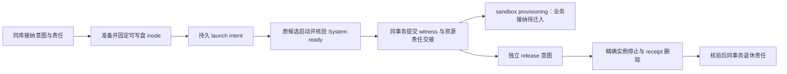
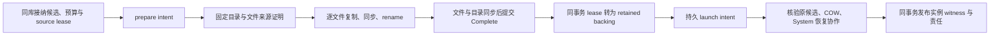
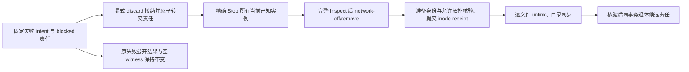
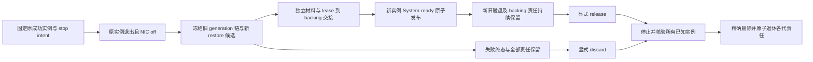
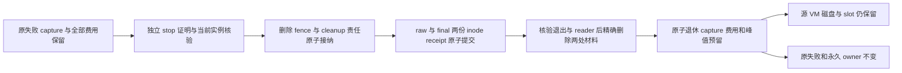
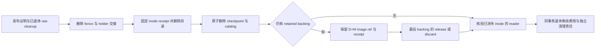

# 024 迁移映射与实施证据

状态：**STAGE_F_PARTIAL / VM_ACCEPTANCE_BLOCKED**。旧控制源码、双 daemon、engine UDS facade 与独立 module 已删除；测试、workspace、CI、native gate、runner 和部署材料已迁到单 Haven。当前 schema 仍为 9。最终组件、完整 race、Rust/smoke、静态与 required-native 通过；`run.9exdrqy5` 为 **677 pass、0 fail/skip**，Haven **278.938s**，原 JSON/race/count=1/300s 不变；实际 capture/kernel 通过。KVM boot/production 未提供显式私有材料、rootfs、OCI/I/O 预算，整体保持 BLOCKED，尚未实施全部完成。当前实现与命令见 [阶段 F 证据](024-stage-f-retirement.md)。[阶段 E](024-stage-e-entrypoints.md) 的 `run.d6zrkslx`（940 pass）和 [阶段 D](024-stage-d-control-matrix.md) 的 `run.2a99sfv7`（923 pass、schema 8）只绑定各自历史完成树。既有部署未切换，017/020/021 继续暂停；下文早期记录保留历史，不作当前树通过证据。

## 源码基准与检查范围

- 本次检查 HEAD：`b7feea385bfc463098551fb24755d931d3efc37c`。
- 计划基准：`d6ced5b`。`git diff --stat d6ced5b..HEAD -- engine sandboxd Makefile go.work scripts deploy docs .github/workflows/check.yml` 仅显示 `docs/README.md` 与 `docs/research/sandbox-comparison.md` 的已提交文档变化；运行时和构建入口未发生 drift。
- 开始时 `git status --short` 为空。未接触已有 daemon、`.local-run/`、旧数据库、未知实例或 VM 材料。
- 已阅读当前 Engine/Sandbox 架构、Engine 集成契约、sandboxd 契约、根 README、Makefile 与 scripts runner 边界。
- 已用实际源码与 `ast-grep outline` 核对 Backend、两份 store、allocation 交接及 Linux/CH/文件机制的结构。下列目标路径均是待迁移位置，不表示已经存在。
- 017、020、021 保持 PAUSED；本次未执行提交、推送、合入或额外下载。

## 控制、效果与证据归属

| 当前代码 | Haven 控制事实与协议 | Loom 显式效果与现场证据 |
|---|---|---|
| `engine/engine.go` | writer lock、schema、独占 DB、调度、恢复、生命周期锁、关闭顺序 | 无；不得搬入 Loom |
| `sandboxd/store.go`、`service.go`、`backup.go` | 合并业务和资源 store；新的 Haven identity/version、统一备份和恢复 gate | 无；不能仅给两个旧 Open 传同一个数据库 |
| `engine/admission.go`、`metadata.go`、`operations.go`、`operation_completion.go`、`query.go` | 唯一 operations/steps、固定请求、候选、终态 witness、SQL 影响行数检查、资源引用和预留 | 资源描述/observation 另行定义，不暴露控制 operation API |
| `engine/backend.go`、`api/types.go` | VM/operation/业务查询 DTO 与动作编排 | 从现有效果接口提炼 Resource/Observation、shape、配置及策略类型，避免反向依赖业务 DTO |
| `engine/cloudhypervisor*.go` | 生命周期调用与观察结果的接纳 | CH 调用、进程收据、PID/starttime/boot/exe/cgroup 核验、pidfd、单次调用 I/O；不得带入恢复控制循环 |
| `engine/launcher_linux.go`、`device_linux.go`、`cow_linux.go` | 预先记录实例、路径、预算与候选归属 | launcher、设备身份、私有 RAM 映射完整范围核验；保留隔离限额 |
| `engine/guest.go` | System 就绪结果与步骤推进 | 明确资源上的 System RPC，保留 reseed/校时 |
| `engine/lifecycle.go` | 持久 launch intent、实例切换、停止/删除资格与终态 | prepare/launch/boot/inspect/stop/remove 的具体效果 |
| `engine/snapshot.go`、`capture_linux.go` | 暂停/恢复意图、Captured/Materialized/ArtifactsSynced 分离、固定 digest、发布资格与预算 | 指定目录的无跟随打开、跨 UID 边界、独立 inode、副本、hash/fsync/seal/rename 的现场操作 |
| `engine/restore.go`、`restore_materials.go`、`restore_cleanup.go` | 源租约到 backing 的同事务交接、候选阶段、restore_blocked、所有已知实例的 cleanup | 明确源/目标/历史证明上的复制、hardlink、身份/digest/fsync/COW 核验及精确删除 |
| `engine/network_policy.go`、`network*.go` | 策略期望值/代次、精确实例绑定、NIC 期望状态、授权发布 | netns/TAP/veth/route/nft、namespace/policy receipt 及实际规则核验 |
| `engine/image.go`、`image_catalog.go` | 导入接纳、catalog、预算、目标路径、发布与持久责任 | 物化步骤须显式给出输入和目标，不能把 Engine.ImportOCI 整体搬进 Loom |
| `engine/image_shared.go`、`image_compat.go`、`image_validation.go`、`fsmeta*.go`、`image_runtime.go`、`storage.go` | builder/manifest 的发布资格及资源引用；混合文件按调用点拆分 | OCI/EROFS 实际工具、格式验证、镜像设备映射与显式文件操作；保留当前格式和限制 |
| `engine/gc*.go`、`admin.go` | 根集合、删除 fence、inode 删除 journal、恢复 gate、备份与责任退休 | 仅精确候选的 inspect/unlink/fsync，不扫描重建 catalog、不自主 GC |
| `sandboxd/admission.go`、`allocation*.go`、`quota.go`、`recovery*.go`、`instance_cleanup.go` | admission 时固定资源 ID、费用/holder/依赖；step 完成与责任交接同事务；独立 cleanup | 删除跨库 Submit/Find/Wait/adopt，不把旧 api.Client 变成进程内远程 facade |
| `sandboxd/activation.go`、`configure.go`、`data_admission.go`、`bindings.go`、`direct.go` | 配置 fence、短发布 guard、租约/实例重核、off→policy→ready→on→接纳 | 仅 namespace/policy 机制；凭据/租户策略不进入 Loom |
| `sandboxd/agent/`、`egress/` | `internal/agent/`、`internal/egress/`，保留内存 secret 与重启阻断 | 不迁入 Loom |
| `sandboxd/http.go`、`preview.go`、`sdk/` | HTTP 接纳/鉴权、业务 DTO 归 `api/`、SDK 归根 `sdk/` | 不迁入 Loom |
| 两个 daemon、engine client/server、sandboxctl | `cmd/haven/`、`cmd/havenctl/`、Haven 私有管理 UDS 和薄 `cmd/loomctl/` | haven 在配置解析/DB 打开前处理 internal-launch/internal-device-check |
| Makefile/workspace/CI/scripts/deploy | 单宿主 module、唯一 daemon、保留 operator/protocol 检查和原 gate 语义 | 架构 gate 用实际 go list 直接及传递依赖，不只扫 import 字符串 |

实际核对：`os.Executable()` 同时存在于 CH Launch 与 device-check 路径；两种内部入口都必须由新 haven 二进制承接。当前物理机制大量使用旧 `api.Config`、`api.NetworkPolicy` 和 `api.Fail`，抽取时必须先拆出资源级类型和错误边界，不能让 Loom 依赖新的业务 API 包。`CloudHypervisor.Close` 的进程观察清理也不能被解释成 VM 生命周期终止。

## 行为测试迁移清单

以下表的每行覆盖所列文件内的**全部现有 Test、子场景、断言和 build tag**。目标目录中的同名文件保留原场景；混合文件拆分后仍以原测试名追踪来源。不得以删文件、改名或替身成功替代原断言。阶段 B/D 完成后应追加实际新测试路径、运行结果和拆分对应关系；本表当前仅是迁移清单。

`engine/` 的目标分配：

| 原文件（相对 engine/） | 目标 | 必须保留的行为 |
|---|---|---|
| `admin_test.go` | `internal/haven/` | 备份 receipt、恢复 review、SQLite sidecar 拒绝 |
| `admission_test.go` | `internal/haven/` | snapshot 预算在 pause 前拒绝 |
| `capture_isolation_linux_test.go` | `loom/` | 实际跨 UID 父/叶目录归属、替换拒绝、独立 inode、非普通文件拒绝 |
| `cgroup_rootless_test.go`、`kernel_isolation_rootless_test.go` | `loom/` | 原 tags、runner 子进程与实际内核隔离/限额 |
| `cow_linux_test.go` | `loom/` | 拒绝 eager fallback、实际 private/shared mapping 完整范围 |
| `engine_test.go` | `internal/haven/` | 生命周期幂等、独立删除、独占写者、缺库拒绝 |
| `fsmeta_test.go` | `loom/` + `internal/haven/` | 真实工具物化/提取、cache 重建/损坏、manifest、层数/设备限额、不安全材料拒绝 |
| `gc_journal_test.go` | `internal/haven/` | 部分删除/重启、inode intent、显式删除后的退休、实际 import/cache 清理 |
| `gc_test.go` | `internal/haven/` | 根集合、dry-run 不写、未知根/身份保留、在途引用、开放 FD/mapping、并发 fence、batch/cancel、blocked restore |
| `guest_test.go` | `loom/` | 等待真实 System vsock listener 的时序，不放宽 readiness |
| `image_catalog_test.go` | `internal/haven/` | orphan/格式冲突拒绝、发布资格 |
| `image_compat_test.go` | `loom/` + `internal/haven/` | 真实 umoci/EROFS 的 hardlink、whiteout、opaque、顺序、confinement、无 fallback；catalog 冲突/未发布 gate 留在 Haven |
| `image_runtime_test.go` | `loom/` | 镜像设备表顺序与保存磁盘匹配 |
| `image_shared_test.go` | `loom/` + `internal/haven/` | 共享层真实语义、前向链接、确定性 cache、旧冻结 builder、损坏拒绝；catalog 发布留在 Haven |
| `image_validation_test.go` | `loom/` | traversal/type/diffID/size/metadata 限额、安全链接、Linux backslash 路径 |
| `kvm_integration_test.go` | `integration/` | 实际 CH/guest/COW/resnapshot、两种镜像、原 kvm tag 与材料门槛 |
| `lifecycle_test.go` | `internal/haven/` | 重启不 relaunch、agent 失败后的可信 stop、未知身份不删 |
| `network_policy_linux_test.go` | `loom/` | 实际规则默认拒绝/共享预算与规则 hash 篡改 |
| `network_policy_rootless_test.go` | `loom/` | 原 rootless tags、真实 nft/NAT/flow 和 probe 子进程 |
| `network_policy_test.go` | `internal/haven/` | 策略安装/撤销、崩溃恢复、精确实例、shutdown 错误、迟到执行、跨 VM 不串行 |
| `operation_completion_test.go` | `internal/haven/` | 固定终态/witness、真实 SQL 拒写及 RAISE(IGNORE)、lease delete、外来候选、较新实例不补历史证明 |
| `operations_test.go` | `internal/haven/` | start/restore 多中断点恢复、候选归属、一次 launch、终态不变 |
| `restore_cleanup_test.go` | `internal/haven/` | blocked 候选保留、所有已知实例精确清理、原失败终态不变 |
| `restore_materials_test.go` | `internal/haven/` + `loom/` | 中断副本/损坏拒绝、源引用连续、源删除后接管、不重建运行中磁盘；文件机制单独落 Loom |
| `restore_test.go` | `internal/haven/` | 旧发布材料拒绝、backing 交接、实例更新/默认断网 |
| `snapshot_test.go` | `internal/haven/` | 暂停/恢复窗口、各持久边界、丢失/损坏材料不重造证明 |
| `storage_test.go` | `loom/` | 实际独立可写副本 |

`sandboxd/` 的目标分配：

| 原文件（相对 sandboxd/） | 目标 | 必须保留的行为 |
|---|---|---|
| `admission_test.go` | `internal/haven/` | 同键重放/异参冲突、租户隔离、并发配额 |
| `allocation_test.go`、`allocation_recovery_test.go` | `internal/haven/` | 原真实 SQLite/transport 场景逐项转成同库 step 场景；SQL 拒写、未知结果、witness、历史归属、费用/slot、cleanup 连续性不可删除 |
| `authorization_test.go` | `internal/haven/` | 外来对象不可区分、sandbox token/operation 结果权限 |
| `backup_test.go`、`store_test.go` | `internal/haven/` | 统一 DB 备份保全、旧/未来格式在 DDL 前拒绝、缺库/独占 writer、恢复 gate |
| `checkpoints_test.go` | `internal/haven/` | paused 不唤醒、rollback replay 不停新实例 |
| `configure_test.go`、`data_admission_test.go` | `internal/haven/` | 原全部竞态/故障矩阵、持久 fence、最终短 guard、透明恢复合并、secret 不持久且重启阻断 |
| `direct_test.go` | `internal/haven/` | off/policy/activate/on 顺序、撤销重试、hostname/host-secret 拒绝 |
| `error_boundary_test.go` | `internal/haven/` | 可信直接 absence、租户 404 与资源丢失区别、历史结果投影不重写 |
| `fork_test.go` | `internal/haven/` | 身份/env 重置、分支补偿、未知实例保留、丢回复确定键恢复 |
| `http_test.go` | `internal/haven/` | 路由/鉴权、幂等、来源 tenant、HTTP2 Upgrade 拒绝、严格 JSON admission |
| `instance_cleanup_test.go` | `internal/haven/` | 历史 B collector、固定 key、release/cleanup/holder 同事务 |
| `lifecycle_test.go` | `internal/haven/` | 捕获失败保源、paused release 零唤醒 |
| `operations_test.go`、`service_test.go` | `internal/haven/` | env 不进入公开 JSON、持久错误上下文与公开脱敏 |
| `preview_test.go` | `internal/haven/` | epoch/tenant/sandbox/lease 绑定 |
| `proxy_socket_linux_test.go` | `internal/haven/` | 仅 verified 精确实例授权、替换对象保留 |
| `quota_test.go`、`tenant_test.go` | `internal/haven/` | 所有峰值边界/拒写/缺 owner/未知分配与实例、backing/版本保守费用、root 计入真实 owner |
| `reconcile_test.go`、`recovery_test.go` | `internal/haven/` | 重绑前拒绝接纳、租约不复活、查询失败保资源、在途依赖与 cleanup 互斥 |
| `sandbox_recovery_test.go`、`snapshot_recovery_test.go` | `internal/haven/` | 独立持久 cleanup、holder 原子交接、失败保源、不重复捕获、权限 provenance |
| `template_test.go` | `internal/haven/` | 永久 owner/placeholder、固定来源、SQL 发布 fence、root 显式 target、模板/配额交接 |
| `warm_fallback_test.go`、`warm_pool_test.go`、`warm_selection_test.go` | `internal/haven/` | 真实同库领取、坏 warm cleanup 后 fallback、未知责任占位、有限 owner 预算、退避、destination 必须持久 |
| `agent/client_test.go` | `internal/agent/` | Admin 激活/Workload 适配行为与错误 |
| `egress/{guard,http,manager,mitm,secrets,socket,socks}_test.go` | `internal/egress/` | 原 DNS/TLS/HTTP/secret/审计/撤权/连接预算全部断言 |
| `sdk/client_test.go` | `sdk/` | 升级预读、RPC 串行/取消/错误与连接语义 |
| `integration/transport_test.go` | `integration/` | 实际 Rust fixture、Upgrade/half-close、keyed exec、Preview；替身只能注入 Loom 效果边界 |
| `integration/microvm_test.go` | `integration/` | 原 privileged 材料门槛与真实完整生命周期 |
| `integration/production_acceptance_test.go`、`production_network_acceptance_test.go` | `integration/` | 原 production tag、真实 launcher/adoption、512 MiB、golden/warm/fork/resume 的 TAP/SNAT 与限额 |

## 实际运行结果

工具版本：Go `go1.27.3 linux/amd64`、Cargo `1.98.0 (797e8a9bc 2026-08-05)`、Python `3.14.7`。

| 实际命令 | exit / 结果 | 证据边界 |
|---|---|---|
| `GOWORK=off go -C engine test ./... -count=1 -timeout=120s` | 1 / FAIL，120s 超时 | 未改源码；栈停在 SQLite fsync，不能声称默认存储基线通过 |
| `GOWORK=off go -C sandboxd test ./... -count=1 -timeout=120s` | 1 / FAIL，120s 超时 | 未改源码；完整 suite 超出原预算 |
| `TMPDIR=<新建私有 tmpfs 目录> GOWORK=off go -C engine test -json ./... -count=1 -timeout=120s` | 0 / 341 pass、24 skip（包含子测试事件），主包 14.008s | 仅改变私有临时目录；保留 FULL 同步及原 timeout。tmpfs 结果不证明断电持久性 |
| `TMPDIR=<另一新建私有 tmpfs 目录> GOWORK=off go -C sandboxd test -json ./... -count=1 -timeout=120s` | 0 / 679 pass、4 skip（包含子测试事件），主包 38.946s | 四项 skip 是未设置 fixture 的 transport tests；下一行单独实际运行 |
| `make integration` | 0 / PASS，1.217s | 构建并使用真实 Rust unix_fixture，非 VM/guest boot |
| `make smoke` | 0 / PASS | 实际双 daemon/CLI、重启幂等、Viper 优先级、离线 sandboxd metadata backup；不启动 VM |
| `TMPDIR=<新建私有 tmpfs 目录> SANDBOX_REQUIRE_EROFS_TESTS=1 GOWORK=off go -C engine test -json . -run '^TestActualLayeredEROFSImportAndExtraction$' -count=1 -timeout=120s` | 1 / FAIL | `incompatible: required OCI tool missing: bwrap`；确认 required-native 不能靠 skip 通过 |

原始本机日志（临时文件，不作为长期验收材料）：

- `/tmp/haven024-engine-baseline.log`
- `/tmp/haven024-sandboxd-baseline.log`
- `/tmp/haven024-engine-tmpfs-baseline.json`
- `/tmp/haven024-sandboxd-tmpfs-baseline.json`
- `/tmp/haven024-integration-baseline.log`
- `/tmp/haven024-smoke-baseline.log`
- `/tmp/haven024-required-native-baseline.json`

24 个 engine skip 来自最初未进入 devShell 的运行；它们不代表仓库缺少工具。仓库 `flake.nix` 已声明 bubblewrap、EROFS 1.9.4、umoci 0.6.0，并通过 `SANDBOX_IMAGE_TOOL_ROOTS=/nix/store` 提供只读依赖根。`nix develop --no-write-lock-file` 可直接使用这些工具，无需修改 flake 或安装系统工具。初始 PATH 检查不足以形成阻塞结论。

## devShell 基线复核

实际命令：

```sh
nix develop --no-write-lock-file -c bash -c 'baseline_tmp=$(mktemp -d /dev/shm/haven024-native-nix.XXXXXX)
TMPDIR="$baseline_tmp" SANDBOX_REQUIRE_EROFS_TESTS=1 GOWORK=off go -C engine test -json ./... -count=1 -timeout=120s'
```

exit 0：410 个测试及子测试 pass，零测试 skip/fail，主包 20s。无测试文件的包级 skip 不是测试跳过。devShell 使用 Go 1.26.8。日志：`/tmp/haven024-engine-nix-baseline.json` 与 `.stderr`。结合前述 sandboxd、Rust fixture 和 smoke 的结果，阶段 A 的缺工具阻塞已解除。

## 阶段 B 初始抽取记录

本节记录前一批切片的源码和结果；当前完整抽取及阶段 C 进度见后文。

已实现：

- 根 `github.com/woxQAQ/haven` module 和 workspace 入口。使用 Go 的 `ignore` 声明排除 `references/`、`third_party/` 和 `build/`、`bin/` 的包扫描，保留第三方显式 replace；未修改参考/第三方目录。
- `loom/resource.go` 独立拥有资源描述、shape、策略、资源错误与效果接口；旧 engine API/Backend 暂时引用这些类型，Loom 不反向依赖旧 engine。
- `loom/guest.go` 承接显式 vsock System RPC；`loom/storage.go` 承接实际文件副本/hash/fsync；`loom/cow_linux.go` 承接保存拓扑和实际 RAM mapping 核验。旧控制代码通过薄函数调用这些机制，持久化逻辑仍留在原位置。
- 原 `engine/guest_test.go`、`storage_test.go`、`cow_linux_test.go` 已迁为 Loom 同名行为测试，保留真实 socket、独立 inode 和 native mapping 断言。对应迁移清单的这三项已有实际目标路径。
- `scripts/check-architecture.py` 使用实际 `go list -deps -json` 追踪传递依赖，并输出违规路径。`--phase loom` 只证明当前抽取边界；默认 final 模式必须找到 Haven/loomctl 并检查依赖，缺失包明确失败。
- Makefile 的 test/check/test-race/lint/fmt 纳入根 module；required-native 同时覆盖根 Loom 与旧 Engine，保留原 JSON/race/300s/required-native 设置。CI 添加根 go.sum 缓存与阶段架构检查，保留 operator/protocol 和旧模块范围。

已运行：

| 命令（均在 nix develop 内） | 结果 |
|---|---|
| `GOWORK=off go test ./loom/... -count=1 -timeout=120s` | PASS |
| `GOWORK=off go test -race ./loom/... -count=1 -timeout=120s` | PASS，1.173s |
| `GOWORK=off go vet ./loom/...` | PASS |
| `python3 -I scripts/check-architecture.py --phase loom` | PASS，仅抽取边界 |
| `TMPDIR=<新私有 tmpfs> SANDBOX_REQUIRE_EROFS_TESTS=1 GOWORK=off go -C engine test -json ./... -count=1 -timeout=120s` | PASS，392 个测试/子测试 pass，零测试 skip，15.182s；减少的 18 个事件随三份测试迁入 Loom |
| `TMPDIR=<新私有 tmpfs> GOWORK=off go -C sandboxd test -json ./... -count=1 -timeout=120s` | PASS，679 pass；4 个 Rust tests 未设置 fixture 跳过，后续 integration 单列 |
| `GOWORK=off go list ./...` | 仅发现根 Loom，不包含参考/第三方代码 |
| `python3 -I scripts/check-architecture.py` | exit 1，预期拒绝尚不存在的 Haven/loomctl，不是最终验收通过 |
| `python3 -I scripts/check-native-gate.py` | PASS；实际 required-native/race 门槛，证据目录 `build/native-gate/run.7shxaalz` |
| `make integration smoke` | PASS；真实 Rust fixture 0.209s，现有双 daemon/CLI 四项 smoke 均通过 |
| `golangci-lint run ./... ./engine/... ./operator/... ./protocol/gen/... ./sandboxd/...` | PASS；首次发现根扫描纳入 build 生成的 probe、格式和 unused 问题后，排除构建产物并修正本次代码，重新检查通过 |

## 阶段 B 续接：完整宿主效果边界

实际迁移位置：

| 来源 | 当前实现/测试位置 | 保留的边界 |
|---|---|---|
| `engine/cloudhypervisor*.go`、`launcher_linux.go`、`device_linux.go` | `loom/host/` 同名文件 | 精确 CH pin/build receipt、CLONE_INTO_CGROUP、namespace/UID/capability、设备身份、PID/starttime/boot/exe/scope、pidfd 观察；Close 不决定 VM 生命周期 |
| `engine/network_linux.go`、`network_policy_linux.go` | `loom/host/` 同名文件 | 精确 namespace/policy receipt、规则 hash、共享连接预算与 self-proving network off/remove |
| `engine/fsmeta*.go`、`image_{compat,shared,validation,runtime}.go` 与 manifest 验证 | `loom/host/` | EROFS/OCI 原格式、builder identity、工具 sandbox、readonly bindings、COW 保存磁盘顺序；不含 SQL/catalog/恢复调度 |
| `engine/capture_linux.go` 与跨 UID 测试 | `loom/capture_linux.go`、`capture_isolation_linux_test.go`、`identity_linux.go` | pin 父/叶目录、独立 inode、保留 FD 无法改发布物、非普通/超大/未知材料拒绝 |
| `engine/restore_materials.go` 中的文件机制 | `loom/restore_linux.go` | 逐步 Prepare/CopyFile/PublishFile/SyncMaterials/Verify；无 DB 回调；Complete 仅由控制层同步后提交，原 journal 检查点不变 |
| `engine/gc_files.go`、`gc_journal.go` 中的现场机制 | `loom/deletion_linux.go` | 显式候选 allowlist、context hash、本进程 reader/mapping、inode receipt、逐文件 unlink 与目录 fsync；不构造根集合或判断回收资格 |
| `engine/{cgroup_rootless,kernel_isolation_rootless,network_policy_rootless}_test.go` | `loom/host/` 同名测试 | 原 native namespace/kernel 限额断言与 subprocess 行为；runner 改为编译新包 |
| `engine/image_runtime_test.go`、`network_policy_linux_test.go` | `loom/host/` 同名测试 | 保存设备表及实际规则/指纹断言 |

`loom/host` 是具体 Linux/CH/镜像文件效果实现包，不是新服务。持久操作、实例完成、catalog、预留、GC 图与删除资格仍由 engine 控制代码维护。`engine/host_effects.go`、`image_effects.go` 和文件适配为迁移期间的直接调用，不运行第二套控制循环，也不向 Loom 传 DB/repository。

镜像导入/GC/快照/恢复的既有 SQLite 集成测试继续经 engine 控制器调用新 Loom 实现，保留所有故障注入和 SQL 断言；它们在阶段 D 随控制协议迁入 Haven，未被替换为能伪造持久完成的后端。原 kernel 测试中已提交 policy instance 的控制层断言迁入 `TestNetworkPolicyInstancePreconditions/stale-commit-with-real-backend`，kernel 包不反向导入 engine。

GC 进一步要求 unlink 前重核精确 inode；collector 与 failed-restore cleanup 都显式传各自已持久的 deletion receipt。新增 Engine/SQLite 行为测试 `TestGCRechecksInodeAfterDeletionIntentCommit`，在提交删除意图之后替换 inode，证明同轮删除拒绝、原 journal 保留、后续仅保留被替换目标，仍允许回收其他合格对象。

### 续接验证与失败定位

以下均在 flake devShell 中运行；组件/native 使用短私有 tmpfs 临时根，capture 使用 `/tmp` 的新私有 fixture，kernel 使用新建 block-backed artifact 目录。

| 实际检查 | 结果与证据 |
|---|---|
| `GOWORK=off go test -race ./loom/... -count=1 -timeout=120s` | PASS；真实文件/mapping/socket 和 host 规则测试 |
| engine 完整 required-native 组件套件 | PASS，18.077s（初次效果抽取树）；后续包含 restore/GC 改动的完整 race/native 结果见下方当前树 gate |
| engine restore/instance/network 精确测试组 | PASS，5.430s；保存原中断点、SQL 拒写与 immutable witness 断言 |
| `SANDBOX_REQUIRE_EROFS_TESTS=1 GOWORK=off go -C engine test . -run '^TestGC' -count=1 -timeout=120s` | PASS；覆盖新 inode 竞态、部分删除、重启与 failed-restore cleanup |
| `python3 -I scripts/check-native-gate.py --negative` | PASS，`build/native-gate/run._yaj8i0q`；实际精确缺 bwrap 失败被 gate 观察 |
| `python3 -I scripts/check-native-gate.py` | 最终当前树 PASS，`build/native-gate/run.hyjwo3ss`；431 个测试/子测试 pass，零测试 fail/skip，含根 store 与 Loom/host/Engine race；Engine 41.931s |
| `make integration smoke` | PASS；真实 Rust fixture 0.227s；现有双 daemon 的 CLI、重启幂等、配置与备份 smoke 全部通过 |
| `python3 -I scripts/test_acceptance_environment.py` | PASS，9 项 runner 回归 |
| `python3 -I scripts/test_native_gate.py` | PASS，7 项 gate 回归 |
| `python3 -I scripts/check-architecture.py --phase loom` | PASS；实际 go list 直接及传递依赖无控制层/SQL/业务 SDK |
| `golangci-lint run ./... ./engine/... ./operator/... ./protocol/gen/... ./sandboxd/...` | PASS，0 issues，含新增 store |
| `GOWORK=off go -C sandboxd test ./... -count=1 -timeout=120s` | 当前树 PASS，主包 29.112s；未设置 fixture 的四项 transport skip 由上方真实 Rust integration 单列补验 |
| `make capture-isolation-e2e` | 当前树 PASS，`/tmp/haven024-current-isolation.log`；mapped writer UID/GID 1、父目录归属、保留写 FD、替换及非法材料全部通过 |
| `make kernel-isolation-e2e KERNEL_ARTIFACTS_DIR=<新建私有目录>` | 当前树 PASS；实际 nft/NAT/flow/revoke/tamper、CLONE_INTO_CGROUP、PID/CPU/memory/块 I/O 限额；`build/024-kernel/run.g2SqRy`，原始输出 `/tmp/haven024-current-isolation.log` |
| `go test -tags=kvm ./... -run '^$'`（engine）与 `go test -tags=kernel_isolation ./loom/... -run '^$'` | 编译 PASS；这两条不执行 VM/kernel 验收，不当作运行证据 |

本次失败及修正均保留：

- 初次 capture 使用 Nix shell 私有 TMPDIR，UID 1 无法遍历祖先目录而 fork/exec 被拒绝。仅将 runner TMPDIR 设为 `/tmp` 后通过，未更改 mapped identity、权限或隔离断言。
- GC 初次抽取遗漏 failed-restore 清理的独立 receipt 来源；改为显式传入原持久 receipt，未根据当前文件补造资格。原相关行为测试重跑通过。
- `build/native-gate/run.1siu1z8r` FAIL：新增 inode 竞态测试错误禁止同轮回收其他对象；目标实际已保留。将替换注入限定一次、断言限定目标责任后，后续 `run.ocy2_7on` 和当前 `run.hyjwo3ss` PASS。
- 一次 Rust integration 因临时路径过长超过 SUN_LEN 失败。使用更短的新私有 TMPDIR 后通过，未放宽 socket 或协议断言。
- 首次 lint 的格式、外部类型 unkeyed literal、重复 import、迁移后 unused adapter 均已修复；最终完整范围通过。

## 阶段 C：store 初始切片（历史记录）

实现为 `internal/haven/{store_linux.go,schema.go}`：

- 独立 `haven-single-control` format、SQLite application identity 与 version，不能把 engine schema 1 或 sandboxd schema 6 当作 Haven schema 1。
- 一个 `haven.db`、私有 node key、唯一 writer lock、store identity 与 HEAD。显式 init 仅接受新私有空目录；普通 open 不创建缺失目录、DB、key 或 lock，不修改旧目录权限。
- readonly immutable probe 先验证静态格式/schema，实际 readonly 查询再核对含 WAL 的状态与 HEAD；所有既有状态检查都先于 writable connection、schema DDL 和 worker。正常 open 不执行 schema DDL，不自动修复旧格式/缺失表/持久 guard。
- 单 SQLite schema 同时包含业务记录、资源/实例/版本、operations/operation_steps、费用/holder、源租约/backing、独立 cleanup、删除意图与 audit；epoch 覆盖两类事实。
- operation/step 的请求身份及终态有持久 guard，operation/step 历史不能删除；这只是存储约束，尚未证明完整工作流的 admission/completion 协议。
- 初次发布 store identity 前完整 checkpoint 静态 schema；WAL、synchronous FULL、foreign_keys 与单连接限制保留。HEAD 只能检测相对本地保留点的回退，不能检测 DB 和全部本地历史一同回退。

实际验证：`GOWORK=off go test -race ./internal/haven -count=1 -timeout=120s` PASS（3.492s），`go vet ./...` PASS；当前 native gate 还再次运行了该包 race（3.751s）。

已发现并运行：

- `TestHavenStoreExclusiveOwner`：同一路径第二 writer 拒绝，真实 SQLite 同库保存两类事实，关闭/重开保留 identity/key。
- `TestHavenStoreRejectsForeignStateBeforeDDL`：旧 engine/sandboxd、重复 init、缺库/损坏、foreign application、future schema、缺表/持久 guard、dangling ref、恢复 gate、缺 key、public mode 与 symlink 均拒绝；前后核对实际文件 hash/inode/mode/link/目录项未改变。
- `TestHavenStoreRejectsRollbackBehindHead`：真实 SQLite 旧备份回退后保留本地新 HEAD，拒绝且不改写现场。

该初始切片尚未通过阶段 C：当时 `TestHavenStepAdmissionAtomicity`、`TestHavenStepCrashRecovery`、`TestHavenInstanceAtomicCompletion`、`TestHavenTerminalResultImmutable` 等工作流测试尚不存在，三个 store 测试的 PASS 未被当作全阶段通过。后续资源步骤实现与当前结果如下。

## 阶段 C：唯一 store 上的冷启动与独立 release

当前实现：

| 路径 | 控制协议 |
|---|---|
| `internal/haven/service.go` | 显式效果后端与宿主预算、唯一 store、服务 context、按 VM 生命周期锁、未完成 step 派发、关闭等待及 writer lock 保留 |
| `vm_types.go`、`vm_admission.go` | 租户/模板永久来源检查、规范化请求/hash、固定候选 VM/instance/version/路径/slot/token；同事务保存 sandbox、step、宿主预留、费用和 typed refs |
| `vm_workflow.go`、`vm_completion.go` | prepare/launch/boot/System-ready 的持久边界；沿原候选恢复；当前归属、实例、版本、来源与费用重核；短事务提交 witness、VM/instance 和 pending→active 责任 |
| `vm_release.go`、`vm_release_workflow.go` | 独立 cleanup intent；冻结成功资源 step 的历史 witness/盘身份；核对当前 VM 与完整责任后逐步 stop/off/remove/精确 unlink；文件和宿主效果均消失后才同事务退休费用、引用、预留及 VM |
| `loom/disk_linux.go` | 对明确可写盘无跟随打开，验证完整大小与单链接独立 inode；仅返回/核对身份，不为变化中的盘重新 hash |
| `loom/vm_files_linux.go`、`loom/deletion_linux.go` | 显式冷 VM 路径/类型 allowlist、挂载拒绝、历史盘 inode 核对、精确删除 receipt 和逐文件/目录同步；未知项或替换保留 |

Haven store 当前 version 为 **2**：cleanup 记录显式资源种类/ID，删除 receipt 有持久不可变 guard；已有原型旧版本拒绝，未增加自动升级。HEAD checkpoint 加独立互斥，避免并发 checkpoint 将新保留点覆盖成旧 epoch。

资源 step 成功只表示 System ready：sandbox 仍是 `provisioning`，业务 operation 仍为 `running`，NIC 保持关闭。Admin/Workload 激活和最终数据接纳属于阶段 D。release admission 可将尚未交付的父 operation 固定为失败，后续 cleanup 保持该公开失败及历史资源 witness 不变。没有成功 witness 的失败候选保持 blocked cleanup、原预留/费用/引用，等待后续显式恢复协议；不通过当前实例补造历史证明。



### 当前行为证据

所有测试经真实 `Service` 和 SQLite 执行。效果替身仅模拟宿主边界，写入自建私有的稀疏盘、目录和真实 Unix socket；不伪造 SQL 提交成功。模板发布来源由测试私有 SQLite fixture 显式建立，尚不证明完整模板 HTTP/授权工作流。

| 测试 | 证明 |
|---|---|
| `TestHavenStepAdmissionAtomicity` | quota ABORT、version INSERT IGNORE、提交前中断均全量回滚；外部效果前有已提交候选，且不持有全局 admission 锁 |
| `TestHavenStepCrashRecovery` | 10 个冷启动中断点重开后沿原候选接续、仅一次 launch；运行后的盘写入保留 |
| `TestHavenStepAbruptSQLiteRecovery` | 独立 controller 子进程在 launch 后、COMMIT 前和提交后直接 `os.Exit(86)`；父进程接管实际 SQLite/WAL，不执行子进程 Close；固定实例与一次 launch 不变 |
| `TestHavenInstanceAtomicCompletion` | 9 类完成写入分别用真实 SQLite ABORT/IGNORE 拒绝；witness、VM、instance、sandbox instance、refs 与费用不半完成；重启仅重试提交 |
| `TestHavenTerminalResultImmutable` | 原失败同键重放、后续新候选与独立 cleanup 不改旧公开结果；资源历史 witness 固定；清理不退无证明候选的费用 |
| `TestHavenStepReleaseRecovery` | 7 个 release/删除中断点沿同一 cleanup/receipt 恢复；原责任直到核验完成才退休 |
| `TestHavenStepReleaseAtomicRetirement` | 8 类退休写入分别 ABORT/IGNORE；文件已消失仍保留 quota、VM、cleanup 和 receipt，重启原事务完成后才退休 |
| `TestHavenInstanceRejectsLateCompletionAfterOwnershipChange` | VM owner、当前实例、资源版本变化后拒绝迟到完成，无新 launch/agent/stop/remove，不补造 witness |
| `TestHavenInstanceRejectsReplacedPreparedDisk`、`TestHavenStepReleasePreservesReplacedDisk` | 准备后或 release 前替换 inode，保留新文件、原证明和费用 |
| `TestHavenStepReleaseRetainsForeignReference` | 新的外来 reader ref 阻断 stop/remove 与退费 |
| `TestHavenStepConcurrentReplayAndCancellation` | 16 个并发同键请求只一个 operation/launch；提交后取消调用方不取消服务工作 |
| `TestHavenStepMissingSourceAndQuotaRetainState` | 缺永久来源/租户、配额不足、文件与 catalog manifest 不符均在接纳前拒绝 |
| `TestHavenStepShutdownKeepsWriterUntilWorkersExit`、`TestHavenStepShutdownBackendDeadline` | worker 或后端 Close 阻塞时，调用方 deadline 仍返回；受跟踪的收尾协程保留 writer lock 到全部收尾结束，原步骤可恢复 |

子进程的持久效果 fixture 只证明控制进程退出、SQLite/WAL 与资源身份协议，**不证明真实 VMM、guest、KVM 或掉电持久性**。完整数据连接撤销/安全收尾的 `TestHavenShutdownRecovery` 仍属于后续业务迁移，不能用当前 worker/锁测试替代。

### 当前实际命令与结果

均通过 `nix develop --no-write-lock-file -c ...`：

| 命令 | 当前结果 |
|---|---|
| `GOWORK=off go test ./internal/haven -list '^TestHaven'` | 发现 18 个实际测试，包含阶段 C 四个目标测试与三个 Store 测试；阶段 D–F 目标未实现，不当作跳过 |
| `GOWORK=off go test -json ./internal/haven -run '^TestHaven(Store\|Step\|Instance\|Terminal)' -count=1 -timeout=120s` | PASS，99 个测试/子测试事件，零 fail/skip；正则实际参数使用普通 alternation `|`，表格为 Markdown 转义 |
| `GOWORK=off go test -race ./internal/haven -count=1 -timeout=120s` | PASS，完整组件与故障矩阵；后续实际 native gate 再次运行根包 race |
| `GOWORK=off go test -race ./internal/haven -run '^TestHavenTerminalResultImmutable$' -count=1 -timeout=120s` | PASS；最后补强同一父 operation 在 release admission 固定失败、cleanup 后公开 JSON 逐字不变的断言 |
| `python3 -I scripts/check-native-gate.py` | 最终 PASS，`build/native-gate/run.hs0jja0s`；511 个测试/子测试 pass，零 fail/skip，Haven race 35.277s、旧 Engine race 44.472s；新私有短 tmpfs 根，required-native 保持真实工具与原 300s 超时 |
| `golangci-lint run ./... ./engine/... ./operator/... ./protocol/gen/... ./sandboxd/...` | PASS，0 issues |
| `GOWORK=off go vet ./...` | PASS |
| `python3 -I scripts/check-architecture.py --phase loom` | PASS，实际直接/传递依赖；最终入口仍未实现，不冒充 final gate |
| `git diff --check` | PASS |

原始本机日志：`/tmp/haven024-c-final.log`、`/tmp/haven024-c-discovery-final.log`、`/tmp/haven024-c-abrupt.log`、`/tmp/haven024-c-native-final.log`。完整 native 首轮 `run.di_pfnyw` 为 510 pass；之后补强同一父 operation cleanup 的终态断言，并修复完整关闭过程的 deadline：包括 admission 锁等待、后端 Close 与 store 关闭的收尾均放到唯一关闭协程中，调用方不在 deadline 后继续阻塞。最终 `run.hs0jja0s` 在该源码和新增阻塞后端验收上重新运行，511 pass。关闭协程完成前不释放 writer lock，超时不伪造失败或资源退休。

本轮失败保留在 `/tmp/haven024-c-gate.log`：加强 release 历史证明时误读了 instance 表不存在的 `step_key`；已按实际 schema 使用实例 operation/resource 证明，并由 resource version 的复合外键核对 step。迟到版本测试初次试图设置无 step 的 owner，被 SQLite FK 正确拒绝；改为 FK 允许但与冻结输入不同的版本 body，验证控制器拒绝迟到完成。未禁用 FK 或减弱证明。两处格式/lint 失败已修正，最终完整范围为 0 issues。

阶段 C 按其四项门槛通过；当时 snapshot/restore/clone、镜像发布、网络、GC、完整业务接纳与 secret、统一备份/恢复 ack、真实 CLI/单 daemon 均尚未迁入。阶段 D 的实际续接如下。

## 阶段 D：snapshot 捕获、发布与源 VM 清理

当前新增实现：

| 路径 | 协议与责任 |
|---|---|
| `internal/haven/snapshot_types.go`、`snapshot_admission.go` | 固定租户、sandbox、期望实例、原成功资源 witness、镜像、CPU/backend 身份、目标 SID 与目录；同事务预留宿主峰值 `(2M+D+224) MiB`、租户 D+M、永久 owner 和来源 refs |
| `snapshot_workflow.go` | `capture_prepared → pause_intent → paused → captured → source_resumed → capture_copied → capture_materialized → artifacts_synced → publish_intent`；按 VM 锁与单 capture 限额执行，长副作用不持有 admission 事务 |
| `snapshot_completion.go` | snapshot 发布、checkpoint holder、pending→snapshot 费用、独立 raw-output cleanup、源 VM 归属释放、step 与 operation 成功同事务提交；所有必要写入校验影响行数 |
| `snapshot_cleanup.go`、`vm_release*.go` | release 冻结已完成 capture 与其 cleanup；同事务将 raw-output VM refs 交给 release、cleanup 标记 transferred；精确文件删除后才到 done，原 capture 终态保持不变 |
| `loom/vm_files_linux.go` | 仅接受显式传入的 capture boundary、已固定父 inode、固定 CH 文件名与类型；精确 receipt 删除仍拒绝未知目录/文件、挂载和替换 inode |
| `loom/host/cpu.go` | 原 CPU 兼容身份算法移入物理库；旧 engine 直接调用，新 Haven 冻结同一字段，不变更 manifest/CH/guest 格式 |

捕获后的原始 CH 输出没有因发布成功而被遗忘。cleanup、镜像 ref 和宿主保守预留持续存在；release 将这些责任原子接到自己的固定输入后才允许停止源 VM。源 VM 文件退休不影响独立的 snapshot、owner、checkpoint holder 或其 D+M 费用。多个发布捕获可分别交接；失败/缺证明的捕获仍保留 blocked cleanup，不从当前 VM 补造删除资格。

关闭普通工作时，可能已暂停的源通过独立、有界 safety context inspect/resume；实际确认未暂停后才提交 resume-required 清除。取消普通 service context 不会跳过这项义务。无法核验当前归属或真实进程时保留未知状态及责任。

store **version 3** 增加 snapshot authorization 的 UPDATE/DELETE 持久拒绝和 source-operation FK；打开时核对新增 guard。原型 version 1/2 不自动升级；仍不访问、合并或迁移真实旧库。授权记录与存活引用、费用及清理资格分别保存。

### 当前验证

| 测试组 | 实际边界 |
|---|---|
| `TestHavenSnapshotDurability` | 12 个接纳/暂停/复制/落盘/rename/提交中断点；落盘证明前拒绝发布并恢复源，完整证明后沿原 SID 继续；不重复 capture/launch |
| `TestHavenSnapshotRejectsUnprovenBytes` | 截断 disk、同尺寸清零/删除 memory、替换 publication inode、丢失 checksums/boundary；不重新 hash 升级证据，不删除诊断材料 |
| `TestHavenSnapshotAtomicPublication` | 7 类完成写入的真实 SQLite ABORT/IGNORE；已 rename 仍保持未发布、原 pending 费用和 VM 责任；重启只重试发布事务 |
| `TestHavenSnapshotAdmissionAndShutdown` | quota 峰值不足在 pause 前拒绝；owner INSERT IGNORE 回滚整个 admission |
| `TestHavenSnapshotUntrustedWriterAndIndependence` | 未知 CH 文件、symlink、超大 memory 拒绝；原 writer 输出在复制后被修改，发布的独立 inode/摘要仍保持原值 |
| `TestHavenSnapshotShutdownResumesSource` | capture 阻塞期间 Close deadline 返回但 writer 责任保留；外部效果退出后恢复源；重启失败掉未证明产物，不再次 capture |
| `TestHavenSnapshotOwnerIsPermanent` | 真实 SQLite 拒绝 owner 转移与授权历史删除；外国 tenant 无法查询 |
| `TestHavenSnapshotReleaseRetainsPublishedSnapshot` | release admission、部分 unlink、结果提交前中断及完整路径均沿原 cleanup 恢复；VM 删除后 snapshot 文件/摘要、owner 与 D+M 费用保留，capture 历史字节不变 |
| `TestHavenSnapshotReleaseHandoffAtomicity` | raw-output cleanup transferred 更新被 IGNORE 时整个 release admission 回滚，原 refs、cleanup、sandbox 状态保留，尚未 stop/remove |

全部为真实 Haven Service/SQLite/文件系统行为；效果后端显式注入，不证明真实 CH/guest/KVM。当前 checkpoint 表及 holder 是资源发布的同库目的地，完整 checkpoint/pause 的业务 fence、Admin/Workload 排空与 HTTP 仍未迁入。

实际命令均在 `nix develop --no-write-lock-file` 中执行：

| 命令 | 结果 |
|---|---|
| `GOWORK=off go test -json ./internal/haven -count=1 -timeout=120s` | PASS，150 个测试/子测试事件，零 fail/skip；短私有 tmpfs 根 |
| `GOWORK=off go test -race ./internal/haven -run '^TestHavenSnapshot' -count=1 -timeout=120s` | 捕获初始矩阵 PASS，24.829s；后续完整 native gate 覆盖最终 schema、release 衔接和全部新增场景 |
| `python3 -I scripts/check-native-gate.py` | 当前树 PASS，`build/native-gate/run.w4m3a610`；562 pass，零 fail/skip；Haven race 65.451s，Engine race 42.591s；required-native、JSON、count=1 与 300s 原超时保留 |
| `golangci-lint run ./... ./engine/... ./operator/... ./protocol/gen/... ./sandboxd/...` | PASS，0 issues |
| `GOWORK=off go vet ./...` | PASS |
| `python3 -I scripts/check-architecture.py --phase loom` | PASS，仅 Loom 抽取边界；最终单 daemon/loomctl gate 仍待阶段 E |
| `python3 -I scripts/test_native_gate.py` | PASS，7 个 runner 回归；未放宽门槛 |
| `git diff --check` | PASS |

首轮 snapshot 矩阵 FAIL：新 store 尚未有 `snapshots/` 父目录，流程停在 artifacts_synced。修正为在已提交意图下通过无跟随目录 FD 创建并同步该父目录后才 rename，后续矩阵通过；未放宽 inode/落盘/发布断言。一次 test-hook 布尔条件 staticcheck 失败已改为明确分支。原始日志：`/tmp/haven024-d-snapshot-tests.log`、`/tmp/haven024-d-snapshot-fixed.log`、`/tmp/haven024-d-snapshot-race.log`、`/tmp/haven024-d-capture-release.log`、`/tmp/haven024-d-native.log`、`/tmp/haven024-d-static.log`。

上述 snapshot 切片完成时，阶段 D 仍未完成；后续 clone 迁移如下。旧两 daemon 仍为生产路径，017/020/021 保持暂停。

## 阶段 D 续接：clone 恢复证明与 backing 连续交接

本轮实现 `AdmitClone` 和新 VM 的完整恢复资源步骤。**已有停止 VM 上的 restore 尚未实现**；它还需要冻结旧资源版本/实例、停止证明、独立磁盘费用及失败后的所有已知实例清理，未把 clone 完成事务直接用于覆盖旧 VM。

| 路径 | 当前职责 |
|---|---|
| `internal/haven/restore_admission.go` | 冻结公开 snapshot 的永久 owner、manifest、捕获 operation/hash、publication inode 与目标配置；拒绝旧/不完整来源及 CPU/backend/COW/image 不一致 |
| `vm_admission.go` | cold 与 clone 共用同一接纳事务；固定 VM/instance/version、slot/token/路径、sandbox slot、独立 D 磁盘、来源 lease 与费用/物理 refs。clone 保持原保守宿主公式：VM D+M、恢复候选 D+M+64、运行 RAM M+128 和 vCPU |
| `restore_workflow.go` | 逐边界调用 Loom Prepare/Copy/Publish/Sync；文件和目录同步之后才提交材料 Complete、固定大小/digest/inode；不完整重启候选保持原路径并阻断，不重新生成证明 |
| `restore_dependencies.go` | 在一个短事务中注册 retained RAM backing、替换 snapshot 引用和 quota holder、删除 source lease 并更新 step；必要写入必须恰好影响一行 |
| `vm_workflow.go`、`vm_completion.go` | cold/clone 共用启动及完成边界；restore 请求执行 `Boot/Agent(...,true)`，保留 COW/reseed/校时和默认断网语义；System ready 的 witness、VM、instance、sandbox instance 与费用交接同事务提交 |
| `vm_release*.go`、`loom/vm_files_linux.go` | 按完整历史材料证明接纳/删除 clone 的明确 version/restore 文件与目录；实际删除后退休该 VM 的 backing/ref/恢复预留，保留独立 snapshot 费用/holder；不修改原成功 witness |
| `snapshot_{types,admission}.go` | 完成的 clone 可成为新的捕获源，沿原成功实例证明和当前 VM 归属核验，保持同一捕获协议 |

`restoreSource` 使用冻结的来源交付事实及不可变 capture operation/hash 引用，避免在每代 clone/capture 输入中递归复制整份祖先 history。来源 catalog 删除后仍从 Haven 自己的不可变 capture 历史核验授权/完成证明；不扫描目录反推 owner，也不从当前 VM 补 witness。

恢复阶段：



交接后的重启只读取冻结的来源记录及 retained 文件证明。启动后不再用交付时 digest 检查可写盘，也不重新复制；仍核对其固定 inode、独立性与大小。配置/state/RAM 和目录的完成证明持续验证。生产 `loom/host` 的 Boot/Inspect 仍核验真实私有 RAM 映射；本轮效果 fixture 不替代该真实 CH/KVM 证明。

runtime 材料失败提交 `restore_blocked` 和独立 blocked cleanup，保留已有 lease 或 backing、磁盘费用、slot、所有预留及引用。SQL 拒写/零行更新不提交虚假终态，沿原 step 接续。缺失已转交材料证明保留未知责任，不重建 source lease。尚未迁入失败候选的显式删除，因此这些候选继续保守阻断。

### 当前测试与实际结果

| 测试 | 实际边界 |
|---|---|
| `TestHavenRestoreResponsibility` | 14 个 admission/prepare/copy/rename/sync/材料完成/依赖转交/launch/boot/agent/提交中断点；不完整材料重启后固定失败并阻断，完整证明沿原实例接续 |
| `TestHavenRestoreHandoffRejectsSQL` | backing INSERT、lease DELETE、quota holder UPDATE、step UPDATE 的真实 SQLite ABORT/IGNORE；交接全部回滚、未提前 launch，重启原事务接续 |
| `TestHavenRestoreSourceDeletionAfterHandoff` | 测试私有 fixture 显式移除 checkpoint 来源名、catalog 和源文件；retained RAM hardlink 与冻结证明继续完成，不再次复制或 launch。该场景不等同于已实现新的 snapshot delete/GC API |
| `TestHavenRestoreKeepsRunningWrites` | 已 launch、尚未保存结果时修改盘内容；重启保留合法写入，不按旧 digest 拒绝、不重建盘、不分配第二实例 |
| `TestHavenRestoreReleaseRetiresOnlyClone` | release admission、部分 unlink、完成提交前中断；精确删除 clone、退休其 backing/磁盘/slot，源 snapshot 的 D+M 费用与原 clone witness 保留 |
| `TestHavenRestoreLeaseAndIncompleteProof` | SQLite FK 阻止 leased snapshot 先退；截断盘、替换 RAM inode、丢失已交接材料证明均不启动，backing 和费用保留 |
| `TestHavenRestoreCloneCanBeCaptured` | clone 可再次捕获，沿同一 VM 实例执行，无多余 launch |

所有输入来自自建私有 SQLite/文件 fixture。恢复 fixture 创建了与 shape 一致的完整静态 RAM topology、真实稀疏文件和 hardlink；控制器实际执行格式、大小、hash、inode、目录同步与账本事务。它没有启动真实 VMM，不宣称证明 kernel/KVM/guest 私有 RAM 映射。

命令均经 `nix develop --no-write-lock-file -c ...`，Go 测试使用新的短私有 tmpfs 根：

| 实际命令 | 当前结果 |
|---|---|
| `GOWORK=off go test -json ./internal/haven -count=1 -timeout=120s` | PASS，186 个测试/子测试事件，零 fail/skip；45.160s |
| `golangci-lint run ./... ./engine/... ./operator/... ./protocol/gen/... ./sandboxd/...` | PASS，0 issues |
| `GOWORK=off go vet ./...` | PASS |
| `python3 -I scripts/check-architecture.py --phase loom` | PASS，仅物理库边界；未冒充最终单 daemon/loomctl gate |
| `python3 -I scripts/check-native-gate.py` | 当前树 PASS，`build/native-gate/run.bmjpqgfk`；598 个测试/子测试 pass，零 fail/skip；Haven race 136.677s、Engine race 42.783s；真实 required-native、JSON、count=1 与 300s 门槛保留 |
| `git diff --check` | PASS |

日志：`/tmp/haven024-restore-first.log`、`/tmp/haven024-restore-matrix.log`、`/tmp/haven024-restore-lifecycle.log`、`/tmp/haven024-clone-final-components.log`、`/tmp/haven024-clone-native.log`。本轮新增行为测试未放宽现有原生测试、映射断言或资源限额。

上述 clone 切片完成时，停止目标 restore、失败候选显式清理及阶段 D 其他工作仍待迁入。失败候选清理的本轮续接如下。

## 阶段 D 续接：失败 cold/clone 的显式 discard

`AdmitDiscard` 是绑定 tenant、sandbox、原失败 operation 与明确候选 instance 的业务侧显式清理。它不提供无归属裸 VM 删除，也不把 created/current-instance 查询升级成成功 witness。当前允许清理 **一个已冻结的 cold 或 clone 失败候选**；停止目标 restore 的多个历史资源版本尚未实现，额外 instance/version/backing/warm/holder 直接拒绝。

| 路径 | 实现 |
|---|---|
| `internal/haven/discard_types.go` | 固定失败请求、原 step/input/hash/state、候选身份和当时 current-instance（未 launch 时可为空）；同时重核当前 VM、sandbox、版本、实例、cleanup、费用/预留与全部依赖 |
| `discard_admission.go` | 同事务接纳独立 discard operation/step、标记 sandbox terminated、转交原 blocked cleanup、VM/image refs 和 slot/pending 费用 holder；失败事务不执行 stop/remove |
| `discard_workflow.go` | `stop_intent → stopped → remove_intent → removed → files_removed → complete`，每步持久推进；精确 Stop 后 full Inspect 成功，才做 network-off/device remove；持久 inode receipt 后逐文件删除 |
| `restore_dependencies.go` | 将不授予执行资格的 dependency relation 检查与 blocked execution fence 分开；discard 可核对被阻断的 lease/backing，不能通过该检查恢复运行 |
| `loom/failed_vm_files_linux.go`、`vm_files_linux.go` | 物理删除资格与可恢复发布证明分开：未完成字节不被重新认证，但已有准备阶段固定的 private version/restore 目录及明确文件名可形成精确删除 receipt；无准备身份的既存目录仍拒绝 |

部分复制只接纳原意图的固定 config/state/disk `.pending` 名称和 RAM hardlink。已知候选 inode、version/restore 目录、磁盘和 memory 身份持续核对；未知条目、symlink、非普通文件、挂载、替换 inode、额外 metadata holder 或 full Inspect 失败均保留现场及费用。没有 inode/目录准备证明时，仅可信的实际目录不存在可继续；存在的未证明目录不通过现查路径生成缺失权限。

只有候选进程/网络/设备均确认退出、文件与目录实际删除并同步后，完成事务才一起退休 pending D、sandbox slot、VM/image refs、lease 或 retained backing、对应宿主预留、实例/版本/VM、删除 receipt，并将独立 cleanup 责任置 done。source snapshot 的 D+M resource/其他 holder 保留。原失败 operation 与原失败 step 受终态 guard 保护，清理不改错误、状态、请求或 witness。



当前行为验证：

| 测试 | 证明 |
|---|---|
| `TestHavenDiscardFailedCandidate` | failed cold、未完成复制的 clone、backing 已交接 clone 均可沿明确意图清理；重开与同键重放不改原失败/空 witness，源 snapshot 费用保留 |
| `TestHavenDiscardCrashRecovery` | 8 个 admission/stop/host remove/receipt/unlink/结果提交中断点沿原 cleanup 接续，未完成时 D 仍占用，不重新 launch |
| `TestHavenDiscardAtomicRetirement` | 5 类关键退休写入分别真实 SQLite ABORT/IGNORE；文件已删除时 SQL 失败仍保留 VM、费用与 receipt，重启只重试原事务 |
| `TestHavenDiscardAdmissionAtomicity` | blocked→transferred 更新被 IGNORE 后整项 admission 回滚，原 sandbox、VM owner、cleanup 与 refs 保留，尚无宿主删除效果 |
| `TestHavenDiscardPreservesUnknownOrReplacedObjects` | 外来 ref、未知文件、receipt 后替换 disk 均阻断回收并保留费用与目标对象 |
| `TestHavenDiscardDoesNotMutateDevicesOnUnknownInspection` | 精确 Stop 后，full Inspect 报未知 sibling 时，network/device remove 不发生，责任保留 |
| `TestHavenDiscardRetainsUnprovedRestoreDirectory` | 中断在目录准备证明前，出现相同名字目录；显式 discard 也不将其现查升级成可信归属，不删除该目录和字节 |

实际命令均经 `nix develop --no-write-lock-file -c ...`，状态及文件仅使用新建私有 fixture：

| 命令 | 当前结果 |
|---|---|
| `GOWORK=off go test -json ./internal/haven -run '^TestHavenDiscard' -count=1 -timeout=120s` | PASS，31 个测试/子测试事件，零 fail/skip，2.777s |
| `golangci-lint run ./... ./engine/... ./operator/... ./protocol/gen/... ./sandboxd/...` | PASS，0 issues |
| `GOWORK=off go vet ./...` | PASS |
| `python3 -I scripts/check-architecture.py --phase loom` | PASS；最终 CLI/单 daemon gate 仍待迁入，不当作 final 通过 |
| `python3 -I scripts/check-native-gate.py` | 当前树 PASS，`build/native-gate/run._0gd2xb7`；629 个测试/子测试 pass，零 fail/skip；Haven race 152.591s、Engine race 42.413s，真实 required-native/JSON/count=1/300s 门槛不变 |
| `git diff --check` | PASS |

日志：`/tmp/haven024-discard-compile.log`、`/tmp/haven024-discard-first.log`、`/tmp/haven024-discard-matrix.log`、`/tmp/haven024-discard-final.log`、`/tmp/haven024-discard-native.log`。本轮不以效果 fixture 通过证明真实 guest/KVM；真实 CH scope/sibling 自核和 native 机制仍保留，生产入口仍用真实 runtime。

阶段 D 尚未完成：已有停止 VM 上的 restore 及所有历史实例/磁盘版本的责任、失败 capture 的显式清理、snapshot 删除和 GC、镜像/网络控制、完整业务 claim/warm/pause/resume/fork/rollback/secret/data admission 仍待迁入；统一备份/ack、单入口/CLI、Rust fixture 迁移与阶段 E–F 也未完成。store 仍为 version 3，未添加旧格式推断或自动迁移。KVM/production 未运行，017/020/021 保持暂停；未触碰现有 daemon、`.local-run/`、真实旧数据库或未知实例，未提交、推送或合入。

## 阶段 D 续接：停止目标 restore 与多版本责任

本轮增加 `AdmitStop` 和 `AdmitRestore` 资源边界。当前仅允许仍处于 provisioning、尚未交付的 sandbox；业务 session 的 pause/deactivation/restore 尚未迁入，不以此资源步骤替代业务授权。独立 stop operation 固定原成功 operation/hash/instance，确认原进程退出及 NIC off 后原子提交 stopped 与不可变结果。

restore 固定成功 stop 证明、旧 current-instance、来源 snapshot 发布证明与完整 generation 链。generation 指一次已成功发布的资源版本；其引用仅保存不可变 operation ID/input hash，不递归复制祖先。新实例使用同一逻辑 VM、slot、network token 和原运行预算；新磁盘费用、RAM backing holder 与复制预留使用独立 operation 身份。旧磁盘与旧 RAM backing 的费用和引用持续存在，失败不退还任何一代责任。

store version 为 **4**，明确要求磁盘费用 key、slot 来源 operation、原运行预算与 backing holder 的冻结身份。旧原型 version 1–3 明确拒绝，未增加推断或自动迁移；SQL schema 仍为单库，未拆出新的控制状态。

| 实现 | 边界 |
| --- | --- |
| `internal/haven/vm_stop.go` | 未交付实例的独立停止 intent、精确 Stop/Inspect/network-off 与原子完成 |
| `restore_target.go` | 冻结 stop 与历史链，重核当前 stopped 归属和所有实例/版本数量，同事务接纳新候选、费用与 source lease |
| `vm_generations.go` | 逐代核对不可变成功 witness、出生实例/版本、祖先前缀、磁盘费用和 retained backing；不从当前查询补造历史证明 |
| `vm_completion.go`、`restore_dependencies.go` | 当前候选完成与每代独立费用/backing 交接；保留历史版本、原 slot/runtime 责任 |
| `vm_release*`、`discard*`、`vm_retirement.go` | 所有已知实例先 Stop，再逐一 Inspect，成功后才变更设备；持久完整删除 receipt，实际回收后同事务退休所有版本、实例、费用、lease/backing 与预留 |
| `loom/vm_set_files_linux.go` | 只接受 Haven 显式给出的版本/run/准备身份与 capture boundary；拒绝未知节点、替换 inode、无证明的已有目录，不扫描推断资源归属 |



验证使用真实 Service/SQLite/私有文件系统，host effects 由支持多实例的显式 fixture 注入。`TestHavenRestoreStoppedTarget*` 矩阵 **34 pass，零 fail/skip**，日志 `/tmp/haven024-target-complete-matrix.log`，覆盖：

- 14 个 restore 接纳、材料、backing、launch、boot、agent 与完成边界的重启恢复；不完整材料失败，不重建证明；原成功历史逐字保留，新旧 D 共 128 MiB 责任不丢失。
- 接纳中实例、pending 费用、VM owner 与 VM ref 的 4 类 SQL 写入 × ABORT/IGNORE，拒绝后仍只有原实例/版本且无新 operation。
- 已成功恢复与失败恢复的多版本 release/discard；连续两次 restore 保留两份 RAM backing 并清理全部三代目标资源。
- 退休原实例被 ABORT/IGNORE 拒绝，已删除物理字节后仍完整保留两代 SQL 历史与费用；移除私有拒写 trigger 并重启后原候选继续完成，不重新 launch。

当前验证：完整 Haven 组件测试 PASS（`/tmp/haven024-target-components.log`，49.522s，早于最后补齐的矩阵与 receipt 重核）；最终 targeted 矩阵 PASS；全工作区 lint 为 0 issues、根模块 vet、Loom 提取阶段依赖门槛与 `git diff --check` PASS。

| 最终检查 | 实际结果 |
| --- | --- |
| devShell 内 `TMPDIR=<mktemp 私有短 tmpfs 根> python3 -I scripts/check-native-gate.py` | 当前最终树 PASS，`build/native-gate/run.9wzc5vku`；**663 pass，零 fail/skip**；Haven race 243.392s、Engine race 41.218s；required-native/JSON/count=1/300s 不变 |
| devShell 内 `golangci-lint run ./... ./engine/... ./operator/... ./protocol/gen/... ./sandboxd/...` | PASS，0 issues，`/tmp/haven024-target-current-static.log` |
| devShell 内 `GOWORK=off go vet ./...` | PASS，与上行同日志 |
| `python3 scripts/check-architecture.py --phase loom` | PASS，仅提取阶段；最终唯一入口 gate 未完成 |
| `git diff --check`；对 `docs/README.md`、`docs/research/sandbox-comparison.md` 的 HEAD diff | PASS，两份要求保留的文档均未改 |

最终 native 日志 `/tmp/haven024-target-current-native.log`，exit `0`；之前 tmpfs 重跑 `build/native-gate/run.uc08adtc` 也为 663 pass（Haven 210.074s、Engine 42.090s），但早于补齐 restore 接纳事务内镜像发布一致性检查，不将该树结果代替最终树验收。

保留本轮失败：`/tmp/haven024-target-native.log`、`build/native-gate/run.d5hgatyj` 在 `/tmp` 文件系统上触发原 300 秒 Haven 包超时，未完成 gate；按已有约定使用 `mktemp -d /dev/shm/h24.XXXXXX` 私有短 tmpfs 目录重跑，未增加超时、放宽资源限制或删除断言。初次编译中的旧局部变量、fixture 请求字段错误，以及把 Fault 当普通失败的测试假设已修正；Fault 实际代表持久中断，失败测试改为真实 effect 拒绝或重启后拒绝不完整证明。lint 首轮 5 项已修正，最终 0 issues。

阶段仍为 **STAGE_C_PASSED / STAGE_D_IN_PROGRESS**。完整业务 pause/restore、失败 capture 清理、snapshot 删除/GC、镜像/网络控制、业务接纳/secret/data admission、统一备份/ack、唯一 daemon/CLI 及阶段 E–F 仍未完成。KVM/production 未运行；017/020/021 保持暂停；未提交、推送或合入。

## 阶段 D 续接：失败 capture 的显式清理

`AdmitCaptureDiscard` 新增独立资源清理 operation。当前适用于未交付、仍 provisioning 且仍绑定原成功实例的 sandbox：请求固定原失败 capture、expected-instance 和一个独立成功 stop operation。原 capture 必须终态失败且已清除 resume-required；stop 固定原成功资源 operation/hash，当前 VM 必须 verified/stopped、NIC 实查关闭且无其他 owner。未解决的恢复义务、业务运行实例或后来的新实例不经当前查询补造清理授权。

清理保留源 VM、独立磁盘、slot、RAM backing、原成功/失败历史和永久 snapshot owner；仅回收指定 capture 的 raw CH 输出及未发布材料。raw 目录和可能已 rename 的 snapshot 目录分别由准备时的 parent/publication inode 固定，不重算 checksum 来获得删除资格。即使原捕获内容损坏，明确属于该私有目录且名称受限的材料仍可回收；未知文件、替换目录、无准备证明的已有目录、存活 reader 或 Inspect 查询失败保留现场及全部捕获费用。

| 实现 | 持久与效果边界 |
| --- | --- |
| `internal/haven/capture_discard_types.go` | 冻结原失败 step、stop hash 与租户/sandbox/instance；重核原公开终态、当前归属、source generation、永久 owner、未发布 catalog、全部费用/refs/预留与无 reader lease |
| `capture_discard_admission.go` | 同事务插入独立 operation/step、snapshot 删除 fence、VM 短期 owner、pending fee 的 cleanup holder 和独立 cleanup 意图；原 blocked capture cleanup 转 transferred |
| `capture_discard_workflow.go` | `admitted → deleting → files_removed → complete`；raw/final 两份 receipt 同事务提交；两个目的地全量核验成功后才 unlink；重启接续同一 inode 记录 |
| `loom/capture_deletion_linux.go` | 仅处理显式 capture resource/op/SID 与准备身份；精确目录/文件 allowlist、mount/type/identity 核验和持久 receipt 绑定，不推断归属 |
| `loom/deletion_linux.go` | 对从未创建过目标父目录的可信缺失情况，向上找到仍存在且 no-follow 核验通过的父目录同步；非 ENOENT/不可信路径仍拒绝，避免缺失 `snapshots/` 导致空目的地无法完成删除 |



实际专项命令在 devShell、私有 `mktemp -d /dev/shm/h24.XXXXXX` 根内执行：`GOWORK=off go test ./internal/haven -run '^TestHavenCaptureDiscard' -json -count=1 -timeout=120s`。最终 **52 pass，零 fail/skip**，日志 `/tmp/haven024-capture-discard-final.log`；同日志还包含全工作区 lint **0 issues** 和根模块 `GOWORK=off go vet ./...` PASS。

| 行为验证 | 覆盖 |
| --- | --- |
| `TestHavenCaptureDiscard` | staging 中断与 rename 后损坏两种失败；实际材料回收后费用 192→0；源 D64/slot1、永久 owner 和原 failed step/result 保留；同键返回原结果；后续源 VM release 可完成 |
| `TestHavenCaptureDiscardRecovery` | 7 个接纳/双 receipt/unlink/目录/完成边界；重启不新建实例、不改原失败 |
| `TestHavenCaptureDiscardRetirementAtomicity` | quota、snapshot catalog、reservation、step 和 operation 5 类退休写入 × ABORT/IGNORE；物理字节已消失仍完整保留费用，移除私有拒写 trigger 后接续完成 |
| `TestHavenCaptureDiscardAdmissionAtomicity` | operation、step、删除 fence、费用 holder 与 VM owner 5 类接纳写入 × ABORT/IGNORE；拒绝后无 operation 或 fence 漏提交 |
| `TestHavenCaptureDiscardReceiptAtomicity` | 第二个目的地 receipt 被 ABORT/IGNORE 拒绝时，第一份 receipt 也回滚，未 unlink，费用保留 |
| `TestHavenCaptureDiscardRetainsUncertainObjects` | raw/publication 未知项和替换目录、打开的 reader、Inspect unknown；不执行源 VM stop/network/remove，不退休费用 |
| `TestHavenCaptureDiscardReceiptReplacement` | receipt 提交后 final 被替换；重启先核验两个目的地，原 raw 文件也不提前删除 |
| `TestHavenCaptureDiscardAuthorization` | 外租户、错误实例、错误 stop、非 capture 原操作、额外费用 holder 和 snapshot reader 都拒绝接纳 |
| `TestHavenCaptureDiscardRejectsUnprovedBoundary` | 相同操作目录名但无准备身份，显式清理也不删除 marker、不退责任 |

首轮专项失败保留在 `/tmp/haven024-capture-discard-first.log`：未创建 `snapshots/` 时删除同步尝试直接打开不存在的父目录；已按可信缺失语义同步最近的已核验现存父目录。损坏已 sealed 文件的测试最初未显式恢复私有文件写权限，已修正 fixture；未放宽 sealed 生产权限、预算、断言或超时。

完整 required-native/race 最终 **PASS**：devShell 内使用自建私有短 tmpfs 根执行 `TMPDIR=<private-root> python3 -I scripts/check-native-gate.py`，证据 `build/native-gate/run.din0i9r1`，**715 pass，零 fail/skip**；Haven race 243.124s、Engine race 42.162s，required-native/JSON/count=1/300s 保持原门槛。日志 `/tmp/haven024-capture-discard-native.log`，exit `0`。依赖提取门槛、`git diff --check` 与两份要求保留文档的 HEAD diff 已通过。KVM/production 未运行；宿主效果 fixture 不证明 guest、真实 CH/COW 或 kernel-isolation。阶段仍为 **STAGE_C_PASSED / STAGE_D_IN_PROGRESS**；完整业务 pause/restore 与 capture 清理、snapshot 删除/GC、镜像/网络控制、业务接纳/secret/data admission、统一备份/ack 和唯一入口/CLI/阶段 E–F 未完成；017/020/021 保持暂停，未提交、推送或合入。

## 阶段 D 续接：已发布 snapshot 删除与 backing 费用退休

`AdmitSnapshotDelete` 提交独立 tenant/SID/key 删除意图。当前要求原 capture 已成功发布且 raw CH cleanup 已退休；它接管自己的 checkpoint holder，其他 checkpoint/template/warm、未解决 source lease、在途 step 或不完整证明阻断删除。接纳在同一事务固定原发布证明、设置 `snapshots.deleting` fence、转交资源/费用 holder 并建立独立 cleanup；新 clone/restore 无法穿过 fence，其他删除者也不能接管相同 catalog。

源目录删除与实际 backing 回收分别提交：目录和 catalog 删除后，已完成 lease→backing 交接的 clone 可以继续使用自己的独立盘和 RAM hardlink，snapshot D+M、image dependency 及 inode 删除 receipt 继续保留。最后一个成功或失败候选的 backing 实际回收后，其 release/discard 完成事务同时退休剩余 snapshot 费用；任何 SQL 零行、ABORT/IGNORE、未知引用、reader 或缺失证明均不退责任。永久 snapshot owner、原捕获公开结果与原删除结果均不改写。

| 实现 | 责任边界 |
| --- | --- |
| `internal/haven/snapshot_delete_types.go` | 固定 published snapshot、capture hash、publication inode；逐个核验显式 backing 的原材料/交接证明与费用 holder；同时检查 source lease、template/warm 与所有 refs |
| `snapshot_delete_admission.go` | 请求幂等与同事务删除 fence/责任交接；raw cleanup 尚未退休或存在未解决借用时拒绝 |
| `snapshot_delete_workflow.go` | `admitted → deleting → files_removed → complete`；完整 checksum/目录身份核验后提交精确 inode receipt，中断沿原 receipt 接续 unlink；原子删除 checkpoint/catalog、退休峰值预留并交接 retained 责任 |
| `snapshot_retirement.go`、`vm_retirement.go` | 独立 retained 删除证明保留至最后 backing 回收；无 catalog/lease/refs、物理目录缺失、原发布/owner/终态/receipt 均可信后才原子退休费用、image ref 与 receipt；没有该独立证明的历史私有 fixture 仍保持收费 |
| `restore_admission.go` | 将不可变 publication 验证与当前 host 的 restore compatibility 验证分离；目录清理不从当前 CPU/backend 查询补造发布事实，restore 继续要求原兼容性 |
| `loom/snapshot_deletion_linux.go` | 受限已发布文件集合、原 publication inode 与既有摘要；第一份 receipt 前目录/文件缺失、损坏、替换或未知项都保留现场 |
| `loom/deletion_linux.go` | `CheckLocalReaderIdentities` 用持久 inode 识别本控制进程的 FD/mapping；路径已消失也不视作 reader 已退出。保持既有 reader 权威范围，不以此声称全宿主进程扫描 |



专项实际命令：devShell 内、自建私有短 tmpfs 根下运行 `GOWORK=off go test ./internal/haven -run '^TestHavenSnapshotDelete' -json -count=1 -timeout=120s`，**51 pass，零 fail/skip**。日志 `/tmp/haven024-snapshot-delete-final.log` 同时包含完整 workspace lint **0 issues** 与根模块 `GOWORK=off go vet ./...` PASS。首次生命周期及恢复验证也通过，分别保存在 `/tmp/haven024-snapshot-delete-first.log`、`/tmp/haven024-snapshot-delete-boundaries.log`。

| 验证 | 实际行为 |
| --- | --- |
| `TestHavenSnapshotDelete` | 无 backing 立即退费；两份 backing 在 catalog/目录删除及重启后继续可用，每次回收只退其责任，最后才退休共享 D+M；永久 owner/原成功结果保留，同键重放固定 |
| `TestHavenSnapshotDeleteRecovery` | 7 个接纳、receipt、unlink、目录、完成边界中断后接续原删除 |
| `TestHavenSnapshotDeleteAtomicRetirement` | checkpoint/catalog、峰值预留、费用、receipt、image ref、step、operation 8 类 SQL 写入 × ABORT/IGNORE；物理已删除仍保持完整收费和原意图，移除私有拒写 trigger 后重启完成 |
| `TestHavenSnapshotDeleteBackingRetirement` | 最后 backing 退休被 ABORT/IGNORE 拒绝时，VM backing/version 和共享 snapshot 费用一起回滚；重启后原 release 完成 |
| `TestHavenSnapshotDeleteFailedBacking` | failed clone 的 retained backing 保持共享 D+M；成功 clone 回收不退该费，最后显式 discard 才退休 |
| `TestHavenSnapshotDeleteAdmissionAtomicity` | 4 类接纳写入 × ABORT/IGNORE，拒绝后没有删除 fence 或新 operation 漏提交 |
| `TestHavenSnapshotDeleteFence`、`TestHavenSnapshotDeleteLeaseFence` | 外租户、新 reader、重复 collector 拒绝；真实已接纳 clone 的 source lease 阻断删除 |
| `TestHavenSnapshotDeleteRetainsUncertainObjects` | 未知、替换、缺失、损坏目录/文件、存活 reader 与 raw 路径重现均保留收费 |
| `TestHavenSnapshotDeleteUnlinkedReader` | receipt 已提交，私有故障 fixture 删除目录项但保持原 RAM inode FD；重启仍不退费，关闭 FD 后沿原意图完成 |

完整 required-native/race 最终 **PASS**：devShell 内使用私有 `mktemp -d /dev/shm/h24.XXXXXX` 根执行 `TMPDIR=<private-root> python3 -I scripts/check-native-gate.py`，证据 `build/native-gate/run.cxisxvnc`，**766 pass，零 fail/skip**；Haven race 296.534s、Engine race 43.102s。日志 `/tmp/haven024-snapshot-delete-native.log`，exit `0`。required-native/JSON/count=1/300s 均保持原门槛；本次 Haven 用时已接近 300s，后续工作需考虑真实验收成本，不能以增加超时或减少断言处理。Loom 提取阶段依赖门槛、`git diff --check` 和要求保留文档的 HEAD diff 均通过。阶段仍为 **STAGE_C_PASSED / STAGE_D_IN_PROGRESS**：本轮完成显式发布 snapshot 删除与其已知 backing 的费用退休，后台 GC 发现/dry-run、raw cleanup 未退休时的独立成功 capture 材料清理、完整业务生命周期、镜像/网络、统一备份/ack、唯一入口/CLI 与阶段 E–F 仍未完成。store 仍为 version 4，未增加旧库自动迁移；KVM/production 未运行，017/020/021 保持暂停，未提交/推送/合入。

## 阶段 D 工作树：sandbox 激活与核心生命周期

本节记录后续进行中的实现，不将上一节 required-native 的结果挪用到当前树。当前 schema 为 version 5；增加请求 credential MAC、sandbox settings、网络 policy 与 checkpoint binding，旧 prototype 仍明确拒绝，不做自动迁移。新增文件按 authorization、claim、activation、configure、data admission、guest client、lifecycle、pause/resume/fork/rollback/release 与 cleanup 的实际职责命名。

- claim 的资源接纳与激活/settings/fence/MAC 同事务提交；System-ready 不代表交付，Admin、Workload、策略和配置 generation 核验后才发布 running。
- host credential 真值只驻内存，DB/step/guest 只保存描述和 placeholder；同键请求通过 node-key HMAC 比较，重启后没有重新提供 credential 则拒绝数据接纳。configure 接纳 fence、撤销与最终短 guard 已迁入，完整既有安全矩阵仍需补齐。
- lifecycle 通过同库冻结的 resource-link step 引用 child operation 和请求 hash，不进行跨服务 Find/Wait receipt 采纳。pause 先成功捕获，再精确删除源 VM，将原 slot 原子转给 sleep holder；resume 保留 sandbox ID/slot、创建新 VM/instance，失败候选实际清理后回到原 sleep snapshot。
- 并发数据唤醒收敛到一个持久 resume attempt。fork 冻结 checkpoint binding，root 请求仍向原 checkpoint owner 计费。running rollback 依赖固定 stop 证明并建立新 generation；paused rollback 原子切换 sleep 引用，保留 slot。
- 成功 raw capture 独立清理固定原 capture、stop 证明与 raw inode receipt，先核验退出/reader，再精确删除原 raw 目录，保留独立 publication、snapshot 费用和原结果。当前保守保留既有 snapshot 峰值预留，未将其缩成新的预算公式；完整后台 GC 退休仍待迁入。
- release 已覆盖 running、paused、失败 cold/restore 候选；paused slot 退休依赖原 pause 的成功 VM 删除 child，不从当前路径缺失补造回收证明。被 release 覆盖的 rollback lease 在全部候选实际回收后退休，原终态保持不变。

实际验证均通过 devShell、使用自建短 tmpfs 根：

| 验证 | 当前结果与证据 |
| --- | --- |
| `GOWORK=off go test ./internal/haven/... -count=1 -timeout=120s` | PASS，67.874s，`/tmp/haven024-d-components.log`；该检查早于最后的 paused/failed release 补充 |
| claim/configure/secret、核心 lifecycle、resume 失败/并发、fork/rollback、独立 raw cleanup 的专项 `go test -race ... -count=1 -timeout=90s` | PASS，`/tmp/haven024-d-sandbox-lifecycle-race.log` |
| paused/failed release、rollback 与 raw cleanup 恢复专项 race | PASS，`/tmp/haven024-d-release-race.log` |
| raw receipt、每个 unlink、目录已删、完成前 commit 四类中断后真实重开 SQLite | PASS，`TestHavenPublishedRawCleanupRecovery`；未知文件阻断且保留责任，移除私有 fixture 项后恢复 |

工作树仍为 **STAGE_D_IN_PROGRESS**。build/warm 选择、补池与 fallback，完整失败捕获业务清理，镜像/GC 控制，统一备份/ack，以及 configure/data/secret 的全部原安全断言映射尚未完成。新增部分仍需完整组件/race/lint 和 required-native 门槛；未运行当前树 KVM/kernel/production，也未开始 E–F、提交或发布。


