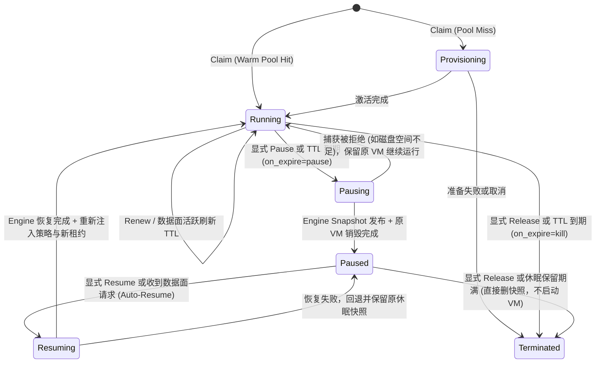
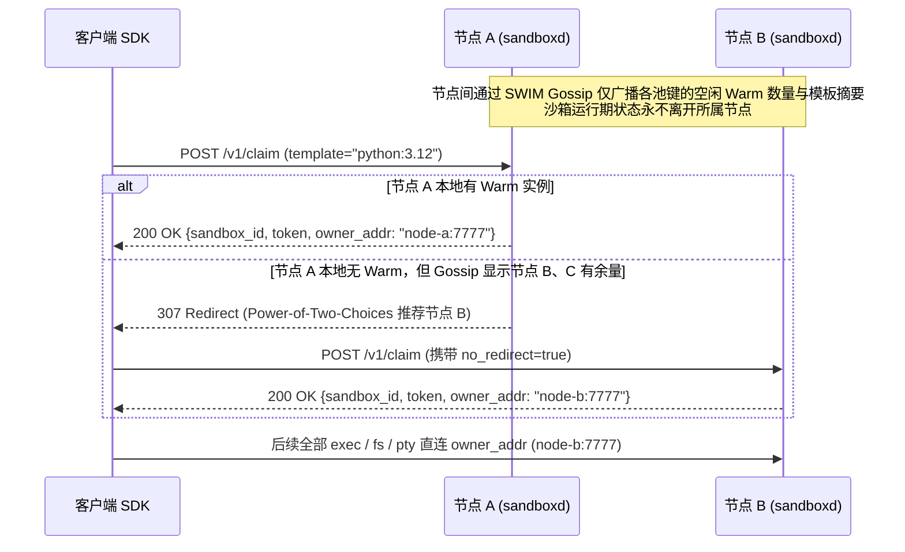

# sandbox 架构

本文描述构建在单宿主机 microVM engine（见 `@architecture.md`）之上的 sandbox 控制面与数据面架构，包括模板构建、预热池（warm pool）、沙箱租约（claim/TTL）、休眠与透明唤醒（hibernate/auto-resume）、分支派生（fork/checkpoint）、零拷贝数据面中继（byte relay）、受控出网与凭据注入（guarded egress），以及多租户隔离、一致性与不变量。

底层 engine 提供确定、安全、可恢复的单机 VM 与快照原语；本层（以下简称 `sandboxd` 与 `guest agent`）在此之上提供亚毫秒至数十毫秒级交付、面向 AI Agent 及交互式工作负载的 sandbox 语义。

接口字段、帧编码细节、具体路径与部署参数在实现设计中确定。待定设计项与限制另行标明。

# 0. 概述

## 0.1 系统模型

sandboxd 管理可按需认领、分支、休眠和销毁的隔离编程环境。调用方通过控制面 API 认领（claim）沙箱，获取专属访问令牌，再经数据面通道在沙箱内执行命令、读写文件、操作持久化会话或转发端口。

系统由宿主机常驻服务 `sandboxd`、底层 `engine` 以及运行在 microVM 内部的统一 `guest agent` 组成。控制面与宿主机中继使用 Go 实现，guest agent 使用 Rust 静态编译并内置于基础镜像。

| 核心对象 | 表达什么 | 身份与生命周期 |
|---|---|---|
| 模板（Template） | 已完成应用初始化与内存预热的黄金快照及其资源配置 | 由 `(template_id, resource_shape)` 标识，绑定底层不可变 `snapshot_id` 与基础镜像摘要 |
| 预热实例（Warm VM） | 从模板克隆、已完成基础握手与重播种但尚未绑定租户的就绪 VM | 归属特定池键（pool key），网络阻断；被认领后转化为 Sandbox，或随池缩容销毁 |
| 沙箱（Sandbox） | 被某个租户独占持有的编程环境实例 | `sandbox_id` 全局唯一；绑定租约截止时间（deadline）、专属令牌、环境变量与出网策略；可在运行态与休眠态之间转换 |
| 检查点（Checkpoint） | 沙箱在运行中途保存的一致状态点 | `checkpoint_id` 唯一标识；底层对应一份 engine 快照，可用于原地回滚或一对多分支派生（fork） |

`sandboxd` 是单节点沙箱编排者与数据面入口，不绕过 `engine` 直接操作 KVM、cgroup、mountns 或底层快照文件；一切 VM 生命周期与宿主网络接口启停均通过 `engine` 的幂等程序调用契约（见 `@architecture.md` 1.8）完成。

| 逻辑职责 | 管理范围 |
|---|---|
| 模板与预热池管理 | 黄金快照构建管线、预热池水位维持（refill）、健康探测与陈旧预热实例淘汰 |
| 租约与生命周期编排 | claim、renew、release、空闲或到期回收（reap）、hibernate、按需透明唤醒（auto-resume）、fork 与 checkpoint |
| 统一 guest agent | 监听固定 vsock 端口，同时承载底层 engine 的基础控制能力（握手、reseed、校时）、宿主专用 Admin 管理能力（activate、prepare_template、quiesce）与 Workload 数据面能力（exec、session、pty、fs、port forward） |
| 数据面字节中继 | 验证沙箱令牌后，将客户端连接经 HTTP Upgrade 直连拼接至对应 VM 的 vsock UDS，以及提供 HMAC 签名的端口预览（preview URL） |
| 受控出网与凭据注入 | 双轨出网控制（vsock 代理轨与受控网卡直连轨）、宿主侧秘密代填（secret injection）、DNS 防重绑定与防私网逃逸（SSRF guard）、出网审计 |
| 租户与配额治理 | 三级令牌鉴权（root / tenant / sandbox）、每租户并发沙箱与存储配额、使用量与审计日志（journal） |
| 集群网格（可选扩展） | 基于无状态 gossip 广播池水位与模板摘要，通过客户端重定向（MOVED redirect）实现多节点去中心化放置 |

## 0.2 与底层 engine 的协同边界

传统设计常因底层运行时与上层沙箱控制面脱节而产生两类缺陷：一是 guest 内同时运行两套守护进程（基础管理 agent 与 Workload 数据面 daemon），浪费内存与启动时间；二是底层克隆恢复时直接放通网卡，导致上层来不及安装租户防火墙或出网锁定规则，从而被迫禁止带网络沙箱的 fork 与 checkpoint。

本设计利用 `@architecture.md` 的底层保证消除上述断层：

1. **网络默认阻断（fail-closed）消除激活竞态**：`engine` 在 `create`、`restore`、`clone` 完成时保持 `tap0` 与 `veth` 关闭。`sandboxd` 在认领或派生路径上，始终先完成租户出网规则安装、代理句柄绑定与环境变量注入，最后才调用 `engine` 启用网络接口或保持代理轨运行，使所有网络模式的沙箱均支持 `fork`、`checkpoint` 与 `hibernate`。
2. **单一二进制、三条通道**：guest 内仅运行一个静态编译的 Rust agent，严格区分 System 2047（供 `engine` 执行 `ping` 握手、`reseed`、`clock_sync`）、宿主专用 Admin 2046（供 `sandboxd` 执行 `activate`、`prepare_template`、`quiesce`）与 Workload 2048（供 `sandboxd` 字节中继转发租户 RPC）。`engine` 的 `running` 仅证明 System 通道与本次基础协作就绪；`sandboxd` 完成 Admin 激活并确认 Workload 就绪后，才将沙箱交付给调用方。租户中继固定连接 2048，不能调用 System 或 Admin 方法。

## 0.3 一个完整示例

假设租户 T 需要在预热好的 Python 环境中运行一段不可信 Agent 代码，该代码需调用外部 `api.openai.com` 且不能接触明文 API Key：

1. **构建与预热**：系统预先从基础镜像启动临时 VM，运行预热脚本加载常用库，调用 `engine.snapshot` 生成黄金模板 `python:3.12`，并在后台调用 `engine.clone` 维持若干处于 `running`（断网）状态的预热 VM。
2. **认领（Claim）**：T 调用 `claim(template="python:3.12", ttl=300s, on_expire="pause", env={"OPENAI_API_KEY": {value: "sk-real...", guest: false, inject: {hosts: ["api.openai.com"], header: "Authorization", placeholder: "Bearer sbx-phantom"}}})`。`sandboxd` 从预热池弹出一个实例，生成 `sandbox_id`（记为 S1）与专属 `sandbox_token`，将占位符写入 guest `/run/sandbox.env`，将真实密钥保存在宿主机内存并绑定 S1 的 vsock 出网代理，在约 1ms 内返回 S1。
3. **数据面交互**：T 持 `sandbox_token` 发起 `exec` 与文件写入。`sandboxd` 校验令牌与租约未过期后，将连接字节流直接拼接至 S1 的 vsock 数据面端口。guest 内代码携带 `Bearer sbx-phantom` 访问 `api.openai.com`；流量经本地代理转发至宿主 `sandboxd`，宿主校验目标域名合法且解析地址非内网后，将请求头替换为真实 `sk-real...` 发出。
4. **分支探索（Fork）**：Agent 在尝试高风险重构前对 S1 调用 `fork(count=2)`。`sandboxd` 协调 `engine.snapshot(S1)` 并在暂停窗口结束恢复 S1 后，并发调用两次 `engine.clone` 生成 S2、S3，分别为其注入独立的 `/run/sandbox.env`、新 `machine-id` 与新 `sandbox_token`。
5. **休眠与透明唤醒（Hibernate & Auto-Resume）**：S1 空闲满 300s 后触发到期策略 `pause`。`sandboxd` 调用 `engine.snapshot` 保存 S1 当前状态，随后调用 `engine.delete` 停止并回收原 VM 进程与内存，S1 进入 `paused` 态（仅占磁盘快照空间）。数小时后 T 再次向 S1 发起 `exec` 请求，`sandboxd` 拦截该请求，自动从休眠快照恢复出新 VM 实例，重绑代理并刷新租约，再将 `exec` 请求无缝转发进恢复后的 guest。
6. **销毁（Release）**：T 对运行中的 S2 和处于 `paused` 态的 S3 调用 `release`。S2 经 `engine.delete` 销毁；S3 直接删除休眠快照与元数据，不唤醒 VM。

## 0.4 非目标与运行前提

本阶段不在 `sandboxd` 内实现跨节点分布式共享文件系统、跨节点实时热迁移、多网卡复杂虚拟拓扑或入站公网固定 IP 分配。宿主机与客户端之间的控制面/数据面通信假定运行在受控内网（VPC / WireGuard / mTLS）或 TLS 终结网关之后；唯一面向终端浏览器的入口是经 HMAC 签名的 Preview 代理端口。

## 0.5 决策状态

沿用 `@architecture.md` 0.5 的决策分类（已定 / 暂定 / 开放）：

已定项如下：

- 单节点控制面与数据面中继合并为常驻进程 `sandboxd`（Go），底层通过程序接口驱动 `engine`，不通过 CLI 子进程胶水调用，见 1.1、1.4。
- guest 内统一使用单个静态编译的 Rust agent 二进制，分设 System 2047、Admin 2046 与 Workload 2048 端口，见第 2 章。
- 认领路径采用三级供应（Warm Pool Hit $\rightarrow$ Golden Clone $\rightarrow$ Cold Boot），预热实例在池中保持网络阻断，认领激活时才注入租户配置并按需开启网络轨，见 1.1、3.1。
- 数据面采用宿主机零反序列化的字节流拼接（Byte Relay），帧协议解析由客户端 SDK 与 guest agent 端到端完成，见 2.2。
- 休眠（`paused`）沙箱通过「底层快照 + 销毁原 VM」实现，删除 `paused` 沙箱直接回收快照，禁止先唤醒再销毁，见 1.2。
- 出网凭据（`guest: false`）永不写入 guest 内存、环境变量文件或磁盘，因而也不会被包含进任何快照或检查点，见 3.2。

暂定项包括预热池自适应水位算法、休眠快照向远端对象存储（S3）异步归档（archive）的冷热分层策略，以及多节点 SWIM gossip 网格的具体参数。

# 1. 沙箱生命周期、预热池与分支模型

## 1.1 三级供应与模板构建管线

为同时满足「亚毫秒级极速认领」与「任意自定义环境按需启动」，`sandboxd` 将沙箱供应划分为三个层级。池键（Pool Key）由 `(template_id, resource_shape)` 唯一确定，其中 `resource_shape` 包含 vCPU 数量、内存大小与可写盘容量。

| 供应层级 | 触发条件 | 核心动作 | 典型延迟量级 |
|---|---|---|---|
| Tier 1: Warm Hit | 目标池键存在就绪的预热 VM | 从内存池原子弹出 VM $\rightarrow$ 写入租户 `/run/sandbox.env` $\rightarrow$ 绑定出网策略并按需启用接口 $\rightarrow$ 签发令牌 | $< 2\text{ms}$（无 VMM 启动与磁盘分配） |
| Tier 2: Golden Clone | 预热池为空，但存在已发布的黄金模板快照 | 调用 `engine.clone(golden_snapshot)`（CH `CopyOnWrite` 内存映射 + `reflink` 可写盘）$\rightarrow$ 执行上述租户激活序列 | $20 \sim 60\text{ms}$ |
| Tier 3: Cold Boot | 未构建黄金模板的原始镜像 | 调用 `engine.create(image)` + `engine.start` $\rightarrow$ 等待 Workload 通道就绪 $\rightarrow$ 执行租户激活序列 | $200 \sim 400\text{ms}$ |

### 黄金模板构建（Template Build & Promote）

黄金模板是一份在受控状态下捕获的底层 `engine` 整机快照。构建流程由 `sandboxd` 编排：

1. **启动构建实例**：按目标 `Base OCI Digest` 与 `resource_shape` 调用 `engine.create` 与 `engine.start`。若预热脚本需访问外部仓库，临时绑定受控出网。
2. **执行预热与清理**：通过 Workload 通道执行用户或镜像定义的 `warmup` 动作（例如启动常驻运行时、预加载大型语言模型或依赖库、等待本地端口就绪）。预热完成后，构建方清理应用特有的凭据与历史记录；随后通过 Admin 2046 调用 `prepare_template`，排空 Workload RPC/会话，清理 agent 身份、环境与保留日志并同步文件系统。该操作保留分离运行的应用进程，无法通用清理它们的内存、环境或外部注册状态。
3. **静默捕获**：关闭构建 VM 的网络接入，确认 Admin `prepare_template` 已完成、Workload 无在途 RPC/会话后，调用 `engine.snapshot` 生成黄金快照。
4. **原子晋升与池滚动**：将新 `snapshot_id` 登记到 `sandboxd` 模板目录，调用 `engine.delete` 销毁临时构建 VM。通知预热池管理器按新快照补充（refill）新预热实例，并逐步排空旧版本预热实例。

快照授权来源由 `sandboxd` schema 2 的不可变 `snapshot_owners` 记录持久化：本层捕获以原 operation 和 engine receipt 证明来源，外部黄金快照仅允许 root 为明确目标租户导入。普通租户登记、模板发布与所有 clone/refill/恢复消费都核验同租户来源；engine 的 published 状态和继承 labels 不构成授权。单个 snapshot ID 不跨租户共享或转移，授权记录本身不是 GC 保活引用。schema 1 不自动推断所有权，启动前须备份并另行审查迁移。

### 预热池（Warm Pool）管理

后台 `refill` 协调器按池键配置的 `target_warm_count` 维持水位：

- **预热实例状态**：池中每台 VM 均已通过 `engine.clone` 恢复执行、完成基础 `reseed` 与时钟同步，且通过了 Workload 2048 端口的存活探测（`info` 握手）。
- **池内安全边界**：预热实例在池中运行期间，从未接触任何租户数据或环境变量，底层网络接口保持关闭，也不绑定任何宿主出网代理端口。
- **故障退避与健康巡检**：周期巡检池中 VM；若发现底层 VMM 意外退出或数据面探测超时，立即从池中摘除并调用 `engine.delete` 清理。当节点容量耗尽（如收到 `engine` 的空间不足或资源预算拒绝错误）或连续克隆失败时，按指数退避暂停 `refill`，避免雪崩重试。

## 1.2 沙箱状态机与租约（Lease / TTL）

上层沙箱的状态机建立在 `sandboxd` 本地元数据（SQLite）之上，与底层 `engine` 的 VM `phase` 通过明确映射关联：

| 沙箱状态 | 含义 | 对应的底层 Engine 资源状态 | 允许的客户端操作 |
|---|---|---|---|
| `provisioning` | 正在执行 Golden Clone 或 Cold Boot 准备（Warm Hit 跳过此态） | `creating` / `created` / `running`（激活未完成） | 查询、取消/释放 |
| `running` | 沙箱已激活并交付租户，可正常收发数据面请求 | 对应 `vm_id` 处于 `running` | 数据面全部操作、`renew`、`checkpoint`、`fork`、`pause`、`release` |
| `pausing` | 正在执行休眠快照捕获与原 VM 回收 | `running`（正在执行 `engine.snapshot` 随后 `engine.delete`） | 查询（数据面新请求排队等待或返回状态冲突） |
| `paused` | 已休眠；不占用 CPU 与内存，完整保留机器执行状态 | 无活跃 `vm_id`；持有独立的休眠 `snapshot_id` | `resume`、数据面请求（触发透明唤醒）、`checkpoint`/`fork`（直接从休眠快照派生）、`release` |
| `resuming` | 正在从休眠快照恢复出新 VM 并重绑资源 | 新 `vm_id` 正在执行 `engine.clone`（或 `restore`）与激活 | 查询（触发唤醒的请求挂起等待完成） |
| `terminated` | 已销毁，所有底层 VM 与专属休眠快照已释放 | 对应资源正在或已完成 `engine.delete` | 仅保留短期墓碑供幂等查询 |

### 租约（TTL）与到期回收（Reap）

每个处于 `running` 的沙箱都具有明确的 `deadline`（由创建时的 `ttl_seconds` 计算，存在服务端上限）。客户端可通过 `renew` 显式延长租约，或配置为随数据面活跃请求自动顺延。

后台 `reaper` 周期扫描到期沙箱，根据沙箱的 `on_expire` 策略执行动作：

- **`on_expire = "kill"`（默认）**：将状态推进为 `terminated`，吊销令牌，关闭中继连接，并调用 `engine.delete` 回收底层 VM。
- **`on_expire = "pause"`**：触发休眠流程（见 1.3）。若休眠因宿主机磁盘预算不足等原因失败，`reaper` 保留 `running` 状态并在后续周期重试或按告警策略处理，绝不静默丢弃用户状态直接销毁。

## 1.3 休眠（Hibernate）、透明唤醒与分支（Fork / Checkpoint）

### 休眠（Hibernate / Pause）与零唤醒删除

底层 `engine` 不维护长期暂停的僵尸 VMM 进程；上层 sandboxd 通过组合 `engine` 原语实现真正的零内存占用休眠：

1. 在沙箱锁内将沙箱状态标记为 `pausing`，断开当前对外网络接入并排空正在建立的数据面握手。
2. 调用 `engine.snapshot(vm_id)` 捕获一致整机快照（记为 `hib_snap_id`），在 `sandboxd` 元数据中将该快照绑定为沙箱的当前休眠载体。
3. 确认快照发布成功后，调用 `engine.delete(vm_id)` 彻底终止原 VMM 进程并释放其内存与网络 namespace，将沙箱状态提交为 `paused`。
4. **零唤醒删除规则**：当对 `paused` 沙箱执行 `release` 或休眠保留期（`paused_ttl`）届满时，`sandboxd` **直接调用 `engine.delete_snapshot(hib_snap_id)`**，绝不为销毁而重新启动 VMM。

### 按需透明唤醒（Auto-Resume）

当客户端持有效 `sandbox_token` 向处于 `paused` 状态的沙箱发起数据面调用（如 `exec`、`fs`、端口访问）或显式 `resume` 时：

1. 使用 `singleflight` 与沙箱级互斥锁合并同一沙箱的并发唤醒请求，将状态置为 `resuming`。
2. 调用 `engine.clone(hib_snap_id)`（或复用预留的 VM ID 执行 `restore`）拉起新的 VMM 运行实例；注意此处必须保留沙箱原有的 guest `/etc/machine-id` 与主机名，仅执行内核熵 `reseed` 与时钟校正。
3. 重新绑定宿主侧出网代理与防火墙规则，按沙箱最新环境变量更新 `/run/sandbox.env`，按需恢复网络接口。
4. 赋予新的租约 `deadline`，将状态切换为 `running`，释放旧休眠快照 `hib_snap_id`，最后放行挂起的数据面请求。

### 检查点（Checkpoint）与多路分支（Fork / Branch）

Agent 在执行多步推理或代码修改时，可随时对沙箱创建 `checkpoint` 或直接 `fork(count=N)`：

1. **从 `running` 沙箱创建 Checkpoint / Fork**：
   - `sandboxd` 调用 `engine.snapshot(source_vm_id)`。得益于 `@architecture.md` 3.1 的短暂停窗口设计，源 VM 在完成内存写出与磁盘 `reflink` 后立即恢复运行，后台完成 `fsync` 与快照发布。
   - 若为 `fork(N)`，则在快照发布后并发调用 $N$ 次 `engine.clone(snap_id)`。每个分支沙箱获得全新的 `sandbox_id`、`sandbox_token`、宿主机网络身份与独立可写盘，但共享同一份宿主页缓存（`CopyOnWrite`）与底层 EROFS 只读层。
   - **分支身份去重**：与 `restore` 不同，`fork` 出的新沙箱在激活阶段必须通过 Admin 2046 的 `activate` 重置 `/etc/machine-id`、更新主机名并重写专属的 `/run/sandbox.env`，防止多个分支共享相同的内部实例标识。
2. **从 `paused` 沙箱或已有 `Checkpoint` 创建分支**：
   - 无需唤醒源沙箱，直接对已持久化的 `snapshot_id` 并发执行 `engine.clone`。

## 1.4 元数据、并发锁与崩溃恢复

`sandboxd` 使用独立的宿主机本地 SQLite 数据库（与 `engine` 的数据库物理隔离，各自维护单写者边界），记录：
- 模板目录（`template_id` $\rightarrow$ `engine_snapshot_id`、镜像摘要、资源规格、状态）；模板名在首次接纳时以 `template_intents` 占位永久归属该租户，失败或重启不转移归属，滚动重建期间继续提供已发布版本
- 沙箱记录（`sandbox_id`、归属租户、状态、当前绑定的 `engine_vm_id` 或 `hib_snapshot_id`、运行实例代次、令牌哈希、租约时间、环境变量、出网策略）
- 检查点记录（`checkpoint_id`、归属租户、对应的 `engine_snapshot_id`、元数据标签）
- 意图日志与操作幂等表（关联向 `engine` 发起的确定性幂等键）

模板 admission 在同一事务核验永久 owner、已发布模板与当前 operation 的租户和模板身份；仅 `succeeded` / `failed` 的模板操作可让出发布指针。占位缺失、已发布归属冲突或指针来源不一致时保留原数据并要求人工恢复，不从目录推断归属。发布按模板锁、资源归属锁、SQLite 事务的顺序提交，guest / engine 调用在资源归属锁外执行。

### 确定性幂等键派生

`sandboxd` 调用 `engine` 时，不生成随机请求 ID，而是由上层操作 ID 与步骤名确定性派生 `engine` 幂等键（例如 `sbx-op:<op_id>:step:clone`）。若 `sandboxd` 在调用 `engine` 期间崩溃重启，恢复流程只需用同一派生键向 `engine` 查询或重提，即可找回对应的 `engine` operation 与已创建的 `vm_id` / `snapshot_id`，不会产生孤儿 VM 或重复克隆。

### 启动与周期 Reconcile

`sandboxd` 重启或周期巡检时，拉取 `engine` 的完整 VM 与快照列表，与自身记录双向比对：
- 在 `sandboxd` 中标记为预热池成员或无主临时构建实例、但已不在活跃集合中的 `engine` VM，调用 `engine.delete` 回收。
- 在 `sandboxd` 中处于 `running`，但 `engine` 报告已非预期退出（`stopped`）的沙箱，关闭其宿主代理门户并标记为 `failed`（或按配置转入待清理），不静默重启已丢失内存状态的沙箱。
- 正在进行中的 `pausing` / `resuming` / `provisioning` 操作，按持久化步骤与确定性幂等键继续推进或安全回滚。

# 2. Guest Agent 与数据面架构

## 2.1 统一 Guest Agent 设计

guest 内仅部署一个静态编译（musl）的 Rust 守护进程 `sandbox-agent`，由 systemd 在 `sysinit` 阶段并行拉起，不依赖任何虚拟网卡或外网就绪。

`sandbox-agent` 仅监听 `AF_VSOCK`（固定 guest CID，仅接受来自宿主 CID 2 的连接），提供三条独立的 RPC 通道：

| 端口 / 门户 | 调用方 | 职责范围 |
|---|---|---|
| System 系统控制通道（`vsock:2047`） | 底层 `engine` | `ping` 握手、`reseed`（注入宿主熵至 `/dev/urandom` 并触发 `RNDRESEEDCRNG`）、`clock_sync`（直接调用 `clock_settime(CLOCK_REALTIME)` 步进对齐宿主时间）。协议极简、固定有界 |
| Admin 宿主管理通道（`vsock:2046`） | 仅宿主 `sandboxd`，不经租户中继暴露 | `activate` 写入 `/run/sandbox.env`、按需重置 `machine-id`、设置主机名及网络模式；`prepare_template` 清理模板状态；`quiesce` 阻止新 Workload 请求并检查排空状态 |
| Workload 工作负载通道（`vsock:2048`） | 经 `sandboxd` 鉴权字节中继的租户 SDK | 用户态数据面操作（`exec`、`proc`、`session`、`pty`、`fs`、`port_forward`、`info`）；拒绝 System/Admin 方法，工作负载以非特权 UID/GID 执行 |

受控出网是独立的反向代理路径：guest `127.0.0.1:3128` / `:1080` 经 `vsock:2049` / `:2050` 桥接到宿主 `sandboxd` 的专属 HTTP/HTTPS 与 SOCKS5 代理 UDS，不属于上述三条 RPC 通道。

通过将时钟校正与身份初始化收归 `sandbox-agent` 原生系统调用处理，消除了在每次恢复路径上 fork `/bin/date` 或 shell 脚本的进程开销与镜像工具链依赖。

## 2.2 零拷贝数据面中继（Byte Relay）

`sandboxd` 的数据面不在宿主机侧解析或反序列化高频的命令输出、文件块和终端字节流：

1. **连接建立与鉴权**：SDK 向 `sandboxd` 发起携带 `Authorization: Bearer <sandbox_token>` 的请求，并通过 HTTP Upgrade（或 WebSocket / HTTP/2 流）请求升级为双向字节流。
2. **状态校验与自动唤醒**：`sandboxd` 在内存中校验令牌、检查沙箱状态。若沙箱处于 `paused`，在此处透明触发 1.3 的唤醒流程；若处于 `running`，按配置刷新空闲 TTL。
3. **宿主 UDS 直连与 `splice`**：`sandboxd` 拨号连接该沙箱当前运行实例对应的宿主 vsock UDS，完成 `CONNECT 2048\n` 握手后，直接在客户端 TCP 连接与 vsock UDS 之间执行内核态 `splice` / 零拷贝双向转发。
4. **连接复用**：同一条升级后的连接可背靠背（back-to-back）连续发送多个数据面 RPC 帧，避免每次执行小命令或读小文件都经历完整的 HTTP 与 vsock 建连握手。

## 2.3 数据面核心原语

客户端与 `sandbox-agent` 之间采用带长度或换行分隔的结构化帧协议（单帧大小硬限制为 8 MiB，防止恶意或异常帧耗尽内存）：

| 能力域 | 核心动作 | 关键工程约束 |
|---|---|---|
| 进程执行 (`exec` / `proc`) | 前台流式执行、后台分离执行（`detach`）、`ps`、`kill`、`logs`、`attach` | 前台执行具备端到端流控背压（慢客户端不会导致输出丢失或撑爆 agent 内存）；连接意外断开且客户端未继续读取时，自动回收前台失联子进程。后台分离进程维护固定上限的环形输出缓冲区（ring buffer），进程退出后保留短暂窗口供拉取日志与退出码 |
| 持久会话 (`session`) | `session_create`、`session_list`、`session_rm`、在指定会话内 `exec` | 对应真实的持久化 shell 进程，跨多次调用保留当前工作目录（`cwd`）与 shell 内部状态；空闲超时的会话自动回收 |
| 伪终端 (`pty`) | `pty_open`、`pty_resize`、双向终端流 | 注册在统一进程表中，支持窗口尺寸动态调整与信号传递 |
| 文件与目录树 (`fs` / `tree`) | 流式 `read`/`write`、`list`、`stat`、`mkdir`、`rm`、`rename`、目录树 tar 流式 `push`/`pull`、`find`/`replace`、`watch` | 单文件写入通过临时文件 + 原子 `rename` 提交；`tree push` 先解压至目标同文件系统的暂存目录，流完整结束后再原子合并，防止网络中断留下半截目录树；`watch` 在返回 `ready` 帧后保证后续变更事件不丢失，队列溢出时显式报错而非静默丢事件 |
| 端口转发与预览 (`port_forward`) | 将 guest `127.0.0.1:<port>` 桥接至当前流 | 支持双向半关闭（half-close）。在无网卡（`net=none` / `relay`）模式下依然可用，是访问沙箱内 Web 服务、Jupyter、LSP 或浏览器 CDP 端口的统一入口 |

## 2.4 环境变量注入与生命周期（Claim Env）

认领沙箱或运行期更新环境变量时，条目分为两类：

1. **Guest 可见变量（`guest: true`，默认）**：由 `sandboxd` 通过 Admin 2046 的 `activate` 写入 guest 内的 `/run/sandbox.env`（权限 `0600`，位于内存 tmpfs）。`sandbox-agent` 在派生任何 `exec`、`session` 或 `pty` 子进程时自动加载该文件（请求级显式传入的 `env` 优先级高于此文件）。由于 `/run/sandbox.env` 位于 guest 内存中，它在 `hibernate` 与 `restore` 时自然保留；而在 `fork` 或从模板 `clone` 时，由 `sandboxd` 在激活新实例时用目标沙箱自己的变量集原子覆写（若目标无变量则清空），绝不泄漏源实例的环境变量。
2. **宿主代填秘密（`guest: false`）**：仅保存在宿主机 `sandboxd` 内存中，永不发往 `sandbox-agent`，也不落入 guest 内存或磁盘。

# 3. sandbox 网络与零信任出网（Guarded Egress）

## 3.1 双轨出网模型（Dual-Lane Networking）

在底层 `engine` 的网络原语之上，`sandboxd` 为沙箱提供三种出网形态，由认领时的网络策略决定：

| 出网形态 | 底层 Engine 接口状态 | Guest 出网路径 | 适用场景 |
|---|---|---|---|
| `none`（完全断网） | `tap0` 与 `veth` 保持关闭；宿主不绑定出网代理门户 | 无任何外联通道，仅保留客户端数据面 vsock | 纯计算、代码评测、高危不受信任载荷 |
| `relay`（受控代理轨，默认受保形态） | `tap0` 与 `veth` **保持关闭**；宿主绑定该沙箱专属的 vsock 出网代理 UDS（`<vsock>_2049` / `_2050`） | `sandbox-agent` 在 guest 本地监听 `127.0.0.1:3128`（HTTP/CONNECT）与 `:1080`（SOCKS5），并自动向子进程注入 `http_proxy`/`https_proxy`/`ALL_PROXY`，流量经 vsock 进入宿主代理 | 绝大多数 AI Agent 场景：调外部 API、拉取代码包、受控网页抓取，支持宿主侧凭据代填，且完全隔绝二/三层网络攻击面 |
| `direct`（受控路由轨） | 激活阶段配置好宿主防火墙与 namespace 规则后，调用 `engine` **开启** `tap0` 与 `veth` | 走 `@architecture.md` 第 4 章的点对点 `tap0` $\rightarrow$ namespace SNAT $\rightarrow$ 宿主 `/32` 路由与出口 NAT；同时可选配透明拦截或保留 `relay` 门户 | 需要原生 UDP、ICMP 或无法支持代理协议的特定二进制程序 |

### 激活顺序消除逃逸窗口

无论在冷启动、预热池认领、还是从快照 `fork` / `restore` 时，只要目标沙箱处于 `direct` 轨，`sandboxd` 都严格执行以下顺序：
1. 确认底层 `engine` 的 VM 网络接口处于关闭状态。
2. 通过 `engine.network_policy` 安装绑定当前运行实例的 CIDR 与连接预算策略，由 engine 管理 netns/nftables 资源。
3. 绑定宿主出网代理（若适用），通过 Admin 2046 的 `activate` 注入身份、环境及网络模式，并确认 Workload 2048 就绪。
4. 调用 `engine` 启用网络接口。
5. 向客户端返回沙箱就绪。

在暂停（`hibernate`）或制作快照（`checkpoint` / `fork`）前，若需锁定出网状态，同样可在操作前后无缝控制接口启停，不会出现克隆恢复瞬间流量绕过策略逃逸的问题。

## 3.2 宿主侧凭据代填（Host-Side Secret Injection）

为防止 Prompt Injection、恶意依赖包或核心转储（core dump）窃取用户的云凭据与 API Key，`sandboxd` 提供基于 `relay` 轨（及透明 TLS 拦截）的宿主侧凭据代填：

1. **声明方式**：调用方在 `claim` 或环境变量更新接口中声明 `guest: false` 的秘密条目，并指定注入规则 `inject: {hosts: ["api.example.com"], header: "Authorization", value: "Bearer real-secret", placeholder: "Bearer sbx-phantom-xxx"}`。
2. **双模式运作**：
   - **占位符替换模式**：将无害的 `placeholder` 作为同名环境变量注入 guest（写入 `/run/sandbox.env`），使严格检查环境变量非空的现有 SDK（如 OpenAI / AWS / GitHub SDK）正常工作；当请求经宿主出网代理发往匹配的 `hosts` 时，宿主代理将报文头/查询参数中的 `placeholder` 替换为真实密钥。
   - **无感注入模式**：不向 guest 注入任何值，当请求发往匹配的 `hosts` 时，宿主代理直接追加或覆写指定 HTTP Header。
3. **安全约束**：
   - 宿主代理按沙箱专属的 vsock UDS 路径（`<vsock_socket>_2049`）识别沙箱身份，无需在代理协议内传递可被伪造的带内认证 token。
   - 真实密钥只允许注入到匹配白名单 `hosts` 的 HTTPS（经受信任的宿主每实例/每节点根 CA 透明中间人终结校验 SNI 与 Host 一致）或显式允许的端点；若请求的目标域名不在该凭证授权的 `hosts` 列表内，即便携带了 `placeholder`，宿主代理也会将其剥离或拒绝，防止恶意代码通过把 `placeholder` 发往攻击者自己的服务器来套取真实密钥。
   - 每次凭据代填调用均记录到不可篡改的宿主机审计流（含 `tenant_id`、`sandbox_id`、目标 `host`、`method`、时间戳，不含密钥明文）。

## 3.3 出网防护边界（SSRF Guard 与资源上限）

宿主出网代理与网络规则强制执行以下防逃逸边界：

- **DNS 解析与防重绑定（Anti-DNS Rebinding）**：所有通过代理轨的域名均在宿主机侧解析，并在建立上游 TCP 连接前对解析出的每一个目标 IP 进行校验。严禁连接环回地址（`127.0.0.0/8`、`::1`）、私有网段（RFC 1918）、链路本地与云元数据地址（`169.254.0.0/16`、`fe80::/10`）、运营商级 NAT（`100.64.0.0/10`）以及嵌入 IPv4 的 IPv6 转换前缀（除非管理员在租户策略中显式豁免特定内部网段）。
- **连接与文件描述符预算**：每个沙箱的出网代理限制最大并发活跃连接数（如 256）与最大空闲上游连接池大小，防止单个失控沙箱耗尽宿主机 `sandboxd` 的文件描述符或源端口。

# 4. 多租户、鉴权与安全预览

## 4.1 三级令牌与最小权限模型

`sandboxd` 采用三级凭证体系，使控制面权限与单个沙箱的数据面操作权限严格分离：

| 凭证类型 | 持有者 | 授权范围与隔离语义 |
|---|---|---|
| Root Token | 基础设施运维组件 | 访问全部接口：管理预热池水位、注册模板、节点排空（drain）、读取全局 `/metrics` 与全量沙箱列表 |
| Tenant Token | 业务后端 / 租户服务 | 在本租户配额内执行 `claim`、`fork`、`checkpoint`、管理本租户模板；列举接口仅返回本租户资源；访问或删除其他租户资源一律返回与“不存在”字节级一致的 `404`（防止跨租户探测枚举）；访问运维接口返回 `403` |
| Sandbox Token | 单个 Agent 任务执行器 / SDK 实例 | 每次 `claim` 或 `fork` 时独立生成的随机高熵令牌；**仅授权操作该 `sandbox_id` 的数据面与自身续租/释放**，无法列举租户沙箱或创建新资源 |

## 4.2 签名预览入口（Preview URL）

当沙箱内运行了 Web 服务、可视化面板或浏览器远程调试端口时，外部浏览器无法直接附带自定义 `Authorization` Header 访问每个子资源。`sandboxd` 提供基于能力签名（Capability URL）的 HTTP/WebSocket 预览代理：

- **URL 结构与签名**：形如 `https://<port>-<sandbox_id>-<exp>-<hmac>.<preview_domain>/...`（或通过路径/Cookie 承载签名令牌）。HMAC 签名输入绑定 `(sandbox_id, port, tenant_id, expire_at, sandbox_creation_epoch)`。
- **生命周期绑定**：预览 URL 的有效期不超过沙箱当前租约 `deadline`；一旦沙箱被释放（`terminated`），即便签名尚未过时间窗口，代理也立即拒绝访问，无需维护中心化的吊销列表。
- **自动唤醒联动**：访问处于 `paused` 状态的沙箱预览 URL 时，自动触发 1.3 的透明唤醒并将请求转发至恢复后的 guest `127.0.0.1:<port>`。

# 5. 多节点集群扩展模型（无状态网格与直连数据面）

单节点 `sandboxd` + `engine` 即可完整独立运行。当扩展为多宿主机集群时，为避免中心化网关成为高吞吐数据面（流式文件传输、终端、端口预览）的带宽与延迟瓶颈，采用 **SWIM Gossip 放置提示 + 客户端直连（MOVED Redirect）** 架构：

1. **Gossip 仅传放置提示，不传沙箱状态**：节点间仅同步三类轻量聚合信息——各池键当前的 `warm_count`、已就绪的黄金模板摘要集合、以及节点的健康/排空（draining）状态。Gossip 视图陈旧最多导致一次额外的客户端重定向，绝不影响正确性。
2. **防乒乓重定向（Ping-Pong Guard）**：入口节点采用 Power-of-Two-Choices 从报告有预热余量的节点中随机挑选目标返回重定向；客户端重试时必须携带 `no_redirect=true`，目标节点收到该标记后即使本地预热实例刚被抢光，也直接在本地降级执行 Tier 2（Golden Clone），禁止再次重定向。
3. **诚实的节点故障模型**：由于活跃沙箱的内存状态位于所属宿主机本地，若某台宿主机宕机，其上的活跃运行沙箱随之终止；对于已将休眠快照或检查点异步归档至共享对象存储（S3）的沙箱，客户端可在其他健康节点上从归档快照恢复（跨节点唤醒）。

# 6. sandbox 层不变量

上层 `sandboxd` 与 `guest agent` 的实现和故障恢复必须遵守以下跨模块不变量（編號以 `P` 开头，与 `@architecture.md` 的底层不变量 `I1`~`I19` 正交互补）：

| 编号 | 不变量 |
|---|---|
| P1 | **单一底层权威**：`sandboxd` 对 VM、快照与宿主网络接口的一切变更均通过 `engine` 的幂等接口执行，使用由上层操作确定性派生的幂等键，禁止绕过 `engine` 直接操作进程、挂载、网络设备或快照文件 |
| P2 | **双重就绪门控**：沙箱交付客户端（进入 sandbox `running` 态）前，必须同时满足底层 `engine` 的 `running` 契约与上层 Workload 2048 握手、Admin 2046 租户配置激活及宿主出网策略安装 |
| P3 | **预热池纯净性**：处于 Warm Pool 中的预热 VM 必须保持网络阻断且不含任何租户环境变量、凭据或历史任务痕迹；一旦预热实例被探测为异常或污染，只能销毁，禁止放回池中 |
| P4 | **先上锁后开网**：在 `claim`、`restore`、`auto-resume` 与 `fork` 路径上，宿主出网策略、代填代理绑定与防火墙规则必须在启用 VM 网络接口或向客户端返回句柄之前生效，不存在未受控的出网时间窗 |
| P5 | **宿主秘密零落地**：标记为 `guest: false` 的凭据仅驻留宿主机 `sandboxd` 内存，永不写入 guest 内存、`/run/sandbox.env`、guest 磁盘、日志或任何快照/检查点产物；代填仅对通过域名校验与防重绑定检查的授权目标生效 |
| P6 | **分支身份与状态隔离**：`fork` 派生的每个分支沙箱必须获得新的 `sandbox_id`、`sandbox_token`、重置后的 `/etc/machine-id` 与独立的 `/run/sandbox.env`；原地 `restore` / `auto-resume` 则保留原沙箱身份 |
| P7 | **零唤醒销毁**：销毁处于 `paused`（休眠）状态的沙箱时，直接删除其持有的底层休眠快照与上层记录，严禁先拉起 VMM 再销毁 |
| P8 | **休眠失败不丢状态**：到期触发 `on_expire="pause"` 时，只有在底层新快照完整发布后才允许销毁原运行 VM；若快照捕获或发布失败，必须保留原 VM 状态并重试或告警，禁止降级为直接销毁 |
| P9 | **并发唤醒单飞（Singleflight）**：针对同一 `paused` 沙箱的并发数据面请求与显式 `resume` 必须在沙箱锁下合并为单次底层恢复操作，恢复完成前后续请求排队等待，禁止并发恢复出多个冲突的 VM 实例 |
| P10 | **数据面有界与背压**：`sandboxd` 字节中继不在宿主内存缓存无界业务帧；`sandbox-agent` 单帧大小与分离进程环形日志缓冲区均有硬上限，前台流式输出遵循客户端背压 |
| P11 | **租约强制兜底**：每个运行态沙箱均受有限 `deadline` 约束；即使客户端崩溃失联，`reaper` 也必须在到期后按策略回收或休眠沙箱，并立即使关联的实时数据面连接与过期 Preview URL 失效 |
| P12 | **跨租户零可见性**：Tenant Token 的一切查询、操作与删除均受租户归属过滤；对非本租户拥有的沙箱、模板或检查点访问，一律返回与对象不存在不可区分的响应 |

## 验证范围

| 验证领域 | 端到端覆盖行为 |
|---|---|
| 供应与预热池 | Warm Hit 亚毫秒认领、池空自动降级 Golden Clone、Cold Boot 兜底、黄金模板构建与在线滚动替换、容量耗尽时 refill 退避与恢复 |
| 休眠与透明唤醒 | 到期自动休眠、显式休眠、对 `paused` 沙箱并发发起多个 `exec`/HTTP 请求触发单次透明唤醒、休眠期间磁盘满回退保护、对 `paused` 沙箱执行零唤醒删除 |
| 分支与检查点 | 对运行中沙箱（含 `relay` 与 `direct` 网络轨）执行 `checkpoint` 与一对多 `fork(N)`、验证各分支内存状态继承且 `machine-id`/`sandbox.env`/网络身份彼此独立、源沙箱删除不影响分支运行 |
| 数据面协议 | 单连接背靠背多 RPC 复用、大输出流背压与慢客户端限速、客户端断连自动清理前台子进程、后台 `detach` 进程环形日志回放、目录树 `tree push` 断流原子回滚、`fs_watch` 溢出报错、端口转发与签名 Preview URL 过期拒绝 |
| 零信任出网 | `guest: false` 凭据占位符替换与无感注入、在 guest 内转储内存/环境变量/快照均无法搜出真实密钥、恶意代码将占位符发往非授权域名被拦截、DNS 解析至 `127.0.0.1` / `169.254.169.254` / 私网 IP 被 SSRF Guard 阻断 |
| 故障与恢复 | `sandboxd` 在 `claim`/`hibernate`/`resume`/`fork` 中途崩溃重启，凭确定性幂等键与 `engine` 对账收敛、底层 VMM 意外被 OOM 杀死后 `sandboxd` 准确感知并关闭代理门户 |
